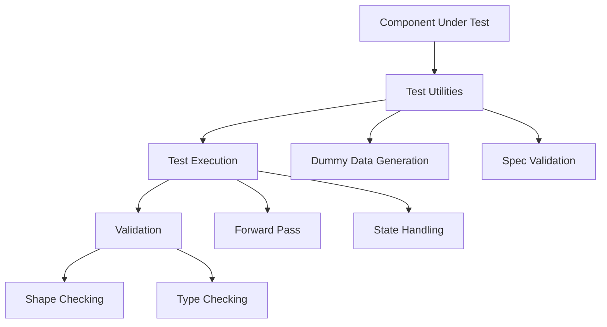
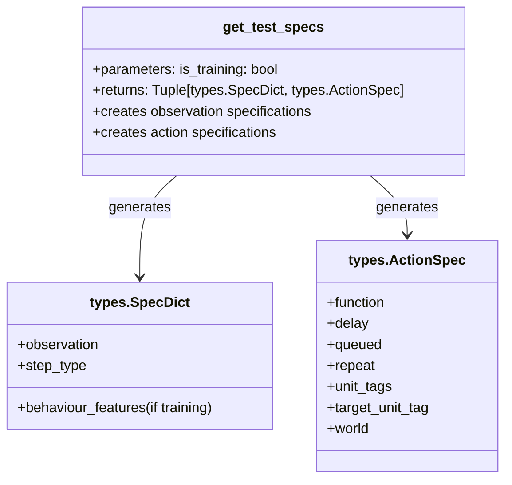
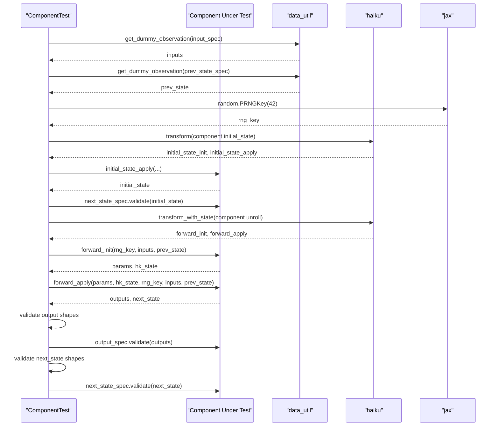
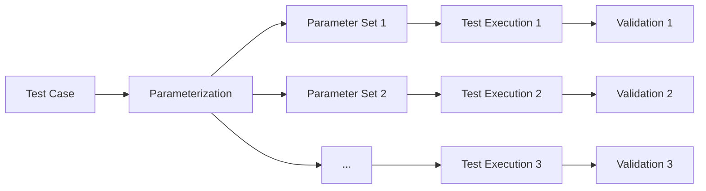
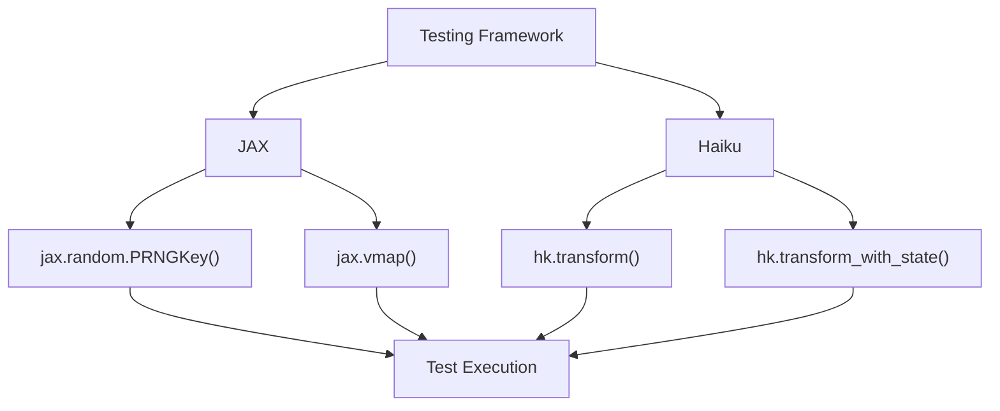

<!-- source: DeepWiki mcp.deepwiki.com · repo google-deepmind/alphastar · page 9 Testing Framework · fetched 2026-10-26 -->

# Testing Framework

<details>
<summary>Relevant source files</summary>

The following files were used as context for generating this wiki page:

- [alphastar/architectures/components/common_test.py](alphastar/architectures/components/common_test.py)
- [alphastar/architectures/components/test_utils.py](alphastar/architectures/components/test_utils.py)

</details>


This document describes the testing framework used in the AlphaStar codebase. It focuses on how components of the AlphaStar architecture are tested for correctness, consistency, and expected behavior. For information about the component architecture itself, see [Modular Component System](#3.1).

## Overview

The AlphaStar testing framework provides utilities and base classes for testing neural network components in a consistent manner. It ensures that components:

1. Handle inputs correctly
2. Produce outputs with expected shapes and types
3. Maintain state correctly between calls
4. Can be composed together without issues



Sources: [alphastar/architectures/components/test_utils.py:15-27](alphastar/architectures/components/test_utils.py:15-27), [alphastar/architectures/components/test_utils.py:90-118](alphastar/architectures/components/test_utils.py:90-118)

## Core Testing Utilities

The foundation of the testing framework is in `test_utils.py`, which provides essential functions and classes for testing components.

### Test Specifications

The `get_test_specs()` function generates input and action specifications for testing purposes. These specifications define the shape, type, and bounds of input tensors and action outputs.



Sources: [alphastar/architectures/components/test_utils.py:29-87](alphastar/architectures/components/test_utils.py:29-87)

The test specifications include:

| Category | Fields | Description |
|----------|--------|-------------|
| Observation | camera, camera_position, minimap_* fields, raw_units, etc. | Game state observations |
| Step Type | step_type | Current step in the episode |
| Action | function, delay, queued, repeat, unit_tags, target_unit_tag, world | Possible agent actions |
| Behavior Features | Present only during training | Contains action information from demonstrations |

Sources: [alphastar/architectures/components/test_utils.py:33-87](alphastar/architectures/components/test_utils.py:33-87)

### Component Test Base Class

The `ComponentTest` class provides a foundation for testing components. Its main method, `_test_component()`, performs a standard set of validations:

1. Generates dummy input data based on the component's specifications
2. Creates an initial state for the component
3. Executes a forward pass through the component
4. Validates that outputs and next states have the correct shape and structure



Sources: [alphastar/architectures/components/test_utils.py:90-118](alphastar/architectures/components/test_utils.py:90-118)

## Testing Components

The framework is used to test various components of the AlphaStar architecture. The `common_test.py` file demonstrates how components are tested using the framework.

### Example: Testing Action Components

Components that handle various aspects of the action space are tested with different parameters:

```python
@parameterized.parameters(*_ALL_ARGUMENT_NAMES)
def test_ActionFromBehaviourFeatures(self, argument_name: types.ArgumentName):
    component = common.ActionFromBehaviourFeatures(argument_name=argument_name)
    self._test_component(component, batch_size=2, unroll_len=3)
```

Sources: [alphastar/architectures/components/common_test.py:40-44](alphastar/architectures/components/common_test.py:40-44)

### Parameterized Testing

The framework leverages the `parameterized` testing library to test components with different configurations:



Examples of parameterizations include:
- Testing with `is_training=True` and `is_training=False`
- Testing with different argument names
- Testing with different overlap lengths

Sources: [alphastar/architectures/components/common_test.py:46-57](alphastar/architectures/components/common_test.py:46-57), [alphastar/architectures/components/common_test.py:59-64](alphastar/architectures/components/common_test.py:59-64)

## Implementation Details

### Test Data Generation

The testing framework uses the `data_util.get_dummy_observation()` function to generate appropriate test data based on the component's input specifications. This ensures that components are tested with data that matches their expected input format.

### State Validation

For stateful components, the framework tests both:
1. Initial state creation through `component.initial_state()`
2. State transitions through the forward pass

Validations ensure that states conform to the component's state specifications.

### Shape Validation

The framework validates that:
- Output tensors have the expected batch and unroll dimensions
- Output tensors conform to the component's output specification
- Next state tensors have the expected batch dimension
- Next state tensors conform to the component's next state specification

Sources: [alphastar/architectures/components/test_utils.py:113-118](alphastar/architectures/components/test_utils.py:113-118)

## Integration with JAX and Haiku

The testing framework integrates with JAX and Haiku, the core libraries used in the AlphaStar implementation:

- JAX is used for random number generation and function transformation
- Haiku is used for managing stateful transformations of the component functions



Sources: [alphastar/architectures/components/test_utils.py:103-112](alphastar/architectures/components/test_utils.py:103-112)

## Example Test Cases

The testing framework is used to test a variety of component types:

| Component Type | Test Function | Parameters |
|----------------|---------------|------------|
| ActionFromBehaviourFeatures | test_ActionFromBehaviourFeatures | argument_name |
| Sample | test_Sample | is_training, argument_name |
| ArgumentMasks | test_ArgumentMasks | is_training |
| FeatureFromPrevState | test_FeatureFromPrevState | is_training |
| FeatureToNextState | test_FeatureToNextState | is_training, overlap_len |

Sources: [alphastar/architectures/components/common_test.py:37-90](alphastar/architectures/components/common_test.py:37-90)

## Error Testing

The framework also includes tests for error conditions to ensure that components fail gracefully with appropriate error messages when used incorrectly:

```python
def test_FeatureToNextState_error(self):
    component = common.FeatureToNextState(input_name='input_stream',
                                          output_name='output_stream',
                                          stream_shape=(2, 4),
                                          overlap_len=2)
    with self.assertRaises(ValueError):
        self._test_component(component, batch_size=2, unroll_len=1)
```

Sources: [alphastar/architectures/components/common_test.py:84-90](alphastar/architectures/components/common_test.py:84-90)

## Extending the Testing Framework

To test a new component, developers should:

1. Create a test class that inherits from `ComponentTest`
2. Implement test methods that call `self._test_component()` with the component instance
3. Use parameterized testing as needed to cover different configurations

This consistent approach ensures all components are tested in a standardized way, making it easier to identify and fix issues.

Sources: [alphastar/architectures/components/common_test.py:37-39](alphastar/architectures/components/common_test.py:37-39)