# Page: Overview

# Overview

<details>
<summary>Relevant source files</summary>

The following files were used as context for generating this wiki page:

- [README.md](README.md)
- [WORKSPACE](WORKSPACE)

</details>


This document provides an introduction to the AlphaStar repository, its primary components, and the high-level architecture of the system. AlphaStar is a machine learning package from DeepMind that provides tools to train agents to master StarCraft II.

## Repository Purpose and Scope

The AlphaStar repository aims to drive research interest around StarCraft II by providing:

1. General purpose architectures to train StarCraft II agents that can be used with different learning algorithms in both online and offline settings
2. Data processing tools for handling StarCraft II replays
3. Offline training and evaluation scripts with Behavior Cloning as a representative example

For installation and environment setup instructions, see [Installation & Setup](#2).

Sources: [README.md:3-16]()

## System Architecture Overview

AlphaStar consists of several interconnected systems that together form a comprehensive framework for training StarCraft II agents.

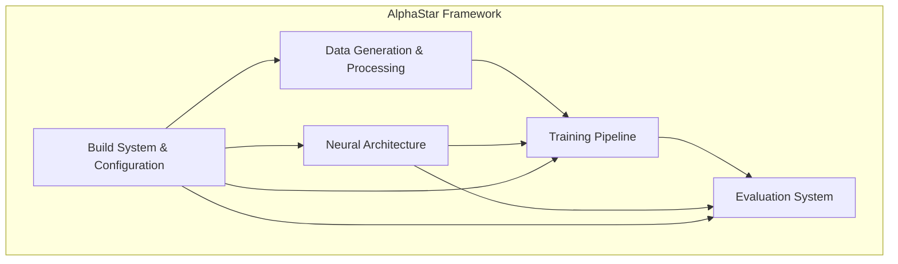

The core systems of AlphaStar include:

| System | Description | Related Wiki Pages |
|--------|-------------|-------------------|
| Data Generation & Processing | Handles StarCraft II replays, transforming them into training data | [Data Pipeline](#4) |
| Neural Architecture | Defines model structure through modular components | [Architecture](#3) |
| Training Pipeline | Implements supervised and reinforcement learning | [Training System](#5) |
| Evaluation System | Assesses trained agent performance | [Evaluation System](#6) |
| Build System | Manages dependencies and configuration | [Module Structure](#7) |

Sources: [README.md:10-16](), [WORKSPACE:1-60]()

## Key Components and Data Flow

The AlphaStar system processes data through a pipeline that begins with StarCraft II replays and ends with trained agents.

```mermaid
flowchart LR
    A["StarCraft II Replays"] --> B["get_replays.sh"]
    B --> C["Replay Packs"]
    C --> D["generate_partitions.py"]
    D --> E["Partitioned Replays"]
    E --> F["generate_dataset.py"]
    F --> G["TFRecord Dataset"]
    G --> H["OfflineTFRecordDataSource"]
    H --> I["SupervisedLearner"]
    I --> J["Checkpoints"]
    J --> K["Evaluator"]
    K --> L["EvalActor"]
    L --> M["Performance Metrics"]
```

This diagram shows the complete flow from raw replay data to trained model evaluation, highlighting the key components in the AlphaStar pipeline.

Sources: [README.md:14-16]()

## Neural Network Architecture

The AlphaStar agent uses a neural network architecture composed of modular components designed to process different aspects of the StarCraft II game state.

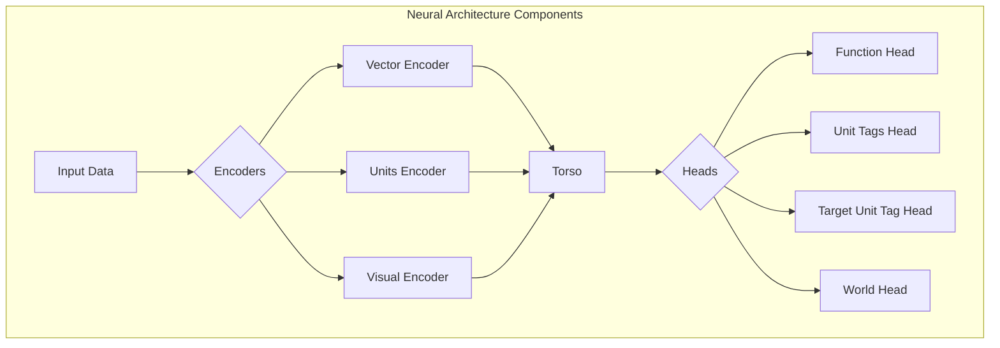

The network architecture consists of:
1. **Encoders** that process different types of input data
2. A **Torso** that integrates information from the encoders
3. **Heads** that predict specific action parameters

These components are built on a modular system that allows for flexible composition and experimentation.

Sources: [README.md:10-12]()

## Modular Component System

AlphaStar's architecture is based on a highly modular component system that forms the foundation for building neural networks.

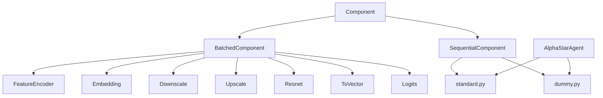

This modular design facilitates:
- Reuse of components across different parts of the system
- Experimentation with different network architectures
- Flexibility in adapting to new learning algorithms

For more details on the modular component system, see [Modular Component System](#3.1).

Sources: [README.md:10-12]()

## AlphaStar Unplugged

AlphaStar Unplugged is a subset of the AlphaStar system focused on fully offline reinforcement learning. It demonstrates how to train agents from StarCraft II replay data without requiring online interaction with the game.

Key features include:
- Data readers for processing StarCraft II replays
- Offline training scripts using Behavior Cloning
- Evaluation scripts for assessing agent performance

For detailed information on AlphaStar Unplugged, see [AlphaStar Unplugged](#8).

Sources: [README.md:14-16](), [README.md:97-101]()

## Build System and Dependencies

AlphaStar can be built and used in two primary ways:

1. **Installing with pip**: Simplest setup, but requires manual rebuilding of PySC2 for any changes
2. **Building with Bazel**: Builds AlphaStar and PySC2 together from source, providing greater flexibility

The repository uses Bazel as its primary build system, with configuration defined in the WORKSPACE file.

Sources: [README.md:18-94](), [WORKSPACE:1-60]()

## Repository Structure

The repository is organized into several key directories:

| Directory | Description |
|-----------|-------------|
| `architectures/` | Contains modular components for building neural networks |
| `unplugged/` | Implementation of offline reinforcement learning |
| `bazel/` | Build system configuration |

For more details on the module structure, see [Module Structure](#7).

Sources: [README.md:10-16](), [README.md:97-101]()

## Conclusion

AlphaStar provides a comprehensive framework for training and evaluating StarCraft II agents. Its modular architecture allows for experimentation with different network designs and learning algorithms. The current implementation focuses on offline reinforcement learning, with tools for data processing, training, and evaluation.

This overview has introduced the key components and systems of AlphaStar. For more detailed information on specific aspects, refer to the other sections of this wiki.

Sources: [README.md:3-16](), [README.md:97-109]()

---

# Page: Installation & Setup

# Installation & Setup

<details>
<summary>Relevant source files</summary>

The following files were used as context for generating this wiki page:

- [README.md](README.md)
- [WORKSPACE](WORKSPACE)
- [alphastar/architectures/BUILD](alphastar/architectures/BUILD)
- [bazel/requirements.txt](bazel/requirements.txt)
- [requirements.txt](requirements.txt)
- [setup.py](setup.py)

</details>


This page provides a comprehensive guide to setting up the AlphaStar repository, installing its dependencies, and configuring your environment. For information about running training and evaluation scripts, see [AlphaStar Unplugged](#8).

## System Requirements

AlphaStar has specific system requirements that must be met for a successful installation:

- **Operating System**: Linux only (other operating systems are not officially supported)
- **Python Version**: Python 3.9 is recommended and tested
- **Disk Space**: Sufficient space for the codebase, dependencies, and potentially StarCraft II replays

Sources: [README.md:20-21]()

## Installation Workflow

The installation process for AlphaStar can follow two different paths depending on your needs.

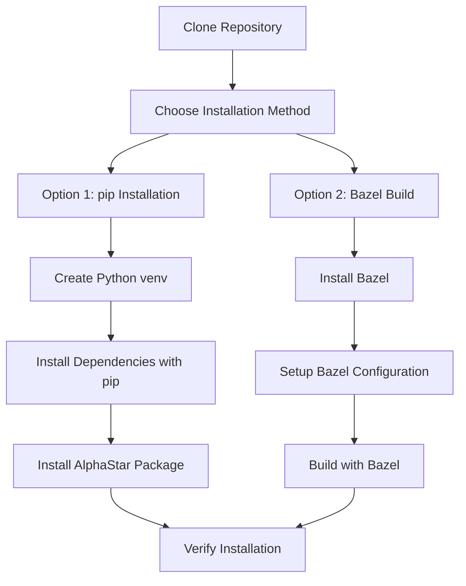

Sources: [README.md:18-90]()

## Prerequisites

Before installing AlphaStar, it's recommended to set up a Python virtual environment:

```bash
python3 -m venv alphastar
source alphastar/bin/activate
pip install --upgrade pip setuptools wheel
```

This helps isolate dependencies and prevents conflicts with other Python packages on your system.

Sources: [README.md:25-33]()

## Installation Options

AlphaStar offers two installation methods, each with its own advantages:

### Option 1: Installing with `pip`

This is the simplest approach and suitable for most users:

1. Clone the repository:
   ```bash
   git clone https://github.com/google-deepmind/alphastar.git
   cd alphastar
   ```

2. Install the package:
   ```bash
   # For an editable installation (recommended for development)
   pip install -e .
   
   # OR for a standard installation
   pip install .
   ```

This method automatically installs all dependencies listed in the requirements file.

Sources: [README.md:50-59](), [setup.py:38-53]()

### Option 2: Building with Bazel

This approach is more complex but offers better integration with PySC2, especially if you need to modify PySC2 code:

1. Install Bazel following the [official instructions](https://docs.bazel.build/versions/main/install-ubuntu.html)

2. Build AlphaStar using Bazel:
   ```bash
   # Build all AlphaStar targets
   bazel build --cxxopt='-std=c++17' ...
   
   # Run tests
   bazel test --cxxopt='-std=c++17' architectures/...
   ```

**Note**: PySC2 requires C++17, hence the `--cxxopt='-std=c++17'` flag is necessary.

Sources: [README.md:63-93](), [WORKSPACE:1-60]()

## PySC2 Integration

AlphaStar depends on PySC2 for data generation and evaluation. The relationship between these components is critical to understand:

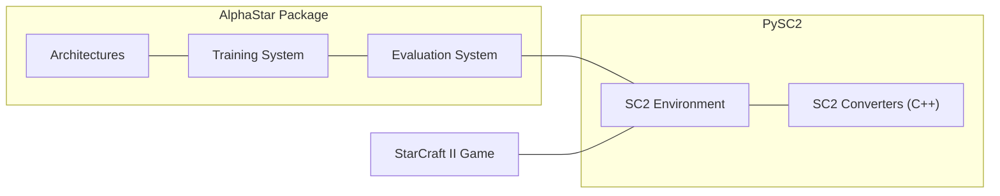

By default, PySC2 is installed from PyPI with pip installation, or built from source with Bazel installation. For Bazel builds, you can also use a local PySC2 repository by modifying the `WORKSPACE` file.

Sources: [README.md:35-48](), [WORKSPACE:28-44]()

## Dependencies

AlphaStar relies on several key dependencies, which are automatically installed when using pip:

| Category | Dependencies |
|----------|--------------|
| ML Frameworks | JAX, TensorFlow |
| DeepMind Libraries | dm-acme, dm-haiku, dm-pix, dm-reverb |
| Data Processing | apache-beam, pandas, tensorflow-datasets |
| StarCraft II | pysc2, s2clientprotocol |
| Utilities | ml-collections, numpy, optax |

The complete list of dependencies can be found in the requirements files:

Sources: [requirements.txt:1-11](), [bazel/requirements.txt:1-19]()

## Environment Configuration

After installation, you might need to configure certain aspects of the environment:

### PySC2 Configuration

If you need to use a local repository for PySC2 (e.g., because you have made local modifications), you can modify the `WORKSPACE` file:

1. Comment out the `git_repository` section for `pysc2_archive`
2. Uncomment the `local_repository` section
3. Update the path to point to your local PySC2 repository

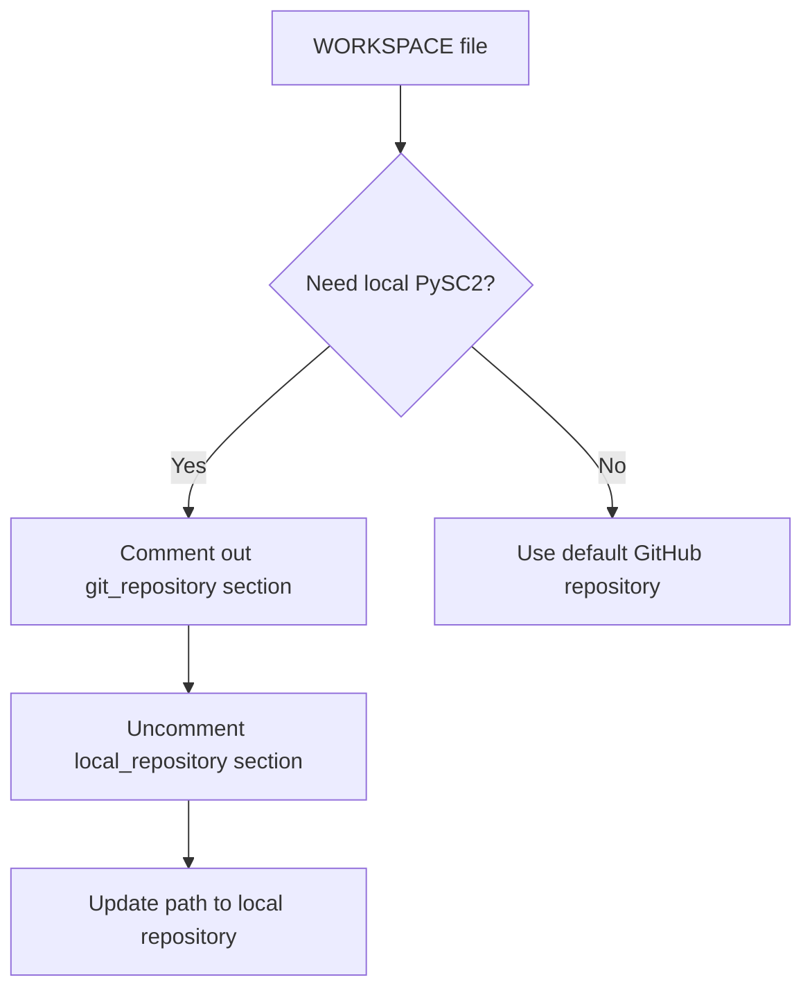

Sources: [WORKSPACE:28-44]()

## Verifying Installation

To verify that AlphaStar has been installed correctly, you can run the following simple test:

```bash
# For pip installation
python -c "import alphastar; print(alphastar.__version__)"

# For Bazel installation
bazel run --cxxopt='-std=c++17' //alphastar/unplugged:verify_install
```

If the command executes without errors, the installation is successful.

## Package Structure

The AlphaStar package has the following main components:

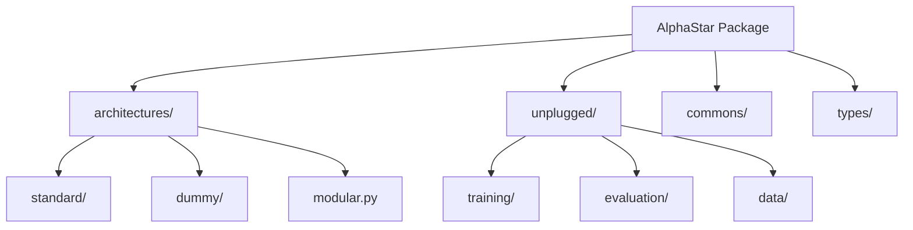

Each component serves a specific purpose:
- `architectures/`: Contains the neural network architectures for StarCraft II agents
- `unplugged/`: Contains scripts for offline reinforcement learning
- `commons/`: Contains common utilities shared across the package
- `types/`: Contains type definitions used throughout the codebase

Sources: [README.md:10-16](), [alphastar/architectures/BUILD:1-41]()

## Troubleshooting Common Issues

### PySC2 Build Issues

If you encounter issues with PySC2 when building with Bazel:
- Ensure you're using the `--cxxopt='-std=c++17'` flag
- Try clearing the Bazel cache with `bazel clean --expunge`

### Dependency Conflicts

If you encounter dependency conflicts:
- Make sure you're using a clean virtual environment
- Check that your Python version is compatible (Python 3.9 is recommended)
- Ensure all dependencies match the versions specified in requirements.txt

### Bazel Configuration

For repeated Bazel builds, consider creating a `.bazelrc` file to avoid specifying command-line options repeatedly.

Sources: [README.md:90-93]()

## Next Steps

After successful installation, you can proceed to:
- Explore the architecture of AlphaStar (see [Architecture](#3))
- Learn about the data pipeline (see [Data Pipeline](#4))
- Try the quickstart instructions for training and evaluation (see [AlphaStar Unplugged](#8))

Sources: [README.md:95-101]()

---

# Page: Architecture

# Architecture

<details>
<summary>Relevant source files</summary>

The following files were used as context for generating this wiki page:

- [alphastar/architectures/modular.py](alphastar/architectures/modular.py)
- [alphastar/architectures/standard/standard.py](alphastar/architectures/standard/standard.py)

</details>


This document provides a comprehensive overview of the AlphaStar agent architecture and its component systems. It explains the modular design approach, the standard architecture implementation, and how data flows through the system.

For information on the data processing pipeline that feeds this architecture, see [Data Pipeline](#4). For details about the training system that uses this architecture, see [Training System](#5).

## Modular Component System

The AlphaStar architecture is built on a flexible, composable component system. Components are the fundamental building blocks that can be connected together to form the complete architecture.

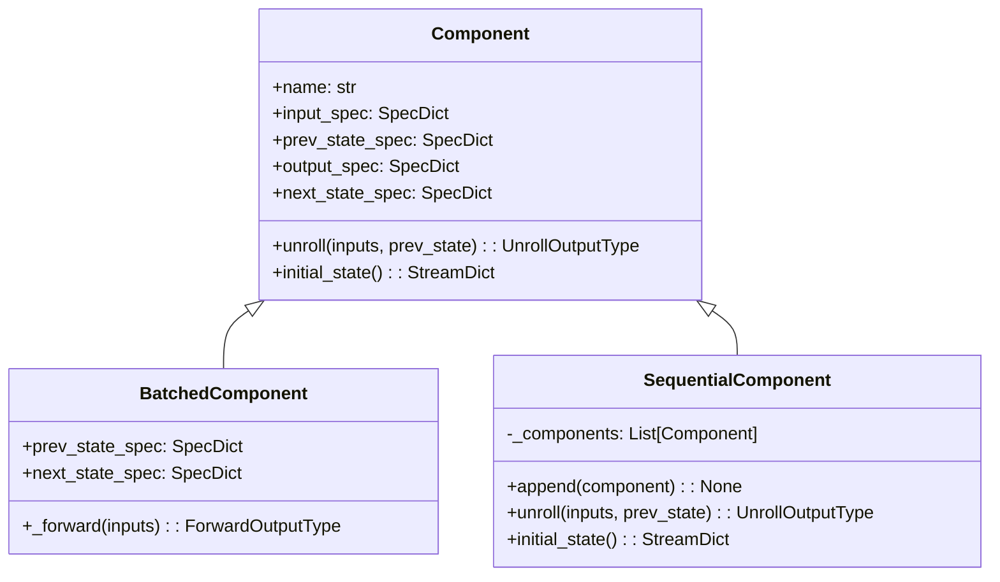

**Component Class Hierarchy**

Sources: [alphastar/architectures/modular.py:98-226](), [alphastar/architectures/modular.py:231-266](), [alphastar/architectures/modular.py:269-482]()

### Base Component

The `Component` class ([alphastar/architectures/modular.py:98-226]()) defines the core interface for all components. Each component implements:

- An `unroll` function that processes inputs from the current rollout and returns outputs
- A state management system that passes information between timesteps
- Type specifications for inputs, outputs, and states

Components have four key specifications:
1. `input_spec`: Defines the expected input tensors
2. `prev_state_spec`: Defines state tensors from previous timesteps
3. `output_spec`: Defines the produced output tensors
4. `next_state_spec`: Defines state tensors passed to future timesteps

### Batched Component

The `BatchedComponent` ([alphastar/architectures/modular.py:231-266]()) is a specialized component that operates on individual timesteps rather than sequences. Instead of implementing `_unroll`, subclasses implement a `_forward` function that processes a single timestep's data without maintaining state between timesteps.

### Sequential Component

The `SequentialComponent` ([alphastar/architectures/modular.py:269-482]()) contains a sequence of connected components. Components are added via the `append` method, creating a pipeline where:

- Outputs from earlier components become inputs to later components
- Each component can see all inputs of the `SequentialComponent` plus outputs of previous components
- States from all components are collected and passed between rollouts

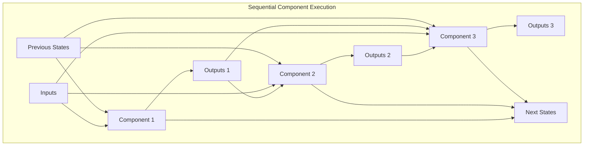

**Sequential Component Data Flow**

Sources: [alphastar/architectures/modular.py:270-322](), [alphastar/architectures/modular.py:469-482]()

## Standard Architecture

The standard AlphaStar architecture is implemented in the `get_alphastar_standard` function ([alphastar/architectures/standard/standard.py:26-102]()). It creates a `SequentialComponent` and appends specific component implementations to create the complete agent architecture.

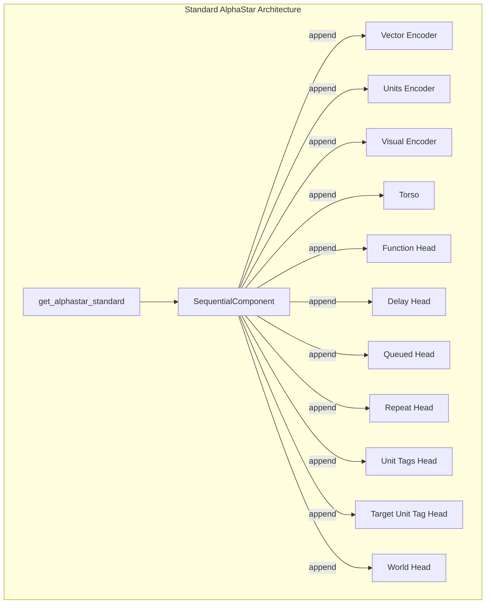

**Standard Architecture Component Assembly**

Sources: [alphastar/architectures/standard/standard.py:26-102]()

### Encoders

The architecture begins with three encoders that process different aspects of the game state:

1. **Vector Encoder** ([alphastar/architectures/standard/standard.py:41-46]()): Processes scalar and vector-valued observations (player resources, game statistics, etc.)
2. **Units Encoder** ([alphastar/architectures/standard/standard.py:47-51]()): Processes information about all units in the game
3. **Visual Encoder** ([alphastar/architectures/standard/standard.py:52-56]()): Processes 2D spatial data from the game map

Each encoder transforms raw observations into feature representations that can be integrated by the torso.

### Torso

The **Torso** component ([alphastar/architectures/standard/standard.py:59-65]()) integrates information from all three encoders. It processes:

- Vector stream (from Vector Encoder)
- Units stream (from Units Encoder)
- Visual streams (from Visual Encoder)

The torso typically contains recurrent components (e.g., LSTM) to maintain state information across timesteps, capturing temporal dynamics of the game.

### Heads

The architecture ends with multiple heads that predict different aspects of the action:

1. **Vector Heads** ([alphastar/architectures/standard/standard.py:68-78]()):
   - **Function Head**: Predicts which action function to execute
   - **Delay Head**: Predicts timing delay for the action
   - **Queued Head**: Predicts whether to queue the action
   - **Repeat Head**: Predicts repetition count for the action

2. **Unit Tags Head** ([alphastar/architectures/standard/standard.py:80-86]()): Predicts which units to select

3. **Target Unit Tag Head** ([alphastar/architectures/standard/standard.py:87-93]()): Predicts which unit to target

4. **World Head** ([alphastar/architectures/standard/standard.py:94-100]()): Predicts spatial targets (map locations)

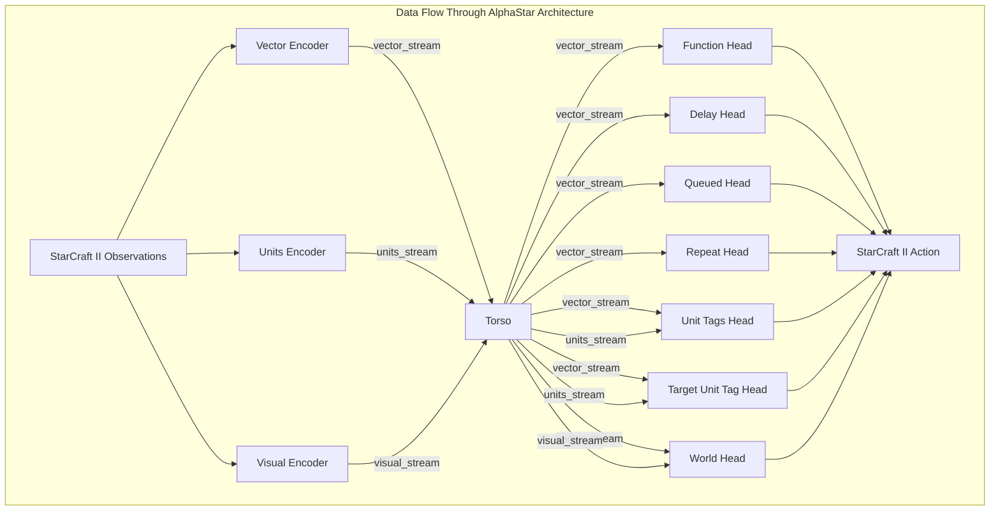

**Complete Architecture Data Flow**

Sources: [alphastar/architectures/standard/standard.py:26-102]()

## Data Processing and Unroll Mechanics

The AlphaStar architecture processes data through "unrolls" - sequences of timesteps that are processed together. This approach enables efficient training and inference.

### State Management

Components can maintain state between timesteps through the `prev_state` and `next_state` mechanism:

1. Each unroll receives `prev_state` from the previous unroll
2. The component processes the current inputs and previous state
3. The component outputs results and a `next_state` for the subsequent unroll

This mechanism is particularly important for recurrent components like LSTMs in the torso, which maintain memory of game state over time.

### Configuration

The standard architecture is highly configurable through a `ConfigDict` passed to the `get_alphastar_standard` function. This configuration specifies:

- Stream sizes for vector, units, and visual data
- Encoder-specific parameters
- Torso configuration
- Head-specific parameters

This allows for experimentation with different architectural variants without changing the code structure.

## Architecture Integration

The architecture integrates with the broader AlphaStar system:

1. **Input**: Receives observations from the StarCraft II environment
2. **Processing**: Transforms observations into action predictions
3. **Output**: Produces action parameters that are executed in the environment
4. **Training**: Supervised by human replay data or reinforcement learning signals

The modular design allows components to be individually trained, replaced, or modified while maintaining the overall structure.

Sources: [alphastar/architectures/modular.py:15-81](), [alphastar/architectures/standard/standard.py:15-25]()

---

# Page: Modular Component System

# Modular Component System

<details>
<summary>Relevant source files</summary>

The following files were used as context for generating this wiki page:

- [alphastar/architectures/components/BUILD](alphastar/architectures/components/BUILD)
- [alphastar/architectures/modular.py](alphastar/architectures/modular.py)

</details>


This document describes the modular component system that forms the foundation of the AlphaStar agent architecture. It explains the abstract component classes, component composition patterns, and the type system used for validation between components.

For information about specific component implementations, such as visual processing components, see [Visual Processing Components](#3.2).

## Component System Overview

The modular component system provides a framework for building neural network architectures in a composable way. It consists of abstract base classes that define the interfaces and behaviors of components, allowing them to be combined and nested to create complex architectures.

```mermaid
classDiagram
    class "Component"  {
        +name: str
        +input_spec: SpecDict
        +prev_state_spec: SpecDict
        +output_spec: SpecDict
        +next_state_spec: SpecDict
        +initial_state()
        +unroll(inputs, prev_state)
        #_unroll(inputs, prev_state)*
        #_initial_state()
    }
    
    class "BatchedComponent" {
        +prev_state_spec: SpecDict
        +next_state_spec: SpecDict
        +_unroll(inputs, prev_state)
        #_forward(inputs)*
    }
    
    class "SequentialComponent" {
        +_components: List[Component]
        +append(component)
        +_unroll(inputs, prev_state)
    }
    
    "Component" <|-- "BatchedComponent"
    "Component" <|-- "SequentialComponent"
```

Sources: [alphastar/architectures/modular.py:98-226](), [alphastar/architectures/modular.py:231-266](), [alphastar/architectures/modular.py:269-482]()

## Component Base Class

The `Component` class is the abstract base class that all components in the AlphaStar architecture inherit from. It defines the core interface for components, which revolve around the `unroll` function that processes data for the current rollout.

### Component Interface

Components implement an `unroll` function that takes inputs from the current rollout and previous state, and returns outputs, next state, and logs:

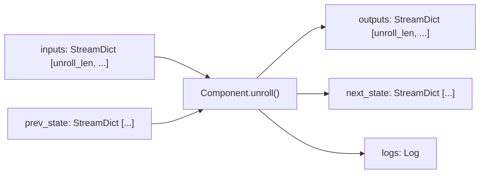

Sources: [alphastar/architectures/modular.py:15-48](), [alphastar/architectures/modular.py:185-225]()

### Component Specification System

Each component defines four specification properties that enforce static typing between components:

1. `input_spec`: Defines what inputs the component expects
2. `prev_state_spec`: Defines what state inputs the component expects from previous rollouts
3. `output_spec`: Defines what outputs the component produces
4. `next_state_spec`: Defines what state the component passes to the next rollout

These specifications use the `types.SpecDict` class, which is a nested dictionary structure with `specs.Array` objects as leaves. The `unroll` method enforces these specifications at runtime by validating inputs and outputs against their specs.

Sources: [alphastar/architectures/modular.py:54-72](), [alphastar/architectures/modular.py:185-225]()

## BatchedComponent

`BatchedComponent` is a specialized component that operates on a single timestep instead of an entire rollout. This simplifies component implementation for stateless operations.

The key differences from the base `Component` class are:

1. `BatchedComponent` is stateless (has empty `prev_state_spec` and `next_state_spec`)
2. Instead of implementing `_unroll`, subclasses implement `_forward` which operates on a single timestep
3. The `_unroll` method is implemented to use JAX's `vmap` to apply `_forward` across the rollout dimension

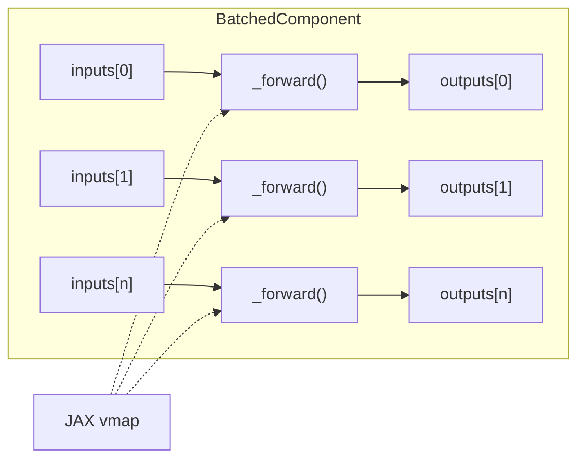

Sources: [alphastar/architectures/modular.py:231-266]()

## SequentialComponent

`SequentialComponent` allows creating a composite component by chaining multiple sub-components together. 

Key features:
- Components are added using the `append` method
- Each component's outputs become available to all subsequent components as inputs
- State is managed across all components in the sequence

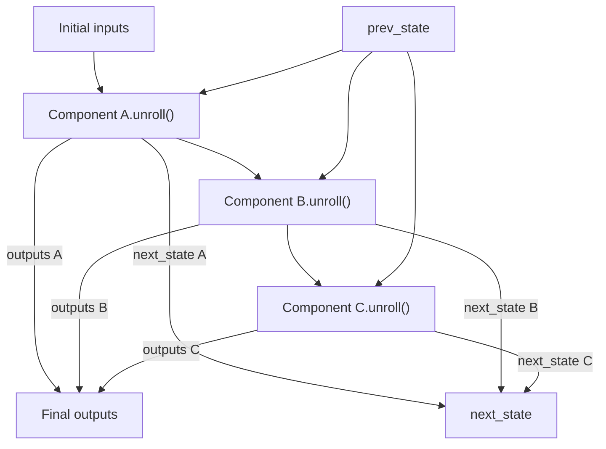

When appending components, `SequentialComponent` performs validation checks on the input, output, and state specifications to ensure compatibility.

Sources: [alphastar/architectures/modular.py:269-482]()

### Component Sequencing and Validation

When components are added to a `SequentialComponent`, the system performs several validation checks:

1. Input validation - Ensures inputs required by components are provided either by system inputs or outputs of previous components
2. Output validation - Ensures outputs don't conflict with existing outputs
3. State validation - Ensures state names are unique across components

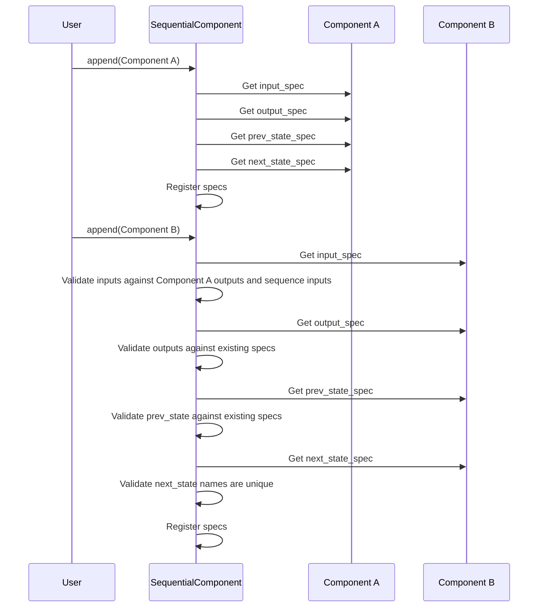

Sources: [alphastar/architectures/modular.py:334-432]()

## State Management

Components can maintain state between rollouts using the `prev_state` and `next_state` mechanism. The `initial_state` method provides the starting state before the first rollout.

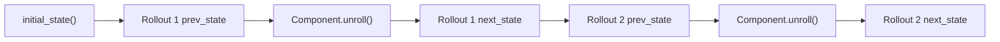

For `SequentialComponent`, the initial state is the combined initial states of all its subcomponents. State management is handled transparently, aggregating states from all components.

Sources: [alphastar/architectures/modular.py:128-158](), [alphastar/architectures/modular.py:450-467]()

## Integration with AlphaStar Architecture

The modular component system is used throughout the AlphaStar architecture to implement various neural network components, such as:

- Vector encoders for processing 1D data
- Unit encoders for processing lists of units
- Visual encoders for processing spatial features
- Core network modules ("torso")
- Action heads for different output types

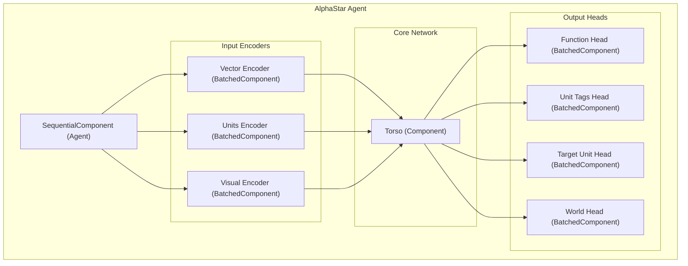

The standard AlphaStar architecture is implemented as a `SequentialComponent` that composes various specialized components together. For more details about the standard architecture, see [Standard Architecture](#3.3).

Sources: [alphastar/architectures/components/BUILD:97-244]()

## Component Implementations

AlphaStar provides various component implementations for different tasks:

| Component Type | Purpose | Implementation |
|----------------|---------|----------------|
| Vector components | Process 1D feature vectors | `alphastar/architectures/components/vector.py` |
| Units components | Process lists of unit features | `alphastar/architectures/components/units.py` |
| Visual components | Process 2D spatial features | `alphastar/architectures/components/visual.py` |
| Merge components | Combine outputs from multiple sources | `alphastar/architectures/components/merge.py` |
| Common components | General-purpose components | `alphastar/architectures/components/common.py` |

Each component type follows the `Component` or `BatchedComponent` interface pattern, allowing them to be used interchangeably in `SequentialComponent` compositions.

Sources: [alphastar/architectures/components/BUILD:97-244]()

## Summary

The modular component system provides a flexible foundation for building and composing neural network architectures in AlphaStar. Key features include:

1. A consistent interface for components through the `unroll` method
2. Strong typing through the specification system
3. Simplified component creation through `BatchedComponent` for stateless operations
4. Component composition through `SequentialComponent`
5. Transparent state management between rollouts

This system enables the construction of complex, modular neural network architectures while maintaining strong typing and clear interfaces between components.

---

# Page: Visual Processing Components

# Visual Processing Components

<details>
<summary>Relevant source files</summary>

The following files were used as context for generating this wiki page:

- [alphastar/architectures/components/visual.py](alphastar/architectures/components/visual.py)
- [alphastar/architectures/components/visual_test.py](alphastar/architectures/components/visual_test.py)
- [alphastar/architectures/standard/encoders.py](alphastar/architectures/standard/encoders.py)

</details>


## Purpose and Scope

This document details the visual processing components of the AlphaStar architecture, which are responsible for handling 2D spatial data from StarCraft II. These components transform raw 2D game features (like minimap data, height maps, and visibility information) into feature representations that can be used by the neural network. For information about the broader component-based architecture, see [Modular Component System](#3.1).

## Visual Component Architecture Overview

The visual processing components in AlphaStar form a modular pipeline for processing spatial game information. Each component inherits from the `BatchedComponent` base class and is designed to transform 2D spatial data in specific ways while maintaining a consistent interface.

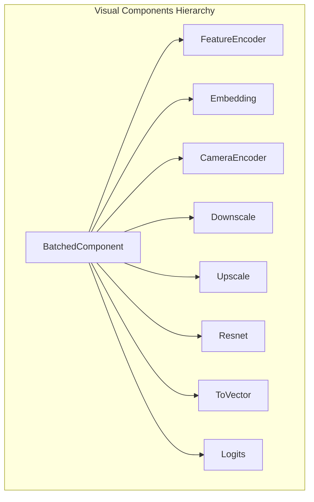

Sources: [alphastar/architectures/components/visual.py:15-660]()

The components handle various transformations including:
- Feature encoding and embedding
- Spatial resolution changes (downscaling and upscaling)
- Residual block processing
- Conversion from spatial to vector representations
- Generation of spatial action logits

## Core Visual Components

### FeatureEncoder

The `FeatureEncoder` component processes 2D feature maps by applying a transformation function followed by a convolution operation. It's typically used for continuous-valued features like height maps.

```mermaid
flowchart LR
    A["Input 2D Map"] --> B["Type Conversion"]
    B --> C["Custom Function"]
    C --> D["Convolution + Downscaling"]
    D --> E["Output Feature Map"]
```

**Key Parameters**:
- `input_spatial_size`: Spatial dimensions of input 
- `downscale_factor`: Factor by which to reduce spatial dimensions
- `output_features_size`: Number of output feature channels
- `kernel_size`: Size of convolution kernel
- `fun`: Optional function to apply to input (default: identity)

Sources: [alphastar/architectures/components/visual.py:33-118]()

### Embedding

The `Embedding` component processes categorical 2D inputs (like unit types or terrain types) by converting each pixel value to a one-hot vector, followed by a convolution.

```mermaid
flowchart LR
    A["Input 2D Map<br>(int values)"] --> B["Value Clipping"]
    B --> C["One-hot Encoding"]
    C --> D["Convolution + Downscaling"]
    D --> E["Output Feature Map"]
```

**Key Parameters**:
- `input_spatial_size`: Spatial dimensions of input
- `downscale_factor`: Factor by which to reduce spatial dimensions
- `num_classes`: Number of possible discrete values in the input
- `output_features_size`: Number of output feature channels
- `kernel_size`: Size of convolution kernel

Sources: [alphastar/architectures/components/visual.py:121-187]()

### CameraEncoder

The `CameraEncoder` component specifically handles the camera view, which represents the visible portion of the game screen. It applies average pooling followed by a linear transformation.

```mermaid
flowchart LR
    A["Camera View"] --> B["Average Pooling"]
    B --> C["Add Channel Dimension"]
    C --> D["Linear Transform"]
    D --> E["Output Feature Map"]
```

**Key Parameters**:
- `input_spatial_size`: Spatial dimensions of input
- `downscale_factor`: Factor by which to reduce spatial dimensions
- `output_features_size`: Number of output feature channels

Sources: [alphastar/architectures/components/visual.py:190-240]()

### Downscale and Upscale

The `Downscale` and `Upscale` components change the spatial resolution of feature maps while potentially changing the number of feature channels.

```mermaid
flowchart LR
    subgraph "Downscale"
        A1["Input Feature Map"] --> B1["Layer Norm (optional)"]
        B1 --> C1["ReLU"]
        C1 --> D1["Strided Convolution"]
        D1 --> E1["Downscaled Feature Map"]
    end

    subgraph "Upscale"
        A2["Input Feature Map"] --> B2["Layer Norm (optional)"]
        B2 --> C2["ReLU"]
        C2 --> D2["Transposed Convolution"]
        D2 --> E2["Upscaled Feature Map"]
    end
```

**Key Parameters**:
- `input_spatial_size`: Spatial dimensions of input
- `input_features_size`: Number of input feature channels
- `output_features_size`: Number of output feature channels
- `downscale_factor`/`upscale_factor`: Factor by which to change spatial dimensions
- `kernel_size`: Size of convolution kernel
- `use_layer_norm`: Whether to apply layer normalization

Sources: 
- Downscale: [alphastar/architectures/components/visual.py:243-315]()
- Upscale: [alphastar/architectures/components/visual.py:318-387]()

### Resnet

The `Resnet` component applies a series of residual blocks to process feature maps while maintaining spatial dimensions. This allows the network to capture complex spatial patterns without increasing spatial size.

```mermaid
flowchart LR
    Input["Input Feature Map"] --> ResBlock1["Residual Block 1"]
    ResBlock1 --> ResBlock2["Residual Block 2"]
    ResBlock2 --> ResBlockN["Residual Block N"]
    ResBlockN --> Output["Output Feature Map"]

    subgraph "Residual Block Structure"
        RInput["Input"] --> LN1["Layer Norm (optional)"]
        LN1 --> ReLU1["ReLU"]
        ReLU1 --> Conv1["Conv2D"]
        Conv1 --> LN2["Layer Norm (optional)"]
        LN2 --> ReLU2["ReLU"]
        ReLU2 --> Conv2["Conv2D"]
        RInput --> Add
        Conv2 --> Add["Add"]
    end
```

**Key Parameters**:
- `input_spatial_size`: Spatial dimensions of input
- `input_features_size`: Number of input feature channels
- `num_resblocks`: Number of residual blocks to apply
- `kernel_size`: Size of convolution kernel
- `use_layer_norm`: Whether to apply layer normalization
- `num_hidden_feature_planes`: Number of feature channels in hidden layers

Sources: [alphastar/architectures/components/visual.py:390-449]()

### ToVector

The `ToVector` component converts spatial feature maps to fixed-size vector representations through a series of strided convolutions followed by reshaping and a linear layer.

```mermaid
flowchart LR
    A["Input Feature Map"] --> B["Strided Convolutions"]
    B --> C["Reshape to 1D"]
    C --> D["Layer Norm (optional)"]
    D --> E["ReLU"]
    E --> F["Linear Layer"]
    F --> G["Output Vector"]
```

**Key Parameters**:
- `input_spatial_size`: Spatial dimensions of input
- `input_features_size`: Number of input feature channels
- `vector_stream_size`: Size of output vector
- `hidden_feature_sizes`: Feature channels for each hidden layer
- `downscale_factor`: Factor by which to reduce spatial dimensions in each layer
- `kernel_size`: Size of convolution kernel
- `use_layer_norm`: Whether to apply layer normalization

Sources: [alphastar/architectures/components/visual.py:452-539]()

### Logits

The `Logits` component generates 2D spatial logits for action selection, particularly for actions that require clicking on the game screen. It handles upscaling feature maps and masking valid action locations.

```mermaid
flowchart LR
    A["Input Feature Map"] --> B["Layer Norm (optional)"]
    B --> C["ReLU"]
    C --> D["Upscale (Conv2D Transpose)"]
    D --> E["Reshape to 1D"]
    
    F["Camera View"] --> G["Create Spatial Mask"]
    H["Current Function"] --> G
    
    E --> I["Apply Mask to Logits"]
    G --> I
    
    I --> J["Final Masked Logits"]
```

**Key Parameters**:
- `input_spatial_size`: Spatial dimensions of input
- `input_features_size`: Number of input feature channels
- `upscale_factor`: Factor by which to increase spatial dimensions
- `kernel_size`: Size of convolution kernel
- `use_layer_norm`: Whether to apply layer normalization
- `use_depth_to_space`: Alternative upscaling method that can improve performance

Sources: [alphastar/architectures/components/visual.py:542-659]()

## Visual Encoder Assembly

The standard AlphaStar architecture assembles these components into a complete visual encoder using the `get_visual_encoder` function. This encoder processes various minimap features and the camera view to create a unified visual stream.

```mermaid
flowchart TD
    subgraph "Visual Encoder Assembly"
        A["Minimap Features"] --> B["Individual Feature Processing"]
        B -->|"FeatureEncoder"| C1["Height Map Features"]
        B -->|"Embedding"| C2["Visibility Features"]
        B -->|"Embedding"| C3["Creep Features"]
        B -->|"Embedding"| C4["Player Relative Features"]
        B -->|"Embedding"| C5["Alerts Features"]
        B -->|"Embedding"| C6["Pathable Features"]
        B -->|"Embedding"| C7["Buildable Features"]
        
        D["Camera View"] -->|"CameraEncoder"| E["Camera Features"]
        
        C1 --> F["SumMerge"]
        C2 --> F
        C3 --> F
        C4 --> F
        C5 --> F
        C6 --> F
        C7 --> F
        E --> F
        
        F --> G["Unified Visual Stream"]
    end
```

**Key Implementation Details**:
- The visual encoder processes 7 different minimap features plus the camera view
- `FeatureEncoder` is used for continuous features (height map)
- `Embedding` is used for categorical features (visibility, creep, etc.)
- All features are processed to the same spatial dimensions and feature size
- Features are merged by summation to create a unified visual stream

Sources: [alphastar/architectures/standard/encoders.py:165-223]()

## Data Flow Through Visual Processing

The complete flow of visual data through the AlphaStar system follows a progression from raw 2D game features to action outputs:

```mermaid
flowchart LR
    A["Game Observations"] --> B["Visual Encoder"]
    B --> C["Visual Stream"]
    C --> D["Downscaling Layers"]
    D --> E["Resnet Processing"]
    
    subgraph "Dual Pathways"
        E --> F1["ToVector"]
        F1 --> G1["Vector Representation"]
        G1 --> H["Torso Network"]
        
        E --> F2["Upscaling Layers"]
        F2 --> G2["Spatial Features"]
        G2 --> I["Logits"]
    end
    
    H --> J["Action Selection"]
    I --> J
```

This pipeline enables AlphaStar to:
1. Process raw spatial game information
2. Extract meaningful features at multiple spatial resolutions
3. Integrate spatial information with other input types (vector and unit data)
4. Generate both spatial actions (screen clicks) and non-spatial actions (ability selections)

Sources: 
- [alphastar/architectures/components/visual.py:15-660]()
- [alphastar/architectures/standard/encoders.py:165-223]()

## Performance Considerations

The visual processing components include several optimizations:
- Downscaling early in the pipeline to reduce computational requirements
- Optional layer normalization for training stability
- Alternative implementations for upscaling (`use_depth_to_space`) that can improve performance on certain hardware
- Residual connections in the Resnet component to improve gradient flow

When downscaling or upscaling, the `kernel_size` should typically be a multiple of the scaling factor to avoid checkerboard artifacts in the output.

Sources: [alphastar/architectures/components/visual.py:573-580]()

---

# Page: Standard Architecture

# Standard Architecture

<details>
<summary>Relevant source files</summary>

The following files were used as context for generating this wiki page:

- [alphastar/architectures/standard/BUILD](alphastar/architectures/standard/BUILD)
- [alphastar/architectures/standard/standard.py](alphastar/architectures/standard/standard.py)

</details>


This document describes the Standard Architecture implementation of AlphaStar, which represents the primary neural network architecture used by AlphaStar agents. For information about the modular component system that underlies this architecture, see [Modular Component System](#3.1). For details on visual processing components, see [Visual Processing Components](#3.2).

## Overview

The Standard Architecture implements a complex neural network designed specifically for StarCraft II gameplay. It processes game state information through a sequence of specialized components organized in three main sections: encoders, a central torso, and action heads. This implementation is found in the `get_alphastar_standard` function, which constructs the complete architecture as a modular, sequential component.

```mermaid
flowchart TB
    subgraph "AlphaStar Standard Architecture"
        input["Input: Observation & Action Specs"] --> encoders
        
        subgraph encoders["Encoders"]
            ve["Vector Encoder"]
            ue["Units Encoder"]
            vise["Visual Encoder"]
        end
        
        encoders --> torso["Torso"]
        
        torso --> heads
        
        subgraph heads["Heads"]
            fh["Function Head"]
            dh["Delay Head"]
            qh["Queued Head"]
            rh["Repeat Head"]
            uth["Unit Tags Head"]
            tuth["Target Unit Tag Head"]
            wh["World Head"]
        end
        
        heads --> output["Output: Action Parameters"]
    end
```

Sources: [alphastar/architectures/standard/standard.py:15-102]()

## Architecture Components

The Standard Architecture is composed as a sequential component, with data flowing through encoders, torso, and heads in a defined order.

```mermaid
classDiagram
    class SequentialComponent {
        +append()
        +__call__()
    }
    
    class VectorEncoder {
        process scalar features
    }
    
    class UnitsEncoder {
        process unit entities
    }
    
    class VisualEncoder {
        process spatial features
    }
    
    class Torso {
        integrate information
    }
    
    class ActionHeads {
        predict action parameters
    }
    
    SequentialComponent --> VectorEncoder
    SequentialComponent --> UnitsEncoder
    SequentialComponent --> VisualEncoder
    SequentialComponent --> Torso
    SequentialComponent --> ActionHeads
```

Sources: [alphastar/architectures/standard/standard.py:38-101]()

### Initialization

The architecture is initialized through the `get_alphastar_standard` function, which sets up the component pipeline based on provided specifications and configuration:

```mermaid
flowchart LR
    A["get_alphastar_standard()"] --> B["Create SequentialComponent"]
    B --> C["Add Encoders"]
    C --> D["Add Torso"]
    D --> E["Add Heads"]
    E --> F["Return Component"]
```

Sources: [alphastar/architectures/standard/standard.py:26-102]()

## Encoders

The Standard Architecture uses three distinct encoders to process different aspects of the observation space:

### Vector Encoder

Processes scalar features from the game state, including global game information and statistics.

Key parameters:
- `vector_stream_size`: Output dimension of the vector stream
- Configuration settings from `config.encoders.vector`

Sources: [alphastar/architectures/standard/standard.py:41-46]()

### Units Encoder

Processes information about game units (entities) present in the observation.

Key parameters:
- `units_stream_size`: Output dimension of the units stream
- Configuration settings from `config.encoders.units` 

Sources: [alphastar/architectures/standard/standard.py:47-51]()

### Visual Encoder

Processes spatial (2D) features from the game state, including maps and terrain information.

Key parameters:
- `visual_features_size`: First dimension in `visual_stream_sizes`
- Configuration settings from `config.encoders.visual`

Sources: [alphastar/architectures/standard/standard.py:52-56]()

## Torso

The torso is the central component that integrates information from all encoders and processes it into a unified representation that can be used by the action heads.

Key parameters:
- `vector_stream_size`: Dimension of the vector stream
- `units_stream_size`: Dimension of the units stream
- `visual_stream_sizes`: Dimensions of the visual stream
- Configuration settings from `config.torso`

Sources: [alphastar/architectures/standard/standard.py:59-65]()

## Heads

The Standard Architecture includes multiple action heads, each responsible for predicting different aspects of the agent's actions:

### Vector Heads

Four separate vector heads handle different action arguments:
- Function head: Selects the function to execute
- Delay head: Determines action delay
- Queued head: Decides if the action should be queued
- Repeat head: Specifies if the action should be repeated

Each head takes the following parameters:
- `argument_name`: The specific argument (FUNCTION, DELAY, QUEUED, REPEAT)
- `action_spec`: Specification of the action space
- `vector_stream_size`: Dimension of the vector stream
- `is_training`: Whether the model is in training mode
- `overlap_len`: Overlap length for sequence processing
- Configuration settings from `config.heads[arg]`

Sources: [alphastar/architectures/standard/standard.py:68-78]()

### Unit Tags Head

Predicts which units should be selected for an action.

Key parameters:
- `vector_stream_size`: Dimension of the vector stream
- `units_stream_size`: Dimension of the units stream
- Configuration settings from `config.heads.unit_tags`

Sources: [alphastar/architectures/standard/standard.py:80-86]()

### Target Unit Tag Head

Predicts the target unit for an action (if applicable).

Key parameters:
- `vector_stream_size`: Dimension of the vector stream
- `units_stream_size`: Dimension of the units stream
- Configuration settings from `config.heads.target_unit_tag`

Sources: [alphastar/architectures/standard/standard.py:87-93]()

### World Head

Predicts spatial (x,y) coordinates for actions that require position selection.

Key parameters:
- `vector_stream_size`: Dimension of the vector stream
- `visual_stream_sizes`: Dimensions of the visual stream
- Configuration settings from `config.heads.world`

Sources: [alphastar/architectures/standard/standard.py:94-100]()

## Data Flow

The following diagram illustrates how data flows through the Standard Architecture:

```mermaid
flowchart TD
    Input["Game Observation"] --> Split["Split Observation"]
    
    Split --> ScalarFeatures["Scalar Features"]
    Split --> UnitEntities["Unit Entities"]
    Split --> SpatialFeatures["Spatial Features"]
    
    ScalarFeatures --> VectorEncoder["get_vector_encoder()"]
    UnitEntities --> UnitsEncoder["get_units_encoder()"]
    SpatialFeatures --> VisualEncoder["get_visual_encoder()"]
    
    VectorEncoder --> VectorStream["Vector Stream"]
    UnitsEncoder --> UnitsStream["Units Stream"]
    VisualEncoder --> VisualStream["Visual Stream"]
    
    VectorStream --> Torso["get_torso()"]
    UnitsStream --> Torso
    VisualStream --> Torso
    
    Torso --> ProcessedVectorStream["Processed Vector Stream"]
    Torso --> ProcessedUnitsStream["Processed Units Stream"]
    Torso --> ProcessedVisualStream["Processed Visual Stream"]
    
    ProcessedVectorStream --> FunctionHead["Vector Heads"]
    ProcessedVectorStream --> UnitTagsHead["Unit Tags Head"]
    ProcessedUnitsStream --> UnitTagsHead
    
    ProcessedVectorStream --> TargetUnitTagHead["Target Unit Tag Head"]
    ProcessedUnitsStream --> TargetUnitTagHead
    
    ProcessedVectorStream --> WorldHead["World Head"]
    ProcessedVisualStream --> WorldHead
    
    FunctionHead --> ActionOutput["Action Output"]
    UnitTagsHead --> ActionOutput
    TargetUnitTagHead --> ActionOutput
    WorldHead --> ActionOutput
```

Sources: [alphastar/architectures/standard/standard.py:38-101]()

## Configuration

The Standard Architecture's behavior is controlled through a hierarchical configuration object with the following structure:

| Configuration Section | Purpose |
|----------------------|---------|
| `vector_stream_size` | Dimension of the vector stream |
| `units_stream_size` | Dimension of the units stream |
| `visual_stream_sizes` | Dimensions of the visual stream (list) |
| `encoders.vector` | Configuration for the vector encoder |
| `encoders.units` | Configuration for the units encoder |
| `encoders.visual` | Configuration for the visual encoder |
| `torso` | Configuration for the torso network |
| `heads.FUNCTION` | Configuration for the function head |
| `heads.DELAY` | Configuration for the delay head |
| `heads.QUEUED` | Configuration for the queued head |
| `heads.REPEAT` | Configuration for the repeat head |
| `heads.unit_tags` | Configuration for the unit tags head |
| `heads.target_unit_tag` | Configuration for the target unit tag head |
| `heads.world` | Configuration for the world (spatial) head |

Sources: [alphastar/architectures/standard/standard.py:28-32](), [alphastar/architectures/standard/BUILD:13-23]()

## Component Creation and Integration

The Standard Architecture is created through a functional approach, with each component created by a corresponding factory function:

```mermaid
flowchart LR
    subgraph "Factory Functions"
        vector["get_vector_encoder()"]
        units["get_units_encoder()"]
        visual["get_visual_encoder()"]
        torso["get_torso()"]
        vector_head["get_vector_head()"]
        unit_tags["get_unit_tags_head()"]
        target["get_target_unit_tag_head()"]
        world["get_world_head()"]
    end
    
    subgraph "SequentialComponent"
        comp["component.append()"]
    end
    
    vector --> comp
    units --> comp
    visual --> comp
    torso --> comp
    vector_head --> comp
    unit_tags --> comp
    target --> comp
    world --> comp
```

Sources: [alphastar/architectures/standard/standard.py:41-100]()

## Usage

The Standard Architecture is used by creating an instance through the `get_alphastar_standard` function and then using it as part of an AlphaStar agent. The function returns a modular component that can be used for both training and inference.

Key parameters for using the architecture:
- `input_spec`: Specification of the input observation space
- `action_spec`: Specification of the action space
- `is_training`: Whether the model is in training mode
- `overlap_len`: Overlap length for sequence processing
- `burnin_len`: Burn-in length for sequence processing (not used)
- `config`: Configuration object defining architecture parameters
- `name`: Optional name for the component

Sources: [alphastar/architectures/standard/standard.py:26-34]()

---

# Page: Dummy Architecture

# Dummy Architecture

<details>
<summary>Relevant source files</summary>

The following files were used as context for generating this wiki page:

- [alphastar/architectures/dummy/dummy.py](alphastar/architectures/dummy/dummy.py)

</details>


## Purpose and Scope

The Dummy Architecture is a minimal implementation of the AlphaStar agent architecture used primarily for testing, debugging, and verification of the agent interface. Unlike the [Standard Architecture](#3.3), the Dummy Architecture is intentionally simplified and not designed to achieve good training performance. Instead, it provides a correct implementation of the expected interfaces while minimizing computational complexity.

This document covers the design, components, and implementation details of the Dummy Architecture, explaining how it serves as a lightweight testing alternative to the full AlphaStar architecture.

Sources: [alphastar/architectures/dummy/dummy.py:15-19]()

## Architecture Overview

The Dummy Architecture follows the same modular component pattern used throughout AlphaStar but implements only the essential components needed to maintain interface compatibility. It consists of a minimal encoder section, a simplified vector stream, and the required action heads.

### High-Level Structure

```mermaid
flowchart TD
    subgraph "Dummy Architecture"
        A["Input Observation"] --> B["VectorEncoder (Player)"]
        B --> C["Vector Stream (1024 dim)"]
        
        C --> D1["Function Head"]
        C --> D2["Delay Head"]
        C --> D3["Queued Head"]
        C --> D4["Repeat Head"]
        C --> D5["Target Unit Tag Head"]
        C --> D6["World Head"]
        C --> D7["Unit Tags Head"]
        
        D1 --> E["Action Output"]
        D2 --> E
        D3 --> E
        D4 --> E
        D5 --> E
        D6 --> E
        D7 --> E
    end
```

Sources: [alphastar/architectures/dummy/dummy.py:114-162]()

## Components and Implementation

### Component Hierarchy

```mermaid
classDiagram
    class SequentialComponent {
        name: string
        components: List[Component]
        append(component)
    }
    
    class VectorEncoder {
        input_name: Tuple
        output_name: string
        num_features: int
        output_size: int
        fun: Function
    }
    
    class VectorHead {
        argument_name: ArgumentName
        logits: Logits
        action: ActionComponent
    }
    
    class UnitTagsHead {
        inner_component: Component
        max_num_selected_units: int
        max_num_observed_units: int
    }
    
    SequentialComponent <|-- DummyArchitecture
    DummyArchitecture o-- VectorEncoder
    DummyArchitecture o-- VectorHead
    DummyArchitecture o-- UnitTagsHead
```

Sources: [alphastar/architectures/dummy/dummy.py:131-161]()

### Encoder Layer

The Dummy Architecture implements only a single encoder for player information, rather than the multiple encoders (units, visual, etc.) found in the standard architecture:

- **Player Encoder**: A simple `VectorEncoder` that processes player-related observation features
  - Applies `log1p` transformation to the input features
  - Projects to the common vector stream size (1024)

Sources: [alphastar/architectures/dummy/dummy.py:133-140]()

### Vector Stream

The vector stream in the Dummy Architecture is a simple fixed-size (1024-dimensional) feature vector. Unlike the more complex stream processing in the standard architecture, the Dummy Architecture does not include:

- No LSTM or other recurrent components
- No advanced residual connections
- No transformer or attention mechanisms
- No embedding or entity processing

Sources: [alphastar/architectures/dummy/dummy.py:128]()

### Action Heads

The Dummy Architecture implements all the required action heads to maintain interface compatibility:

| Head Type | Purpose | Implementation |
|-----------|---------|----------------|
| Function | Selects the action function | Vector-based logits |
| Delay | Controls action timing | Vector-based logits |
| Queued | Controls action queuing | Vector-based logits |
| Repeat | Controls action repetition | Vector-based logits |
| Target Unit Tag | Selects target unit | Vector-based logits |
| World | Selects world coordinates | Vector-based logits |
| Unit Tags | Selects source units | Specialized unit tags component |

Each head consists of:
1. A logits component that produces action probabilities
2. Either a behavior cloning component (during training) or a sampling component (during inference)

Sources: [alphastar/architectures/dummy/dummy.py:143-160]()

## Implementation Details

### Vector Head Implementation

The vector heads are created through the `_get_vector_head` helper function, which:

1. Determines the number of possible actions based on the action specification
2. Creates a sequential component with a name based on the argument
3. Adds a `Logits` component to produce action probabilities
4. Adds either:
   - An `ActionFromBehaviourFeatures` component (during training)
   - A `Sample` component (during inference)
5. For the function head specifically, adds an `ArgumentMasks` component to generate valid argument masks

```mermaid
flowchart LR
    A["Vector Stream"] --> B["Logits Component"]
    B --> C{"Training Mode?"}
    C -->|"Yes"| D["ActionFromBehaviourFeatures"]
    C -->|"No"| E["Sample Component"]
    D --> F["Action Output"]
    E --> F
    
    subgraph "Function Head Only"
        F --> G["ArgumentMasks"]
    end
```

Sources: [alphastar/architectures/dummy/dummy.py:33-64]()

### Unit Tags Head Implementation

The unit tags head is more complex due to the need to handle multiple selected units:

1. Creates an inner sequential component similar to vector heads
2. Wraps this in a `UnitTagsHead` component that:
   - Tracks maximum number of selected units
   - Tracks maximum number of observable units
   - Handles selection of multiple units in sequence

Sources: [alphastar/architectures/dummy/dummy.py:67-111]()

## Usage and Configuration

The Dummy Architecture is instantiated through the `get_alphastar_dummy` function:

```python
architecture = get_alphastar_dummy(
    input_spec=input_spec,
    action_spec=action_spec,
    is_training=True,
    overlap_len=0,  # Not used in dummy architecture
    burnin_len=0,   # Not used in dummy architecture
    sample_fns=None,  # Default sampling functions will be used
    name="alpha_star_dummy"
)
```

### Key Parameters

| Parameter | Type | Description |
|-----------|------|-------------|
| input_spec | SpecDict | Specification of input observations |
| action_spec | ActionSpec | Specification of possible actions |
| is_training | bool | Whether the architecture is being used for training |
| overlap_len | int | Sequence overlap length (unused in dummy) |
| burnin_len | int | Burnin length for recurrent models (unused in dummy) |
| sample_fns | Optional[Mapping] | Custom sampling functions for each action argument |
| name | str | Name for the component |

Sources: [alphastar/architectures/dummy/dummy.py:114-123]()

## When to Use the Dummy Architecture

The Dummy Architecture is appropriate for:

1. **Testing the AlphaStar interface**: Verifying that inputs and outputs are correctly formatted
2. **Debugging the training pipeline**: Isolating issues in the training system from architecture issues
3. **Benchmarking**: Providing a performance baseline for more complex architectures
4. **Integration testing**: Ensuring new components integrate correctly with the existing system

Note that the Dummy Architecture is explicitly designed not to train well. As stated in the code comment: "Minimal architecture, should not train (or terribly) but the interface is correct."

Sources: [alphastar/architectures/dummy/dummy.py:15-19]()

---

# Page: Type System

# Type System

<details>
<summary>Relevant source files</summary>

The following files were used as context for generating this wiki page:

- [alphastar/types/__init__.py](alphastar/types/__init__.py)
- [alphastar/types/types.py](alphastar/types/types.py)

</details>


## Purpose and Scope

This document explains the custom type system used throughout the AlphaStar project. The type system provides specialized data structures for handling nested data, managing specifications, and ensuring compatibility with JAX's functional transformations. The type system enables consistent handling of observations, actions, and model state across the different components of AlphaStar.

This page focuses on the core types and data structures defined in the types module. For information about the architecture components that use these types, see [Modular Component System](#3.1).

## Overview of the Type System

AlphaStar implements a custom type system built on Python's typing module with specialized containers designed to handle StarCraft II observation and action data. At its core, the system provides robust nested dictionary structures that support complex indexing patterns and validation against specifications.

```mermaid
classDiagram
    class "Basic Type Aliases" {
        ArgumentName
        ObsSpec
        ActionSpec
        StreamType
    }
    
    class "Container Types" {
        NestedDict
        StrDict
        StreamDict
        SpecDict
    }
    
    class "Integration" {
        JAX PyTree Registration
    }
    
    "Basic Type Aliases" --> "Container Types" : used by
    "Container Types" --> "Integration" : enables
```

Sources: [alphastar/types/types.py:15-45](), [alphastar/types/types.py:259-263]()

## Basic Type Aliases

The type system defines several foundational type aliases to improve code readability and type safety:

| Type Alias | Definition | Purpose |
|------------|------------|---------|
| `ArgumentName` | `str` | Represents action argument names |
| `ObsSpec` | `Mapping[str, specs.BoundedArray]` | Specification for observation spaces |
| `ActionSpec` | `Mapping[ArgumentName, specs.BoundedArray]` | Specification for action spaces |
| `StreamType` | `Union[str, Sequence[str]]` | Identifier for data streams or nested paths |

These aliases provide a common vocabulary for handling StarCraft II game interfaces and agent interactions.

Sources: [alphastar/types/types.py:37-42](), [alphastar/types/__init__.py:17-24]()

## NestedDict: Core Data Structure

The `NestedDict` class is the cornerstone of AlphaStar's type system, providing a specialized dictionary that supports nested indexing with tuples of strings. This simplifies access to deeply nested structures commonly found in the StarCraft II observation and action spaces.

```mermaid
flowchart TB
    subgraph "NestedDict Usage"
        A["NestedDict"]
        B["dict['a'] = 100"]
        C["dict['b', 'c'] = 200"]
        D["dict['b', 'd'] = 300"]
        
        A --- B
        A --- C
        A --- D
        
        E["Access: dict['a'] → 100"]
        F["Access: dict['b', 'c'] → 200"]
        G["Partial: dict.get('b') → {'c': 200, 'd': 300}"]
        
        A --- E
        A --- F
        A --- G
    end
```

### Key Features of NestedDict

1. **Hierarchical Indexing**: Allows indexing with tuples of strings to access nested values directly.
2. **Type Safety**: Implements generic typing for value types.
3. **Filtering**: Can filter entries based on another NestedDict or sequence of keys.
4. **Dictionary Conversion**: Can be converted to standard Python dictionaries.
5. **JAX Compatibility**: Registered as a PyTree node for JAX transformations.

### Specialized NestedDict Types

The system defines specialized NestedDict subtypes for common use cases:

- `StrDict`: A NestedDict containing string values
- `StreamDict`: A NestedDict containing array values (observations, actions, etc.)

Sources: [alphastar/types/types.py:77-256](), [alphastar/types/types.py:259-261]()

### Usage Examples

NestedDict supports several patterns for initializing and accessing data:

```
# Creating a NestedDict
nested = NestedDict()
nested['a'] = 100
nested['b', 'c'] = 200
nested['b', 'd'] = 300

# Accessing elements
value = nested['b', 'c']  # 200
partial = nested.get('b')  # {'c': 200, 'd': 300}

# Filtering against another structure
filter_template = NestedDict([('foo', NestedDict(dict(a=0)))])
filtered = some_data.filter(filter_template)  # Only keeps the 'foo/a' entry
```

Sources: [alphastar/types/types.py:90-123]()

## SpecDict: Validating Data Structures

The `SpecDict` class extends `NestedDict` with additional validation capabilities. It's specifically designed to hold specifications (from `dm_env.specs`) and validate data against these specifications.

```mermaid
classDiagram
    NestedDict <|-- SpecDict
    
    class NestedDict {
        +__getitem__(key)
        +__setitem__(key, value)
        +get(key, default)
        +filter(other)
        +asdict()
    }
    
    class SpecDict {
        +validate(data, exact_match, num_leading_dims_to_ignore)
        +copy()
    }
    
    class "StreamDict" {
        Contains Array Data
    }
    
    SpecDict --> "StreamDict" : validates
```

### Validation Process

The `validate` method in `SpecDict` performs several checks:

1. Ensures all keys in the spec exist in the data
2. Optionally checks for exact key matching (no extra keys in data)
3. Validates shape consistency of leading dimensions
4. For each entry, validates the shape and dtype against the specification

This validation is critical for ensuring that observations and actions conform to their expected specifications before processing by the agent.

Sources: [alphastar/types/types.py:263-333]()

## JAX Integration

The AlphaStar type system integrates with JAX's functional transformations by registering `NestedDict` and `SpecDict` as PyTree nodes. This enables these containers to work with JAX functions like `jit`, `grad`, and `vmap`.

```mermaid
flowchart LR
    subgraph "JAX PyTree Integration"
        A["NestedDict/SpecDict"]
        B["flatten_func"]
        C["unflatten_func"]
        D["JAX Tree Utilities"]
        
        A -->|"registered with"| D
        B -->|"converts to"| E["(values, keys)"]
        E -->|"inputs to"| C
        C -->|"reconstructs"| A
    end
```

The registration process defines:

1. A `_flatten_func` that converts a NestedDict into a tuple of (values, keys)
2. An `_unflatten_func` that reconstructs a NestedDict from (keys, values)

This integration allows the custom data structures to be used seamlessly within JAX's functional programming paradigm, enabling efficient gradient computation and compilation.

Sources: [alphastar/types/types.py:336-351]()

## Type System in the Broader Architecture

The type system provides the foundation for data handling throughout the AlphaStar architecture. It enables consistent representation of:

- Observation and action specifications
- Game state data
- Model inputs and outputs
- Configuration settings

```mermaid
flowchart TD
    subgraph "Type System Usage in AlphaStar"
        A["ObsSpec/ActionSpec"]
        B["NestedDict"]
        C["SpecDict"]
        D["StreamDict"]
        
        E["Environment Interface"]
        F["Neural Architecture"]
        G["Training Pipeline"]
        
        A -->|"defines"| E
        B -->|"structures data in"| F
        B -->|"organizes state in"| G
        C -->|"validates I/O in"| E
        D -->|"holds observations in"| F
    end
```

By providing a consistent interface for nested data structures with validation capabilities, the type system ensures that data flows correctly between the various components of AlphaStar, from the environment interface to the neural architecture and training pipeline.

Sources: [alphastar/types/types.py:15-45](), [alphastar/types/__init__.py:15-24]()

## Summary

The AlphaStar Type System provides specialized data structures for handling the complex, nested data encountered in StarCraft II agents. The `NestedDict` class forms the foundation, offering flexible nested indexing, while `SpecDict` adds validation capabilities. Integration with JAX ensures these structures work efficiently within the functional programming paradigm used throughout the AlphaStar codebase.

---

# Page: Data Pipeline

# Data Pipeline

<details>
<summary>Relevant source files</summary>

The following files were used as context for generating this wiki page:

- [alphastar/unplugged/data/BUILD](alphastar/unplugged/data/BUILD)
- [alphastar/unplugged/data/README.md](alphastar/unplugged/data/README.md)
- [alphastar/unplugged/data/get_replays.sh](alphastar/unplugged/data/get_replays.sh)

</details>


## Purpose and Scope

This document describes the AlphaStar data pipeline, which is responsible for processing StarCraft II replay data to create datasets for training and evaluating AlphaStar agents. The pipeline handles downloading replay packs, partitioning them for parallel processing, and converting them to the TFRecord format required for training. This document also covers the data source implementation used to feed this data to the training system. For information about using this data in training, see [Training System](#5).

## Overview

The AlphaStar data pipeline transforms raw StarCraft II replay files into structured TensorFlow datasets suitable for training an AlphaStar agent. This process is computationally intensive and can generate hundreds of terabytes of data depending on the size of the replay collection.

```mermaid
flowchart LR
    A["StarCraft II Replays (.SC2Replay)"] --> B["get_replays.sh"]
    B --> C["Replay Packs"]
    C --> D["generate_partitions.py"]
    D --> E["Partitioned Replays"]
    E --> F["generate_dataset.py"]
    F --> G["TFRecord Dataset"]
    G --> H["OfflineTFRecordDataSource"]
    H --> I["SupervisedLearner"]
    
    subgraph "Data Generation"
        B
        D
        F
    end
    
    subgraph "Training"
        H
        I
    end
```

Sources: [alphastar/unplugged/data/README.md:1-126](), [alphastar/unplugged/data/get_replays.sh:1-201]()

## Data Pipeline Components

### 1. Replay Collection

The first step in the pipeline is collecting StarCraft II replay files. These replays contain the complete game state and player actions from human matches.

```mermaid
flowchart TD
    A["Blizzard Game Data APIs"] --> B["get_replays.sh"]
    B --> C1["Train Dataset"]
    B --> C2["Test Dataset"]
    B --> C3["Debug Dataset"]
    
    C1 --> D1["Version 4.8.2-4.9.2 Replays"]
    C2 --> D2["Version 4.8.2-4.9.2 Replays"]
    C3 --> D3["Version 4.9.2 Replays only"]
```

The `get_replays.sh` script handles downloading replay packs from Blizzard's servers. It requires:
- A Blizzard Developer account with client ID and secret
- A directory for saving replays
- Selection of which datasets to download (train, test, or debug)
- Specification of which StarCraft II version to download replays for

Key characteristics of the datasets:
- **Train**: Contains all replay packs used for training the AlphaStar baseline (~15GB for version 4.9.2)
- **Test**: A small subset for validation and testing (~200MB for version 4.9.2)
- **Debug**: Minimal set for testing the pipeline (supported only for version 4.9.2)

The total size across all supported game versions is approximately 1TB.

Sources: [alphastar/unplugged/data/get_replays.sh:16-201](), [alphastar/unplugged/data/README.md:1-55]()

### 2. Data Partitioning

Due to the computational intensity of the conversion process, the replay data is partitioned into manageable chunks for parallel processing.

```mermaid
flowchart TD
    A["Replay Directory"] --> B["generate_partitions.py"]
    B --> C["Partition Files"]
    C --> D["partition_0"]
    C --> E["partition_1"]
    C --> F["..."]
    C --> G["partition_n"]
```

The `generate_partitions.py` script:
- Takes input replay directory and output directory paths
- Divides replays into roughly equal-sized partitions
- Creates partition files that list which replay files belong to each partition

For the test dataset, 16 partitions might be sufficient, but for the full dataset, many more partitions would be required to make processing feasible.

Sources: [alphastar/unplugged/data/README.md:57-77](), [alphastar/unplugged/data/BUILD:82-93]()

### 3. Data Conversion

The most computationally intensive step is converting the replay files to TFRecord format, which contains tensor observations for every frame on which the player acted.

```mermaid
flowchart TD
    A["Partition File"] --> B["generate_dataset.py"]
    C["StarCraft II Binary"] --> B
    D["Converter Settings"] --> B
    B --> E["TFRecord Files"]
    
    subgraph "Conversion Process"
        F["Load Replay"] --> G["Re-render Game"]
        G --> H["Extract Observations"]
        H --> I["Create TFRecord"]
    end
```

The `generate_dataset.py` script:
- Takes a partition file listing replay files to process
- Uses the StarCraft II game binary to re-render each replay
- Extracts tensor observations at each action frame
- Converts these observations to TFRecord format
- Processes each partition serially (though different partitions can be processed in parallel on different machines)

Important considerations:
- The StarCraft II binary version must match the replay version
- The conversion generates files approximately 100x larger than the original replays
- Processing the full dataset on a single machine would take months

Sources: [alphastar/unplugged/data/README.md:79-126](), [alphastar/unplugged/data/BUILD:55-80]()

### 4. Data Source Implementation

Once the TFRecord files are generated, they need to be fed into the training pipeline through a data source implementation.

```mermaid
flowchart LR
    A["TFRecord Files"] --> B["DataSourceBase"]
    B --> C["OfflineTFRecordDataSource"]
    C --> D["Training Pipeline"]
    
    subgraph "Data Source Components"
        E["data_source_base.py"] --> F["Generic Interface"]
        G["data_source.py"] --> H["TFRecord Implementation"]
        I["util.py"] --> J["Data Processing Utilities"]
    end
```

The data source implementation consists of:
- A base class (`DataSourceBase`) that defines the interface for data sources
- The `OfflineTFRecordDataSource` implementation that reads from the converted TFRecord files
- Utility functions for processing and manipulating the data

Sources: [alphastar/unplugged/data/BUILD:9-53]()

## Data Pipeline Workflow

The complete workflow for generating and using the dataset involves:

```mermaid
flowchart TD
    A["1. Download Replays"] --> B["2. Partition Replays"]
    B --> C["3. Convert Replays"]
    C --> D["4. Use in Training"]
    
    subgraph "1. Download"
        A1["Create Blizzard Developer Account"] --> A2["Run get_replays.sh"]
        A2 --> A3["Download CSV Index Files"]
        A3 --> A4["Download Replay Packs"]
    end
    
    subgraph "2. Partition"
        B1["Run generate_partitions.py"] --> B2["Create Partition Files"]
    end
    
    subgraph "3. Convert"
        C1["Install Matching SC2 Binary"] --> C2["Set Up Python Environment"]
        C2 --> C3["Run generate_dataset.py Per Partition"]
        C3 --> C4["Generate TFRecord Files"]
    end
    
    subgraph "4. Training Use"
        D1["Configure Data Source"] --> D2["Load in SupervisedLearner"]
    end
```

Sources: [alphastar/unplugged/data/README.md:1-126]()

## Implementation Details

### Command-line Tools

The data pipeline provides three main command-line tools:

1. **get_replays.sh**:
   ```bash
   alphastar/unplugged/data/get_replays.sh
   ```
   This interactive script guides you through downloading replay packs.

2. **generate_partitions.py**:
   ```bash
   python3 alphastar/unplugged/data/generate_partitions.py \
     --sc2_replay_path=${REPLAYS_DIR}/4.9.2/test \
     --converted_path=${REPLAYS_DIR}/converted/4.9.2/test \
     --num_partitions=16 \
     --partition_path=${REPLAYS_DIR}/partitions/4.9.2/test
   ```

3. **generate_dataset.py**:
   ```bash
   python3 alphastar/unplugged/data/generate_dataset.py \
     --sc2_replay_path=${REPLAYS_DIR}/4.9.2/test \
     --converted_path=${REPLAYS_DIR}/converted/4.9.2/test \
     --partition_file=${REPLAYS_DIR}/partitions/4.9.2/test/partition_0 \
     --converter_settings=alphastar/unplugged/configs/alphastar_supervised_converter_settings.pbtxt \
     --logtostderr
   ```

Sources: [alphastar/unplugged/data/README.md:63-101](), [alphastar/unplugged/data/get_replays.sh:1-201](), [alphastar/unplugged/data/BUILD:55-93]()

### Data Source Implementation Classes

```mermaid
classDiagram
    class DataSourceBase {
        +get_environment_batch()
        +get_batch_spec()
        +steps_per_environment_step()
        +randomize_batches()
    }
    
    class OfflineTFRecordDataSource {
        -_dataset_paths: List[str]
        -_batch_size: int
        -_shuffle_buffer_size: int
        +get_environment_batch()
        +get_batch_spec()
        -_dataset_processor()
    }
    
    DataSourceBase <|-- OfflineTFRecordDataSource
```

The data source components are defined in:
- `data_source_base.py`: Base class defining the interface
- `data_source.py`: Implementation for TFRecord datasets
- `util.py`: Utility functions for data processing

These components work together to load the converted TFRecord data and feed it into the training pipeline.

Sources: [alphastar/unplugged/data/BUILD:9-53]()

## Considerations and Limitations

1. **Resource Requirements**:
   - Converting replays requires substantial computational resources
   - The final TFRecord dataset may be hundreds of terabytes in size
   - Processing the full dataset on a single machine is impractical

2. **Version Compatibility**:
   - StarCraft II binary version must match the replay version
   - Each replay version requires a separate Python environment

3. **Distributed Processing**:
   - The repository does not provide a distributed pipeline implementation
   - Users need to develop their own parallelization strategy for processing large datasets

4. **Data Size Reference**:
   - Train dataset: ~15GB of replay packs for version 4.9.2
   - Test dataset: ~200MB of replay packs for version 4.9.2
   - Final converted TFRecord files: 100x larger than original replays

Sources: [alphastar/unplugged/data/README.md:16-25](), [alphastar/unplugged/data/README.md:85-93]()

## Conclusion

The AlphaStar data pipeline provides a framework for generating training data from StarCraft II replays. While it requires significant computational resources and careful management of game versions and environments, it enables the creation of datasets suitable for training AlphaStar agents using supervised learning and reinforcement learning techniques. For large-scale applications, users should consider implementing a distributed processing system to handle the conversion workload efficiently.

Sources: [alphastar/unplugged/data/README.md:1-126]()

---

# Page: Replay Data Processing

# Replay Data Processing

<details>
<summary>Relevant source files</summary>

The following files were used as context for generating this wiki page:

- [alphastar/unplugged/data/README.md](alphastar/unplugged/data/README.md)
- [alphastar/unplugged/data/get_replays.sh](alphastar/unplugged/data/get_replays.sh)

</details>


This document details the process of acquiring and converting StarCraft II replay data for training and evaluating AlphaStar agents. It covers the complete pipeline from downloading raw replay files through conversion to the final TFRecord format used by the training system. For information about how these datasets are consumed during training, see [Data Sources](#4.2).

## Overview of the Data Pipeline

The replay data processing pipeline involves three main steps:

1. **Download Replay Packs**: Acquiring replay files from Blizzard's Game Data APIs
2. **Partition Replays**: Dividing replays into manageable chunks for parallel processing
3. **Convert to TFRecord**: Transforming replays into observation tensors for model training

This process is computationally intensive and can generate hundreds of terabytes of data for a full-sized dataset.

```mermaid
flowchart LR
    A["Raw SC2Replay Files"] --> B["get_replays.sh"]
    B --> C["SC2 Replay Packs"]
    C --> D["generate_partitions.py"]
    D --> E["Partitioned Replays"]
    E --> F["generate_dataset.py"]
    F --> G["TFRecord Dataset"]
    G --> H["Training Pipeline"]
    
    subgraph "Step 1: Download"
        B
    end
    
    subgraph "Step 2: Partition"
        D
    end
    
    subgraph "Step 3: Convert"
        F
    end
```

**Data Pipeline Flow**

Sources: [alphastar/unplugged/data/README.md:8-13]()

## Step 1: Downloading Replay Packs

The first step is to acquire StarCraft II replay packs from Blizzard. The project provides a shell script to automate this process.

### Available Datasets

Three types of datasets are supported:

| Dataset Type | Description | Approximate Size (v4.9.2) |
|--------------|-------------|---------------------------|
| `train` | Full dataset used for training the AlphaStar baseline | 15 GB |
| `test` | Small subset for validation and testing | 200 MB |
| `debug` | Minimal set for testing the pipeline (v4.9.2 only) | <100 MB |

The complete set of replay packs across all supported game versions (4.8.2 through 4.9.2) totals approximately 1 TB.

Sources: [alphastar/unplugged/data/README.md:26-54]()

### Using the Download Script

The provided script (`get_replays.sh`) guides users through the process of:

1. Creating a Blizzard Developer Portal account
2. Setting up API access credentials
3. Downloading selected datasets for specific game versions

```mermaid
sequenceDiagram
    participant User
    participant Script as "get_replays.sh"
    participant Blizzard as "Blizzard API"
    participant FS as "File System"
    
    User->>Script: Execute script
    Script->>User: Request Blizzard credentials
    User->>Script: Provide client ID & secret
    Script->>User: Request dataset selection
    User->>Script: Select train/test/debug datasets
    Script->>User: Request SC2 version
    User->>Script: Specify version
    Script->>User: Request to download CSV files
    User->>Script: Confirm CSV downloads
    Script->>Blizzard: API requests with credentials
    Blizzard->>Script: Download replay packs
    Script->>FS: Save and extract replays
    Script->>User: Confirm completion
```

**Replay Download Process**

Sources: [alphastar/unplugged/data/get_replays.sh:16-38](), [alphastar/unplugged/data/get_replays.sh:166-179]()

### Authentication Requirements

The script requires:
- A Blizzard Developer Portal account (https://dev.battle.net)
- Client ID and secret from a registered API client
- Selection of which datasets to download (train/test/debug)
- Target StarCraft II version

The script will download replays to a specified directory structure organized by version and dataset type.

Sources: [alphastar/unplugged/data/get_replays.sh:28-83]()

## Step 2: Partitioning Replay Data

Since processing the replay files is computationally intensive, the second step involves partitioning the downloaded replays into chunks that can be processed in parallel.

### Partitioning Process

The partitioning is performed using the `generate_partitions.py` script:

```mermaid
flowchart TD
    A["SC2 Replay Packs"] --> B["generate_partitions.py"]
    B --> C["Partition Files"]
    C -->|"partition_0"| D["Processing Job 1"]
    C -->|"partition_1"| E["Processing Job 2"]
    C -->|"..."| F["..."]
    C -->|"partition_n"| G["Processing Job n"]
```

**Replay Partitioning Process**

Sources: [alphastar/unplugged/data/README.md:57-77]()

### Running the Partitioning Script

The script takes the following parameters:

| Parameter | Description |
|-----------|-------------|
| `--sc2_replay_path` | Directory containing downloaded replay files |
| `--converted_path` | Target directory for converted files |
| `--num_partitions` | Number of partitions to create |
| `--partition_path` | Output directory for partition files |

Example usage:

```
python3 alphastar/unplugged/data/generate_partitions.py \
  --sc2_replay_path=${REPLAYS_DIR}/4.9.2/test \
  --converted_path=${REPLAYS_DIR}/converted/4.9.2/test \
  --num_partitions=16 \
  --partition_path=${REPLAYS_DIR}/partitions/4.9.2/test
```

The number of partitions should be chosen based on available computational resources. For the full training dataset, significantly more than 16 partitions would likely be needed.

Sources: [alphastar/unplugged/data/README.md:64-77]()

## Step 3: Converting to TFRecord Format

The final step converts the partitioned replay data into TFRecord format, which contains tensor observations for each frame where a player action occurred during the game.

### Conversion Process

This step requires the StarCraft II game binary to re-render each replay and extract the observations. The process generates files that are collectively 100+ times larger than the original replay files.

```mermaid
flowchart LR
    A["Partition File"] --> B["generate_dataset.py"]
    C["SC2 Game Binary"] --> B
    D["Converter Settings"] --> B
    B --> E["TFRecord Files"]
    
    subgraph "Input"
        A
        C
        D
    end
    
    subgraph "Output"
        E
    end
```

**Replay Conversion Process**

Sources: [alphastar/unplugged/data/README.md:79-88]()

### Running the Conversion Script

The conversion script requires:

| Requirement | Description |
|-------------|-------------|
| StarCraft II Binary | Must match the exact version of the replays being processed |
| Converter Settings | PySC2 converter configuration in protobuf format |
| Python Environment | Separate environment required for each SC2 version |

Example usage:

```
python3 alphastar/unplugged/data/generate_dataset.py \
  --sc2_replay_path=${REPLAYS_DIR}/4.9.2/test \
  --converted_path=${REPLAYS_DIR}/converted/4.9.2/test \
  --partition_file=${REPLAYS_DIR}/partitions/4.9.2/test/partition_0 \
  --converter_settings=alphastar/unplugged/configs/alphastar_supervised_converter_settings.pbtxt \
  --logtostderr
```

This process must be repeated for each partition file, potentially across multiple machines for larger datasets.

Sources: [alphastar/unplugged/data/README.md:94-101]()

## Directory Structure

Throughout the processing pipeline, the following directory structure is typically used:

```mermaid
graph TD
    A["${REPLAYS_DIR}"] --> B["4.9.2/"]
    A --> C["partitions/"]
    A --> D["converted/"]
    
    B --> B1["train/"]
    B --> B2["test/"]
    B --> B3["debug/"]
    
    C --> C1["4.9.2/"]
    C1 --> C2["train/"]
    C1 --> C3["test/"]
    C1 --> C4["debug/"]
    
    C2 --> C5["partition_0...n"]
    C3 --> C6["partition_0...n"]
    C4 --> C7["partition_0...n"]
    
    D --> D1["4.9.2/"]
    D1 --> D2["train/"]
    D1 --> D3["test/"]
    D1 --> D4["debug/"]
    
    D2 --> D5["*.tfrecord"]
    D3 --> D6["*.tfrecord"]
    D4 --> D7["*.tfrecord"]
```

**Directory Structure for Replay Processing**

Sources: [alphastar/unplugged/data/README.md:94-125]()

## Technical Considerations and Best Practices

### Version Compatibility

A critical requirement is that the StarCraft II binary version must exactly match the version of the replays being processed. Since PySC2 can only use one StarCraft II binary at a time, a separate Python environment is needed for each replay version being processed.

### Handling Large Datasets

Some key considerations when working with the full replay dataset:

1. **Storage Requirements**: The final converted dataset can be hundreds of terabytes in size
2. **Computation Time**: Converting the full dataset on a single machine would take months
3. **Parallel Processing**: It's strongly recommended to process partitions in parallel across multiple machines

### Processing Multiple Versions

When processing replays from multiple StarCraft II versions:

1. Process one version completely before moving to the next
2. Create separate Python environments for each version
3. Ensure the correct StarCraft II binary is installed for each version

Sources: [alphastar/unplugged/data/README.md:103-125]()

## Summary

The replay data processing pipeline transforms raw StarCraft II replay files into the TFRecord format required for training AlphaStar agents. The process involves downloading replay packs, partitioning them for parallel processing, and converting them to observation tensors. While computationally intensive, this pipeline is essential for creating the high-quality datasets needed for supervised learning and offline reinforcement learning with AlphaStar.

Sources: [alphastar/unplugged/data/README.md:1-125](), [alphastar/unplugged/data/get_replays.sh:1-201]()

---

# Page: Data Sources

# Data Sources

<details>
<summary>Relevant source files</summary>

The following files were used as context for generating this wiki page:

- [alphastar/unplugged/data/data_source.py](alphastar/unplugged/data/data_source.py)
- [alphastar/unplugged/data/path_utils.py](alphastar/unplugged/data/path_utils.py)

</details>


This document explains the data sources used for training AlphaStar agents. Data sources are responsible for providing training data to the AlphaStar learning system by abstracting away the details of dataset access, parsing, and preprocessing.

For information about how replay data is initially processed before becoming available to data sources, see [Replay Data Processing](#4.1). For utilities used by data sources, see [Data Utilities](#4.3).

## Data Source Architecture

In the AlphaStar architecture, data sources implement a common interface based on the abstract `DataSource` class. The main implementations are:

1. **OfflineTFRecordDataSource** - The primary data source used for training, which reads TFRecord datasets containing StarCraft II game episodes
2. **DummyDataSource** - A simplified data source that generates synthetic data for testing purposes

```mermaid
classDiagram
    class DataSource {
        <<abstract>>
        +get_generator()
        +env_spec property
        +input_spec property
    }
    
    class OfflineTFRecordDataSource {
        -_data_split
        -_converter_settings
        -_player_min_mmr
        -_shuffle_buffer_size
        -_use_prev_features
        -_replay_versions
        -_dataset_pattern
        +get_generator()
        +env_spec property
        +input_spec property
    }
    
    class DummyDataSource {
        -_unroll_len
        -_batch_size
        -_obs_spec
        -_action_spec
        +get_generator()
        +env_spec property
        +input_spec property
    }
    
    DataSource <|-- OfflineTFRecordDataSource
    DataSource <|-- DummyDataSource
```

**Diagram: Data Source Class Hierarchy**

Sources: [alphastar/unplugged/data/data_source.py:80-194](), [alphastar/unplugged/data/data_source.py:195-237]()

## OfflineTFRecordDataSource

The `OfflineTFRecordDataSource` is the main data source implementation for AlphaStar training, providing StarCraft II gameplay data from pre-processed TFRecord files.

### Data Flow

```mermaid
flowchart TD
    A["StarCraft II TFRecord Files"] --> B["files_ds = tf.data.Dataset.list_files()"]
    B --> C["ds = files_ds.interleave(tf.data.TFRecordDataset)"]
    C --> D["ds = ds.map(serializer.decode)"]
    D --> E["make_episodes_dataset()"]
    E --> F["episode_ds"]
    F --> G["ds = episode_ds.flat_map()"]
    G --> H["ds = ds.batch(unroll_len)"]
    H --> I["ds = ds.shuffle(buffer_size)"]
    I --> J["ds = ds.batch(batch_size)"]
    J --> K["make_unrolls_dataset()"]
    K --> L["get_generator() yields batches"]
    L --> M["SupervisedLearner"]
```

**Diagram: Data Flow Through OfflineTFRecordDataSource**

Sources: [alphastar/unplugged/data/data_source.py:29-54](), [alphastar/unplugged/data/data_source.py:57-77](), [alphastar/unplugged/data/data_source.py:157-171]()

### Configuration Parameters

The `OfflineTFRecordDataSource` requires several parameters to correctly configure data access and preprocessing:

| Parameter | Description |
|-----------|-------------|
| `unroll_len` | Length of sequence unrolls for RNN processing |
| `overlap_len` | Overlap between successive unrolled sequences |
| `batch_size` | Number of sequences per batch |
| `data_split` | Data split identifier (train/test) |
| `converter_settings` | Settings for the SC2 observation/action converter |
| `replay_versions` | Sequence of replay file versions to include |
| `player_min_mmr` | Minimum player MMR (skill rating) threshold |
| `dataset_paths_fname` | Python file containing dataset path information |
| `home_race` | Race of the player (optional filter) |
| `away_race` | Race of the opponent (optional filter) |
| `use_prev_features` | Whether to include previous actions as context |
| `shuffle_buffer_size` | Size of buffer for shuffling training data |

Sources: [alphastar/unplugged/data/data_source.py:83-121]()

### Dataset Pattern Resolution

The `OfflineTFRecordDataSource` resolves dataset file patterns using utilities from `path_utils.py`:

```mermaid
flowchart TD
    A["replay_versions"] --> D["get_dataset_pattern()"]
    B["data_split"] --> D
    C["player_min_mmr"] --> D
    E["dataset_paths_fname"] --> D
    D --> F["_read_config()"]
    F --> G["Import paths module"]
    G --> H["Extract BASE_PATH and RELATIVE_PATHS"]
    H --> I["Complete dataset pattern"]
    I --> J["TensorFlow file pattern"]
```

**Diagram: Dataset Pattern Resolution Process**

The dataset pattern is resolved by:
1. Reading a configuration file specified by `dataset_paths_fname`
2. Extracting the base path and relative paths mapping
3. Looking up the pattern using replay versions, data split, and MMR
4. Joining paths to form a complete glob pattern for TensorFlow

Sources: [alphastar/unplugged/data/path_utils.py:14-56]()

## DummyDataSource

The `DummyDataSource` provides synthetic data for testing and development. It generates dummy observations matching the expected specifications but doesn't require actual dataset files.

```mermaid
flowchart LR
    A["DummyDataSource.__init__()"] --> B["get_environment_spec()"]
    B --> C["Create specs"]
    D["get_generator()"] --> E["get_dummy_observation()"]
    E --> F["yield infinite dummy batches"]
```

**Diagram: DummyDataSource Operation**

This data source is primarily used for:
- Testing the training pipeline without real data
- Verifying input shapes and types
- Development and debugging

Sources: [alphastar/unplugged/data/data_source.py:195-237]()

## Helper Functions

The data source implementation uses several key helper functions:

### make_episodes_dataset

Creates a TensorFlow dataset from episode files:
- Takes a dataset pattern and feature specification
- Returns a dataset that yields individual episodes

```python
def make_episodes_dataset(dataset_pattern, features, training=True):
  files_ds = tf.data.Dataset.list_files(dataset_pattern, shuffle=training)
  ds = files_ds.interleave(tf.data.TFRecordDataset, num_parallel_calls=tf.data.AUTOTUNE)
  serializer = data_utils.TFExampleCoder(features=features, compress=True)
  ds = ds.map(serializer.decode, num_parallel_calls=tf.data.AUTOTUNE)
  ds = ds.repeat()
  return ds
```

Sources: [alphastar/unplugged/data/data_source.py:29-54]()

### make_unrolls_dataset

Creates batched unrolled sequences from an episodes dataset:
- Takes episodes dataset, batch size, unroll length, and shuffle buffer size
- Returns a dataset that yields batches of unrolled sequences

```python
def make_unrolls_dataset(episode_ds, batch_size, unroll_len, shuffle_buffer_size):
  ds = episode_ds.flat_map(tf.data.Dataset.from_tensor_slices)
  ds = ds.batch(unroll_len)
  ds = ds.shuffle(buffer_size=shuffle_buffer_size, reshuffle_each_iteration=True)
  ds = ds.batch(batch_size)
  ds = ds.prefetch(buffer_size=tf.data.AUTOTUNE)
  return ds
```

Sources: [alphastar/unplugged/data/data_source.py:57-77]()

## Integration with Training System

Data sources integrate with the AlphaStar training system by providing a standardized interface for accessing training data:

```mermaid
flowchart LR
    A["TFRecord Files"] --> B["OfflineTFRecordDataSource"]
    B --> C["get_generator()"]
    C --> D["Training Batches"]
    D --> E["SupervisedLearner"]
    
    F["DummyDataSource"] --> G["get_generator()"]
    G --> D
```

**Diagram: Data Source Integration with Training**

The training system accesses data through the following interfaces:

1. `get_generator()` - Returns a generator that yields training batches
2. `env_spec` property - Provides environment specification (observation and action specs)
3. `input_spec` property - Provides input specification for the neural network

Sources: [alphastar/unplugged/data/data_source.py:157-171](), [alphastar/unplugged/data/data_source.py:174-192](), [alphastar/unplugged/data/data_source.py:226-237]()

## Summary

Data sources in AlphaStar provide a unified interface for accessing training data, whether from real TFRecord datasets or synthetic sources. The primary implementation, `OfflineTFRecordDataSource`, handles reading datasets generated from StarCraft II replays, processing them into appropriate batches, and feeding them to the learning system. The simpler `DummyDataSource` is provided for testing and development purposes.

Sources: [alphastar/unplugged/data/data_source.py:14-237](), [alphastar/unplugged/data/path_utils.py:14-56]()

---

# Page: Data Utilities

# Data Utilities

<details>
<summary>Relevant source files</summary>

The following files were used as context for generating this wiki page:

- [alphastar/unplugged/data/util.py](alphastar/unplugged/data/util.py)

</details>


## Purpose and Scope

The Data Utilities module provides essential functions and classes for data processing, transformation, and manipulation within the AlphaStar system. These utilities serve as the foundation for the data pipeline, enabling efficient handling of StarCraft II observation data, feature specifications, and serialization/deserialization of dataset elements. 

This document covers the key utility functions and classes in the `alphastar/unplugged/data/util.py` file that facilitate data processing. For information about replay data processing, see [Replay Data Processing](#4.1), and for data sources information, see [Data Sources](#4.2).

## Key Components

```mermaid
flowchart TB
    subgraph "Data Utilities Components"
        A["SpecificationUtilities"]
        B["FeatureHandling"]
        C["DataSerialization"]
        D["IterationHelpers"]
        E["DataTransformation"]
    end
    
    A --> A1["get_input_spec()"]
    A --> A2["get_dummy_observation()"]
    
    B --> B1["FeatureSpec"]
    B --> B2["spec_to_feature()"]
    B --> B3["get_dataset_specs()"]
    
    C --> C1["TFExampleCoder"]
    C --> C2["_bytes_feature()"]
    
    D --> D1["prefetch()"]
    D --> D2["iterate()"]
    
    E --> E1["split_behaviour_actions()"]
    E --> E2["as_learner_input()"]
```

Sources: [alphastar/unplugged/data/util.py:15-35]()

## Specification Utilities

These utilities help define and manipulate input specifications for the AlphaStar system.

### get_input_spec

This function constructs a complete input specification by combining observation specs with optional behavior features and previous features specs.

**Signature:**
```python
def get_input_spec(
    obs_spec: types.ObsSpec,
    behaviour_features_spec: Optional[types.SpecDict] = None,
    prev_features_spec: Optional[types.SpecDict] = None
) -> types.SpecDict
```

The function creates a `SpecDict` containing:
- `step_type`: A bounded array specifying the step type (first, mid, or last step in an episode)
- `observation`: The provided observation specification
- `behaviour_features` (optional): Specification for behavior features
- `prev_features` (optional): Specification for previous features

Sources: [alphastar/unplugged/data/util.py:37-51]()

### get_dummy_observation

Creates zero-initialized dummy observations matching a given input specification. This is useful for testing or initialization purposes.

**Signature:**
```python
def get_dummy_observation(input_spec: types.SpecDict,
                          batch_size: int,
                          unroll_len: Optional[int]) -> types.StreamDict
```

The function generates zero arrays with shapes determined by the provided spec, batch size, and optional unroll length.

Sources: [alphastar/unplugged/data/util.py:54-64]()

## Feature Handling

The feature handling components provide tools for defining, creating, and manipulating feature specifications.

### FeatureSpec

`FeatureSpec` is a class that describes the features used in the dataset, including their data type and shape. It provides methods for serializing and deserializing feature values.

```mermaid
classDiagram
    class "FeatureSpec" {
        -dtype
        -numpy_scalar_type
        -numpy_dtype
        -shape
        -reshape_arg
        +__init__(dtype, shape)
        +dtype(property)
        +shape(property)
        +_check_shape(array)
        +value_to_string(value) -> str
        +string_to_value(byte_string) -> Tensor
    }
```

Key methods include:
- `value_to_string()`: Serializes a numpy array to a byte string
- `string_to_value()`: Deserializes a byte string back to a tensor

Sources: [alphastar/unplugged/data/util.py:67-134]()

### spec_to_feature

Converts an array specification to a `FeatureSpec` object, ensuring proper handling of scalar values.

**Signature:**
```python
def spec_to_feature(x: Union[np.ndarray, chex.Array]) -> FeatureSpec
```

Sources: [alphastar/unplugged/data/util.py:233-240]()

### get_dataset_specs

Generates dataset feature specifications from StarCraft II observation specifications.

**Signature:**
```python
def get_dataset_specs(
    obs_spec,
    make_spec: Callable[..., FeatureSpec] = FeatureSpec
) -> Mapping[str, FeatureSpec]
```

Sources: [alphastar/unplugged/data/util.py:243-253]()

## Data Serialization

These components handle the serialization and deserialization of data for storage and transmission.

### TFExampleCoder

`TFExampleCoder` is a class that helps encode and decode rows of the dataset to/from TensorFlow protocol buffers (`tf.train.Example`).

```mermaid
classDiagram
    class "TFExampleCoder" {
        -features
        -compress
        -flat_features_with_paths
        -flat_features
        -string_flat_features
        -success_counter
        -failure_counter
        +__init__(features, compress)
        +convert_to_proto(row) -> tf.train.Example
        +serialize(proto) -> Optional[str]
        +encode(row) -> Optional[str]
        +decode(example_string) -> Mapping
    }
```

The class provides these key methods:
- `convert_to_proto()`: Converts a row of data to a `tf.train.Example` proto
- `serialize()`: Serializes a proto to a string
- `encode()`: Combines conversion and serialization in one step
- `decode()`: Deserializes a string back to a row of data

The coder also supports optional compression of feature values.

Sources: [alphastar/unplugged/data/util.py:144-219](), [alphastar/unplugged/data/util.py:137-141]()

## Iteration Utilities

These utilities facilitate efficient iteration over datasets.

### prefetch

Performs prefetching of elements from an iterable in a separate thread, improving performance by preparing data in advance.

**Signature:**
```python
def prefetch(iterable: Iterable[T],
             buffer_size: int) -> Generator[T, None, None]
```

This function creates a producer thread that fills a queue with items from the iterable, while the consumer (main) thread pulls items from this queue.

Sources: [alphastar/unplugged/data/util.py:258-303]()

### iterate

A helper function to iterate over a TensorFlow dataset, converting elements to numpy arrays and applying prefetching.

**Signature:**
```python
def iterate(ds: tf.data.Dataset)
```

Sources: [alphastar/unplugged/data/util.py:306-307]()

## Data Transformation

These utilities transform data between different formats required by the system.

### split_behaviour_actions

Extracts behavior actions from an observation dictionary, separating them from other observation data.

**Signature:**
```python
def split_behaviour_actions(observation: Mapping[str, Any])
```

The function returns a tuple of `(behaviour_actions, observation)` where behavior actions are extracted from keys starting with `'action/'`.

Sources: [alphastar/unplugged/data/util.py:310-322]()

### as_learner_input

Transforms raw input data into a `StreamDict` format that can be used by the learner component.

**Signature:**
```python
def as_learner_input(raw_input: Mapping[str, Any],
                     use_prev_features: bool = False) -> types.StreamDict
```

If `use_prev_features` is enabled, the function uses the first timestep to generate previous features and discards it from the main data.

Sources: [alphastar/unplugged/data/util.py:325-352]()

## Data Flow and Integration

The Data Utilities integrate with the broader data pipeline as illustrated in the following diagram:

```mermaid
flowchart LR
    A["StarCraft II\nReplays"] --> B["Replay Processing\n(4.1)"]
    B --> C["TFRecord Dataset"]
    C --> D["Data Source\n(4.2)"]
    
    subgraph "Data Utilities (4.3)"
        E["FeatureSpec"]
        F["TFExampleCoder"]
        G["as_learner_input()"]
        H["Iteration Utilities"]
    end
    
    D --> H
    H --> G
    F <--> C
    E --> F
    G --> I["SupervisedLearner\n(5.1)"]
```

Sources: [alphastar/unplugged/data/util.py:15-352]()

## Usage Examples

### Creating Feature Specifications

Feature specifications are created from observation specifications to define the structure of the dataset:

1. First, observation specifications are mapped to feature specifications using `spec_to_feature()`
2. These are combined with step type specifications using `get_dataset_specs()`
3. The resulting specs are used by `TFExampleCoder` for serialization/deserialization

### Data Transformation Flow

```mermaid
flowchart TB
    A["Raw Dataset Element"] --> B["iterate()"]
    B --> C["split_behaviour_actions()"]
    C --> D["as_learner_input()"]
    D --> E["StreamDict for Learner"]
    
    style A fill:white,stroke:black
    style B fill:white,stroke:black
    style C fill:white,stroke:black
    style D fill:white,stroke:black
    style E fill:white,stroke:black
```

A typical data transformation flow includes:
1. Iterating over a dataset with `iterate()`
2. Extracting behavior actions with `split_behaviour_actions()`
3. Transforming to learner input format with `as_learner_input()`
4. Using the resulting `StreamDict` in the learner component

Sources: [alphastar/unplugged/data/util.py:306-352]()

## Error Handling

The Data Utilities include several error handling mechanisms:

- `FeatureSpec` validates shape and data type compatibility
- `TFExampleCoder` tracks successful and failed serializations using Beam metrics
- The `prefetch()` function propagates errors from the producer thread to the main thread
- The `encode()` method validates that serialized data can be correctly reconstructed

Sources: [alphastar/unplugged/data/util.py:100-104](), [alphastar/unplugged/data/util.py:157-191](), [alphastar/unplugged/data/util.py:275-303]()

---

# Page: Dataset Configuration

# Dataset Configuration

<details>
<summary>Relevant source files</summary>

The following files were used as context for generating this wiki page:

- [alphastar/unplugged/data/path_utils.py](alphastar/unplugged/data/path_utils.py)
- [alphastar/unplugged/data/paths.py.template](alphastar/unplugged/data/paths.py.template)

</details>


This document describes the dataset configuration system used in AlphaStar, covering how to set up and manage paths to StarCraft II replay datasets. The system provides a flexible way to organize and access datasets based on replay versions, data splits, and player skill ratings.

For information about processing StarCraft II replay data, see [Replay Data Processing](#4.1). For details on data sources used in training, see [Data Sources](#4.2).

## Dataset Path Configuration System

The AlphaStar dataset configuration system provides a standardized way to reference and access TFRecord datasets generated from StarCraft II replays. It uses a configuration file approach to decouple dataset location information from the code that uses the datasets.

```mermaid
flowchart LR
    A["paths.py"] -->|"contains"| B["BASE_PATH"]
    A -->|"contains"| C["RELATIVE_PATHS"]
    D["path_utils.py"] -->|"reads"| A
    D -->|"provides"| E["get_dataset_pattern()"]
    E -->|"returns"| F["Full dataset path"]
    G["Training code"] -->|"calls"| E
    G -->|"accesses"| F
```

### Key Components

1. **paths.py**: A user-created configuration file defining dataset locations
   - `BASE_PATH`: The root directory for all datasets
   - `RELATIVE_PATHS`: A mapping of dataset parameters to relative path patterns

2. **path_utils.py**: Utility module that reads the configuration and provides lookup functions
   - `_read_config()`: Internal function to import and process the configuration file
   - `get_dataset_pattern()`: Public function to retrieve full dataset paths

Sources: [alphastar/unplugged/data/path_utils.py:15-56](), [alphastar/unplugged/data/paths.py.template:1-11]()

## Creating a Dataset Configuration File

To configure dataset paths, you need to create a `paths.py` file based on the provided template. This file defines where your datasets are stored and how they are organized.

### Basic Structure

The configuration file requires two main components:

1. `BASE_PATH`: A string defining the root directory for all datasets
2. `RELATIVE_PATHS`: A dictionary mapping dataset parameters to relative path patterns

```mermaid
classDiagram
    class "paths.py" {
        BASE_PATH: string
        RELATIVE_PATHS: dict
    }
    
    class "RELATIVE_PATHS" {
        key: (replay_versions, data_split, player_min_mmr)
        value: path_pattern
    }

    "paths.py" --> "RELATIVE_PATHS"
```

### Example Configuration

Here's an example of a `paths.py` file:

```python
BASE_PATH = '/data/alphastar/datasets'

RELATIVE_PATHS = {
    # Training data for StarCraft II version 4.9.2 with min MMR of 3500
    (('4.9.2',), 'train', 3500): 'tfrecords_train_4_9_2/*/*.tfrecord',
    
    # Validation data for StarCraft II version 4.9.2 with min MMR of 3500
    (('4.9.2',), 'valid', 3500): 'tfrecords_valid_4_9_2/*/*.tfrecord',
    
    # Training data for multiple StarCraft II versions with min MMR of 4000
    (('4.9.2', '4.9.3'), 'train', 4000): 'tfrecords_train_multi_version/*/*.tfrecord',
}
```

Sources: [alphastar/unplugged/data/paths.py.template:1-11]()

## Path Configuration Format

The `RELATIVE_PATHS` dictionary uses a tuple-based key system to map dataset parameters to file paths:

| Parameter | Description | Example |
|-----------|-------------|---------|
| `replay_versions` | Tuple of StarCraft II game versions | `('4.9.2',)` or `('4.9.2', '4.9.3')` |
| `data_split` | Dataset split identifier | `'train'`, `'valid'`, `'test'` |
| `player_min_mmr` | Minimum player MMR (skill rating) | `3500`, `4000` |

The values in this dictionary are glob patterns relative to the `BASE_PATH` that point to TFRecord files containing the processed replay data.

Sources: [alphastar/unplugged/data/paths.py.template:5-11]()

## Using the Dataset Path Utilities

Once you have created a `paths.py` file, you can use the path utilities to retrieve dataset paths in your code.

### Using `get_dataset_pattern()`

The main function for accessing dataset paths is `get_dataset_pattern()`:

```mermaid
flowchart TD
    A["get_dataset_pattern()"] -->|"1. Imports"| B["_read_config()"]
    B -->|"2. Reads"| C["paths.py"]
    C -->|"3. Returns"| D["BASE_PATH, RELATIVE_PATHS"]
    A -->|"4. Constructs key"| E["pattern_key"]
    E -->|"5. Looks up"| F["pattern"]
    A -->|"6. Joins"| G["os.path.join(BASE_PATH, pattern)"]
    G -->|"7. Returns"| H["Full dataset path"]
```

The function takes four parameters:
- `replay_versions`: A tuple of StarCraft II replay versions
- `data_split`: The dataset split ('train', 'valid', 'test')
- `player_min_mmr`: Minimum player MMR (skill rating)
- `dataset_paths_fname`: Path to the dataset paths configuration file

It returns the full path pattern to the dataset files, or `None` if no matching dataset is found.

### Example Usage

Here's how you might use `get_dataset_pattern()` in your code:

```python
from alphastar.unplugged.data.path_utils import get_dataset_pattern

# Get path to training data for version 4.9.2 with minimum MMR of 3500
dataset_path = get_dataset_pattern(
    replay_versions=('4.9.2',),
    data_split='train',
    player_min_mmr=3500,
    dataset_paths_fname='/path/to/paths.py'
)

# Use the dataset path with TensorFlow data loading
if dataset_path:
    dataset = tf.data.TFRecordDataset(tf.data.Dataset.list_files(dataset_path))
else:
    raise ValueError("Dataset not found")
```

Sources: [alphastar/unplugged/data/path_utils.py:40-56]()

## Best Practices

### Organizing Dataset Paths

1. **Hierarchical Structure**: Organize datasets in a hierarchical directory structure by version, split, and MMR
2. **Descriptive Names**: Use descriptive directory names that include key parameters
3. **Glob Patterns**: Utilize glob patterns to handle sharded datasets (multiple files per dataset)

### Multiple Path Configurations

For different environments (development, testing, production), consider:

- Maintaining separate path configuration files
- Using environment variables to select the appropriate configuration
- Creating a central configuration directory with multiple path configurations

### Error Handling

When a dataset is not found, `get_dataset_pattern()` returns `None`. Always check for this condition and provide meaningful error messages to users.

```python
dataset_path = get_dataset_pattern(replay_versions, data_split, player_min_mmr, paths_fname)
if dataset_path is None:
    available_datasets = "..." # Get list of available datasets
    raise ValueError(f"Dataset not found for {replay_versions}, {data_split}, {player_min_mmr}. "
                     f"Available datasets: {available_datasets}")
```

Sources: [alphastar/unplugged/data/path_utils.py:40-56]()

## Integration with Data Pipeline

The dataset configuration system integrates with the broader data pipeline in AlphaStar as follows:

```mermaid
flowchart LR
    A["SC2 Replay Processing"] -->|"generates"| B["TFRecord datasets"]
    B -->|"stored at"| C["Configured paths"]
    D["Dataset Configuration"] -->|"defines"| C
    E["Training System"] -->|"uses"| F["path_utils.get_dataset_pattern()"]
    F -->|"retrieves"| C
    G["Data Sources"] -->|"load from"| C
```

The dataset configuration provides the connection point between the data generation process and the training system, ensuring that training code can locate the correct datasets regardless of their physical location on disk.

Sources: [alphastar/unplugged/data/path_utils.py:15-56](), [alphastar/unplugged/data/paths.py.template:1-11]()

---

# Page: Training System

# Training System

<details>
<summary>Relevant source files</summary>

The following files were used as context for generating this wiki page:

- [alphastar/modules/optimizers.py](alphastar/modules/optimizers.py)
- [alphastar/unplugged/modules/learner.py](alphastar/unplugged/modules/learner.py)
- [alphastar/unplugged/modules/learner_test.py](alphastar/unplugged/modules/learner_test.py)

</details>


This document provides a technical overview of the AlphaStar training system, which handles the supervised learning training procedures for AlphaStar agents. The training system is responsible for managing the model weights, optimization process, data flow, and training metrics. For information about dataset preparation, see [Data Pipeline](#4), and for model architecture details, see [Architecture](#3).

## Overview

The AlphaStar training system is built on JAX and utilizes the ACME reinforcement learning library for its core components. It implements a supervised learning approach with distributed, multi-device training capabilities for processing StarCraft II gameplay data efficiently.

```mermaid
flowchart TD
    subgraph "Training System Components"
        A["DataSource"] -->|"Batched Episodes"| B["SupervisedLearner"]
        B --> C["Optimization Pipeline"]
        C -->|"Parameter Updates"| B
        D["Architecture Builder"] -->|"Network Structure"| B
        E["Loss Builder"] -->|"Training Objectives"| B
        B -->|"Checkpoints"| F["Checkpointing"]
        B -->|"Metrics"| G["Logger"]
    end
```

Sources: [alphastar/unplugged/modules/learner.py:15-17](), [alphastar/unplugged/modules/learner.py:57-282]()

## Core Components

### SupervisedLearner

The primary class in the training system is `SupervisedLearner`, which implements the ACME `Learner` interface to manage the entire training process.

```mermaid
classDiagram
    class "SupervisedLearner" {
        +data_source: DataSource
        +architecture_builder: ArchitectureBuilder
        +loss_builder: LossBuilder 
        +optimizer: optax.GradientTransformation
        +batch_size: int
        +unroll_len: int
        +overlap_len: int
        +frames_per_step: int
        +step()
        +get_variables(names)
        +save()
        +restore(state)
    }
    class "acme.Learner" {
        +step()
        +get_variables(names)
        +save()
        +restore(state)
    }
    "SupervisedLearner" --|> "acme.Learner"
```

The `SupervisedLearner` is responsible for:
1. Initializing network parameters and optimizer state
2. Processing data batches from the data source
3. Computing loss and applying optimization updates
4. Logging metrics and saving checkpoints

Sources: [alphastar/unplugged/modules/learner.py:57-102]()

### Training State

The training state is maintained in a dataclass that contains all stateful elements required during training:

```mermaid
classDiagram
    class "TrainingState" {
        +params: hk.Params
        +opt_state: optax.OptState
        +net_state: Any
        +step: int
        +rng: chex.PRNGKey
    }
```

This encapsulated state contains:
- Network parameters (`params`)
- Optimizer state (`opt_state`)
- Network recurrent state (`net_state`) 
- Current training step counter (`step`)
- Random number generator key (`rng`)

Sources: [alphastar/unplugged/modules/learner.py:47-54]()

## Training Process

The training process follows a standard supervised learning approach, but with optimizations for distributed training and sequence processing.

```mermaid
flowchart TD
    A["Initialize Training State"] --> B["Get Next Batch"]
    B --> C["Preprocess for Multi-Device Training"]
    C --> D["Forward Pass & Loss Computation"]
    D --> E["Gradient Calculation"]
    E --> F["Average Gradients Across Devices"]
    F --> G["Apply Optimizer Updates"]
    G --> H["Log Metrics"]
    H --> B
```

### Initialization

During the initialization, `SupervisedLearner`:
1. Sets up the necessary components including architecture, loss function, and optimizer
2. Creates a dummy batch to initialize the network parameters
3. Initializes the network and optimizer state
4. Replicates the state across all available devices using JAX's pmap

Sources: [alphastar/unplugged/modules/learner.py:184-220]()

### Training Step

Each call to the `step()` method:
1. Fetches the next batch from the data source
2. Reshapes it for distributed processing across multiple devices
3. Executes the forward pass, computes the loss, and calculates gradients
4. Synchronizes and averages gradients across devices
5. Updates model parameters using the optimizer
6. Logs training metrics and updates counters

Sources: [alphastar/unplugged/modules/learner.py:242-272]()

## Optimization

The training system uses the `optax` library to configure a flexible optimization pipeline. The optimizer is created using the `get_optimizer` function.

```mermaid
flowchart LR
    A["get_optimizer()"] --> B["Weight Decay Configuration"]
    B --> C["Gradient Clipping (Pre-Adam)"]
    C --> D["Adam/AdamW Configuration"]
    D --> E["Weight Decay (AdamW)"]
    E --> F["Gradient Clipping (Post-Adam)"]
    F --> G["Learning Rate Schedule"]
    G --> H["Final Optimizer Chain"]
```

Sources: [alphastar/modules/optimizers.py:120-230]()

### Learning Rate Schedules

Two primary learning rate schedules are supported:

```mermaid
flowchart TD
    A["Learning Rate Schedule"] --> B{"Schedule Type"}
    B -->|"STAIRCASE"| C["get_staircase_schedule()"]
    B -->|"COSINE"| D["get_cosine_schedule()"]
    C --> E["Optional Warmup Period"]
    D --> E
    E --> F["Final LR Schedule"]
```

1. **Staircase Schedule**: Reduces learning rate by a fixed factor at predefined intervals
2. **Cosine Schedule**: Smoothly decreases learning rate following a cosine curve
3. **Warmup**: Optional addition to either schedule that gradually increases the learning rate during initial training

Sources: [alphastar/modules/optimizers.py:29-67]()

### Weight Decay

Weight decay can be selectively applied to parameters with options to filter out specific parameter types:

```mermaid
flowchart TD
    A["Weight Decay Configuration"] --> B{"Filter Types"}
    B --> C["LAYER_NORM Filter"]
    B --> D["BIAS Filter"]
    B --> E["Custom Filter"]
    C --> F["Exclude LayerNorm Parameters"]
    D --> G["Exclude Bias Parameters"]
    E --> H["Apply Custom Filtering"]
    F --> I["Final Weight Decay Mask"]
    G --> I
    H --> I
```

Sources: [alphastar/modules/optimizers.py:80-97](), [alphastar/modules/optimizers.py:171-187]()

## Integration with Other Systems

The training system connects with several other AlphaStar components:

```mermaid
flowchart TD
    A["Training System"] --> B["Data Pipeline (#4)"]
    A --> C["Neural Architecture (#3)"]
    A --> D["Evaluation System (#6)"]
    A --> E["Checkpointing System (#5.3)"]
    
    B -->|"Provides Training Data"| A
    C -->|"Defines Network Structure"| A
    A -->|"Produces Model Checkpoints"| D
    A -->|"Saves/Loads State"| E
```

### Integration with Data Pipeline

The training system receives data through a `DataSource` implementation, which provides batches of StarCraft II gameplay data preprocessed into the required format.

### Integration with Architecture

The architecture is provided through an `architecture_builder` function that constructs the neural network. This modular approach allows different architectures to be trained with the same system.

### Integration with Evaluation

The training system saves checkpoints that can be loaded by the evaluation system to assess agent performance during training.

Sources: [alphastar/unplugged/modules/learner_test.py:41-94]()

## Configuration Options

The training system exposes numerous configuration parameters:

| Parameter | Description |
|-----------|-------------|
| `batch_size` | Number of samples per training batch |
| `unroll_len` | Sequence length for temporal inputs |
| `overlap_len` | Overlap between consecutive sequences |
| `frames_per_step` | Frames processed per training step |
| `log_every_n_seconds` | Interval between logging updates |
| `log_to_csv` | Whether to log metrics to CSV files |
| `increment_counts` | Whether to increment internal counters |
| `reduce_metrics_all_devices` | Whether to aggregate metrics across devices |

Optimizer configuration includes:

| Parameter | Description |
|-----------|-------------|
| `learning_rate` | Base learning rate |
| `learning_rate_schedule_type` | Schedule type (STAIRCASE or COSINE) |
| `lr_frames_before_decay` | When to begin learning rate decay |
| `lr_num_warmup_frames` | Length of warmup period |
| `adam_b1`, `adam_b2`, `adam_eps` | Adam optimizer parameters |
| `use_adamw` | Whether to use AdamW variant |
| `weight_decay` | Weight decay coefficient |
| `weight_decay_filter_out` | Parameter types to exclude from weight decay |

Sources: [alphastar/unplugged/modules/learner.py:60-102](), [alphastar/modules/optimizers.py:120-166]()

---

# Page: SupervisedLearner

# SupervisedLearner

<details>
<summary>Relevant source files</summary>

The following files were used as context for generating this wiki page:

- [alphastar/modules/optimizers.py](alphastar/modules/optimizers.py)
- [alphastar/unplugged/modules/learner.py](alphastar/unplugged/modules/learner.py)
- [alphastar/unplugged/modules/learner_test.py](alphastar/unplugged/modules/learner_test.py)

</details>


The `SupervisedLearner` is a core component in the AlphaStar training pipeline responsible for implementing supervised learning on StarCraft II gameplay data. It handles model initialization, training optimization, data processing, and checkpoint management. This document details the implementation, functionality, and usage of the `SupervisedLearner` class within the AlphaStar system.

For information about evaluation of trained models, see the [Evaluation System](#6) documentation.

## 1. Overview

The `SupervisedLearner` class is implemented within AlphaStar Unplugged to enable supervised learning from demonstration data. It integrates with the ACME reinforcement learning framework and leverages JAX for efficient, parallelized training across multiple devices.

```mermaid
graph TD
    subgraph "SupervisedLearner in AlphaStar System"
        DS["DataSource"] --> |"Provides batched\ntraining data"| SL["SupervisedLearner"]
        AB["ArchitectureBuilder"] --> |"Creates agent\narchitecture"| SL
        LB["LossBuilder"] --> |"Defines training\nobjectives"| SL
        OP["Optimizer"] --> |"Provides gradient\nupdates"| SL
        SL --> |"Training\nmetrics"| LOG["Logger"]
        SL --> |"Trained\nparameters"| CP["Checkpoints"]
        CP --> |"Used by"| EVAL["Evaluator"]
    end
    
    classDef component stroke-width:2px
    class SL,DS,AB,LB,OP component
```

Sources: [alphastar/unplugged/modules/learner.py:57-283]()

## 2. Core Components

The `SupervisedLearner` integrates several key components:

### 2.1 Training State

The training state encapsulates all mutable state required for training:

```mermaid
classDiagram
    class TrainingState {
        +params: hk.Params
        +opt_state: optax.OptState
        +net_state: Any
        +step: int
        +rng: chex.PRNGKey
    }
```

Sources: [alphastar/unplugged/modules/learner.py:47-54]()

### 2.2 Component Integration

The `SupervisedLearner` connects various components of the AlphaStar system:

```mermaid
flowchart LR
    DS["OfflineTFRecordDataSource"] --> |"Batched\nData"| SL["SupervisedLearner"]
    SL --> |"JAX gradient\ncomputation"| LF["Loss Function"]
    SL --> |"Parameter\nupdates"| OPT["Optax Optimizer"]
    SL --> |"Metrics"| LOG["Logger"]
    SL --> |"Counts"| CNT["Counter"]
    SL --> |"Checkpoints"| CKPT["Model Checkpoints"]
    
    subgraph "AlphaStarAgent"
        ARCH["Architecture"] --> |"implements"| ASA["Agent Interface"]
    end
    
    ARCH --> |"used by"| SL
```

Sources: [alphastar/unplugged/modules/learner.py:57-76](), [alphastar/unplugged/modules/learner_test.py:80-91]()

## 3. Initialization and Configuration

The `SupervisedLearner` initialization takes several important parameters:

| Parameter | Description |
|-----------|-------------|
| `architecture_builder` | Function that constructs the agent architecture |
| `loss_builder` | Function that constructs the training loss |
| `batch_size` | Training batch size used per host |
| `unroll_len` | Sequence length for the inputs |
| `overlap_len` | Overlap length between successive sequences |
| `frames_per_step` | Number of frames used per training step |
| `data_source` | Data source used as data iterator for training |
| `optimizer` | Optax optimizer module for gradient updates |
| `optimizer_logs_fn` | Helper function that logs optimizer statistics |
| `rng_key` | JAX random number generator key |
| `counter` | ACME counter object for statistics tracking |
| `logger` | ACME logger object for logging training metrics |
| `devices` | XLA devices for the learner model |

Sources: [alphastar/unplugged/modules/learner.py:60-102]()

### 3.1 Model Initialization Process

The `SupervisedLearner` initializes the neural network model, optimizer state, and other training components in a structured process:

```mermaid
sequenceDiagram
    participant SL as "SupervisedLearner"
    participant AB as "ArchitectureBuilder"
    participant DS as "DataSource"
    participant OP as "Optimizer"
    
    SL->>SL: make_initial_state(key)
    SL->>DS: get_dummy_observation()
    DS-->>SL: dummy_obs
    SL->>AB: agent.initial_state()
    AB-->>SL: initial_state
    SL->>AB: agent.init(params_key, dummy_obs, initial_state)
    AB-->>SL: params
    SL->>OP: optimizer.init(params)
    OP-->>SL: initial_opt_state
    SL->>SL: Create TrainingState
    SL->>SL: Replicate state across devices
```

Sources: [alphastar/unplugged/modules/learner.py:184-219]()

## 4. Training Process

The training process in `SupervisedLearner` follows a well-defined workflow:

### 4.1 Update Step

The core update step performs the following operations:

```mermaid
flowchart TD
    A["Current state"] --> B["Compute gradients"]
    B --> C["Average gradients over devices"]
    C --> D["Apply optimizer updates"]
    D --> E["Update parameters"]
    E --> F["Compute metrics"]
    F --> G["New state"]
```

Sources: [alphastar/unplugged/modules/learner.py:138-182]()

### 4.2 Loss Computation

The loss computation process integrates the agent's architecture with the training objective:

```mermaid
flowchart LR
    A["Input data"] --> B["Agent.apply"]
    B --> |"agent outputs"| C["Loss function"]
    C --> D["Mean loss + logs"]
```

Sources: [alphastar/unplugged/modules/learner.py:125-136]()

### 4.3 Step Method

The `step()` method orchestrates a single training step:

1. Fetch data batch from the data source
2. Preprocess data for multi-device distribution
3. Execute the update step function using JAX's pmap
4. Collect and log metrics
5. Update counters with frames processed and time metrics

Sources: [alphastar/unplugged/modules/learner.py:242-271]()

## 5. Integration with Optimizers

The `SupervisedLearner` uses the optimizer system defined in `optimizers.py` to manage learning rates and gradient updates:

### 5.1 Learning Rate Schedules

The learner supports different learning rate schedules:

```mermaid
flowchart LR
    subgraph "Learning Rate Schedules"
        A["get_optimizer()"] --> B["Schedule Selection"]
        B --> C1["Staircase Schedule"]
        B --> C2["Cosine Schedule"]
        C1 --> D["Optional Warmup"]
        C2 --> D
        D --> E["Chain into Optimizer"]
    end
```

Sources: [alphastar/modules/optimizers.py:120-230]()

### 5.2 Weight Decay Configuration

Weight decay can be selectively applied to different parameter types:

```mermaid
flowchart TD
    A["get_optimizer()"] --> B["Weight Decay Filter"]
    B --> C["Filter by Layer Type"]
    B --> D["Filter by Parameter Name"]
    C --> E["Combined Mask"]
    D --> E
    E --> F["Weight Decay Optimizer"]
```

Sources: [alphastar/modules/optimizers.py:173-187]()

## 6. Device Management and Distribution

The `SupervisedLearner` efficiently distributes computation across multiple devices:

### 6.1 Data Parallelism

Training uses JAX's pmap for data parallelism:

```mermaid
flowchart TD
    A["Input Data"] --> B["_preprocess()"]
    B --> C["Reshape for multi-device"]
    C --> D["jax.pmap(update_step)"]
    D --> E["Parallel Computation"]
    E --> F["Results from devices"]
    F --> G["Aggregate metrics"]
```

Sources: [alphastar/unplugged/modules/learner.py:227-240](), [alphastar/unplugged/modules/learner.py:215-219]()

### 6.2 Device Validation

The learner performs validation to ensure batch sizes are compatible with device counts:

```
if batch_size % len(local_devices) != 0:
  raise ValueError(
      f'Batch size ({batch_size}) must always be a multiple of number of '
      f'training devices on each host ({local_devices}).')
```

Sources: [alphastar/unplugged/modules/learner.py:113-116]()

## 7. Usage Example

Below is a simplified example of how the `SupervisedLearner` is instantiated and used, based on the test case:

```mermaid
sequenceDiagram
    participant Main as "Training Script"
    participant Config as "Configuration"
    participant DataSrc as "DataSource"
    participant Arch as "Architecture"
    participant Loss as "Loss Function"
    participant Opt as "Optimizer"
    participant SL as "SupervisedLearner"
    
    Main->>Config: expt_config = get_config(architecture)
    Main->>Arch: architecture = architectures.get_architecture(expt_config.architecture.name)
    Main->>Loss: loss = losses.get_loss(expt_config.train.loss.name)
    Main->>Opt: optimizer, optimizer_logs_fn = optimizers.get_optimizer(...)
    Main->>DataSrc: train_data_source = data_source.get_data_source(...)
    Main->>SL: learner_node = SupervisedLearner(data_source, architecture, loss, optimizer, ...)
    
    loop Training Loop
        Main->>SL: learner_node.step()
    end
```

Sources: [alphastar/unplugged/modules/learner_test.py:46-94]()

## 8. Checkpoint Management

The `SupervisedLearner` provides methods for saving and restoring model state:

### 8.1 Save Method

The `save()` method serializes the training state from the first device:

```python
def save(self) -> TrainingState:
  # Serialize only the first replica of parameters and optimizer state.
  return jax.tree_map(utils.get_from_first_device, self._state)
```

Sources: [alphastar/unplugged/modules/learner.py:277-279]()

### 8.2 Restore Method

The `restore()` method loads a saved state and replicates it across all devices:

```python
def restore(self, state: TrainingState):
  self._state = utils.replicate_in_all_devices(state, self._local_devices)
```

Sources: [alphastar/unplugged/modules/learner.py:281-282]()

## Summary

The `SupervisedLearner` class is a central component in the AlphaStar training pipeline, responsible for supervised learning from demonstration data. It leverages JAX for efficient parallel computation across multiple devices, integrates with various components of the AlphaStar system, and provides mechanisms for checkpoint management. Understanding this class is essential for working with the AlphaStar codebase and extending its functionality.

Sources: [alphastar/unplugged/modules/learner.py:57-283]()

---

# Page: Training Script

# Training Script

<details>
<summary>Relevant source files</summary>

The following files were used as context for generating this wiki page:

- [alphastar/unplugged/scripts/train.py](alphastar/unplugged/scripts/train.py)

</details>


## Purpose and Scope

This document details the training script used to train AlphaStar agents. The script handles the initialization of training components, configuration loading, checkpoint management, and the execution of the training loop. For information about the SupervisedLearner implementation, see [SupervisedLearner](#5.1). For details on checkpoint management, refer to [Checkpointing System](#5.3). For training configuration options, see [Training Configuration](#5.4).

Sources: [alphastar/unplugged/scripts/train.py:15-49]()

## Script Overview

The training script (`train.py`) is the primary entry point for training AlphaStar agents. It loads the provided configuration, sets up the training environment, initializes the necessary components, and manages the training process. The script supports various training scenarios from full-scale training with real data to small debugging sessions with dummy data.

```mermaid
flowchart TD
    A["Load Configuration"] --> B["Setup Architecture"]
    B --> C["Initialize Loss Function"]
    C --> D["Configure Optimizer"]
    D --> E["Setup Data Source"]
    E --> F["Initialize Logger"]
    F --> G["Create SupervisedLearner"]
    G --> H["Setup Checkpointing"]
    H --> I["Run Training Loop"]
    I --> J["Training Complete"]
```

Sources: [alphastar/unplugged/scripts/train.py:72-127]()

## Command-Line Usage

The script is designed to be run from the command line with a configuration file specified via the `--config` flag. Additional configuration overrides can be provided directly on the command line.

```
python alphastar/scripts/train.py --config=/path/to/config.py[:config_name]
```

For debugging purposes, the script can be run with minimal resources:

```
python alphastar/scripts/train.py \
  --config=${PWD}/configs/alphastar_supervised.py:alphastar.dummy \
  --config.train.max_number_of_frames=16 \
  --config.train.learner_kwargs.batch_size=4 \
  --config.train.datasource.kwargs.shuffle_buffer_size=16 \
  --config.train.optimizer_kwargs.lr_frames_before_decay=4 \
  --config.train.learner_kwargs.unroll_len=3 \
  --config.train.datasource.name=DummyDataSource
```

Sources: [alphastar/unplugged/scripts/train.py:15-49]()

## Key Components and Interactions

The training script initializes and orchestrates several key components that work together to train the AlphaStar agent.

```mermaid
graph TD
    subgraph "Training Script Components"
        A["Configuration"] --> B["Architecture Builder"]
        A --> C["Loss Function"]
        A --> D["Optimizer"]
        A --> E["Data Source"]
        
        B --> F["SupervisedLearner"]
        C --> F
        D --> F
        E --> F
        
        F --> G["CheckpointingRunner"]
        G --> H["Training Loop"]
    end
    
    B --> |"get_architecture"| B1["architectures.get_architecture()"]
    C --> |"instantiate"| C1["losses.MODULE_NAME"]
    D --> |"create"| D1["optimizers.get_optimizer()"]
    E --> |"instantiate"| E1["data_source.MODULE_NAME"]
    F --> |"create"| F1["learner.SupervisedLearner"]
    G --> |"wrap"| G1["acme_common.FramesLimitedCheckpointingRunner"]
```

Sources: [alphastar/unplugged/scripts/train.py:72-126]()

### 1. Configuration Loading

The script loads a configuration file specified via the `--config` flag. This configuration contains all the parameters needed for training, including architecture details, optimizer settings, data source configuration, and more.

### 2. Architecture Setup

The script retrieves the architecture builder function using `architectures.get_architecture()` and partially applies the architecture-specific configuration parameters.

```python
architecture = architectures.get_architecture(config.architecture.name)
architecture = functools.partial(architecture, **config.architecture.kwargs)
```

Sources: [alphastar/unplugged/scripts/train.py:77-79]()

### 3. Loss Function Configuration

The loss function is configured by retrieving the appropriate function from the `losses` module and partially applying the loss-specific configuration parameters.

```python
loss = functools.partial(
    getattr(losses, config.train.loss.name), **config.train.loss.kwargs)
```

Sources: [alphastar/unplugged/scripts/train.py:80-82]()

### 4. Optimizer Setup

The script configures the optimizer using `optimizers.get_optimizer()` with parameters for learning rate, decay, and total training frames.

```python
optimizer, optimizer_logs_fn = optimizers.get_optimizer(
    num_frames_per_learner_update=frames_per_step,
    total_num_training_frames=config.train.max_number_of_frames,
    **config.train.optimizer_kwargs)
```

Sources: [alphastar/unplugged/scripts/train.py:84-87]()

### 5. Data Source Initialization

A data source is initialized to provide training data to the learner. The data source type and parameters are specified in the configuration.

```python
train_data_source = getattr(data_source, config.train.datasource.name)(
    **data_source_kwargs)
```

Sources: [alphastar/unplugged/scripts/train.py:89-98]()

### 6. SupervisedLearner Creation

The `SupervisedLearner` is created with the architecture, loss function, optimizer, and data source.

```python
learner_node = learner.SupervisedLearner(
    data_source=train_data_source,
    architecture_builder=architecture,
    loss_builder=loss,
    optimizer=optimizer,
    optimizer_logs_fn=optimizer_logs_fn,
    logger=logger,
    rng_key=jax.random.PRNGKey(22),
    frames_per_step=frames_per_step,
    increment_counts=False,
    **config.train.learner_kwargs)
```

Sources: [alphastar/unplugged/scripts/train.py:107-117]()

### 7. Checkpointing Setup

The learner is wrapped with `FramesLimitedCheckpointingRunner` to manage training duration and checkpoint saving.

```python
checkpointed_learner_node = acme_common.FramesLimitedCheckpointingRunner(
    max_number_of_frames=config.train.max_number_of_frames,
    num_frames_per_step=frames_per_step,
    wrapped=learner_node,
    **config.train.checkpoint_kwargs
)
```

Sources: [alphastar/unplugged/scripts/train.py:119-124]()

### 8. Training Execution

Finally, the training is executed by calling `run()` on the checkpointed learner.

```python
checkpointed_learner_node.run()
```

Sources: [alphastar/unplugged/scripts/train.py:126]()

## Training Configuration Parameters

The training script is highly configurable through the provided configuration file. The key configuration sections and parameters are:

| Configuration Section | Purpose | Key Parameters |
|:----------------------|:--------|:---------------|
| `architecture` | Neural network architecture | `name`, `kwargs` |
| `train.loss` | Loss function | `name`, `kwargs` |
| `train.optimizer_kwargs` | Optimizer settings | `lr_init`, `lr_final`, `lr_frames_before_decay` |
| `train.datasource` | Data source configuration | `name`, `kwargs` |
| `train.learner_kwargs` | Learner parameters | `batch_size`, `unroll_len`, `overlap_len`, `log_to_csv` |
| `train.checkpoint_kwargs` | Checkpoint settings | `directory`, `add_uid`, `checkpoint_every_n_steps` |

Sources: [alphastar/unplugged/scripts/train.py:72-125]()

## Data Flow During Training

The training script orchestrates the flow of data from the data source through the neural network, loss computation, and optimization steps.

```mermaid
flowchart LR
    A["Data Source"] -->|"Batched Data"| B["SupervisedLearner"]
    B -->|"Forward Pass"| C["Architecture"]
    C -->|"Predictions"| D["Loss Function"]
    D -->|"Loss & Gradients"| E["Optimizer"]
    E -->|"Parameter Updates"| C
    B -->|"Metrics"| F["Logger"]
    B -->|"Checkpoints"| G["Disk Storage"]
```

Sources: [alphastar/unplugged/scripts/train.py:107-126]()

## Example Use Cases

### Full-Scale Training

For full-scale training with real data, use the default configuration:

```
python alphastar/scripts/train.py --config=${PWD}/configs/alphastar_supervised.py:alphastar.standard
```

### Debugging Session

For a quick debugging session with minimal resources:

```
python alphastar/scripts/train.py \
  --config=${PWD}/configs/alphastar_supervised.py:alphastar.dummy \
  --config.train.max_number_of_frames=16 \
  --config.train.learner_kwargs.batch_size=4 \
  --config.train.datasource.kwargs.shuffle_buffer_size=16 \
  --config.train.optimizer_kwargs.lr_frames_before_decay=4 \
  --config.train.learner_kwargs.unroll_len=3 \
  --config.train.datasource.name=DummyDataSource
```

### Warmstarting from a Checkpoint

To continue training from a previously saved checkpoint:

```
python alphastar/scripts/train.py \
  --config=${PWD}/configs/alphastar_supervised.py:alphastar.standard \
  --config.train.init_checkpoint_path=/path/to/checkpoint
```

Sources: [alphastar/unplugged/scripts/train.py:15-49]()

## Integration with Other Components

The training script integrates with several other components of the AlphaStar system:

1. **Architecture System**: The script uses `architectures.get_architecture()` to obtain the neural network architecture.
2. **Data Pipeline**: The script initializes a data source from the data module to feed training examples.
3. **Checkpointing System**: The script wraps the learner with `FramesLimitedCheckpointingRunner` to manage checkpoints.
4. **Evaluation System**: While the script itself doesn't perform evaluation, it produces checkpoints that can be evaluated using the evaluation script.

Note that the training script does not perform any evaluation during training. To evaluate the trained models, you need to run the evaluation script (`scripts/evaluate.py`) in parallel, which will load the checkpoints saved by the training script.

Sources: [alphastar/unplugged/scripts/train.py:15-21](), [alphastar/unplugged/scripts/train.py:119-124]()

---

# Page: Checkpointing System

# Checkpointing System

<details>
<summary>Relevant source files</summary>

The following files were used as context for generating this wiki page:

- [alphastar/modules/common.py](alphastar/modules/common.py)
- [alphastar/modules/common_test.py](alphastar/modules/common_test.py)

</details>


The Checkpointing System in AlphaStar provides functionality for saving and restoring model states during training and evaluation processes. This system is critical for enabling long-running training jobs with recovery capabilities and for evaluating models at various stages of training.

For information about the Training Script, see [Training Script](#5.2). For information about the Evaluation System that uses these checkpoints, see [Evaluation System](#6).

## 1. Overview

The AlphaStar Checkpointing System builds on TensorFlow's checkpoint infrastructure to provide capabilities for saving model state, restoring entire or partial states, and generating iterators over checkpoint sequences for evaluation.

```mermaid
flowchart TB
    subgraph "Training Pipeline"
        A["SupervisedLearner"]
        B["tf_savers.CheckpointingRunner"]
        C["FramesLimitedCheckpointingRunner"]
    end
    
    subgraph "Checkpoint Storage"
        D["Checkpoint Files<br>(.data, .index)"]
    end
    
    subgraph "Evaluation Pipeline"
        E["Checkpoint Generator"]
        F["Evaluator"]
        G["EvalActor"]
    end
    
    A -->|"save()"| B
    B -->|"Periodic Saving"| D
    C -->|"Limit by Frames"| B
    
    D -->|"get_checkpoint_generator()"| E
    E -->|"yields (state, index)"| F
    F -->|"restore(state)"| G
```

**Checkpoint System Overview**

Sources: [alphastar/modules/common.py:174-274](), [alphastar/modules/common_test.py:43-118]()

## 2. Key Components

The Checkpointing System consists of several key functions and classes that handle different aspects of the checkpointing process:

```mermaid
classDiagram
    class "core.Saveable" {
        <<interface>>
        +save()
        +restore(state)
    }
    
    class "tf_savers.CheckpointingRunner" {
        +run()
        +step()
        +save()
    }
    
    class "FramesLimitedCheckpointingRunner" {
        +run()
        -num_frames_per_step
        -max_number_of_frames
    }
    
    class "MockSaveableLearner" {
        +save()
        +restore(state)
        -state
    }
    
    class "Functions" {
        <<static>>
        +restore_from_checkpoint()
        +get_checkpoint_generator()
        +get_checkpoint_generator_for_path()
        -_get_ckpt_index()
    }
    
    "tf_savers.CheckpointingRunner" <|-- "FramesLimitedCheckpointingRunner"
    "core.Saveable" <|-- "MockSaveableLearner"
    "core.Saveable" <-- "Functions" : operates on
```

**Checkpoint System Components**

Sources: [alphastar/modules/common.py:38-78](), [alphastar/modules/common.py:202-274]()

### 2.1. Frame-Limited Checkpointing Runner

`FramesLimitedCheckpointingRunner` extends TensorFlow's `CheckpointingRunner` to terminate training based on the number of frames processed rather than steps taken. This is important for AlphaStar as it allows for consistent training durations regardless of batch size or unroll length.

```python
def __init__(self, num_frames_per_step: int, max_number_of_frames: int, **kwargs):
  # Initialization with frame limits
  
def run(self):
  # Run until reaching max_number_of_frames
```

Sources: [alphastar/modules/common.py:38-52]()

### 2.2. Checkpoint Restoration

The `restore_from_checkpoint` function provides the ability to restore a model's state either completely or partially from a checkpoint file. This is particularly useful for fine-tuning or transferring knowledge from one model to another.

```python
def restore_from_checkpoint(wrapped: core.Saveable,
                            checkpoint_to_restore: Optional[str] = None,
                            fields_to_restore: Optional[Sequence[str]] = None):
  # Restore model state from checkpoint
```

Sources: [alphastar/modules/common.py:174-199]()

### 2.3. Checkpoint Generators

Two key functions provide iterators over checkpoints:

1. `get_checkpoint_generator`: Continuously yields the latest checkpoint from a directory, blocking if none are available
2. `get_checkpoint_generator_for_path`: Yields a specific checkpoint repeatedly, used for evaluation at a specific training point

Sources: [alphastar/modules/common.py:210-274]()

## 3. Checkpoint Workflow

The checkpointing process typically follows these steps:

```mermaid
sequenceDiagram
    participant Trainer as "SupervisedLearner"
    participant Runner as "CheckpointingRunner"
    participant Storage as "Checkpoint Files"
    participant Generator as "Checkpoint Generator"
    participant Evaluator as "Evaluator"
    
    Trainer->>Runner: step()
    Runner->>Storage: Periodically save checkpoint
    Note over Storage: Checkpoint written to disk
    
    Generator->>Storage: Monitor for new checkpoints
    Storage->>Generator: Latest checkpoint available
    Generator->>Evaluator: yield (state, index)
    Evaluator->>Evaluator: Evaluate model with state
```

**Checkpoint Workflow**

Sources: [alphastar/modules/common.py:210-256](), [alphastar/modules/common_test.py:89-92]()

## 4. Implementation Details

### 4.1. Checkpoint Structure

AlphaStar checkpoints are stored using TensorFlow's checkpoint system and consist of:
- `.index` files containing a table of contents
- `.data` files containing the actual model weights and state

The checkpoints follow a naming convention of `{directory}/ckpt-{index}`, where `index` is an incrementing number.

Sources: [alphastar/modules/common.py:202-207]()

### 4.2. Checkpoint Generation

The checkpoint generator provides continuous access to the latest model states:

```python
def get_checkpoint_generator(checkpoint_dir: str,) -> Iterator[Tuple[Any, int]]:
    # Continuously yield the latest checkpoint, block if none are available
```

This function is particularly useful for evaluation, as it:
1. Monitors a checkpoint directory for new checkpoints
2. Loads new checkpoints when they appear
3. Yields the loaded state along with its index
4. Handles errors during checkpoint loading with retries

Sources: [alphastar/modules/common.py:210-256]()

### 4.3. Testing Checkpoint Functionality

The checkpoint system includes testing to verify its functionality:

1. Create a learner with a configured architecture, optimizer, and data source
2. Save a checkpoint using `tf_savers.Checkpointer`
3. Create a new learner with different initialization
4. Restore the checkpoint to the new learner
5. Verify that the states match using `chex.assert_trees_all_close`

Sources: [alphastar/modules/common_test.py:46-117]()

## 5. Integration with Training System

The checkpointing system is tightly integrated with the SupervisedLearner class to save training progress. The standard workflow is:

1. Configure a `SupervisedLearner` instance with architecture, loss, optimizer, etc.
2. Wrap it with `tf_savers.Checkpointer` for saving functionality
3. Optionally wrap with `FramesLimitedCheckpointingRunner` to limit by frames
4. Run training, which periodically saves checkpoints
5. Use checkpoint generators during evaluation to load models

```mermaid
flowchart LR
    A["Training Config"] --> B["SupervisedLearner"]
    B -->|"wrap"| C["Checkpointer"]
    C -->|"wrap"| D["FramesLimitedCheckpointingRunner"]
    D -->|"run()"| E["Saved Checkpoints"]
    
    F["Evaluation Config"] --> G["Evaluator"]
    E -->|"get_checkpoint_generator()"| H["Checkpoint Iterator"]
    H -->|"(state, index)"| G
```

**Checkpoint Integration**

Sources: [alphastar/modules/common_test.py:76-92](), [alphastar/modules/common.py:38-52]()

## 6. Troubleshooting and Recovery

The checkpointing system includes error handling mechanisms for robustness:

1. Waits for checkpoint availability with timeouts
2. Retries checkpoint loading up to 10 times before failing
3. Provides informative error messages about checkpoint state
4. Supports partial state restoration for flexible recovery

Sources: [alphastar/modules/common.py:231-255]()

## Summary

The AlphaStar Checkpointing System provides robust mechanisms for saving and restoring model states throughout the training and evaluation process. Built on TensorFlow's checkpoint infrastructure, it extends the functionality with frame-based training limits, checkpoint generation facilities, and error handling for production robustness.

---

# Page: Training Configuration

# Training Configuration

<details>
<summary>Relevant source files</summary>

The following files were used as context for generating this wiki page:

- [alphastar/unplugged/configs/alphastar_supervised.py](alphastar/unplugged/configs/alphastar_supervised.py)

</details>


## Purpose and Scope

This document details the configuration options available for training AlphaStar agents. It covers the structure of configuration files, the various parameters that can be adjusted, and how these settings affect the training process. This page focuses specifically on supervised learning configuration rather than reinforcement learning. For information about the training process itself, see [SupervisedLearner](#5.1).

## Configuration Overview

The AlphaStar training configuration is defined using the `ml_collections.ConfigDict` structure, which provides a hierarchical organization of parameters. The main configuration is created through the `get_config` function, which returns a configuration object with distinct sections for evaluation, training, architecture, and converter settings.

```mermaid
flowchart TD
    A["get_config"] --> B["ConfigDict"]
    B --> C["eval"]
    B --> D["train"]
    B --> E["architecture"]
    B --> F["converter_settings"]
    
    D --> D1["learner_kwargs"]
    D --> D2["datasource"]
    D --> D3["optimizer_kwargs"]
    D --> D4["loss"]
    
    F --> F1["train: SUPERVISED_CONVERTER_SETTINGS"]
    F --> F2["eval: EVAL_CONVERTER_SETTINGS"]
```

**Diagram: Configuration Structure**

Sources: [alphastar/unplugged/configs/alphastar_supervised.py:92-208]()

## Main Configuration Sections

### Evaluation Settings

The evaluation section defines parameters for evaluating trained models against various opponents and on different maps.

| Parameter | Description | Default Value |
|-----------|-------------|---------------|
| `home_races` | List of player races to use | Protoss, Terran, Zerg |
| `away_races` | List of opponent races to use | Protoss, Terran, Zerg |
| `map_names` | Maps used for evaluation | KairosJunction, KingsCove, CyberForest, NewRepugnancy |
| `competitor_names` | AI opponents to evaluate against | very_easy, very_hard |
| `eval_checkpoint_dir` | Directory containing checkpoints to evaluate | "" |
| `evaluator_type` | Type of evaluator to use | "checkpoint" |
| `max_num_steps` | Maximum steps per evaluation episode | 1,000,000 |

Sources: [alphastar/unplugged/configs/alphastar_supervised.py:97-121]()

### Training Settings

The training section configures the learning process parameters, including batch size, data sources, and checkpointing.

#### Learner Parameters

```mermaid
flowchart LR
    A["SupervisedLearner"] --> B["Learner Parameters"]
    B --> C["unroll_len: 1"]
    B --> D["overlap_len: 0"]
    B --> E["batch_size: 1024"]
    B --> F["log_every_n_seconds: 60"]
```

**Diagram: Learner Parameters Flow**

Sources: [alphastar/unplugged/configs/alphastar_supervised.py:125-132]()

#### Data Source Configuration

The data source configuration specifies how training data is loaded and processed:

```
config.train.datasource = {
    "name": "OfflineTFRecordDataSource",
    "kwargs": {
        "replay_versions": ["4.8.2", "4.8.3", "4.8.4", "4.8.6", "4.9.0", "4.9.1", "4.9.2"],
        "player_min_mmr": 3500,
        "dataset_paths_fname": "",
        "home_race": None,
        "away_race": None,
        "use_prev_features": True,
        "shuffle_buffer_size": 1024,
        "extra_replay_filters": {}
    }
}
```

The data source uses TFRecord files containing StarCraft II replay data. Key parameters include:
- `replay_versions`: Supported StarCraft II game versions
- `player_min_mmr`: Minimum player skill rating (MMR) for replay selection
- `shuffle_buffer_size`: Size of the buffer for shuffling training examples

Sources: [alphastar/unplugged/configs/alphastar_supervised.py:147-161]()

#### Checkpointing

Checkpointing parameters control how and when model states are saved:

| Parameter | Description | Default Value |
|-----------|-------------|---------------|
| `subdirectory` | Subdirectory for checkpoint storage | "learner" |
| `checkpoint_ttl_seconds` | Time to live for checkpoints | 90 days |
| `time_delta_minutes` | Time between checkpoints | 5 minutes |
| `max_to_keep` | Maximum checkpoints to retain | 5 |

Sources: [alphastar/unplugged/configs/alphastar_supervised.py:138-145]()

### Optimizer Configuration

The optimizer settings control the learning rate, weight decay, and gradient clipping parameters:

```mermaid
flowchart TD
    A["optimizer_kwargs"] --> B["learning_rate: 5e-4"]
    A --> C["learning_rate_schedule_type: COSINE"]
    A --> D["weight_decay: 1e-5"]
    A --> E["adam_b1: 0.9, adam_b2: 0.98, adam_eps: 1e-8"]
    A --> F["before_adam_gradient_clipping_norm: 10.0"]
    A --> G["use_adamw: False"]
```

**Diagram: Optimizer Configuration**

Sources: [alphastar/unplugged/configs/alphastar_supervised.py:163-179]()

Key optimizer parameters include:
- Learning rate and schedule type (COSINE)
- Adam optimizer parameters (beta1, beta2, epsilon)
- Weight decay settings
- Gradient clipping norms

### Loss Configuration

The loss configuration defines weights for different components of the supervised loss function:

```
config.train.loss = {
    "name": "Supervised",
    "kwargs": {
        "weights": {
            "function": 40.0,
            "delay": 9.0,
            "queued": 1.0,
            "repeat": 0.1,
            "target_unit_tag": 30.0,
            "unit_tags": 320.0,
            "world": 11.0
        },
        "burnin_len": 0,
        "overlap_len": 0,
        "name": "supervised_loss"
    }
}
```

These weights balance the importance of correctly predicting different aspects of player actions:
- `function`: Weight for predicting the correct action function
- `unit_tags`: Weight for selecting the correct units
- `target_unit_tag`: Weight for targeting the correct unit
- `world`: Weight for predicting the correct screen coordinate

Sources: [alphastar/unplugged/configs/alphastar_supervised.py:181-195]()

## Architecture Configuration

The architecture configuration is set based on the architecture string passed to the `get_config` function. It uses the default configuration from `arch_util.get_default_config(arch_str)`.

```mermaid
flowchart LR
    A["get_config(arch_str)"] --> B["configuration.architecture"]
    B --> C["name: arch_str"]
    B --> D["kwargs: {...}"]
    D --> E["config = arch_util.get_default_config(arch_str)"]
```

**Diagram: Architecture Configuration Flow**

Sources: [alphastar/unplugged/configs/alphastar_supervised.py:198-204]()

## Converter Settings

Converter settings control how StarCraft II replay data is processed for both training and evaluation. Two different configurations are used:

1. `SUPERVISED_CONVERTER_SETTINGS`: Used during training
2. `EVAL_CONVERTER_SETTINGS`: Used during evaluation

These settings are created using the `get_converter_settings` function with different parameters.

Key converter settings include:
- `resolution`: The world dimensions (256x256)
- `max_unit_count`: Maximum number of units (512)
- `max_unit_selection_size`: Maximum selectable units (64)
- `use_camera_position`: Whether to use camera positioning
- Game feature selection (minimap features, unit features, etc.)

Sources: [alphastar/unplugged/configs/alphastar_supervised.py:55-89]()

## Configuration Usage Flow

```mermaid
flowchart TD
    A["get_config(arch_str)"] --> B["Configuration Object"]
    B --> C["SupervisedLearner"]
    C --> D["Training Loop"]
    
    B --> E["Evaluator"]
    E --> F["Evaluation Process"]
    
    B --> G["Data Processing"]
    G --> H["OfflineTFRecordDataSource"]
    H --> C
    
    subgraph "Pipeline Flow"
        C
        D
        E
        F
        G
        H
    end
```

**Diagram: Configuration Usage in Training Pipeline**

Sources: [alphastar/unplugged/configs/alphastar_supervised.py:92-208]()

## Customizing Configuration

To customize the training configuration:

1. Start with the default configuration returned by `get_config`
2. Modify specific parameters based on your requirements
3. Pass the modified configuration to the training system

Common customization areas include:
- Learning rate and optimizer parameters
- Batch size and unroll length
- Loss function weights
- Data source filters (replay versions, MMR thresholds)

Example of configuration customization:

```python
config = get_config("standard")
# Modify batch size
config.train.learner_kwargs.batch_size = 512
# Change learning rate
config.train.optimizer_kwargs.learning_rate = 1e-4
# Filter replays by race
config.train.datasource.kwargs.home_race = common_pb2.Protoss
```

Sources: [alphastar/unplugged/configs/alphastar_supervised.py:92-208]()

---

# Page: Evaluation System

# Evaluation System

<details>
<summary>Relevant source files</summary>

The following files were used as context for generating this wiki page:

- [alphastar/commons/jax_utils.py](alphastar/commons/jax_utils.py)
- [alphastar/modules/agent_test.py](alphastar/modules/agent_test.py)
- [alphastar/modules/evaluator.py](alphastar/modules/evaluator.py)
- [alphastar/modules/evaluator_base.py](alphastar/modules/evaluator_base.py)
- [alphastar/modules/run_loop.py](alphastar/modules/run_loop.py)
- [alphastar/unplugged/modules/BUILD](alphastar/unplugged/modules/BUILD)

</details>


The Evaluation System is a dedicated framework for assessing trained AlphaStar agents against StarCraft II built-in bots. This system handles the loading of model checkpoints, environment setup, episode execution, and performance metric collection. For information about the training system that produces the models being evaluated, see [Training System](#5).

## System Architecture

The Evaluation System follows a modular design with clear separation of concerns. It consists of several key components:

1. **Evaluators** - Classes that implement the evaluation logic
2. **EvalActor** - Worker that runs evaluation episodes
3. **Match Generator** - Creates matches between the agent and opponents
4. **Run Loop** - Controls the episode execution flow

```mermaid
flowchart TD
    subgraph "Evaluation System"
        E[Evaluator] -- "implements" --> EB["EvaluatorBase"]
        E1["CheckpointEvaluator"] -- "extends" --> E
        E2["RandomParamsEvaluator"] -- "extends" --> E
        EA["EvalActor"] -- "uses" --> E
        EA -- "uses" --> MG["MatchGenerator"]
        EA -- "uses" --> RL["RunLoop"]
        EA -- "creates episode" --> EL["EpisodeLogger"]
        TE["ThreadedUnbatchedEvalActor"] -- "manages multiple" --> EA
    end
    
    subgraph "External Components"
        CP["Checkpoint System"] -- "provides params" --> E1
        ASA["AlphaStarAgent"] -- "used by" --> E
        ENV["SC2Environment"] -- "interacts with" --> EA
    end
```

Sources: [alphastar/modules/evaluator.py:16-152](alphastar/modules/evaluator.py:16-152), [alphastar/modules/evaluator_base.py:15-54](alphastar/modules/evaluator_base.py:15-54)

### Key Components

#### Evaluator Base Class

The `Evaluator` abstract base class defines the interface that all evaluators must implement:

- **reset()** - Prepares the evaluator for a new episode
- **step(timestep)** - Processes environment timesteps and returns agent actions

The `StepEvaluationMixin` provides common functionality for stepping an agent with model parameters, including handling JAX computation, processing observations, and extracting actions.

#### Evaluator Types

The system supports two types of evaluators, defined in the `EvaluatorType` enum:

| Type | Description | Use Case |
|------|-------------|----------|
| CHECKPOINT | Loads parameters from saved model checkpoints | Evaluating trained models |
| RANDOM_PARAMS | Uses randomly initialized parameters | Baseline comparison, debugging |

Sources: [alphastar/modules/evaluator_base.py:26-30](alphastar/modules/evaluator_base.py:26-30), [alphastar/modules/evaluator.py:152-255](alphastar/modules/evaluator.py:152-255)

#### EvalActor

The `EvalActor` is the main worker that orchestrates evaluation. It:

1. Creates the appropriate evaluator
2. Sets up a match with a specific map, races, and opponent
3. Creates the StarCraft II environment
4. Runs the episode
5. Logs results through the EpisodeLogger

Sources: [alphastar/modules/evaluator.py:284-467](alphastar/modules/evaluator.py:284-467)

## Evaluation Process

The evaluation process follows a well-defined flow from model checkpoint to episode execution to metrics collection.

```mermaid
sequenceDiagram
    participant CP as "Checkpoint System"
    participant EA as "EvalActor"
    participant E as "Evaluator"
    participant MG as "MatchGenerator"
    participant ENV as "SC2 Environment"
    participant RL as "RunLoop"
    participant EL as "EpisodeLogger"
    
    EA->>E: create evaluator
    EA->>MG: generate_match()
    MG-->>EA: home_race, away_race, map_name
    EA->>ENV: create environment
    EA->>E: reset()
    E->>CP: load checkpoint
    CP-->>E: model parameters
    EA->>RL: play_episode()
    
    loop Until Episode End
        RL->>ENV: step(action)
        ENV-->>RL: timestep
        RL->>E: step(timestep)
        E-->>RL: agent_output, logs
        RL->>EL: register_step()
    end
    
    RL->>EL: register_final_step()
```

Sources: [alphastar/modules/evaluator.py:439-466](alphastar/modules/evaluator.py:439-466), [alphastar/modules/run_loop.py:27-84](alphastar/modules/run_loop.py:27-84)

### Environment Setup

The evaluation system includes a factory function `_make_environment_factory` that creates StarCraft II environments with specific settings:

- Map selection (from a predefined list)
- Player races (for both agent and opponent)
- Opponent difficulty
- Interface and converter settings

The function returns a ConvertedEnvironment that implements the dm_env interface, ensuring compatibility with the evaluator.

Sources: [alphastar/modules/evaluator.py:258-281](alphastar/modules/evaluator.py:258-281)

### Running Episodes

Episodes are executed through the `play_episode` function in the run_loop module, which:

1. Initializes the episode
2. Enters a loop until the episode ends
3. For each step:
   - Gets the agent's action from the evaluator
   - Applies the action to the environment
   - Logs step information
4. Logs the final step information upon episode completion

Sources: [alphastar/modules/run_loop.py:27-84](alphastar/modules/run_loop.py:27-84)

## Checkpoint Evaluation

The `CheckpointEvaluator` is the primary evaluator type used for assessing trained models. It loads parameters from saved checkpoints and uses them for agent inference.

```mermaid
classDiagram
    class Evaluator {
        <<abstract>>
        +reset() Dict
        +step(timestep) Tuple
    }
    
    class StepEvaluationMixin {
        -agent: AlphaStarAgent
        -rng: PRNGKey
        -output_features: Sequence[str]
        -state: Any
        -warmup_params: Any
        -prohibit_recompilation: bool
        +_step(timestep, agent_params) Tuple
    }
    
    class CheckpointEvaluator {
        -checkpoint_generator: Iterator
        -checkpoint_state: Any
        -checkpoint_index: int
        -learner_frames_per_step: int
        +reset() Dict
        +_get_params() Parameters
        +step(timestep) Tuple
    }
    
    class RandomParamsEvaluator {
        -learner_frames_per_step: int
        +reset() Dict
        +_get_params() Parameters
        +step(timestep) Tuple
    }
    
    Evaluator <|-- StepEvaluationMixin
    StepEvaluationMixin <|-- CheckpointEvaluator
    StepEvaluationMixin <|-- RandomParamsEvaluator
```

Key responsibilities of the CheckpointEvaluator:

1. Tracks a checkpoint generator that provides model parameters
2. Resets to a new checkpoint for each episode
3. Processes observations into a format compatible with the agent
4. Applies the agent to generate actions
5. Handles JIT compilation and optimization

Sources: [alphastar/modules/evaluator.py:152-209](alphastar/modules/evaluator.py:152-209)

## Multi-threaded Evaluation

For efficient evaluation, the system provides `ThreadedUnbatchedEvalActor`, which runs multiple evaluation threads in parallel.

### Architecture

```mermaid
flowchart TD
    TUEA["ThreadedUnbatchedEvalActor"] -- "creates per-device" --> A["AlphaStarAgent"]
    TUEA -- "manages N threads" --> T1["Thread 1"]
    TUEA -- "manages N threads" --> T2["Thread 2"]
    TUEA -- "manages N threads" --> TN["Thread N"]
    
    T1 -- "assigned to" --> EA1["EvalActor 1"]
    T2 -- "assigned to" --> EA2["EvalActor 2"] 
    TN -- "assigned to" --> EAN["EvalActor N"]
    
    EA1 -- "uses" --> A
    EA2 -- "uses" --> A
    EAN -- "uses" --> A
    
    CG["Checkpoint Generator"] -- "thread-safe" --> LI["LockedIterator"]
    LI -- "provides checkpoints" --> EA1
    LI -- "provides checkpoints" --> EA2
    LI -- "provides checkpoints" --> EAN
```

The `ThreadedUnbatchedEvalActor`:

1. Creates one agent per device core for optimal hardware utilization
2. Distributes evaluation tasks across multiple threads
3. Ensures thread safety with locked iterators for shared resources
4. Manages warmup to avoid recompilation during evaluation

This approach allows multiple episodes to be evaluated simultaneously, significantly improving throughput.

Sources: [alphastar/modules/evaluator.py:473-602](alphastar/modules/evaluator.py:473-602)

## Common Functions and Utilities

The evaluation system includes several utility functions to support its operations:

1. **JAX Compilation Control**:
   - `no_jax_compilation_allowed()` - Context manager that prevents JAX recompilation, improving performance and stability
   - `disable_jax_optimizations()` - Function to disable JAX optimizations for faster compilation during development

2. **Actor Creation Utilities**:
   - `setup_agent()` - Sets up the agent architecture and creates an evaluator
   - `build_checkpoint_generator()` - Creates a generator that yields model checkpoints

3. **Error Handling**:
   - `_traceback_exception()` - Utility for proper error reporting in threaded contexts

Sources: [alphastar/commons/jax_utils.py:15-63](alphastar/commons/jax_utils.py:15-63), [alphastar/modules/evaluator.py:469-470](alphastar/modules/evaluator.py:469-470)

## Integration with the AlphaStar System

The Evaluation System is a critical component in the AlphaStar training and evaluation pipeline, providing feedback on agent performance. It integrates with:

1. The **Checkpoint System** for loading trained models
2. The **Agent Architecture** for model inference
3. The **Logging System** for performance metrics collection

This enables continuous assessment of agent capabilities as training progresses, helping to track improvements and identify potential issues.

---

# Page: Evaluation Framework

# Evaluation Framework

<details>
<summary>Relevant source files</summary>

The following files were used as context for generating this wiki page:

- [alphastar/modules/evaluator.py](alphastar/modules/evaluator.py)
- [alphastar/modules/evaluator_base.py](alphastar/modules/evaluator_base.py)
- [alphastar/modules/run_loop.py](alphastar/modules/run_loop.py)

</details>


The Evaluation Framework is a core subsystem of AlphaStar that enables systematic testing of trained agent models against built-in StarCraft II bots. It provides the infrastructure for running evaluation episodes, managing the interaction between agents and the game environment, and collecting performance metrics. This document focuses on the components and processes involved in evaluating AlphaStar agents. For information about agent implementation specifics, see [Agent Implementation](#6.2).

Sources: [alphastar/modules/evaluator.py:16-17](), [alphastar/modules/evaluator_base.py:15-16]()

## Overview of the Evaluation Framework

The Evaluation Framework is designed to be flexible, supporting different evaluation methods and configurations. It sits at the end of the AlphaStar training pipeline, providing a way to measure agent performance after training.

```mermaid
flowchart LR
    subgraph "AlphaStar Training Pipeline"
        A["Training"] --> B["Checkpointing"]
    end
    
    subgraph "Evaluation Framework"
        B --> C["Checkpoint Generator"]
        C --> D["Evaluator"]
        D --> E["EvalActor"]
        E --> F["Agent"]
        E --> G["Match Generator"]
        F --> H["Environment"]
        G --> H
        H --> I["Episode Metrics"]
    end
```

The framework allows for evaluating models loaded from checkpoints or using random parameters, orchestrating matches against built-in StarCraft II bots, and collecting detailed metrics on agent performance.

Sources: [alphastar/modules/evaluator.py:152-154](), [alphastar/modules/evaluator.py:284-286]()

## Key Components

The Evaluation Framework consists of several key components that work together to enable agent evaluation:

```mermaid
classDiagram
    class "Evaluator" {
        <<abstract>>
        +reset()
        +step(timestep)
    }
    
    class "StepEvaluationMixin" {
        -agent
        -rng
        -state
        -_step(timestep, params)
    }
    
    class "CheckpointEvaluator" {
        -checkpoint_generator
        -checkpoint_state
        -checkpoint_index
        +reset()
        +step(timestep)
    }
    
    class "RandomParamsEvaluator" {
        +reset()
        +step(timestep)
    }
    
    class "EvalActor" {
        -match_generator
        -episode_logger
        -environment_factory
        +setup_agent()
        +run()
        +run_episode()
    }
    
    class "ThreadedUnbatchedEvalActor" {
        -num_agents
        -eval_actors
        -agents
        +run()
    }
    
    "Evaluator" <|-- "CheckpointEvaluator"
    "Evaluator" <|-- "RandomParamsEvaluator"
    "StepEvaluationMixin" <|-- "CheckpointEvaluator"
    "StepEvaluationMixin" <|-- "RandomParamsEvaluator"
    "EvalActor" --> "Evaluator" : creates
    "ThreadedUnbatchedEvalActor" --> "EvalActor" : manages
```

### Evaluator Base

The `Evaluator` abstract class defines the interface for all evaluators:

- `reset()`: Prepares the evaluator for a new episode and returns metadata
- `step(timestep)`: Processes an environment timestep and returns agent actions

Sources: [alphastar/modules/evaluator_base.py:32-54]()

### Evaluator Types

AlphaStar supports two main types of evaluators:

1. **Checkpoint Evaluator**: Evaluates agents using parameters loaded from training checkpoints
2. **Random Parameters Evaluator**: Evaluates agents with randomly initialized parameters (useful for baseline comparisons)

These types are defined in the `EvaluatorType` enum:

```
EvaluatorType.CHECKPOINT = 0
EvaluatorType.RANDOM_PARAMS = 1
```

Sources: [alphastar/modules/evaluator_base.py:26-29](), [alphastar/modules/evaluator.py:152-254]()

### EvalActor

The `EvalActor` is the main worker class that:

1. Sets up the evaluation environment
2. Creates and configures the appropriate evaluator
3. Runs evaluation episodes
4. Collects and logs performance metrics

It handles the configuration of match details, including races, maps, and opponent difficulty.

Sources: [alphastar/modules/evaluator.py:284-467]()

### ThreadedUnbatchedEvalActor

For parallel evaluation, the `ThreadedUnbatchedEvalActor` manages multiple `EvalActor` instances running on separate threads. This allows for efficient utilization of available CPU cores and faster evaluation.

Sources: [alphastar/modules/evaluator.py:473-602]()

## Evaluation Process

The evaluation process follows a defined flow, from setting up the environment to collecting metrics:

```mermaid
sequenceDiagram
    participant EA as "EvalActor"
    participant MG as "Match Generator"
    participant EV as "Evaluator"
    participant ENV as "Environment"
    participant EL as "Episode Logger"
    
    EA->>MG: generate(opponent_name)
    MG-->>EA: home_race, away_race, map_name
    EA->>EV: reset()
    EV-->>EA: agent_info
    EA->>ENV: create environment
    
    loop Until episode end
        EA->>ENV: step({})
        ENV-->>EA: timestep
        EA->>EV: step(timestep)
        EV-->>EA: agent_output, logs
        EA->>EL: register_step(...)
        EA->>ENV: step(agent_output["action"])
    end
    
    EA->>EL: register_step(final)
```

The evaluation process is implemented in the `run_episode` method of `EvalActor` and the `play_episode` function in `run_loop.py`.

Sources: [alphastar/modules/evaluator.py:439-466](), [alphastar/modules/run_loop.py:27-84]()

### Match Generation

The `MatchGenerator` creates matches by randomly selecting:
- A race for the AlphaStar agent (home race)
- A race for the opponent (away race)
- A StarCraft II map

This allows for evaluating agent performance across different matchup scenarios.

Sources: [alphastar/modules/evaluator.py:350-352](), [alphastar/modules/evaluator.py:439-452]()

### Environment Setup

The evaluation framework creates a StarCraft II environment using PySC2, setting up:
- Players (AlphaStar agent vs. built-in bot)
- Game settings (maps, steps per episode)
- Interface options

Sources: [alphastar/modules/evaluator.py:258-281](), [alphastar/modules/evaluator.py:454-459]()

### Episode Execution

Episodes are executed through the `play_episode` function, which:
1. Steps through the environment until termination
2. Processes agent actions through the evaluator
3. Logs observations, actions, and rewards
4. Handles episode termination conditions

Sources: [alphastar/modules/run_loop.py:27-84]()

## Checkpoint Handling

A key aspect of evaluation is loading trained models from checkpoints:

```mermaid
flowchart TB
    A["Checkpoint Source"] --> B{"Evaluation Type"}
    B -->|"CHECKPOINT"| C["Checkpoint Generator"]
    B -->|"RANDOM_PARAMS"| D["Random Init Params"]
    
    C -->|"Path Specified"| E["Single Checkpoint"]
    C -->|"Directory Specified"| F["Latest Checkpoint"]
    C -->|"Learner Node Specified"| G["Learner Directory"]
    
    E --> H["CheckpointEvaluator"]
    F --> H
    G --> H
    D --> I["RandomParamsEvaluator"]
    
    H --> J["Agent Evaluation"]
    I --> J
```

The evaluation framework provides several options for checkpoint handling:
- Evaluating a specific checkpoint file
- Evaluating the latest checkpoint in a directory
- Evaluating checkpoints from the learner node's directory

Sources: [alphastar/modules/evaluator.py:384-426]()

## Parallel Evaluation

For efficiency, the evaluation framework supports parallel evaluation using the `ThreadedUnbatchedEvalActor`:

```mermaid
flowchart TB
    A["ThreadedUnbatchedEvalActor"] --> B["Thread Pool Executor"]
    B --> C1["Thread 1"]
    B --> C2["Thread 2"]
    B --> CN["Thread N"]
    
    subgraph "Per Thread"
        D["EvalActor"] --> E["Setup Agent"]
        E --> F["Build Evaluator"]
        F --> G["Run Episode"]
    end
    
    C1 --> D
    C2 --> D
    CN --> D
```

Key features of parallel evaluation:
- Each thread evaluates a different agent-opponent matchup
- Shared checkpoint generator with thread safety (using `LockedIterator`)
- One agent per device core for efficient computation

Sources: [alphastar/modules/evaluator.py:473-602]()

## Evaluation Configuration

The evaluation framework offers extensive configuration options:

| Parameter | Description |
|-----------|-------------|
| `home_races` | SC2 races that can be used for the agent |
| `away_races` | SC2 races that can be used for the opponent |
| `map_names` | SC2 maps used for evaluation games |
| `competitor_name` | Name of the built-in bot competitor (e.g., "very_easy") |
| `evaluator_type` | Type of evaluator to use (CHECKPOINT or RANDOM_PARAMS) |
| `eval_checkpoint_dir` | Directory to evaluate checkpoints from |
| `eval_checkpoint_path` | Specific checkpoint path to evaluate |
| `game_steps_per_episode` | Number of game steps per evaluation episode |
| `max_num_steps` | Maximum number of steps per episode |
| `num_threads_per_inference_device` | Number of evaluation threads per device |

Sources: [alphastar/modules/evaluator.py:308-345](), [alphastar/modules/evaluator.py:482-496]()

## Usage Example

The typical workflow for using the Evaluation Framework involves:

1. Creating an appropriate evaluator (checkpoint or random parameters)
2. Setting up the evaluation actor with desired configuration
3. Running evaluation episodes
4. Analyzing the collected metrics

The framework is designed to be used both during training (to evaluate checkpoints as they are created) and for post-training evaluation.

Sources: [alphastar/modules/evaluator.py:434-466]()

---

# Page: Agent Implementation

# Agent Implementation

<details>
<summary>Relevant source files</summary>

The following files were used as context for generating this wiki page:

- [alphastar/commons/jax_utils.py](alphastar/commons/jax_utils.py)
- [alphastar/modules/agent_test.py](alphastar/modules/agent_test.py)
- [alphastar/unplugged/modules/BUILD](alphastar/unplugged/modules/BUILD)

</details>


## Purpose and Scope

This document describes the implementation of the `AlphaStarAgent` class, which serves as the runtime interface between the neural network model and the StarCraft II environment. It explains how the agent encapsulates model architecture, processes observations, and produces actions during both evaluation and training. For information about the evaluation framework that uses this agent, see [Evaluation Framework](#6.1).

## Agent Overview

The `AlphaStarAgent` is a lightweight wrapper around a neural network component that handles the actual computation. This class provides a consistent interface for interaction with the environment, regardless of the underlying neural architecture being used.

```mermaid
graph TD
    subgraph "AlphaStarAgent"
        A["Neural Network Component"] -->|"Processes"| B["Observations"]
        A -->|"Produces"| C["Actions"]
    end
    
    D["Architecture Builder"] -->|"Creates"| A
    
    B -->|"From"| E["StarCraft II Environment"]
    C -->|"To"| E
    
    F["Evaluation System"] -->|"Uses"| G["AlphaStarAgent"]
```

Sources: [alphastar/modules/agent_test.py:92-95]()

## Initialization and Basic Usage

The agent is initialized with a pre-built neural network component and must be warmed up before use:

```python
# Construction
builder = architectures.get_architecture(architecture_name)
component = builder(input_spec, action_spec, is_training, seed, version)
alphastar_agent = agent.AlphaStarAgent(component)

# Preparation
alphastar_agent.warmup()
```

The `warmup()` method prepares the agent's internal state for operation, ensuring that any necessary JAX compilations are performed before the agent is used in the environment.

Sources: [alphastar/modules/agent_test.py:86-95]()

## Component Structure

The `AlphaStarAgent` wraps a neural network component built using one of the available architecture builders. The following diagram illustrates this relationship:

```mermaid
graph TD
    A["AlphaStarAgent"] -->|"Contains"| B["Neural Network Component"]
    B -->|"Built with"| C["Architecture Builder"]
    C -->|"Retrieved via"| D["architectures.get_architecture()"]
    D -->|"Returns builder for"| E["Specific Architecture"]
    E -->|"Examples"| F["alphastar.dummy, alphastar.lite, alphastar.standard"]
    
    A -->|"Exposes method"| G["warmup()"]
    A -->|"Inferred methods"| H["step(observation)"]
    A -->|"Inferred methods"| I["reset()"]
```

Sources: [alphastar/modules/agent_test.py:86-92]()

## JAX Optimization Considerations

The agent uses JAX for efficient computation and is designed to avoid unnecessary recompilation. The test suite verifies this behavior:

```python
# First warmup may trigger compilation
alphastar_agent.warmup()  

# Second warmup should not trigger recompilation
with jax_utils.no_jax_compilation_allowed():
    alphastar_agent.warmup()
```

This optimization is important since JAX compilation can be time-consuming, especially for complex models. The agent ensures that once compiled, the computation graph can be reused efficiently.

Sources: [alphastar/modules/agent_test.py:94-95](), [alphastar/commons/jax_utils.py:45-62]()

## Input and Output Specifications

The agent interfaces with structured observation and action specifications that define the data format for interaction with the StarCraft II environment:

### Observation Specification

| Field | Type | Description |
|-------|------|-------------|
| away_race_observed | int32 | Race of opponent as observed |
| away_race_requested | int32 | Race of opponent as requested |
| camera | int32 (256×256) | Camera view state |
| camera_position | int32 (2,) | Position of camera |
| camera_size | int32 (2,) | Size of camera view |
| game_loop | int32 | Current game loop count |
| minimap_* | int32 (128×128) | Various minimap features (alerts, buildable, creep, etc.) |
| raw_units | int32 (10, 47) | Unit data |
| player | int32 (7,) | Player information |
| upgrades_fixed_length | int32 (8,) | Available upgrades |

### Action Specification

| Field | Type | Range | Description |
|-------|------|-------|-------------|
| function | int32 | 0-10 | Function ID to execute |
| delay | int32 | 0-6 | Action delay |
| queued | int32 | 0-2 | Whether action is queued |
| repeat | int32 | 0-4 | Action repeat count |
| unit_tags | int32 (max_num_selected_units,) | 0-10 | Selected unit tags |
| target_unit_tag | int32 | 0-9 | Target unit tag |
| world | int32 | 0-65535 | World coordinates |

Sources: [alphastar/modules/agent_test.py:35-76]()

## Supported Architectures

The `AlphaStarAgent` can work with different neural network architectures, including:

1. **alphastar.dummy**: A minimal architecture used for testing
2. **alphastar.lite**: A lightweight architecture for faster experimentation
3. **alphastar.standard**: The full AlphaStar architecture

Each architecture implements the same interface but may vary in complexity, capacity, and computational requirements.

Sources: [alphastar/modules/agent_test.py:81-84]()

## Training and Inference Modes

The agent supports both training and inference modes, controlled by the `is_training` parameter during component construction:

```python
# Inference mode
component = builder(input_spec, action_spec, is_training=False, seed=0, version=0)

# Training mode
component = builder(input_spec, action_spec, is_training=True, seed=0, version=0)
```

In training mode, the input specification may include additional behavioral features that are used for learning but not needed during inference:

```python
# Training mode includes behavioral features
behaviour_features_spec = {'action': action_spec} if is_training else None
input_spec = data_util.get_input_spec(
    obs_spec=obs_spec, behaviour_features_spec=behaviour_features_spec)
```

Sources: [alphastar/modules/agent_test.py:87-90]()

## Integration with Evaluation System

The `AlphaStarAgent` is a key component in the evaluation system, where it is used by `EvalActor` instances to interact with the StarCraft II environment:

```mermaid
graph TD
    subgraph "Evaluation System"
        A["Evaluator"] -->|"Creates"| B["EvalActor"]
        B -->|"Uses"| C["AlphaStarAgent"]
    end
    
    C -->|"Interacts with"| D["StarCraft II Environment"]
    D -->|"Sends"| E["Observations"]
    E -->|"To"| C
    C -->|"Returns"| F["Actions"]
    F -->|"To"| D
    D -->|"Generates"| G["Episode Metrics"]
    G -->|"Analyzed by"| A
```

The evaluation system creates match scenarios, instantiates agents with appropriate model parameters, and measures performance metrics such as win rates and game statistics.

Sources: System Architecture Diagrams

## Dependencies

The `AlphaStarAgent` has the following key dependencies:

1. **alphastar.architectures**: Provides architecture builders for creating neural network components
2. **alphastar.commons.jax_utils**: Utilities for JAX optimization and compilation control
3. **alphastar.unplugged.data.util**: Data utility functions for preparing input specifications

These dependencies enable the agent to efficiently process game observations and produce appropriate actions for the StarCraft II environment.

Sources: [alphastar/modules/agent_test.py:18-23](), [alphastar/unplugged/modules/BUILD:38-41]()

---

# Page: Module Structure

# Module Structure

<details>
<summary>Relevant source files</summary>

The following files were used as context for generating this wiki page:

- [alphastar/__init__.py](alphastar/__init__.py)
- [alphastar/_metadata.py](alphastar/_metadata.py)
- [alphastar/modules/BUILD](alphastar/modules/BUILD)

</details>


This document provides a detailed overview of the module structure in the AlphaStar codebase, focusing on how modules are organized, their dependencies, and their roles within the system. For information about the high-level architecture, see [Architecture](#3), and for details about specific components, refer to their respective wiki pages.

## Overview

The AlphaStar codebase follows a modular design pattern, organizing functionality into logical units with clear dependencies. This approach enhances maintainability, enables code reuse, and facilitates independent testing of components.

```mermaid
graph TD
    subgraph "Core Modules"
        A["types"] --> B["common"]
        C["optimizers"] --> B
        B --> D["evaluator_base"]
        D --> E["run_loop"]
        F["match_generator"] --> G["evaluator"] 
        E --> G
        H["agent"] --> G
    end

    subgraph "Supporting Libraries"
        I["architectures"] --> H
        I --> G
        J["collections"] --> B
        K["commons"] --> G
        K --> H
        L["loggers"] --> E
        L --> G
        M["unplugged/data"] --> H
        M --> G
    end
```

*Module dependency diagram showing relationships between core AlphaStar modules*

Sources: [alphastar/modules/BUILD:8-243]()

## Build System

AlphaStar uses Bazel as its build system, which defines modules and their dependencies through BUILD files. Each module is defined as a `pytype_strict_library` with explicit dependencies specified in the `deps` field.

```mermaid
graph TD
    A["BUILD file"] --> B["pytype_strict_library"]
    A --> C["py_strict_test"]
    A --> D["pytype_strict_contrib_test"]
    
    B --> E["name: module identifier"]
    B --> F["srcs: source files"]
    B --> G["deps: dependencies"]
    
    C --> H["tests module functionality"]
    D --> I["contribution tests"]
    
    J["load rules"] --> A
```

*Bazel build system structure for AlphaStar modules*

Sources: [alphastar/modules/BUILD:1-7]()

The build system enforces strict typing through `pytype_strict_library` targets and comprehensive testing through `py_strict_test` and `pytype_strict_contrib_test` targets.

## Core Modules

The following table summarizes the core modules in the AlphaStar codebase:

| Module | Purpose | Key Dependencies |
|--------|---------|------------------|
| `types` | Defines type system used throughout AlphaStar | acme |
| `optimizers` | Implements optimization algorithms | haiku, jax, optax |
| `common` | Provides common utilities and functions | acme, collections, chex, ml_collections |
| `evaluator_base` | Base classes for evaluation | commons.log_utils, chex, dm_env |
| `run_loop` | Implements environment interaction loops | evaluator_base, loggers, types |
| `match_generator` | Creates StarCraft II matches for evaluation | commons.competitors, pysc2 |
| `evaluator` | Evaluates trained agents | agent, common, match_generator, run_loop |
| `agent` | Implements the AlphaStar agent | architectures.modular, types, unplugged.data |

Sources: [alphastar/modules/BUILD:9-243]()

## Module Dependencies

### Key Module Relationships

```mermaid
flowchart TD
    A["agent.py"] --> B["architectures.modular"]
    A --> C["types"]
    A --> D["unplugged.data.util"]
    
    E["evaluator.py"] --> A
    E --> F["common"]
    E --> G["evaluator_base"]
    E --> H["match_generator"]
    E --> I["run_loop"]
    
    J["match_generator.py"] --> K["commons.competitors"]
    
    L["run_loop.py"] --> G
    L --> M["loggers.episode_logger"]
    L --> C
```

*Detailed dependencies between key AlphaStar modules*

Sources: [alphastar/modules/BUILD:187-243]()

### External Dependencies

The modules rely on several external libraries for core functionality:

| External Library | Used By | Purpose |
|------------------|---------|---------|
| JAX/JAXlib | Most modules | Machine learning framework |
| Haiku | agent, evaluator, optimizers | Neural network library |
| Acme | types, common | Reinforcement learning framework |
| PySC2 | match_generator, evaluator | StarCraft II environment |
| Chex | evaluator_base, common, evaluator | Testing and debugging utilities |
| NumPy | optimizers, run_loop, evaluator | Numerical computing |

Sources: [alphastar/modules/BUILD:13-225]()

## Module Implementation Details

### Types Module

The `types` module defines the custom type system used throughout AlphaStar. It provides type definitions for StarCraft II observations, actions, and internal model representations.

Sources: [alphastar/modules/BUILD:9-14]()

### Optimizers Module

The `optimizers` module implements optimization algorithms used for training. It relies on JAX, Haiku, and Optax for efficient neural network optimization.

Sources: [alphastar/modules/BUILD:16-28]()

### Common Module

The `common` module provides utility functions and common operations used across other modules. It has dependencies on multiple libraries including Acme, collections, Chex, and TensorFlow.

Sources: [alphastar/modules/BUILD:46-59]()

### Agent Module

The `agent` module implements the AlphaStar agent, which uses the modular architecture system to process observations and generate actions.

```mermaid
graph TD
    subgraph "Agent Module"
        A["AlphastarAgent"] --> B["process_observation"]
        A --> C["get_action"]
        A --> D["initial_state"]
        
        B --> E["Architectures.modular"]
        C --> E
    end
    
    subgraph "External Dependencies"
        E --> F["Haiku"]
        E --> G["JAX"]
        H["unplugged.data.util"] --> B
        H --> C
    end
```

*Structure of the agent module and its interactions*

Sources: [alphastar/modules/BUILD:231-243]()

### Evaluator Module

The `evaluator` module contains the most complex dependencies, integrating multiple components for agent evaluation:

```mermaid
graph TD
    subgraph "Evaluator Module"
        A["Evaluator"] --> B["EvalActor"]
        B --> C["run_episodes"]
        
        D["checkpoint management"] --> A
        E["environment setup"] --> C
        F["metrics collection"] --> C
    end
    
    subgraph "Dependencies"
        G["agent"] --> A
        H["match_generator"] --> A
        I["run_loop"] --> C
        J["pysc2.env"] --> E
        K["loggers.episode_logger"] --> F
    end
```

*Structure of the evaluator module showing key components*

Sources: [alphastar/modules/BUILD:197-229]()

## Package Structure

The AlphaStar package also contains metadata and version information, which is centralized in `_metadata.py` and imported by `__init__.py`.

```mermaid
graph LR
    A["setup.py"] --> B["_metadata.py"]
    B --> C["__version__ = '0.1.0'"]
    D["__init__.py"] --> B
```

*Package structure showing version management*

Sources: [alphastar/__init__.py:1-16](), [alphastar/_metadata.py:1-21]()

## Testing Structure

AlphaStar modules have corresponding test files that verify their functionality:

| Module | Test File | Test Type |
|--------|-----------|-----------|
| optimizers | optimizers_test.py | py_strict_test |
| common | common_test.py | py_strict_test |
| match_generator | match_generator_test.py | py_strict_test |
| evaluator | evaluator_test.py | pytype_strict_contrib_test |
| agent | agent_test.py | py_strict_test |

Sources: [alphastar/modules/BUILD:30-185]()

## Integration with Larger System

The modules described here integrate with the larger AlphaStar system components as follows:

```mermaid
flowchart TD
    subgraph "AlphaStar System"
        A["Data Generation & Processing"]
        B["Training Pipeline"]
        C["Evaluation System"]
        D["Neural Architecture"]
    end
    
    subgraph "Core Modules"
        E["types"]
        F["optimizers"] --> B
        G["common"] --> B
        G --> C
        H["evaluator_base"] --> C
        I["run_loop"] --> C
        J["match_generator"] --> C
        K["evaluator"] --> C
        L["agent"] --> C
        L --> D
    end
    
    A --> B
    D --> B
    D --> C
```

*Integration of modules with broader AlphaStar system components*

Sources: [alphastar/modules/BUILD:9-243]()

## Summary

The AlphaStar codebase is structured around a set of well-defined modules with clear dependencies. The Bazel build system enforces these dependencies and ensures type safety through strict typing. Core modules like `agent`, `evaluator`, and `common` provide the fundamental functionality, while specialized modules handle specific aspects of the system. This modular design facilitates independent development and testing of components, as well as reuse across different parts of the system.

---

# Page: AlphaStar Unplugged

# AlphaStar Unplugged

<details>
<summary>Relevant source files</summary>

The following files were used as context for generating this wiki page:

- [alphastar/unplugged/README.md](alphastar/unplugged/README.md)
- [alphastar/unplugged/data/BUILD](alphastar/unplugged/data/BUILD)

</details>


## Purpose and Scope

AlphaStar Unplugged is a specialized framework for offline reinforcement learning in StarCraft II, built upon the core AlphaStar architecture. Unlike traditional reinforcement learning approaches that require active interaction with an environment, offline RL focuses on learning policies from pre-recorded datasets without additional environment interaction. This document details the AlphaStar Unplugged system architecture, supported algorithms, data processing pipeline, and usage instructions for training and evaluating agents.

## System Overview

AlphaStar Unplugged consists of three primary components working together to enable offline reinforcement learning from StarCraft II gameplay data.

### System Architecture

```mermaid
graph TD
    A["AlphaStar Unplugged"] --> B["Data Processing Pipeline"]
    A --> C["Training System"]
    A --> D["Evaluation System"]
    
    B --> B1["generate_partitions.py"]
    B --> B2["generate_dataset.py"]
    B --> B3["data_source.py classes"]
    
    C --> C1["train.py script"]
    C --> C2["alphastar_supervised.py config"]
    C --> C3["Offline Learning Algorithms"]
    
    D --> D1["evaluate.py script"]
    D --> D2["Random & Trained Agent Evaluation"]
```

Sources:
- [alphastar/unplugged/README.md:1-11]()
- [alphastar/unplugged/data/BUILD:9-53]()

## Offline Learning Algorithms

AlphaStar Unplugged currently implements the following offline reinforcement learning approaches:

1. **Behavior Cloning (BC)**: A supervised learning approach that directly learns a policy from expert demonstrations, treating the problem as a classification task of predicting actions from states.

2. **Fine-tuned Behavior Cloning (FT-BC)**: An extension of BC that starts with a pre-trained checkpoint and continues training with specific hyperparameters to refine the policy.

These algorithms represent different approaches to learning from the static dataset of StarCraft II replays without requiring additional environment interaction.

Sources:
- [alphastar/unplugged/README.md:3-10]()

## Data Pipeline

The data pipeline is a critical component of AlphaStar Unplugged, responsible for converting raw StarCraft II replay files into a format suitable for training offline RL agents.

### Data Processing Flow

```mermaid
flowchart LR
    A["StarCraft II Replays"] --> B["generate_partitions.py"]
    B --> C["Partitioned Replays"]
    C --> D["generate_dataset.py"]
    D --> E["TFRecord Dataset"]
    E --> F["OfflineTFRecordDataSource"]
    F --> G["SupervisedLearner"]
```

The pipeline consists of the following key stages:

1. **Raw StarCraft II Replays**: The initial dataset containing recorded gameplay from human players or other agents.

2. **Partition Generation**: The `generate_partitions.py` script processes the raw replays and divides them into training, validation, and test partitions based on criteria such as player MMR (matchmaking rating) and game version.

3. **Dataset Generation**: The `generate_dataset.py` script converts partitioned replays into TFRecord format, extracting the relevant features and actions.

4. **Data Source**: The `OfflineTFRecordDataSource` class in `data_source.py` loads the TFRecord datasets and provides batched data to the training system.

The data pipeline supports configurable filtering based on replay versions, player MMR thresholds, and other criteria to control the quality and characteristics of the training data.

Sources:
- [alphastar/unplugged/README.md:52-78]()
- [alphastar/unplugged/data/BUILD:55-93]()

## Training System

AlphaStar Unplugged employs a configuration-driven training system that enables flexible experimentation with various model architectures, learning algorithms, and hyperparameters.

### Training Components

```mermaid
flowchart TD
    A["alphastar_supervised.py Config"] --> B["train.py Script"]
    B --> C["Data Sources"]
    B --> D["Model Architecture"]
    B --> E["Learning Algorithms"]
    
    C --> C1["DummyDataSource"]
    C --> C2["OfflineTFRecordDataSource"]
    
    E --> E1["Behavior Cloning (BC)"]
    E --> E2["Fine-tuned BC (FT-BC)"]
    
    F["Checkpoint Generation"] --- B
```

The training system consists of:

1. **Configuration System**: The primary configuration file at `alphastar/unplugged/configs/alphastar_supervised.py` defines training parameters and can be overridden through command-line arguments.

2. **Training Script**: The main entry point for training is `alphastar/unplugged/scripts/train.py`, which sets up the training environment based on the provided configuration.

3. **Data Sources**: The system supports both `DummyDataSource` for debugging and `OfflineTFRecordDataSource` for training with real StarCraft II replay data.

4. **Model Architecture**: Various neural network architectures can be specified through the configuration.

5. **Learning Algorithms**: Currently supports Behavior Cloning (BC) and Fine-tuned BC (FT-BC).

The training process can run with either dummy data (for debugging purposes) or real StarCraft II replay data. When using real data, the system requires a paths file that specifies the locations of the dataset files.

Sources:
- [alphastar/unplugged/README.md:12-107]()

## Evaluation System

The evaluation system allows assessment of trained agent performance. It can evaluate both random agents (for baseline comparisons) and trained agents loaded from checkpoints.

The evaluation script at `alphastar/unplugged/scripts/evaluate.py` supports various configuration options to control the evaluation process, including the ability to log results to CSV files for analysis.

Sources:
- [alphastar/unplugged/README.md:109-123]()

## Data Configuration

The data configuration is managed through a paths Python file that needs to be created with specific constants:

| Parameter | Description | Example |
|-----------|-------------|---------|
| BASE_PATH | Root directory for the converted datasets | '/data/sc2_replays/' |
| RELATIVE_PATHS | Dictionary mapping of parameters to file paths | {('4.9.2', 'train', 3500): 'glob/pattern/*.tfrecord'} |

The keys in RELATIVE_PATHS consist of:
- replay_versions: Tuple of StarCraft II versions (e.g., "4.9.2")
- data_split: Dataset split ('train', 'valid', 'test')
- player_min_mmr: Minimum player MMR threshold

Sources:
- [alphastar/unplugged/README.md:59-77]()

## Usage Examples

### Training with Dummy Data (Debugging)

For debugging or testing the system, you can run training with dummy data:

```shell
python alphastar/unplugged/scripts/train.py \
  --config=alphastar/unplugged/configs/alphastar_supervised.py:alphastar.dummy \
  --config.train.max_number_of_frames=16 \
  --config.train.learner_kwargs.batch_size=4 \
  --config.train.datasource.kwargs.shuffle_buffer_size=16 \
  --config.train.optimizer_kwargs.lr_frames_before_decay=4 \
  --config.train.learner_kwargs.unroll_len=3 \
  --config.train.datasource.name=DummyDataSource
```

### Training with Real Data

To train with real StarCraft II replay data:

1. Generate the dataset following instructions in [alphastar/unplugged/data/README.md]()
2. Create a paths Python file with BASE_PATH and RELATIVE_PATHS constants
3. Run training with appropriate configuration:

```shell
python alphastar/unplugged/scripts/train.py \
  --config=alphastar/unplugged/configs/alphastar_supervised.py:alphastar.full \
  --config.train.datasource.kwargs.dataset_paths_fname='/tmp/paths.py' \
  --config.train.datasource.kwargs.replay_versions='("4.9.2",)'
```

### Evaluating a Random Agent

To evaluate a random agent for benchmarking:

```shell
python alphastar/unplugged/scripts/evaluate.py \
  --config=alphastar/unplugged/configs/alphastar_supervised.py:alphastar.dummy \
  --config.eval.log_to_csv=False \
  --config.eval.evaluator_type=random_params
```

Sources:
- [alphastar/unplugged/README.md:18-123]()

## Relation to AlphaStar Project

AlphaStar Unplugged serves as a specialized subsystem within the larger AlphaStar project, focusing specifically on offline reinforcement learning from replay data. While it leverages many components from the core AlphaStar architecture, it introduces specialized modules for processing replay data and implementing offline learning algorithms rather than requiring active gameplay interaction during training.

For information about the standard AlphaStar architecture, see [Standard Architecture](#3.3).

Sources:
- [alphastar/unplugged/README.md:1-5]()

---

# Page: Testing Framework

# Testing Framework

<details>
<summary>Relevant source files</summary>

The following files were used as context for generating this wiki page:

- [alphastar/architectures/components/common_test.py](alphastar/architectures/components/common_test.py)
- [alphastar/architectures/components/test_utils.py](alphastar/architectures/components/test_utils.py)

</details>


This document describes the testing framework used in the AlphaStar codebase. It focuses on how components of the AlphaStar architecture are tested for correctness, consistency, and expected behavior. For information about the component architecture itself, see [Modular Component System](#3.1).

## Overview

The AlphaStar testing framework provides utilities and base classes for testing neural network components in a consistent manner. It ensures that components:

1. Handle inputs correctly
2. Produce outputs with expected shapes and types
3. Maintain state correctly between calls
4. Can be composed together without issues

```mermaid
flowchart TD
    A["Component Under Test"] --> B["Test Utilities"]
    B --> C["Test Execution"]
    C --> D["Validation"]
    
    B --> B1["Dummy Data Generation"]
    B --> B2["Spec Validation"]
    
    C --> C1["Forward Pass"]
    C --> C2["State Handling"]
    
    D --> D1["Shape Checking"]
    D --> D2["Type Checking"]
```

Sources: [alphastar/architectures/components/test_utils.py:15-27](alphastar/architectures/components/test_utils.py:15-27), [alphastar/architectures/components/test_utils.py:90-118](alphastar/architectures/components/test_utils.py:90-118)

## Core Testing Utilities

The foundation of the testing framework is in `test_utils.py`, which provides essential functions and classes for testing components.

### Test Specifications

The `get_test_specs()` function generates input and action specifications for testing purposes. These specifications define the shape, type, and bounds of input tensors and action outputs.

```mermaid
classDiagram
    class get_test_specs {
        +parameters: is_training: bool
        +returns: Tuple[types.SpecDict, types.ActionSpec]
        +creates observation specifications
        +creates action specifications
    }
    
    class types.SpecDict {
        +observation
        +step_type
        +behaviour_features (if training)
    }
    
    class types.ActionSpec {
        +function
        +delay
        +queued
        +repeat
        +unit_tags
        +target_unit_tag
        +world
    }
    
    get_test_specs --> types.SpecDict: generates
    get_test_specs --> types.ActionSpec: generates
```

Sources: [alphastar/architectures/components/test_utils.py:29-87](alphastar/architectures/components/test_utils.py:29-87)

The test specifications include:

| Category | Fields | Description |
|----------|--------|-------------|
| Observation | camera, camera_position, minimap_* fields, raw_units, etc. | Game state observations |
| Step Type | step_type | Current step in the episode |
| Action | function, delay, queued, repeat, unit_tags, target_unit_tag, world | Possible agent actions |
| Behavior Features | Present only during training | Contains action information from demonstrations |

Sources: [alphastar/architectures/components/test_utils.py:33-87](alphastar/architectures/components/test_utils.py:33-87)

### Component Test Base Class

The `ComponentTest` class provides a foundation for testing components. Its main method, `_test_component()`, performs a standard set of validations:

1. Generates dummy input data based on the component's specifications
2. Creates an initial state for the component
3. Executes a forward pass through the component
4. Validates that outputs and next states have the correct shape and structure

```mermaid
sequenceDiagram
    participant Test as "ComponentTest"
    participant Component as "Component Under Test"
    participant DataUtil as "data_util"
    participant Haiku as "haiku"
    participant JAX as "jax"
    
    Test->>DataUtil: get_dummy_observation(input_spec)
    DataUtil-->>Test: inputs
    
    Test->>DataUtil: get_dummy_observation(prev_state_spec)
    DataUtil-->>Test: prev_state
    
    Test->>JAX: random.PRNGKey(42)
    JAX-->>Test: rng_key
    
    Test->>Haiku: transform(component.initial_state)
    Haiku-->>Test: initial_state_init, initial_state_apply
    
    Test->>Component: initial_state_apply(...)
    Component-->>Test: initial_state
    
    Test->>Component: next_state_spec.validate(initial_state)
    
    Test->>Haiku: transform_with_state(component.unroll)
    Haiku-->>Test: forward_init, forward_apply
    
    Test->>Component: forward_init(rng_key, inputs, prev_state)
    Component-->>Test: params, hk_state
    
    Test->>Component: forward_apply(params, hk_state, rng_key, inputs, prev_state)
    Component-->>Test: outputs, next_state
    
    Test->>Test: validate output shapes
    Test->>Component: output_spec.validate(outputs)
    Test->>Test: validate next_state shapes
    Test->>Component: next_state_spec.validate(next_state)
```

Sources: [alphastar/architectures/components/test_utils.py:90-118](alphastar/architectures/components/test_utils.py:90-118)

## Testing Components

The framework is used to test various components of the AlphaStar architecture. The `common_test.py` file demonstrates how components are tested using the framework.

### Example: Testing Action Components

Components that handle various aspects of the action space are tested with different parameters:

```python
@parameterized.parameters(*_ALL_ARGUMENT_NAMES)
def test_ActionFromBehaviourFeatures(self, argument_name: types.ArgumentName):
    component = common.ActionFromBehaviourFeatures(argument_name=argument_name)
    self._test_component(component, batch_size=2, unroll_len=3)
```

Sources: [alphastar/architectures/components/common_test.py:40-44](alphastar/architectures/components/common_test.py:40-44)

### Parameterized Testing

The framework leverages the `parameterized` testing library to test components with different configurations:

```mermaid
flowchart LR
    Test["Test Case"] --> P["Parameterization"]
    P --> P1["Parameter Set 1"]
    P --> P2["Parameter Set 2"]
    P --> P3["..."]
    
    P1 --> E1["Test Execution 1"]
    P2 --> E2["Test Execution 2"]
    P3 --> E3["Test Execution 3"]
    
    E1 --> V1["Validation 1"]
    E2 --> V2["Validation 2"]
    E3 --> V3["Validation 3"]
```

Examples of parameterizations include:
- Testing with `is_training=True` and `is_training=False`
- Testing with different argument names
- Testing with different overlap lengths

Sources: [alphastar/architectures/components/common_test.py:46-57](alphastar/architectures/components/common_test.py:46-57), [alphastar/architectures/components/common_test.py:59-64](alphastar/architectures/components/common_test.py:59-64)

## Implementation Details

### Test Data Generation

The testing framework uses the `data_util.get_dummy_observation()` function to generate appropriate test data based on the component's input specifications. This ensures that components are tested with data that matches their expected input format.

### State Validation

For stateful components, the framework tests both:
1. Initial state creation through `component.initial_state()`
2. State transitions through the forward pass

Validations ensure that states conform to the component's state specifications.

### Shape Validation

The framework validates that:
- Output tensors have the expected batch and unroll dimensions
- Output tensors conform to the component's output specification
- Next state tensors have the expected batch dimension
- Next state tensors conform to the component's next state specification

Sources: [alphastar/architectures/components/test_utils.py:113-118](alphastar/architectures/components/test_utils.py:113-118)

## Integration with JAX and Haiku

The testing framework integrates with JAX and Haiku, the core libraries used in the AlphaStar implementation:

- JAX is used for random number generation and function transformation
- Haiku is used for managing stateful transformations of the component functions

```mermaid
flowchart TD
    T["Testing Framework"] --> J["JAX"]
    T --> H["Haiku"]
    
    J --> J1["jax.random.PRNGKey()"]
    J --> J2["jax.vmap()"]
    
    H --> H1["hk.transform()"]
    H --> H2["hk.transform_with_state()"]
    
    J1 --> E["Test Execution"]
    J2 --> E
    H1 --> E
    H2 --> E
```

Sources: [alphastar/architectures/components/test_utils.py:103-112](alphastar/architectures/components/test_utils.py:103-112)

## Example Test Cases

The testing framework is used to test a variety of component types:

| Component Type | Test Function | Parameters |
|----------------|---------------|------------|
| ActionFromBehaviourFeatures | test_ActionFromBehaviourFeatures | argument_name |
| Sample | test_Sample | is_training, argument_name |
| ArgumentMasks | test_ArgumentMasks | is_training |
| FeatureFromPrevState | test_FeatureFromPrevState | is_training |
| FeatureToNextState | test_FeatureToNextState | is_training, overlap_len |

Sources: [alphastar/architectures/components/common_test.py:37-90](alphastar/architectures/components/common_test.py:37-90)

## Error Testing

The framework also includes tests for error conditions to ensure that components fail gracefully with appropriate error messages when used incorrectly:

```python
def test_FeatureToNextState_error(self):
    component = common.FeatureToNextState(input_name='input_stream',
                                          output_name='output_stream',
                                          stream_shape=(2, 4),
                                          overlap_len=2)
    with self.assertRaises(ValueError):
        self._test_component(component, batch_size=2, unroll_len=1)
```

Sources: [alphastar/architectures/components/common_test.py:84-90](alphastar/architectures/components/common_test.py:84-90)

## Extending the Testing Framework

To test a new component, developers should:

1. Create a test class that inherits from `ComponentTest`
2. Implement test methods that call `self._test_component()` with the component instance
3. Use parameterized testing as needed to cover different configurations

This consistent approach ensures all components are tested in a standardized way, making it easier to identify and fix issues.

Sources: [alphastar/architectures/components/common_test.py:37-39](alphastar/architectures/components/common_test.py:37-39)