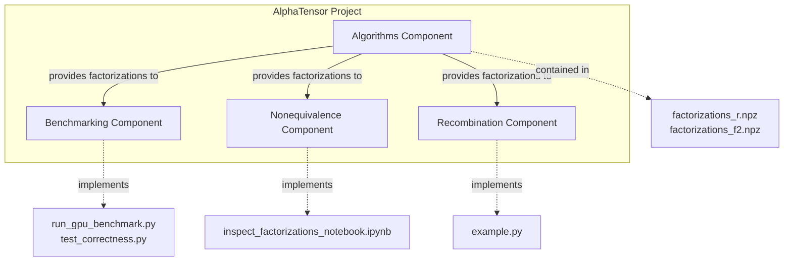
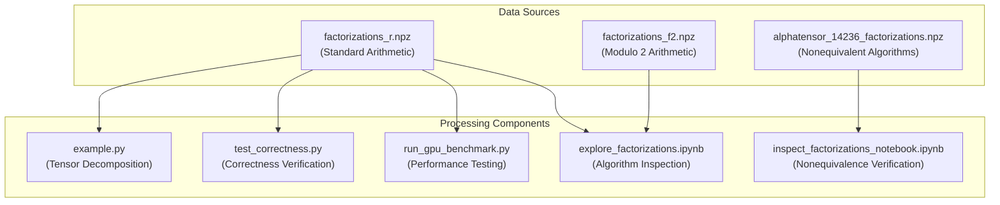
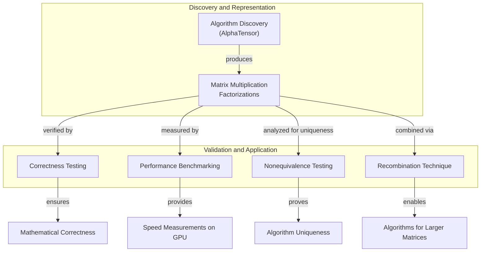

<!-- source: DeepWiki mcp.deepwiki.com · repo google-deepmind/alphatensor · page 1 AlphaTensor Project Overview · fetched 2026-10-26 -->

# AlphaTensor Project Overview

Relevant source files

The following files were used as context for generating this wiki page:

- [README.md](README.md)

## Purpose and Scope

This document provides a comprehensive overview of the AlphaTensor project, which is designed to discover, verify, benchmark, and apply faster matrix multiplication algorithms. The project represents factorizations of matrix multiplication tensors found using reinforcement learning techniques, as described in the Nature paper "Discovering faster matrix multiplication algorithms with reinforcement learning" by Fawzi et al.

This overview covers the high-level architecture, main components, and interactions between different parts of the system. For detailed information about specific components, please refer to their dedicated wiki pages: [Algorithms](#2), [Benchmarking](#3), [Nonequivalence Testing](#4), and [Recombination](#5).

Sources: [README.md:1-23]()

## System Architecture

The AlphaTensor project consists of four independent but complementary components, each addressing different aspects of matrix multiplication algorithm discovery and verification.

### High-Level System Architecture

Sources: [README.md:9-23]()

### Component Interactions and Data Flow

Sources: [README.md:40-61]()

## Main Components

### 1. Algorithms

The Algorithms component contains matrix multiplication algorithms discovered by AlphaTensor, represented as factorizations of matrix multiplication tensors. It includes:

- **factorizations_r.npz**: Contains algorithms in standard arithmetic
- **factorizations_f2.npz**: Contains algorithms in arithmetic modulo 2
- **explore_factorizations.ipynb**: A notebook for exploring and verifying these factorizations

The factorizations represent novel matrix multiplication algorithms that can perform multiplications with fewer operations than traditional methods.

Sources: [README.md:11-13](), [README.md:40-45]()

### 2. Benchmarking

The Benchmarking component measures the practical performance of matrix multiplication algorithms on hardware. It includes:

- **run_gpu_benchmark.py**: Script for measuring execution speed on NVIDIA V100 GPUs
- **test_correctness.py**: Verifies mathematical correctness of the algorithms
- **utils.py**: Provides support utilities for benchmarking
- **factorizations.py**: Contains optimized factorizations for specific hardware

This component allows users to validate the theoretical efficiency gains in real-world performance scenarios.

Sources: [README.md:15-16](), [README.md:47-48]()

### 3. Nonequivalence

The Nonequivalence component verifies that the discovered algorithms are truly distinct from each other. It includes:

- **inspect_factorizations_notebook.ipynb**: Notebook that computes invariants to certify algorithm nonequivalence
- **alphatensor_14236_factorizations.npz**: Dataset containing 14,236 nonequivalent algorithms for 4×4 matrix multiplication

This component demonstrates the richness of the algorithm space discovered by AlphaTensor.

Sources: [README.md:18-20](), [README.md:50-57]()

### 4. Recombination

The Recombination component demonstrates how to decompose larger matrix multiplication tensors by recombining factorizations of smaller ones. It includes:

- **example.py**: Example showing how to use recombination to find lower-rank factorizations

This allows building more efficient algorithms for larger matrix multiplications by leveraging the discovered algorithms for smaller matrices.

Sources: [README.md:22-23](), [README.md:59-61]()

## Functional Architecture

The following diagram illustrates the functional relationships between components and their outputs:

Sources: [README.md:1-61]()

## Installation and Usage

### Installation

Each component has different installation requirements:

- **Algorithms**: No installation required
- **Benchmarking**: Refer to the README in the benchmarking subdirectory
- **Nonequivalence**: No installation required
- **Recombination**: Requires Python 3 with `numpy` and `absl-py` dependencies

Sources: [README.md:26-36]()

### Usage

- **Algorithms**: Use the explore_factorizations.ipynb notebook to load and inspect factorizations
- **Benchmarking**: Follow instructions in the benchmarking subdirectory README
- **Nonequivalence**: Use the inspect_factorizations_notebook.ipynb to verify nonequivalence
- **Recombination**: Run `python3 -m alphatensor.recombination.example` from the parent directory

Sources: [README.md:38-61]()

## Data Format Overview

The AlphaTensor project primarily uses NumPy's compressed format (.npz) to store matrix multiplication factorizations:

| File | Content | Purpose |
|------|---------|---------|
| factorizations_r.npz | Factorizations in standard arithmetic | For general matrix multiplication use cases |
| factorizations_f2.npz | Factorizations in modulo 2 arithmetic | For binary matrix operations (e.g., in cryptography) |
| alphatensor_14236_factorizations.npz | 14,236 nonequivalent factorizations | For analyzing algorithm diversity |

The factorizations represent decompositions of the matrix multiplication tensor into a sum of rank-1 tensors, which translate to more efficient multiplication algorithms.

Sources: [README.md:40-57]()

## Summary

The AlphaTensor project provides a complete ecosystem for working with novel matrix multiplication algorithms discovered through reinforcement learning:

1. **Discovery and Representation**: Algorithms component with factorization data
2. **Validation**: Correctness testing and nonequivalence verification
3. **Performance Evaluation**: Benchmarking on actual hardware
4. **Application**: Recombination for larger matrices

Together, these components enable researchers and practitioners to understand, validate, and utilize faster matrix multiplication algorithms in their applications.

For detailed information about specific components, please refer to their dedicated wiki pages: [Algorithms](#2), [Benchmarking](#3), [Nonequivalence Testing](#4), and [Recombination](#5).

Sources: [README.md:1-61]()

---

