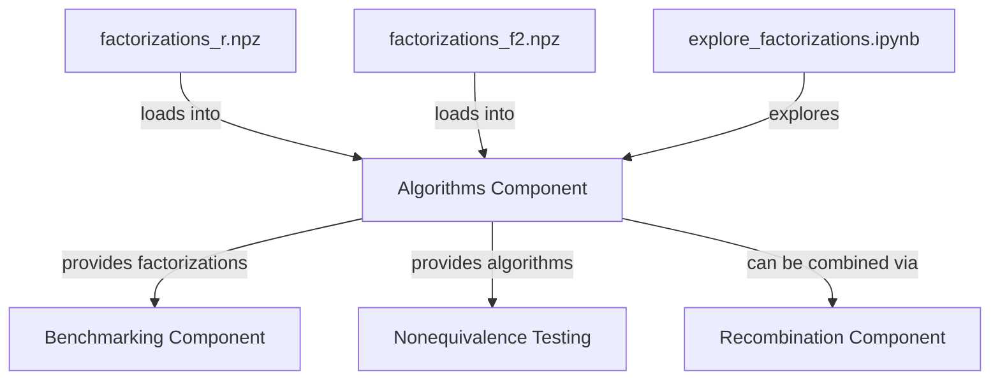
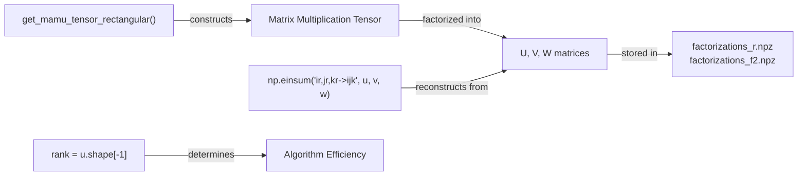
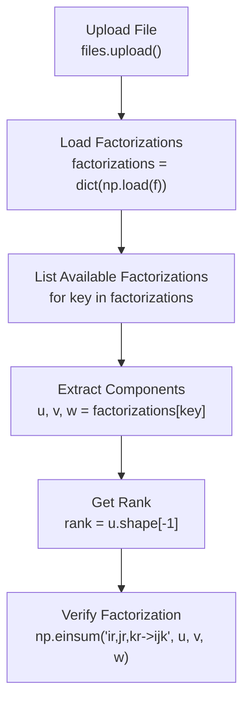
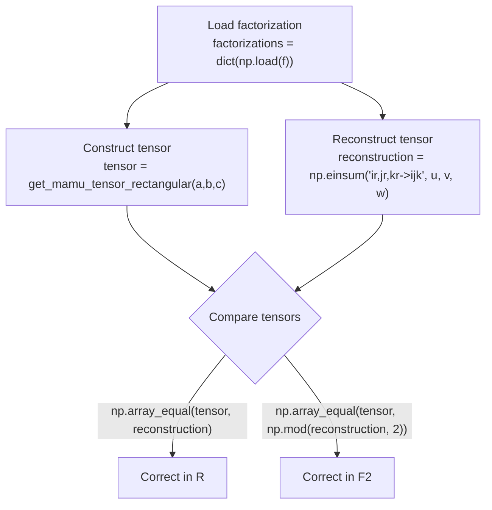

<!-- source: DeepWiki mcp.deepwiki.com · repo google-deepmind/alphatensor · page 2 Algorithms · fetched 2026-10-26 -->

# Algorithms

<details>
<summary>Relevant source files</summary>

The following files were used as context for generating this wiki page:

- [README.md](README.md)
- [algorithms/explore_factorizations.ipynb](algorithms/explore_factorizations.ipynb)

</details>


## Purpose and Scope

The Algorithms component of the AlphaTensor project contains matrix multiplication algorithms discovered by AlphaTensor, represented as factorizations of matrix multiplication tensors. This document explains the structure of these factorizations, how they're stored, and how to explore them using the provided tools. For information about benchmarking these algorithms, see [Benchmarking](#3). For testing the nonequivalence of algorithms, see [Nonequivalence Testing](#4).

Sources: [README.md:10-13]()

## AlphaTensor System Architecture

### Position of Algorithms Component



Sources: [README.md:9-23]()

## Matrix Multiplication Tensor Factorizations

Matrix multiplication factorizations represent the decomposition of the matrix multiplication operation into a sum of simpler operations. In AlphaTensor, these factorizations are represented as three sets of matrices (U, V, W) that, when combined using tensor product and summation, reconstruct the original matrix multiplication tensor.

The factorizations have the form:
T = ∑ᵣ Uᵣ ⊗ Vᵣ ⊗ Wᵣ

Where:
- T is the matrix multiplication tensor
- r ranges from 1 to the rank of the factorization
- ⊗ denotes the tensor product

### Structure of Matrix Factorizations



Sources: [algorithms/explore_factorizations.ipynb:87-106]()

### Symmetrized Matrix Multiplication Tensor

The factorizations in AlphaTensor decompose the *symmetrized* version of the matrix multiplication tensor, representing the bilinear operation A, B ↦ (A · B)ᵀ. This is standard in the literature, and factorizations can be easily converted between the symmetrized and non-symmetrized versions.

The symmetrized matrix multiplication tensor for dimensions a, b, c is defined in the code as:

```
T[i*b + j][j*c + k][k*a + i] = 1 for all valid i, j, k
```

Where i ranges from 0 to a-1, j from 0 to b-1, and k from 0 to c-1. All other elements are 0.

Sources: [algorithms/explore_factorizations.ipynb:74-77](), [algorithms/explore_factorizations.ipynb:87-94]()

## AlphaTensor Algorithm Formats

AlphaTensor provides discovered algorithms in two formats:

1. **Standard Arithmetic (R)**: Factorizations that work with real numbers, stored in `factorizations_r.npz`.
2. **Modular Arithmetic (F2)**: Factorizations that work with arithmetic modulo 2 (in the finite field F2), stored in `factorizations_f2.npz`.

The format of each factorization consists of three matrices U, V, and W. The rank of the factorization (which corresponds to the computational complexity of the algorithm) is equal to the number of columns in these matrices.

Each factorization is identified by a key representing the dimensions of the matrices being multiplied. For example, "3,4,5" represents a factorization for multiplying a 3×4 matrix by a 4×5 matrix.

| Format | File | Description |
|--------|------|-------------|
| Standard Arithmetic | factorizations_r.npz | Real-valued factorizations |
| Modular Arithmetic | factorizations_f2.npz | Binary field (F2) factorizations |

Sources: [README.md:43-45](), [algorithms/explore_factorizations.ipynb:36-37](), [algorithms/explore_factorizations.ipynb:60-66]()

## Exploring Factorizations

The notebook `explore_factorizations.ipynb` allows users to load and explore the factorizations through three main operations:

### Loading and Exploring Process



### Verification Process



The verification process uses NumPy's Einstein summation function (`np.einsum`) to reconstruct the matrix multiplication tensor from the U, V, W components, and then compares it with the expected tensor.

Sources: [algorithms/explore_factorizations.ipynb:30-106](), [README.md:40-45]()

## Available Factorizations

AlphaTensor has discovered factorizations for various matrix dimensions. When loading a factorization file, you can list all available factorizations and their ranks using:

```python
for key in factorizations:
  u, v, w = factorizations[key]
  rank = u.shape[-1]
  print(f'{key}: rank={rank}')
```

The rank of a factorization directly relates to its computational efficiency - lower ranks correspond to faster algorithms.

Example factorizations include:
- Square matrix multiplication algorithms (e.g., 2×2, 3×3, 4×4)
- Rectangular matrix multiplication algorithms (e.g., 3×4×5 for multiplying a 3×4 matrix by a 4×5 matrix)

Sources: [algorithms/explore_factorizations.ipynb:60-66]()

---

