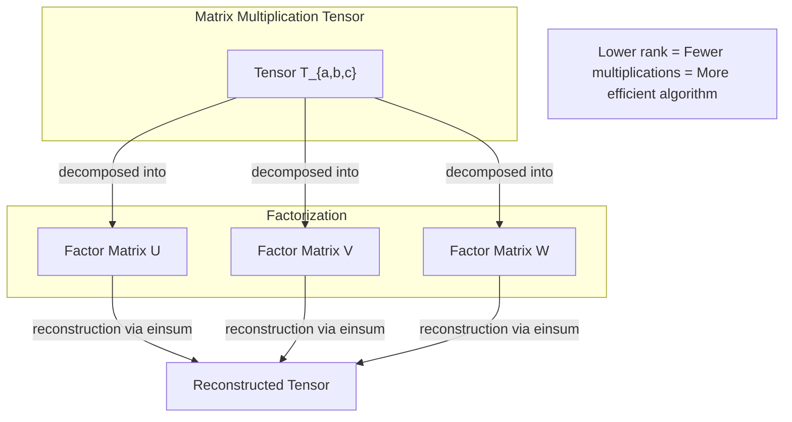
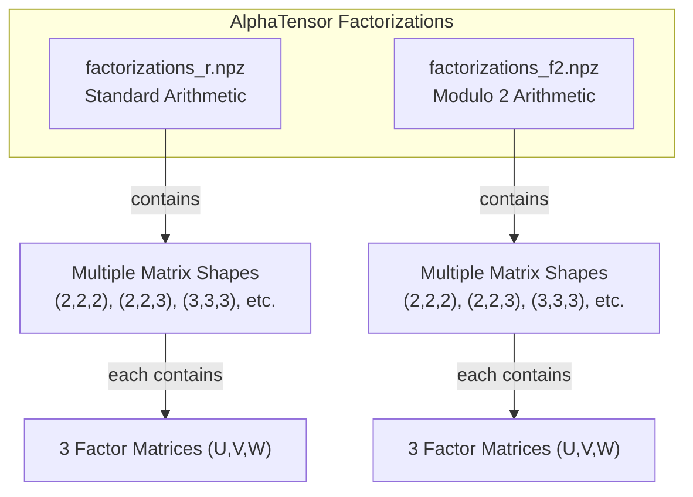
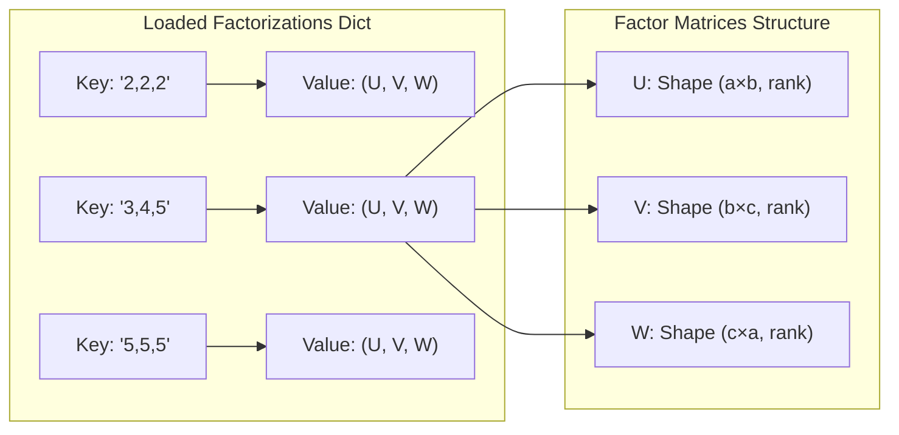
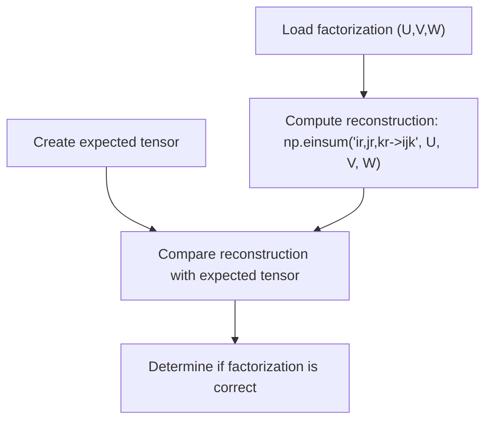

<!-- source: DeepWiki mcp.deepwiki.com · repo google-deepmind/alphatensor · page 2.1 Factorizations and Data Format · fetched 2026-10-26 -->

# Factorizations and Data Format

<details>
<summary>Relevant source files</summary>

The following files were used as context for generating this wiki page:

- [algorithms/explore_factorizations.ipynb](algorithms/explore_factorizations.ipynb)
- [algorithms/factorizations_f2.npz](algorithms/factorizations_f2.npz)
- [algorithms/factorizations_r.npz](algorithms/factorizations_r.npz)

</details>


This document explains how matrix multiplication factorizations discovered by AlphaTensor are stored and represented in the project's data files. For information about how to explore these factorizations, see [Exploring Factorizations](#2.2).

## Matrix Multiplication Factorizations

Matrix multiplication factorizations in AlphaTensor represent algorithms for computing matrix products more efficiently than traditional methods. The project stores these factorizations in NPZ files, which contain optimized algorithms for various matrix shapes.

### What are Matrix Factorizations?

In the context of AlphaTensor, a factorization decomposes the matrix multiplication tensor into three factor matrices, enabling faster computation. The rank of the factorization corresponds to the number of scalar multiplications required, with lower ranks indicating more efficient algorithms.



Sources: [algorithms/explore_factorizations.ipynb:87-104]()

## Data Storage Format

AlphaTensor provides factorizations in two main files:

1. `factorizations_r.npz` - Algorithms in standard arithmetic
2. `factorizations_f2.npz` - Algorithms in arithmetic modulo 2 (binary field)

These NPZ files are structured as NumPy archives containing multiple arrays, each representing a factorization for a specific matrix shape.



Sources: [algorithms/explore_factorizations.ipynb:30-37](), [algorithms/factorizations_f2.npz]()

## Internal Representation

Each factorization in the NPZ files is stored as a triple of matrices (U, V, W) representing the decomposition of the matrix multiplication tensor.

### Data Structure

When loaded, the factorizations are structured as a Python dictionary:
- Keys: Matrix shape strings (e.g., "3,4,5" for multiplication of a 3×4 matrix with a 4×5 matrix)
- Values: Tuples of three NumPy arrays (U, V, W) representing the factorization



Sources: [algorithms/explore_factorizations.ipynb:46-51](), [algorithms/explore_factorizations.ipynb:61-66]()

### Symmetrized Tensor Representation

Important: The factorizations represent the *symmetrized* version of the matrix multiplication tensor, corresponding to the bilinear operation A, B ↦ (A·B)ᵀ. This is standard in the literature, and factorizations can be converted between symmetrized and non-symmetrized versions.

For matrix multiplication of size a×b with b×c to produce a c×a matrix, the tensor has dimensions (a×b, b×c, c×a).

Sources: [algorithms/explore_factorizations.ipynb:71-77]()

## Loading and Verifying Factorizations

### Loading Factorizations

Factorizations can be loaded using NumPy's `load` function:

```
with open(filename, 'rb') as f:
  factorizations = dict(np.load(f, allow_pickle=True))
```

### Verifying Correctness

To verify a factorization's correctness, reconstruct the tensor using `np.einsum` and compare it with the expected matrix multiplication tensor:



For standard arithmetic (R), the reconstruction should exactly match the expected tensor.
For modular arithmetic (F2), the reconstruction modulo 2 should match the expected tensor.

Sources: [algorithms/explore_factorizations.ipynb:87-106]()

## Available Factorizations

The provided NPZ files contain factorizations for various matrix shapes, including:

| Matrix Shape | Description |
|--------------|-------------|
| 2,2,2        | 2×2 by 2×2 matrix multiplication |
| 2,2,3        | 2×2 by 2×3 matrix multiplication |
| 2,3,3        | 2×3 by 3×3 matrix multiplication |
| 3,3,3        | 3×3 by 3×3 matrix multiplication |
| 3,4,5        | 3×4 by 4×5 matrix multiplication |
| 4,4,4        | 4×4 by 4×4 matrix multiplication |
| 5,5,5        | 5×5 by 5×5 matrix multiplication |

Each factorization's rank can be inspected using the shape of the factor matrices:

```
for key in factorizations:
  u, v, w = factorizations[key]
  rank = u.shape[-1]
  print(f'{key}: rank={rank}')
```

Sources: [algorithms/explore_factorizations.ipynb:61-66](), [algorithms/factorizations_f2.npz]()

## Relationship to Other Components

These factorizations serve as the foundation for the AlphaTensor system, feeding into:

1. **Benchmarking** - The factorizations are used to benchmark performance against standard algorithms ([Benchmarking](#3))
2. **Nonequivalence Testing** - The factorizations are analyzed to verify they represent truly distinct algorithms ([Nonequivalence Testing](#4))
3. **Recombination** - Smaller factorizations can be recombined to create algorithms for larger matrices ([Recombination](#5))

The factorization format is consistent across the project, enabling seamless integration between different components of the AlphaTensor system.

---

