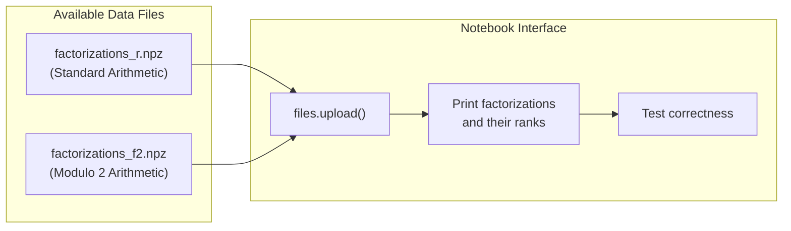
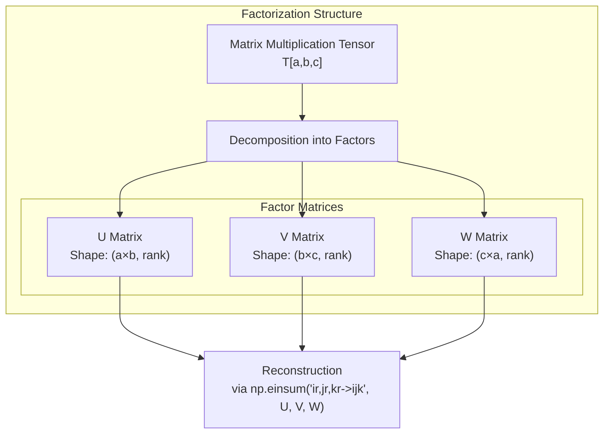
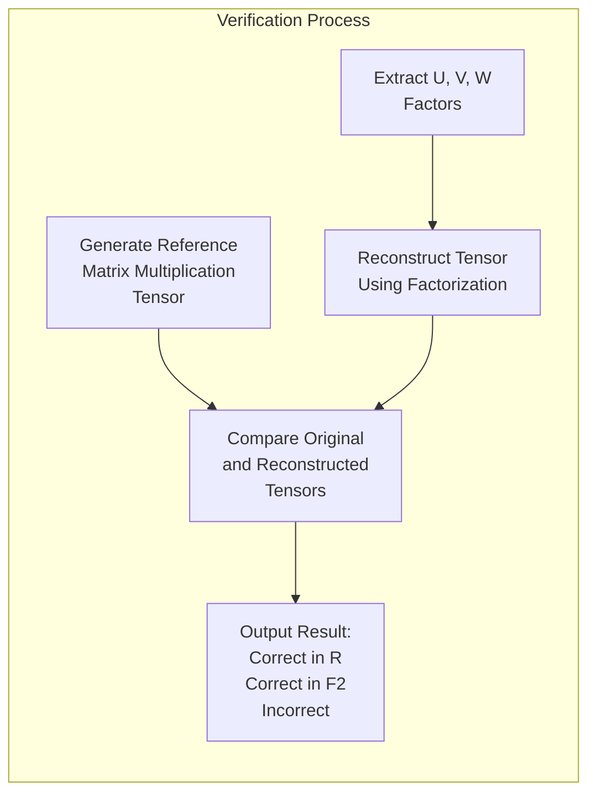
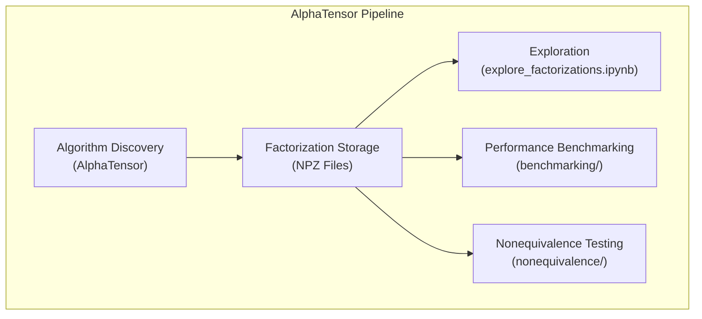

<!-- source: DeepWiki mcp.deepwiki.com · repo google-deepmind/alphatensor · page 2.2 Exploring Factorizations · fetched 2026-10-26 -->

# Exploring Factorizations

<details>
<summary>Relevant source files</summary>

The following files were used as context for generating this wiki page:

- [algorithms/explore_factorizations.ipynb](algorithms/explore_factorizations.ipynb)

</details>


## Purpose

This document provides a guide to using the `explore_factorizations.ipynb` notebook for examining, verifying, and understanding the matrix multiplication factorizations discovered by AlphaTensor. The notebook allows users to load factorization data files, inspect their properties, and verify their mathematical correctness. For information about benchmarking the performance of these factorizations, see [Benchmarking](#3).

Sources: [algorithms/explore_factorizations.ipynb:4-16]()

## Factorization Data Files

AlphaTensor provides two primary factorization data files:

1. `factorizations_r.npz` - Contains factorizations in standard arithmetic (ℝ)
2. `factorizations_f2.npz` - Contains factorizations in modulo 2 arithmetic (F₂)

These files store matrix multiplication factorizations discovered by the AlphaTensor system. Each factorization represents a decomposition of the matrix multiplication tensor for specific matrix shapes.



**Diagram: Factorization Data Loading Workflow**

Sources: [algorithms/explore_factorizations.ipynb:31-37](), [algorithms/explore_factorizations.ipynb:39-51]()

## Understanding Factorization Format

The factorization files contain decompositions of the symmetrized matrix multiplication tensor. Each factorization is represented as a tuple of three matrices (U, V, W), which together reconstruct the original tensor.



**Diagram: Matrix Factorization Structure**

Each factorization key in the data file represents the dimensions of the matrices being multiplied (e.g., `'3,4,5'` represents multiplication of a 3×4 matrix with a 4×5 matrix). The rank of the factorization indicates the efficiency of the algorithm, with lower ranks corresponding to faster multiplication algorithms.

Sources: [algorithms/explore_factorizations.ipynb:54-67](), [algorithms/explore_factorizations.ipynb:69-77]()

## Loading and Exploring Factorizations

The notebook provides a simple interface to work with these factorizations:

### Step 1: Upload Factorization File

First, upload either the `factorizations_r.npz` or `factorizations_f2.npz` file using the following code in the notebook:

```
uploaded = files.upload()
filename = list(uploaded.keys())[0]
with open(filename, 'rb') as f:
  factorizations = dict(np.load(f, allow_pickle=True))
```

This loads the factorization data into a Python dictionary.

Sources: [algorithms/explore_factorizations.ipynb:39-51]()

### Step 2: Inspect Available Factorizations

Once loaded, you can examine the available factorizations and their ranks:

```
for key in factorizations:
  u, v, w = factorizations[key]
  rank = u.shape[-1]
  assert rank == v.shape[-1] and rank == w.shape[-1]
  print(f'{key}: rank={u.shape[-1]}')
```

This code iterates through each factorization, extracts the U, V, and W matrices, and prints the dimensions and rank of each factorization.

Sources: [algorithms/explore_factorizations.ipynb:54-67]()

## Verifying Factorization Correctness

The notebook includes functionality to verify that a factorization correctly reconstructs the matrix multiplication tensor:



**Diagram: Factorization Verification Workflow**

The verification process works as follows:

1. The `get_mamu_tensor_rectangular(a, b, c)` function generates the reference matrix multiplication tensor for multiplying an a×b matrix with a b×c matrix.
2. The factorization (U, V, W) is extracted from the loaded data.
3. The tensor is reconstructed using `np.einsum('ir,jr,kr->ijk', u, v, w)`.
4. The original and reconstructed tensors are compared:
   - If they match directly, the factorization is correct in standard arithmetic (ℝ).
   - If they match after applying modulo 2, the factorization is correct in modulo 2 arithmetic (F₂).
   - Otherwise, the factorization is incorrect.

Sources: [algorithms/explore_factorizations.ipynb:80-107]()

## Important Technical Notes

It's important to understand that the provided factorizations decompose the *symmetrized* version of the matrix multiplication tensor, representing the bilinear operation A, B ↦ (A·B)ᵀ. This is standard in the literature, and factorizations can be easily converted between symmetrized and non-symmetrized versions.

### Factorization Keys and Tensor Shapes

The factorization dictionary uses keys formatted as `'a,b,c'` where:
- `a` is the number of rows in the first matrix
- `b` is the number of columns in the first matrix / rows in the second matrix
- `c` is the number of columns in the second matrix

For example, the key `'3,4,5'` represents factorization for multiplying a 3×4 matrix with a 4×5 matrix.

| Key Format | Example | Matrix Multiplication |
|------------|---------|------------------------|
| `'a,b,c'`  | `'3,4,5'` | (3×4) · (4×5) → (3×5) |

Sources: [algorithms/explore_factorizations.ipynb:61-67](), [algorithms/explore_factorizations.ipynb:98-100]()

## Relationship to AlphaTensor System

The exploration notebook serves as an interface to examine the results of AlphaTensor's algorithm discovery process. While the benchmark system measures the performance of these algorithms, and the nonequivalence testing verifies their uniqueness, this notebook allows users to directly inspect the mathematical properties of the discovered factorizations.



**Diagram: Position of Exploration in AlphaTensor Workflow**

Sources: [algorithms/explore_factorizations.ipynb:1-16]()

## Summary

The `explore_factorizations.ipynb` notebook provides a straightforward interface to:

1. Load matrix multiplication factorizations discovered by AlphaTensor
2. Inspect the properties of these factorizations (dimensions and rank)
3. Verify the mathematical correctness of the factorizations
4. Understand the structure of the matrix multiplication decompositions

This exploration tool serves as an entry point for examining the algorithmic discoveries of AlphaTensor before proceeding to performance benchmarking or further analysis.

---

