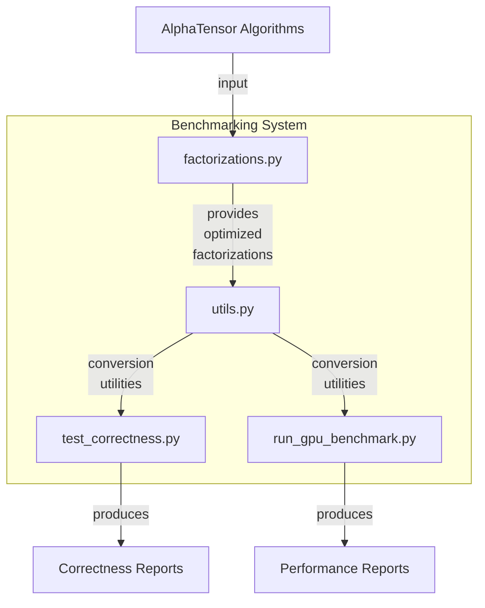
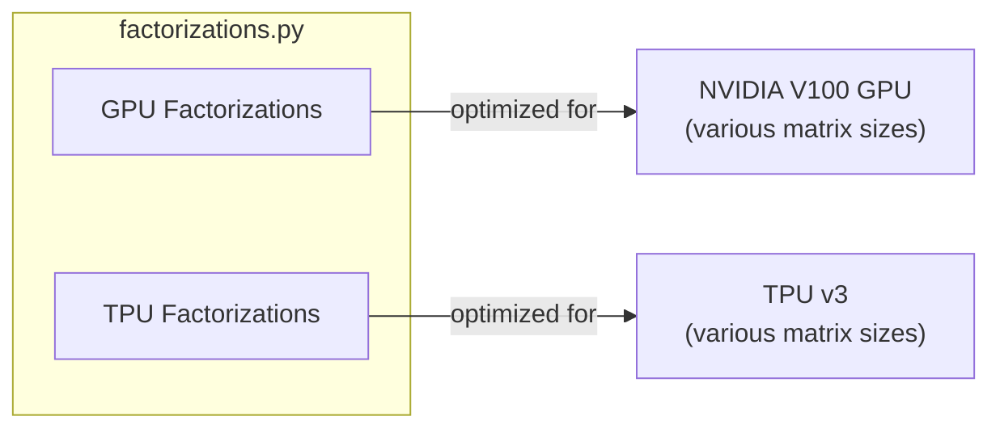
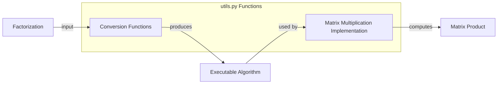
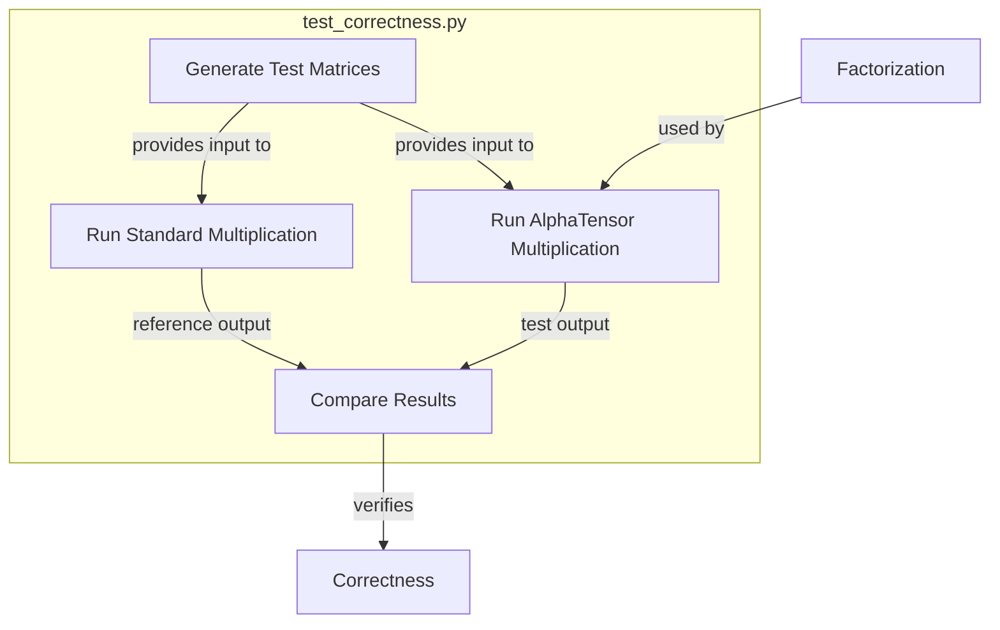
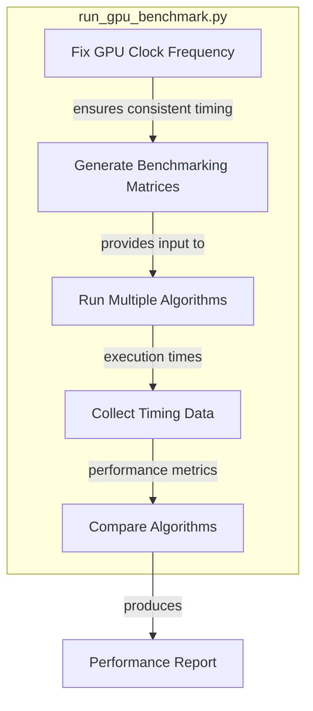
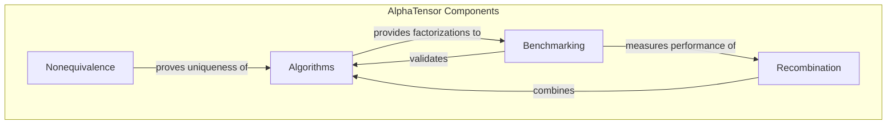

<!-- source: DeepWiki mcp.deepwiki.com · repo google-deepmind/alphatensor · page 3 Benchmarking · fetched 2026-10-26 -->

# Benchmarking

<details>
<summary>Relevant source files</summary>

The following files were used as context for generating this wiki page:

- [README.md](README.md)
- [benchmarking/README.md](benchmarking/README.md)

</details>


## Purpose and Scope

The Benchmarking component of the AlphaTensor project provides tools and infrastructure to evaluate the performance and correctness of matrix multiplication algorithms discovered by AlphaTensor. This page covers the implementation details, usage instructions, and workflow of the benchmarking system. For information about the actual algorithms being benchmarked, see [Algorithms](#2).

The benchmarking system serves three primary functions:
1. Providing optimized factorizations for specific hardware platforms
2. Converting factorizations into executable matrix multiplication algorithms
3. Verifying algorithm correctness and measuring performance

Sources: [benchmarking/README.md:1-22]()

## System Architecture

The benchmarking component consists of four primary files that work together to provide a complete testing and evaluation framework.



Sources: [benchmarking/README.md:5-22]()

## Core Components

### Factorization Repository

The `factorizations.py` file contains the matrix multiplication factorizations discovered by AlphaTensor when optimizing for the running time of specific multiplication scenarios. These factorizations are optimized for particular hardware platforms (GPU or TPU) and matrix sizes.



Sources: [benchmarking/README.md:5-8]()

### Conversion Utilities

The `utils.py` file provides essential functions for converting abstract tensor factorizations into executable matrix multiplication algorithms that can be run on actual hardware. This translation layer is critical for both testing correctness and measuring real-world performance.



Sources: [benchmarking/README.md:10-12]()

### Correctness Testing

The `test_correctness.py` file contains unit tests that verify two critical properties of the factorizations:
1. They correctly decompose the matrix multiplication tensor
2. The resulting algorithms produce the same results as standard matrix multiplication implementations, within the bounds of numerical precision



Sources: [benchmarking/README.md:13-16]()

### Performance Benchmarking

The `run_gpu_benchmark.py` file measures the actual performance of AlphaTensor's GPU-tailored algorithms against established methods, specifically Strassen's algorithm and the standard matrix multiplication implementation in JAX (`jax.numpy.dot`).



Sources: [benchmarking/README.md:18-22]()

## Implementation Details

### Factorization Structure

The factorizations in `factorizations.py` are structured as coefficient tensors that represent matrix multiplication algorithms. These factorizations are optimized for specific hardware platforms and matrix sizes, with some examples including:

- Factorizations for 5x5x5 matrix multiplication
- Specialized algorithms for 8192x8192 matrices on NVIDIA V100 GPUs
- Algorithms optimized for TPU v3 hardware

Each factorization provides a decomposition that can be translated into an efficient implementation for the target platform.

Sources: [benchmarking/README.md:5-8]()

### Algorithm Conversion

The utilities in `utils.py` provide the following key functions:

1. Converting abstract factorization representations to executable code
2. Implementing matrix multiplication operations based on the factorization
3. Supporting both standard arithmetic and modulo-2 arithmetic
4. Interfacing with JAX for GPU/TPU acceleration

This conversion process is crucial as it bridges the gap between the mathematical representation of algorithms and their practical implementation.

Sources: [benchmarking/README.md:10-12]()

### Testing Methodology

The correctness tests in `test_correctness.py` follow a systematic approach:

1. Generate test matrices of various sizes and patterns
2. Compute the matrix product using standard implementations
3. Compute the matrix product using AlphaTensor's factorizations
4. Compare results within acceptable numerical precision
5. Verify across multiple test cases and matrix sizes

| Test Type | Purpose | Verification Method |
|-----------|---------|---------------------|
| Basic Correctness | Verify factorization accuracy | Compare with reference implementation |
| Numerical Stability | Check precision limits | Measure error magnitude |
| Edge Cases | Test with special matrices | Verify correct handling |

Sources: [benchmarking/README.md:13-16]()

### Benchmarking Methodology

The benchmarking process in `run_gpu_benchmark.py` includes:

1. Setting a fixed GPU clock frequency to ensure consistent timing
2. Running matrix multiplications with various sizes (small to large)
3. Measuring execution time with multiple repetitions to reduce variance
4. Calculating effective FLOPS (floating-point operations per second)
5. Comparing performance between AlphaTensor, Strassen's algorithm, and standard matrix multiplication

The benchmark specifically targets NVIDIA V100 GPUs, as mentioned in the documentation, and requires sudo access to fix the GPU clock frequency.

Sources: [benchmarking/README.md:18-22]()

## Usage Instructions

### Installation Requirements

To use the benchmarking system, you need:

1. An NVIDIA V100 GPU (for replicating the paper's results)
2. Python 3
3. JAX and other dependencies

Installation steps:

```bash
# Clone the repository
git clone https://github.com/deepmind/alphatensor.git

# Optional: Set up a virtual environment
python3 -m venv benchmarking_env
source benchmarking_env/bin/activate

# Install dependencies
pip3 install -r alphatensor/benchmarking/requirements.txt -f https://storage.googleapis.com/jax-releases/jax_cuda_releases.html
```

Sources: [benchmarking/README.md:24-48]()

### Running Tests and Benchmarks

To run the correctness tests:

```bash
python3 -m alphatensor.benchmarking.test_correctness
```

To run the performance benchmarks:

```bash
python3 -m alphatensor.benchmarking.run_gpu_benchmark
```

**Important**: These commands must be executed from the parent directory that contains the `alphatensor` repository as a subdirectory.

Sources: [benchmarking/README.md:50-64]()

## Integration with Other Components

The benchmarking system integrates with other components of the AlphaTensor project as follows:



The benchmarking component primarily consumes the factorizations from the algorithms component, validates their correctness, and measures their performance. This performance data can then be used to evaluate the practical utility of algorithms discovered through both direct search (algorithms component) and composition methods (recombination component).

Sources: [README.md:9-23](), [benchmarking/README.md:1-22]()

---

