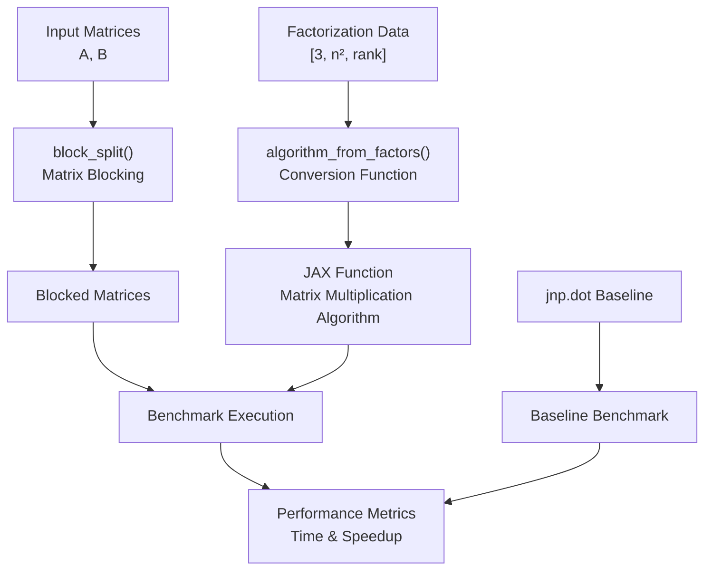
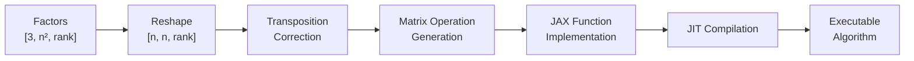
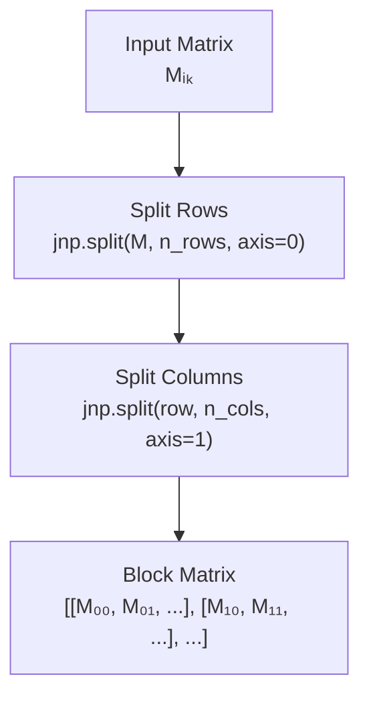
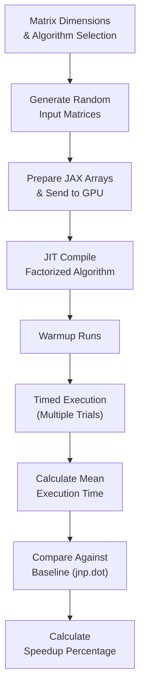
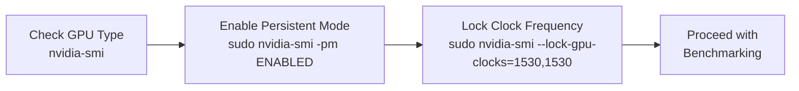
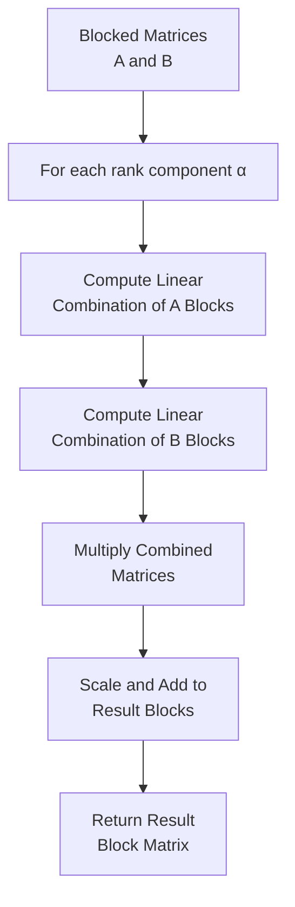

<!-- source: DeepWiki mcp.deepwiki.com · repo google-deepmind/alphatensor · page 3.1 Benchmark Implementation · fetched 2026-10-26 -->

# Benchmark Implementation

<details>
<summary>Relevant source files</summary>

The following files were used as context for generating this wiki page:

- [benchmarking/README.md](benchmarking/README.md)
- [benchmarking/run_gpu_benchmark.py](benchmarking/run_gpu_benchmark.py)
- [benchmarking/utils.py](benchmarking/utils.py)

</details>


This page details the technical implementation of the benchmarking system in AlphaTensor, which evaluates and compares the performance of discovered matrix multiplication algorithms. For information about running these benchmarks, see [Running Benchmarks](#3.4). For details about pre-computed factorizations used in benchmarking, see [Pre-computed Factorizations](#3.2).

## Benchmarking Architecture

The AlphaTensor benchmarking system implements a complete pipeline for converting mathematical factorizations of tensors into executable matrix multiplication algorithms and measuring their performance against standard implementations.



Sources: [benchmarking/utils.py:30-33](), [benchmarking/utils.py:57-116](), [benchmarking/utils.py:222-233]()

## Core Components

The benchmarking system consists of these primary components:

1. **Factorization Representation**: Tensor factorizations stored as NumPy arrays
2. **Algorithm Conversion**: Transformation of factorizations into executable code
3. **Matrix Splitting**: Techniques to partition matrices into blocks
4. **Benchmarking Functions**: Methods to measure and compare algorithm performance
5. **GPU Optimization**: Utilities to ensure consistent benchmarking conditions

```mermaid
classDiagram
    class "Factorization" {
        +numpy.ndarray factors[3, n², rank]
        +represents tensor decomposition
    }
    
    class "algorithm_from_factors()" {
        +converts factorization to algorithm
        +returns jax function
    }
    
    class "benchmark_factorized_algorithm()" {
        +measures performance
        +handles matrix preparation
        +handles jit compilation
    }
    
    class "benchmark_jnp_dot()" {
        +benchmarks baseline
        +ensures fair comparison
    }
    
    class "run_gpu_benchmark" {
        +sets GPU clock frequency
        +runs comparative benchmarks
        +calculates speedup percentages
    }
    
    "Factorization" --> "algorithm_from_factors()"
    "algorithm_from_factors()" --> "benchmark_factorized_algorithm()"
    "benchmark_factorized_algorithm()" --> "run_gpu_benchmark"
    "benchmark_jnp_dot()" --> "run_gpu_benchmark"
```

Sources: [benchmarking/utils.py:57-116](), [benchmarking/utils.py:195-233](), [benchmarking/run_gpu_benchmark.py:50-89]()

## Factorization to Algorithm Conversion

The central function `algorithm_from_factors()` converts mathematical tensor factorizations into executable JAX code. This is the critical step that enables benchmarking of AlphaTensor's discoveries.

### Input Format

Factorizations are represented as NumPy arrays with shape `[3, n², rank]`, where:
- `n²` represents the flattened dimensions of an n×n matrix
- `rank` is the number of terms in the factorization
- The 3 components correspond to the three matrices in the factorization

### Conversion Process

The conversion process transforms these mathematical factors into a function that implements a fast matrix multiplication algorithm:



Sources: [benchmarking/utils.py:57-116](), [benchmarking/utils.py:119-137]()

## Matrix Blocking System

The benchmarking system uses block matrix operations to implement factorized algorithms. This allows the system to handle large matrices efficiently.

### Block Split Implementation

The `block_split()` function divides a matrix into an n×n grid of blocks:



Sources: [benchmarking/utils.py:30-33]()

## Benchmarking Process Implementation

The benchmarking process involves these steps:

1. **Setup**: Fix GPU clock frequency to ensure consistent measurements
2. **Matrix Generation**: Create random matrices of specified sizes
3. **Algorithm Preparation**: Convert factorizations to JAX functions
4. **Execution**: Run both standard and factorized algorithms multiple times
5. **Timing**: Measure execution time using `timeit.default_timer()`
6. **Analysis**: Calculate speedup percentages

### Benchmarking Flow



Sources: [benchmarking/utils.py:195-233](), [benchmarking/run_gpu_benchmark.py:66-89]()

## Benchmark Methods

The system provides two primary benchmarking functions:

1. `benchmark_jnp_dot()` - Measures the performance of JAX's standard matrix multiplication
2. `benchmark_factorized_algorithm()` - Measures the performance of factorized algorithms

Both functions use the same core timing methodology to ensure fair comparison:

| Function | Purpose | Key Parameters |
|----------|---------|----------------|
| `benchmark_jnp_dot()` | Baseline performance | `matrix_dims`, `num_trials`, `dtype` |
| `benchmark_factorized_algorithm()` | Algorithm performance | `factors`, `matrix_dims`, `num_trials`, `dtype` |
| `_benchmark_op()` | Core timing logic | `op`, `num_trials` |

Sources: [benchmarking/utils.py:195-233]()

## GPU Configuration for Consistent Benchmarking

To ensure consistent and reliable benchmark results, the system implements GPU clock frequency locking:



Sources: [benchmarking/run_gpu_benchmark.py:50-64]()

## Algorithm Execution Flow

The factorized algorithm execution follows this pattern:



Sources: [benchmarking/utils.py:80-116]()

## Technical Implementation Details

The implementation relies heavily on JAX for GPU acceleration and just-in-time compilation:

1. **JAX JIT Compilation**: Algorithms are compiled using `jax.jit()` for optimal performance
2. **Device Transfer**: Arrays are transferred to GPU using `jax.device_put()`
3. **Block-Until-Ready**: Ensures computation is complete before timing stops with `.block_until_ready()`
4. **Garbage Collection**: Temporarily disabled during timing to prevent interference
5. **Multiple Trials**: Each benchmark runs multiple trials to obtain reliable statistics

Sources: [benchmarking/utils.py:149-152](), [benchmarking/utils.py:195-209]()

## Benchmark Configuration

The system benchmarks multiple algorithms against different matrix sizes:

| Algorithm | Description | Source |
|-----------|-------------|--------|
| `jnp.dot` | Standard JAX matrix multiplication | JAX library |
| Strassen² | Two levels of Strassen's algorithm | `factorizations.get_4x4x4_strassen_squared()` |
| AlphaTensor GPU-optimized | AlphaTensor algorithm for GPU | `factorizations.get_4x4x4_alphatensor_gpu()` |
| AlphaTensor TPU-optimized | AlphaTensor algorithm for TPU | `factorizations.get_4x4x4_alphatensor_tpu()` |

Matrix sizes tested range from 8192×8192 to 20480×20480, with each benchmark running 10 trials.

Sources: [benchmarking/run_gpu_benchmark.py:66-89]()

---

