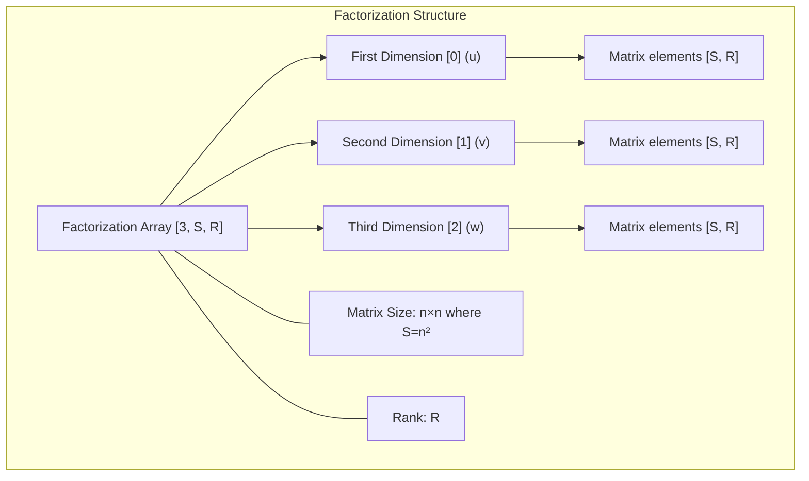
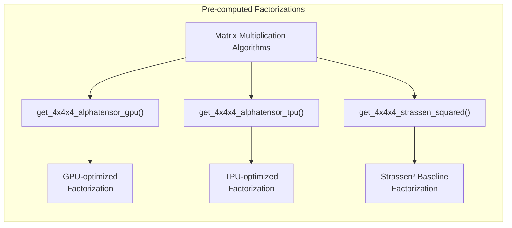
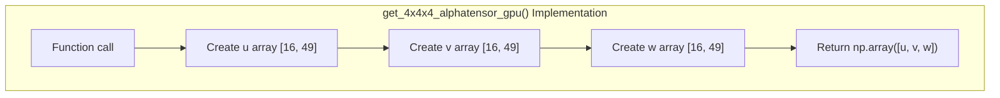
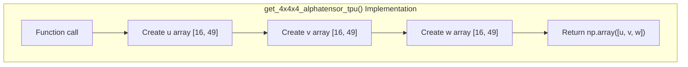
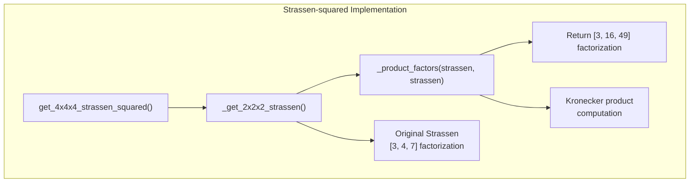
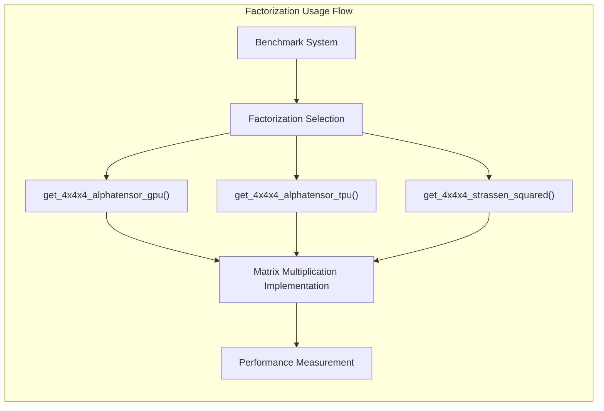

<!-- source: DeepWiki mcp.deepwiki.com · repo google-deepmind/alphatensor · page 3.2 Pre-computed Factorizations · fetched 2026-10-26 -->

# Pre-computed Factorizations

Relevant source files

The following files were used as context for generating this wiki page:

- [benchmarking/factorizations.py](benchmarking/factorizations.py)

## Purpose and Overview

This document describes the pre-computed matrix multiplication factorizations in the AlphaTensor project that have been optimized for specific hardware platforms. These factorizations represent efficient algorithms for matrix multiplication discovered by AlphaTensor and serve as the core building blocks for the benchmarking system. For information about the benchmarking implementation that uses these factorizations, see [Benchmark Implementation](#3.1).

## Factorization Structure

The pre-computed factorizations in the AlphaTensor project are represented as 3-dimensional arrays with shape `[3, S, R]`, where:
- The first dimension (size 3) represents the factors for the three dimensions of the matrix multiplication tensor
- `S` is the square of the matrix size (16 for 4×4 matrices)
- `R` is the rank of the factorization (49 for the pre-computed factorizations)

Sources: [benchmarking/factorizations.py:21-180](), [benchmarking/factorizations.py:183-341]()

## Hardware-optimized Factorizations

AlphaTensor has discovered multiple factorizations that are optimized for specific hardware platforms. Each factorization represents a different algorithm for performing matrix multiplication that has been tuned for performance on a particular type of hardware.

Sources: [benchmarking/factorizations.py:16-17](), [benchmarking/factorizations.py:21-180](), [benchmarking/factorizations.py:183-341](), [benchmarking/factorizations.py:389-401]()

### GPU-optimized Factorization

The `get_4x4x4_alphatensor_gpu()` function returns a factorization that has been optimized for NVIDIA V100 GPUs. This factorization was discovered by AlphaTensor while specifically targeting the runtime of multiplying two 8192×8192 matrices in `float32` precision on V100 GPUs.

Key properties:
- Matrix size: 4×4
- Rank: 49
- Optimized for: NVIDIA V100 GPU
- Data type: `float32`
- Matrix test size: 8192×8192

Sources: [benchmarking/factorizations.py:21-180]()

### TPU-optimized Factorization

The `get_4x4x4_alphatensor_tpu()` function returns a factorization that has been optimized for Google TPUv2 hardware. This factorization was discovered by AlphaTensor while targeting the runtime of multiplying two 8192×8192 matrices in `bfloat16` precision on TPUv2.

Key properties:
- Matrix size: 4×4
- Rank: 49
- Optimized for: Google TPUv2
- Data type: `bfloat16`
- Matrix test size: 8192×8192

Sources: [benchmarking/factorizations.py:183-341]()

## Strassen-squared Baseline

The `get_4x4x4_strassen_squared()` function provides a baseline factorization for 4×4 matrix multiplication based on Strassen's algorithm applied recursively twice. This is often used for comparison with the AlphaTensor-discovered factorizations.

The implementation uses two helper functions:
- `_get_2x2x2_strassen()`: Returns the original Strassen's rank-7 factorization for 2×2 matrices
- `_product_factors()`: Computes the Kronecker product of two factorizations

Sources: [benchmarking/factorizations.py:344-401]()

## Comparison and Usage

The table below summarizes the key characteristics of the pre-computed factorizations:

| Factorization | Target Hardware | Matrix Size | Rank | Data Type | Optimization Target |
|---------------|-----------------|-------------|------|-----------|---------------------|
| AlphaTensor GPU | NVIDIA V100 GPU | 4×4 | 49 | float32 | 8192×8192 matrix multiplication |
| AlphaTensor TPU | Google TPUv2 | 4×4 | 49 | bfloat16 | 8192×8192 matrix multiplication |
| Strassen² | Generic (baseline) | 4×4 | 49 | N/A | N/A |

These pre-computed factorizations are used by the benchmarking system to evaluate the performance of AlphaTensor's discovered algorithms against existing methods. The factorizations provide the coefficients used to implement the actual matrix multiplication operations on the respective hardware platforms.

Sources: [benchmarking/factorizations.py:21-401]()

## Implementation Details

Each factorization is stored as a collection of three arrays (`u`, `v`, and `w`), each with shape `[16, 49]` for 4×4 matrix multiplication. These arrays contain integer coefficients (typically -1, 0, or 1) that define the factorization.

The representation is consistent across all factorizations, allowing them to be used interchangeably in the benchmarking system. The GPU-optimized and TPU-optimized factorizations differ in their coefficients, reflecting the different characteristics and performance optimizations for each hardware platform.

When implementing a matrix multiplication algorithm using these factorizations, the coefficients are used to determine how to combine elements from the input matrices to produce the output matrix in a way that minimizes the number of multiplication operations.

Sources: [benchmarking/factorizations.py:33-179](), [benchmarking/factorizations.py:194-340]()

---

