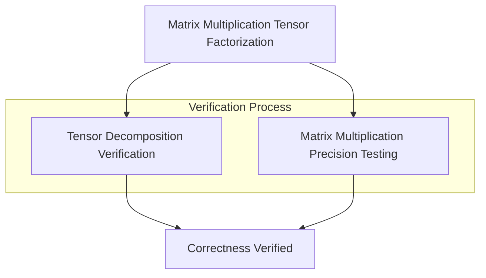
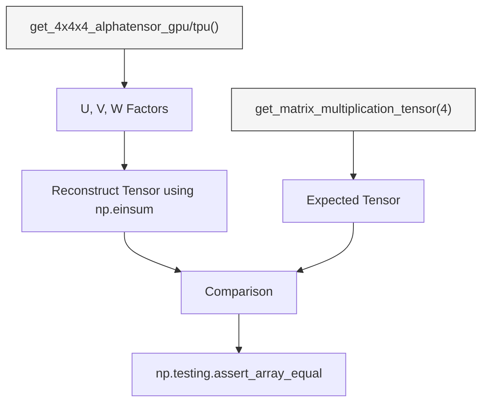
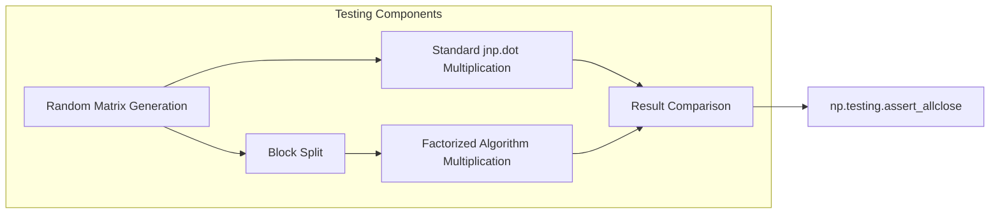
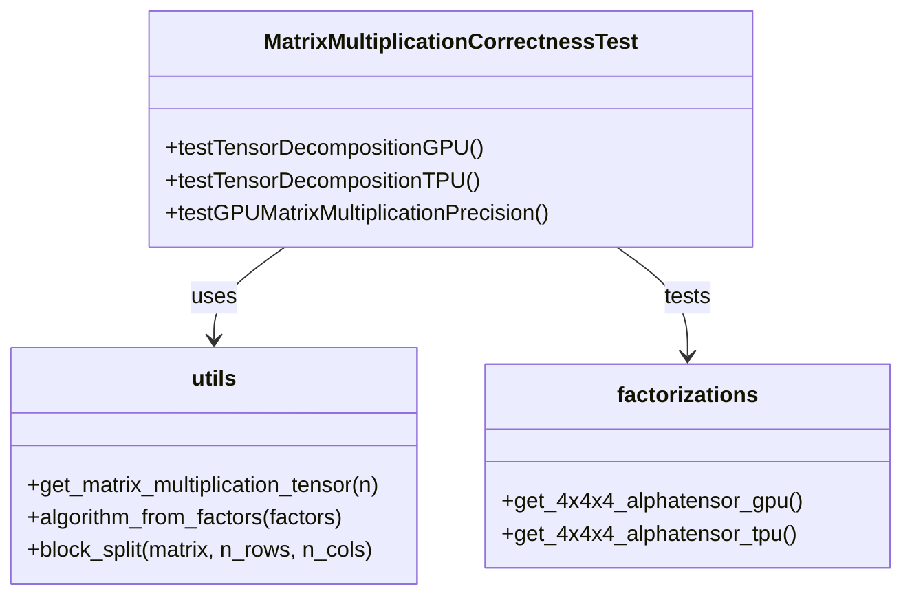
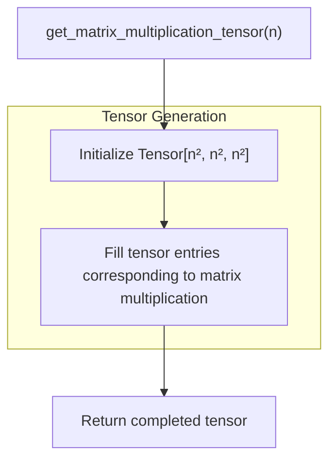
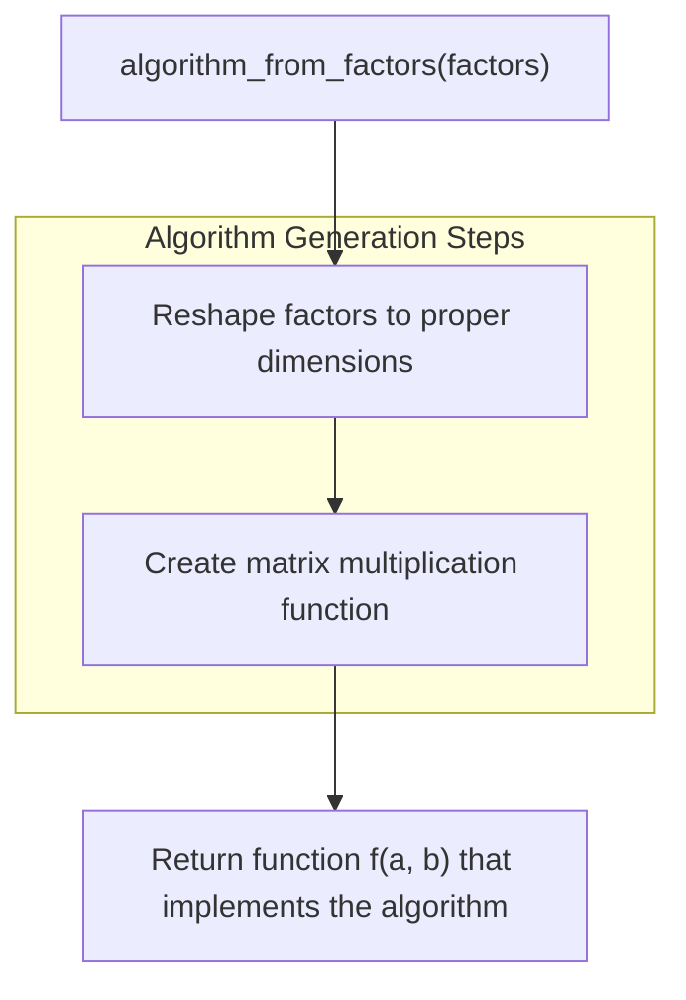

<!-- source: DeepWiki mcp.deepwiki.com · repo google-deepmind/alphatensor · page 3.3 Correctness Testing · fetched 2026-10-26 -->

# Correctness Testing

<details>
<summary>Relevant source files</summary>

The following files were used as context for generating this wiki page:

- [benchmarking/test_correctness.py](benchmarking/test_correctness.py)
- [benchmarking/utils.py](benchmarking/utils.py)

</details>


This document explains how the AlphaTensor project verifies the mathematical correctness of matrix multiplication algorithms represented as tensor factorizations. The correctness testing framework ensures that the factorizations discovered by AlphaTensor properly represent matrix multiplication operations and produce accurate results when implemented.

For information about benchmarking performance, see [Running Benchmarks](#3.4).

## Overview of Correctness Testing

The AlphaTensor correctness testing framework applies two primary verification methods:

1. **Tensor Decomposition Verification** - Confirms that the factors properly decompose the matrix multiplication tensor
2. **Matrix Multiplication Precision Testing** - Ensures that matrix multiplication using the factorized algorithm produces identical results to standard matrix multiplication



Sources: [benchmarking/test_correctness.py:33-45](), [benchmarking/test_correctness.py:47-67]()

## Testing Framework Components

### Tensor Decomposition Verification

The tensor decomposition verification tests that the factors (U, V, W matrices) correctly decompose the matrix multiplication tensor. This is the most fundamental test of correctness - it confirms that the mathematical decomposition is valid.



Sources: [benchmarking/test_correctness.py:33-45](), [benchmarking/utils.py:36-54]()

The test:
1. Retrieves the factors (U, V, W) for 4×4 matrix multiplication from either GPU or TPU optimized implementations
2. Reconstructs the tensor using Einstein summation (`np.einsum`)
3. Compares the reconstructed tensor against the expected matrix multiplication tensor
4. Uses `np.testing.assert_array_equal` to verify exact matching

### Matrix Multiplication Precision Testing

While tensor decomposition verification checks the mathematical correctness, precision testing confirms that the algorithm works correctly in practice for actual matrix multiplication tasks.



Sources: [benchmarking/test_correctness.py:47-67](), [benchmarking/utils.py:30-33](), [benchmarking/utils.py:57-116]()

The precision test:
1. Creates two random 1024×1024 matrices using JAX's random number generator
2. Splits these matrices into 4×4 blocks
3. Applies the factorized algorithm to multiply the matrices
4. Compares the result against standard matrix multiplication using `np.testing.assert_allclose`
5. Ensures results match up to numerical precision

## Implementation Details

### Code Structure for Correctness Testing

The correctness testing framework is composed of two main files with the following responsibilities:



Sources: [benchmarking/test_correctness.py:30-67](), [benchmarking/utils.py:30-116]()

### GPU and TPU Factorization Testing

The framework tests factorizations optimized for both GPU and TPU hardware:

| Test Function | Hardware Target | Factorization Source |
|---------------|----------------|----------------------|
| `testTensorDecompositionGPU` | GPU | `factorizations.get_4x4x4_alphatensor_gpu()` |
| `testTensorDecompositionTPU` | TPU | `factorizations.get_4x4x4_alphatensor_tpu()` |
| `testGPUMatrixMultiplicationPrecision` | GPU | `factorizations.get_4x4x4_alphatensor_gpu()` |

Sources: [benchmarking/test_correctness.py:33-45](), [benchmarking/test_correctness.py:47-67]()

### Matrix Multiplication Tensor Understanding

The matrix multiplication tensor is a 3D tensor that encodes the bilinear operation of matrix multiplication. For n×n matrices, this tensor has dimensions [n², n², n²].



Sources: [benchmarking/utils.py:36-54]()

The `get_matrix_multiplication_tensor` function generates this tensor by:
1. Creating a tensor of zeros with shape [n², n², n²]
2. Setting specific entries to 1 based on the matrix multiplication pattern
3. These entries correspond to the terms that appear in the matrix multiplication formula

## Algorithm From Factors

One of the most important components of the correctness testing framework is the `algorithm_from_factors` function, which converts a tensor factorization into an actual matrix multiplication algorithm.



Sources: [benchmarking/utils.py:57-116]()

The function:
1. Takes a factorization represented as three matrices U, V, W
2. Reshapes these matrices appropriately
3. Returns a function that implements block matrix multiplication according to the factorization
4. The returned function takes block matrices A and B as input and returns their product C = A×B

## Running the Tests

The correctness tests are implemented using Python's unittest framework and can be run using the absltest test runner:

```
python -m alphatensor.benchmarking.test_correctness
```

When the tests pass, it confirms that:
1. The factorizations correctly decompose the matrix multiplication tensor
2. The algorithms derived from these factorizations correctly compute matrix products
3. The results match standard matrix multiplication up to numerical precision

Sources: [benchmarking/test_correctness.py:70-71]()

## Relationship to Benchmarking

While correctness testing focuses on mathematical validity, the benchmarking system (see [Running Benchmarks](#3.4)) focuses on performance. Together, they ensure that AlphaTensor's algorithms are both correct and efficient.

The correctness tests serve as a prerequisite for benchmarking - only algorithms that pass the correctness tests should be considered for performance evaluation.

---

