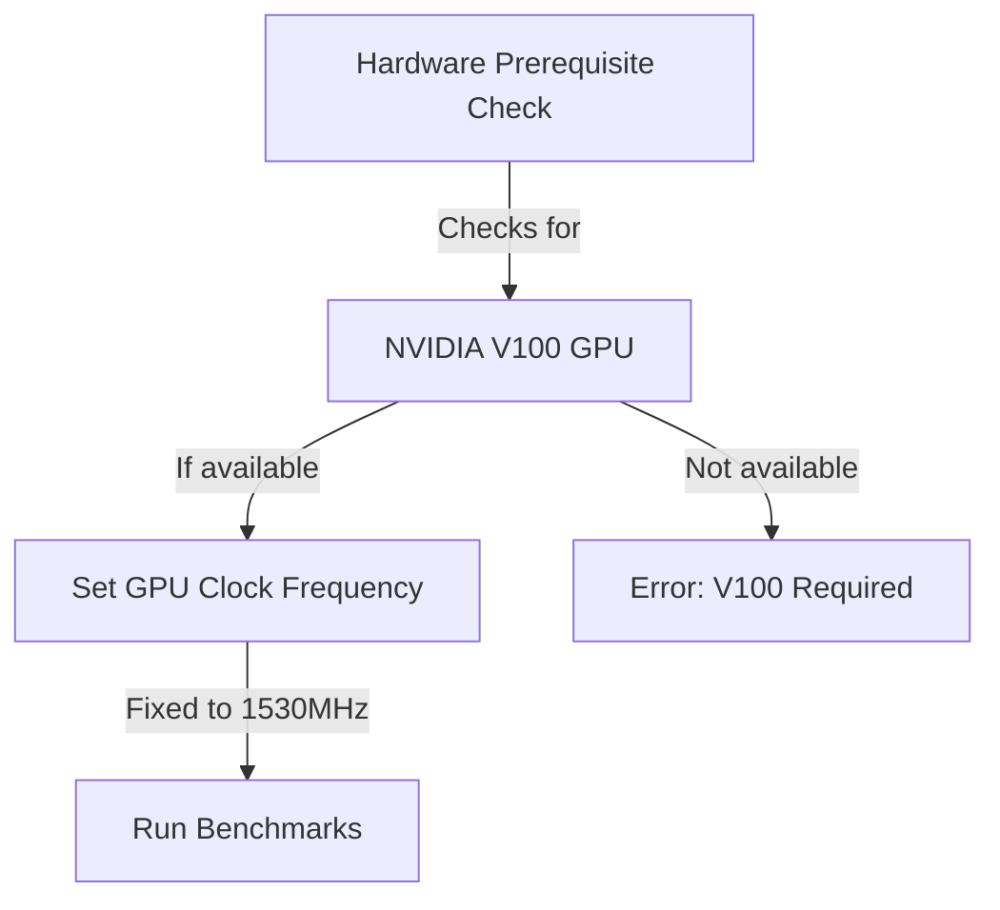
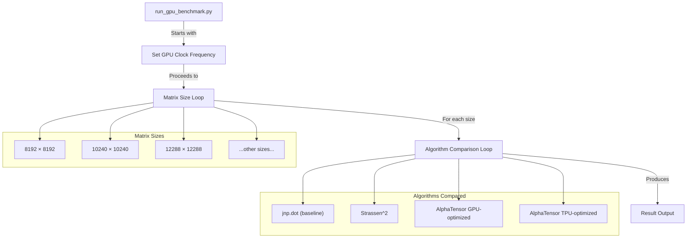
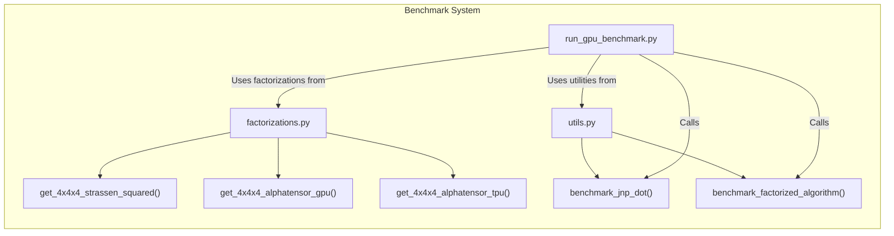
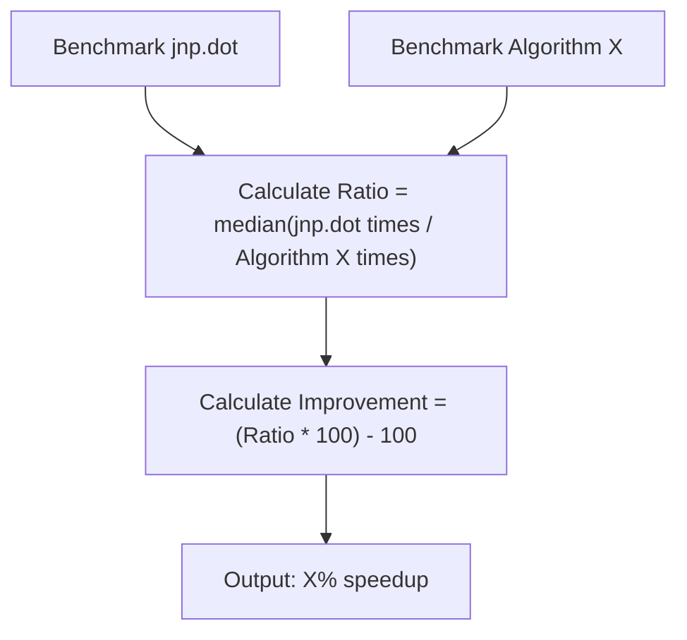

<!-- source: DeepWiki mcp.deepwiki.com · repo google-deepmind/alphatensor · page 3.4 Running Benchmarks · fetched 2026-10-26 -->

# Running Benchmarks

<details>
<summary>Relevant source files</summary>

The following files were used as context for generating this wiki page:

- [benchmarking/README.md](benchmarking/README.md)
- [benchmarking/requirements.txt](benchmarking/requirements.txt)
- [benchmarking/run_gpu_benchmark.py](benchmarking/run_gpu_benchmark.py)
- [nonequivalence/alphatensor_14236_factorizations.npz](nonequivalence/alphatensor_14236_factorizations.npz)

</details>


This document provides a comprehensive guide on how to run the GPU benchmarks in the AlphaTensor project and how to interpret the results. The benchmarking system allows you to compare the performance of matrix multiplication algorithms discovered by AlphaTensor against baseline methods such as Strassen's algorithm and standard matrix multiplication implementations.

For information about the implementation details of the benchmarking system, see [Benchmark Implementation](#3.1). For understanding the correctness testing process, see [Correctness Testing](#3.3).

## Prerequisites

Before running the benchmarks, you need to ensure you have the appropriate hardware and software setup.

### Hardware Requirements

The benchmarks are designed to be run on an NVIDIA V100 GPU. The benchmark script checks if you're running on a V100 GPU and will raise an error if not.



Sources: [benchmarking/run_gpu_benchmark.py:51-55](), [benchmarking/README.md:26-27]()

### Software Requirements

The benchmarks require Python 3 and a specific set of dependencies, primarily JAX with CUDA support.

Sources: [benchmarking/README.md:26-28](), [benchmarking/requirements.txt:1-6]()

## Installation

Follow these steps to set up the environment for running the benchmarks:

1. Clone the AlphaTensor repository:
   ```bash
   git clone https://github.com/deepmind/alphatensor.git
   ```

2. Set up a virtual Python environment (recommended):
   ```bash
   python3 -m venv benchmarking_env
   source benchmarking_env/bin/activate
   ```

3. Install the benchmarking dependencies:
   ```bash
   pip3 install -r alphatensor/benchmarking/requirements.txt -f https://storage.googleapis.com/jax-releases/jax_cuda_releases.html
   ```

Sources: [benchmarking/README.md:30-48]()

## Running the Benchmark

The benchmark compares the performance of different matrix multiplication algorithms on various matrix sizes. The script requires sudo access to set the GPU clock frequency, which reduces benchmarking variance.

To run the benchmark, execute from the parent directory that contains the AlphaTensor repository as a subdirectory:

```bash
python3 -m alphatensor.benchmarking.run_gpu_benchmark
```

### Benchmark Process



Sources: [benchmarking/run_gpu_benchmark.py:50-93](), [benchmarking/README.md:59-64]()

### Benchmark Configuration

The benchmark script is configured with the following settings:

| Parameter | Value | Description |
|-----------|-------|-------------|
| `num_trials` | 10 | Number of benchmark runs for each algorithm |
| `matrix_sizes` | [8192, 10240, 12288, 14336, 16384, 18432, 20480] | Sizes of matrices to be multiplied |
| GPU clock frequency | 1530 MHz | Fixed frequency to reduce variance |

The script benchmarks three different algorithm implementations:
1. Strassen squared (`factorizations.get_4x4x4_strassen_squared()`)
2. AlphaTensor GPU-optimized (`factorizations.get_4x4x4_alphatensor_gpu()`)  
3. AlphaTensor TPU-optimized (`factorizations.get_4x4x4_alphatensor_tpu()`)

Each algorithm is compared against the standard `jax.numpy.dot` implementation.

Sources: [benchmarking/run_gpu_benchmark.py:66-72]()

## Benchmark Components and Data Flow



Sources: [benchmarking/run_gpu_benchmark.py:46-47](), [benchmarking/run_gpu_benchmark.py:69-72](), [benchmarking/run_gpu_benchmark.py:78-84]()

## Understanding the Results

The benchmark script outputs speedup percentages for each algorithm compared to the standard `jnp.dot` implementation. The results are presented for each matrix size.

### Example Output

For each matrix size, the script will output something like:

```
Multiplying 8192 x 8192 matrices
========================================
Strassen^2 vs `jnp.dot`: 4.23% speedup
AlphaTensor GPU-optimized vs `jnp.dot`: 8.50% speedup
AlphaTensor TPU-optimized vs `jnp.dot`: 7.35% speedup
```

### Result Calculation

The benchmark calculates the speedup ratio using this process:



Sources: [benchmarking/run_gpu_benchmark.py:77-88]()

## Performance Interpretation

When analyzing the benchmark results, you should expect the following:

1. The AlphaTensor GPU-optimized algorithm should show approximately 8.5% speedup compared to `jnp.dot` for 8192×8192 matrices on an NVIDIA V100 GPU.

2. Performance improvements will vary by matrix size. The benchmark tests multiple sizes to give you a comprehensive view of algorithm performance across different problem scales.

3. Note that the TPU-optimized algorithm may run out of memory for very large matrices (>19000) on a V100 GPU, as indicated in the code.

Sources: [benchmarking/run_gpu_benchmark.py:16-22](), [benchmarking/run_gpu_benchmark.py:81-83]()

## Troubleshooting

If you encounter issues when running the benchmarks, check the following:

1. Verify that you're running on an NVIDIA V100 GPU. The script checks for this and will raise an error if not detected.

2. Ensure you have sudo access, as the script requires it to set the GPU clock frequency.

3. Run the benchmark on a server that is not being used by others to minimize interference.

4. If you encounter out-of-memory errors with large matrices, particularly with the TPU-optimized algorithm, try smaller matrix sizes.

Sources: [benchmarking/run_gpu_benchmark.py:51-55](), [benchmarking/run_gpu_benchmark.py:24-28]()

## Performance Factors

Several factors can influence the benchmark results:

1. **GPU Clock Frequency**: The script fixes this to 1530 MHz to reduce variance.

2. **Server Load**: Ideally, run the benchmark on a dedicated server.

3. **Hardware Configuration**: The benchmark was tested on an n1-standard-96 Google Cloud VM instance with eight V100 GPUs and Intel Skylake CPU.

4. **JAX Version**: The benchmark requires JAX with CUDA support. Ensure you've installed the correct version from the requirements file.

Sources: [benchmarking/run_gpu_benchmark.py:56-64](), [benchmarking/run_gpu_benchmark.py:30-37](), [benchmarking/requirements.txt:3-4]()

---

