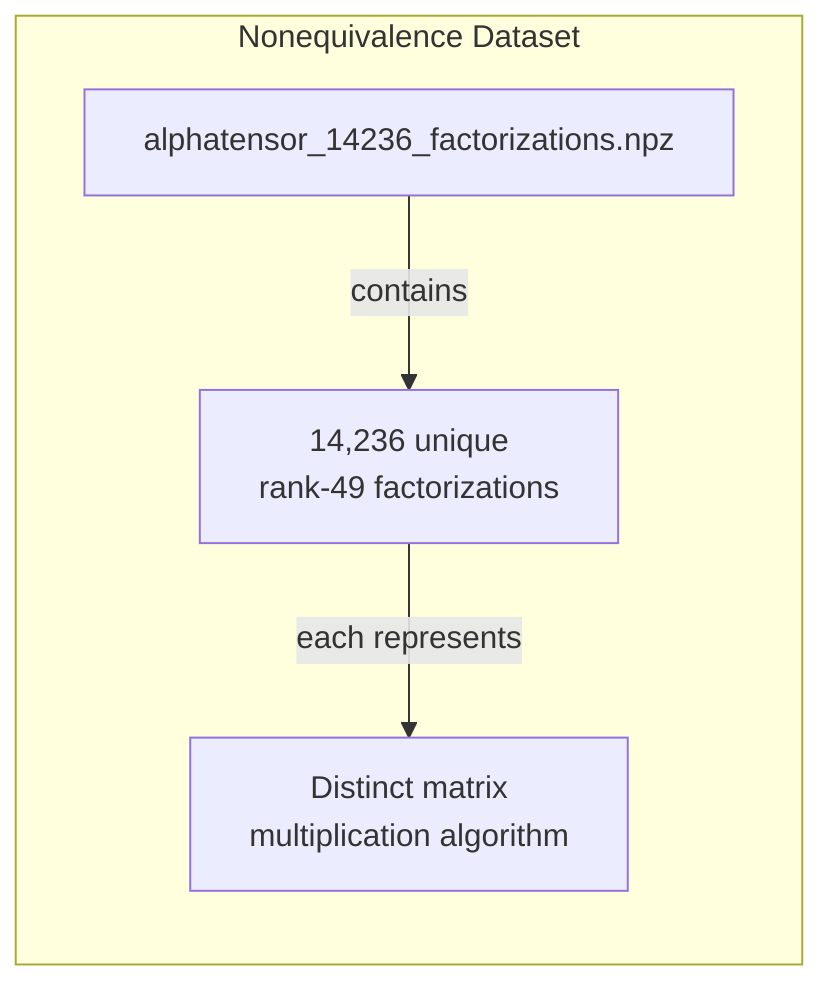
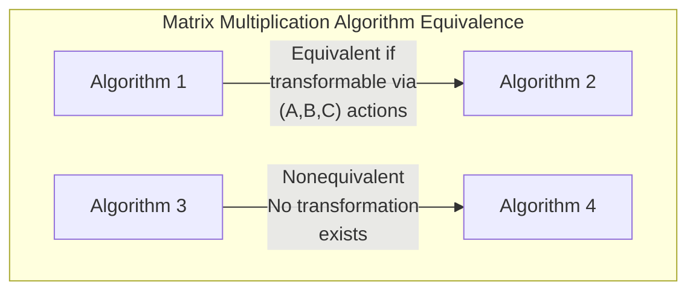
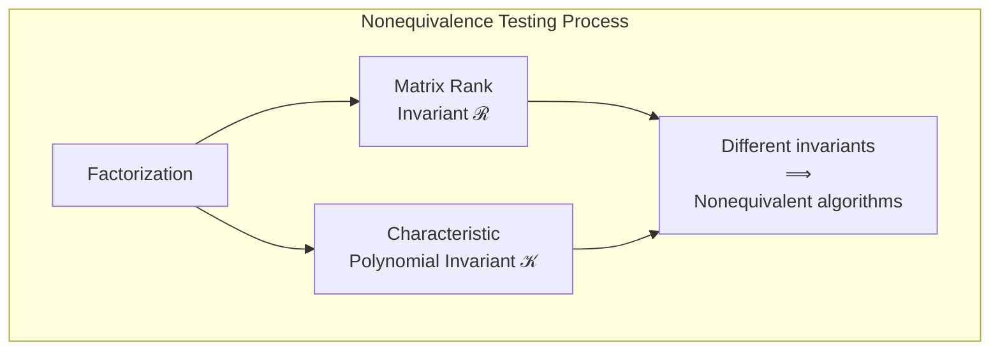
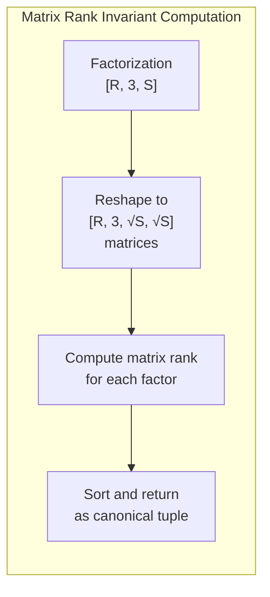
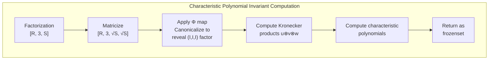
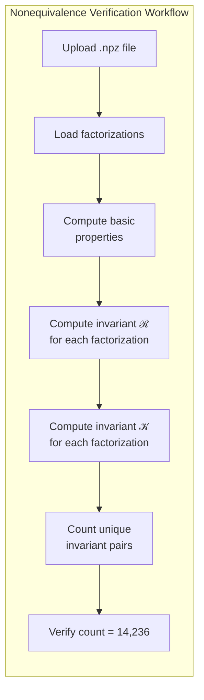
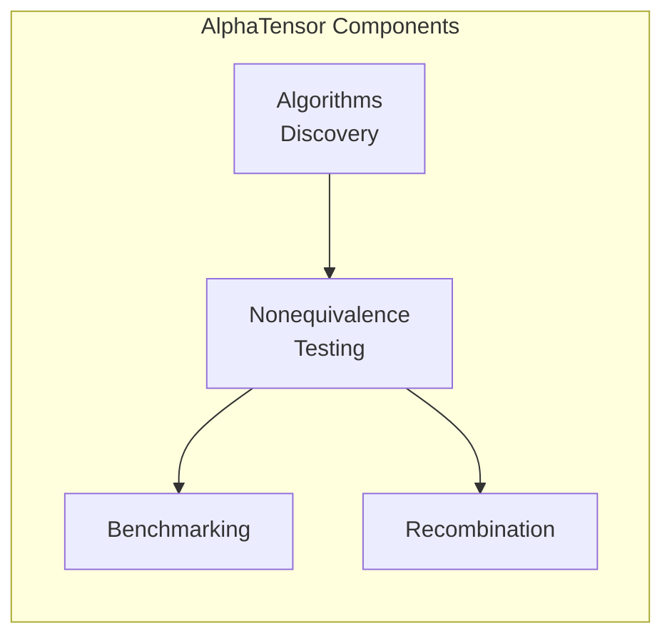

<!-- source: DeepWiki mcp.deepwiki.com · repo google-deepmind/alphatensor · page 4 Nonequivalence Testing · fetched 2026-10-26 -->

# Nonequivalence Testing

Relevant source files

The following files were used as context for generating this wiki page:

- [README.md](README.md)
- [nonequivalence/inspect_factorizations_notebook.ipynb](nonequivalence/inspect_factorizations_notebook.ipynb)

## Purpose and Scope

The Nonequivalence Testing system verifies that matrix multiplication algorithms discovered by AlphaTensor are truly distinct from one another. This is a crucial verification step that ensures the uniqueness of each algorithm in the discovered set. Without this testing, we might incorrectly count equivalent algorithms multiple times, leading to an overestimation of the number of unique algorithms found.

This document covers:
- The nonequivalence dataset of 14,236 unique matrix multiplication algorithms
- The mathematical framework for testing algorithm uniqueness through invariants
- How to use the provided tools to verify algorithm nonequivalence

For information about the specific algorithms themselves, see [Algorithms](#2). For information about benchmarking algorithm performance, see [Benchmarking](#3).

Sources: [README.md:18-20](), [README.md:50-57]()

## Nonequivalent Factorizations Dataset

The AlphaTensor project provides a dataset of 14,236 nonequivalent factorizations for multiplying 4×4 matrices (specifically, rank-49 factorizations of the tensor T₄ in standard arithmetic). These factorizations are stored in the compressed NumPy file `alphatensor_14236_factorizations.npz`.

Each factorization in this dataset represents a fundamentally different algorithm for matrix multiplication that cannot be derived from others by simple transformations.

**Dataset Format**:
- Each factorization is represented as a 3D array with dimensions [R, 3, S]
- R = 49 (the rank of the factorization)
- 3 represents the three factor matrices (U, V, W)
- S = 16 (the size of each factor, representing a 4×4 matrix)

Sources: [README.md:18-20](), [nonequivalence/inspect_factorizations_notebook.ipynb:9-10](), [nonequivalence/inspect_factorizations_notebook.ipynb:86-89]()

## Understanding Algorithm Equivalence

Before discussing nonequivalence testing, it's important to understand what makes two matrix multiplication algorithms equivalent or nonequivalent.

### Equivalence Transformations

Two factorizations of a matrix multiplication tensor are considered equivalent if one can be transformed into the other through certain operations that don't change the underlying algorithm's fundamental structure.

In AlphaTensor's context, these transformations are known as (A, B, C) actions, which correspond to simultaneous transformations on the three factor matrices in a factorization.

Sources: [nonequivalence/inspect_factorizations_notebook.ipynb:127-133]()

## Invariant-Based Nonequivalence Testing

AlphaTensor uses mathematical invariants to prove that algorithms are nonequivalent. An invariant is a property that remains unchanged under equivalence transformations.

### The Invariant Framework

The system computes two key invariants:

1. **Matrix Rank Invariant (ℛ)**: Based on the ranks of each factor matrix when viewed as a square matrix
2. **Characteristic Polynomial Invariant (𝒦)**: A more granular invariant based on the canonicalized factorization

If two factorizations have different invariant values, they must be nonequivalent algorithms.

Sources: [nonequivalence/inspect_factorizations_notebook.ipynb:86-89](), [nonequivalence/inspect_factorizations_notebook.ipynb:98-186]()

## Implementation Details

### Matrix Rank Invariant (ℛ)

The matrix rank invariant of a factorization {Uᵣ, Vᵣ, Wᵣ}_{r=1}^R is the collection of matrix ranks for each factor when viewed as a square matrix. This is implemented in the `compute_invariant_r` function:

The implementation reshapes each factor into a square matrix, computes its rank using `np.linalg.matrix_rank`, and returns a sorted tuple representation.

Sources: [nonequivalence/inspect_factorizations_notebook.ipynb:106-123]()

### Characteristic Polynomial Invariant (𝒦)

The more granular invariant 𝒦 requires:

1. Canonicalizing the factorization to reveal an (I, I, I) factor through the Φ map
2. Computing characteristic polynomials of Kronecker products of the canonicalized factors

This invariant is implemented in the `compute_invariant_k` function, with helper functions `_phi` and `_action_abc` to perform the canonicalization.

Sources: [nonequivalence/inspect_factorizations_notebook.ipynb:126-186]()

## Using the Nonequivalence Testing System

To verify that the 14,236 factorizations are all nonequivalent:

1. Load the dataset from `alphatensor_14236_factorizations.npz`
2. Compute both invariants (ℛ and 𝒦) for each factorization
3. Count the number of unique invariant pairs

The system provides the notebook `inspect_factorizations_notebook.ipynb` that performs these steps automatically.

The notebook will demonstrate that each of the 14,236 factorizations has a unique invariant signature, proving they are all nonequivalent algorithms.

Sources: [nonequivalence/inspect_factorizations_notebook.ipynb:207-217](), [README.md:50-57]()

## Relation to Other AlphaTensor Components

The Nonequivalence Testing system plays a critical verification role in the AlphaTensor project ecosystem:

- **Algorithms**: Provides the discovered factorizations that require verification
- **Nonequivalence Testing**: Verifies that discovered algorithms are truly distinct
- **Benchmarking**: Relies on verified nonequivalent algorithms to measure performance
- **Recombination**: Uses verified unique algorithms as building blocks for larger matrix multiplication

Sources: [README.md:9-23]()

## Summary

The Nonequivalence Testing system ensures the mathematical rigor of AlphaTensor's discoveries by verifying that each of the 14,236 algorithms for multiplying 4×4 matrices is truly unique. This verification is critical for establishing the innovation represented by the AlphaTensor approach, as it confirms that the reinforcement learning system did not simply rediscover the same algorithms multiple times.

By computing mathematical invariants that are preserved under equivalence transformations, the system proves that each algorithm is fundamentally different from all others in the dataset.

Sources: [README.md:18-20](), [nonequivalence/inspect_factorizations_notebook.ipynb:9-10]()

---

