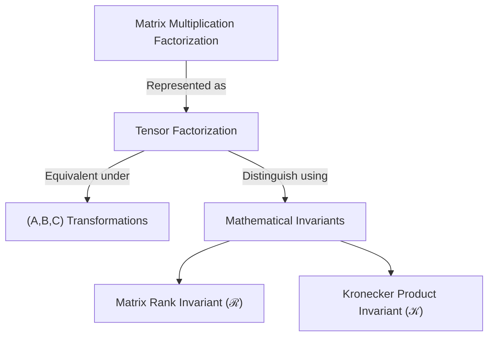
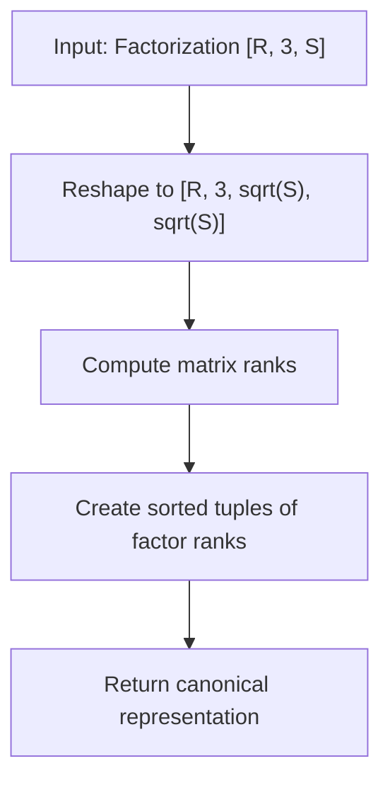
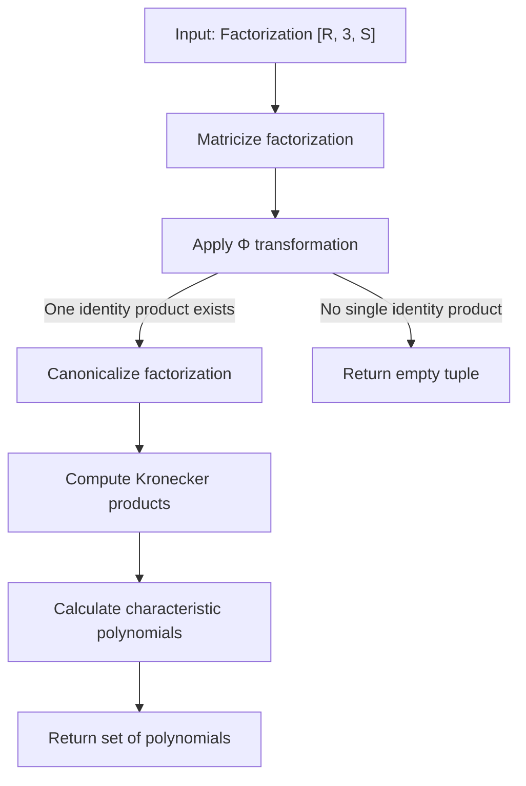
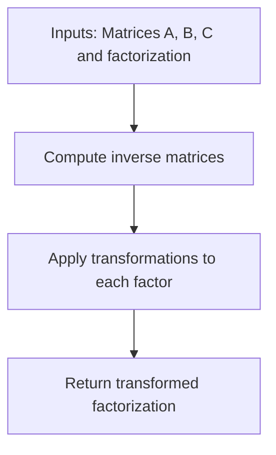
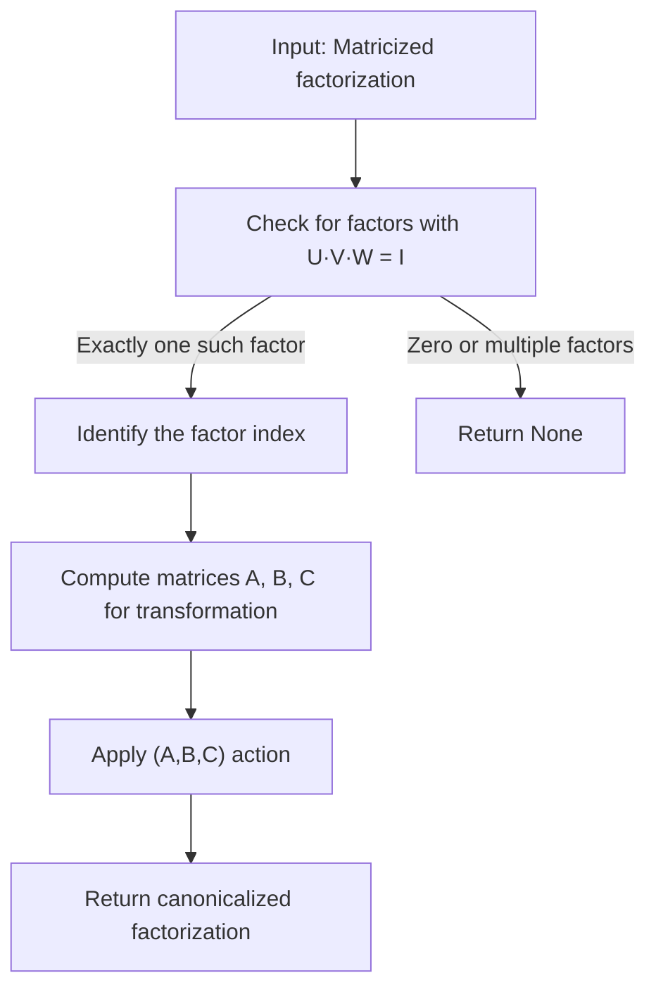
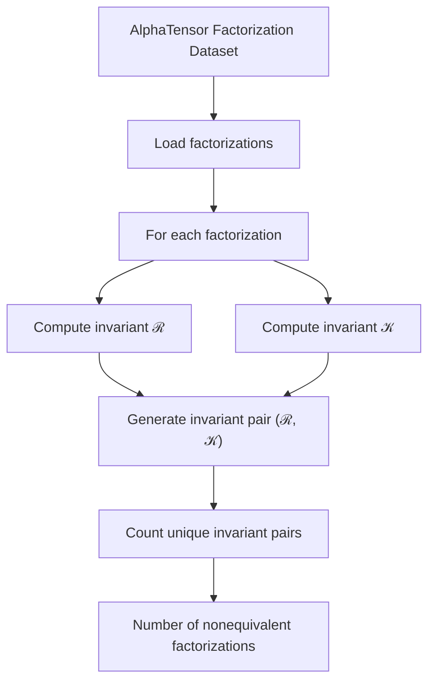

<!-- source: DeepWiki mcp.deepwiki.com · repo google-deepmind/alphatensor · page 4.1 Invariant Computation · fetched 2026-10-26 -->

# Invariant Computation

Relevant source files

The following files were used as context for generating this wiki page:

- [nonequivalence/inspect_factorizations_notebook.ipynb](nonequivalence/inspect_factorizations_notebook.ipynb)

## Purpose and Scope

This document details the mathematical invariants used in the AlphaTensor project to determine nonequivalence between matrix multiplication factorizations. These invariants play a critical role in certifying that discovered algorithms are truly distinct from one another, even when they might appear similar due to different representations.

The invariant computation system focuses on two specific invariants:
- The matrix rank invariant (ℛ)
- The Kronecker product polynomial invariant (𝒦)

For information about the complete dataset of nonequivalent factorizations, see [Nonequivalent Factorizations Dataset](#4.2).

Sources: [nonequivalence/inspect_factorizations_notebook.ipynb:8-15]()

## Invariant Theory Background

Matrix multiplication factorizations can be represented in different ways while encoding the same underlying algorithm. Two factorizations are considered equivalent if one can be transformed into the other through certain matrix operations without changing the underlying algorithm.

To determine whether two factorizations are truly different algorithms, we need mathematical tools that remain unchanged (invariant) under these transformations.

Sources: [nonequivalence/inspect_factorizations_notebook.ipynb:86-89]()

## Computing the Matrix Rank Invariant (ℛ)

The matrix rank invariant ℛ is the primary tool for distinguishing nonequivalent factorizations.

### Definition and Properties

For a factorization {U_r, V_r, W_r}_{r=1}^R, the matrix rank invariant is defined as:
ℛ = { { rank(U_r), rank(V_r), rank(W_r) } }_{r=1}^R

Where:
- U_r, V_r, W_r are the factors in the tensor decomposition
- rank(X) represents the matrix rank when X is viewed as a square matrix
- The inner braces denote an unordered tuple of ranks for a specific r
- The outer braces represent the collection of these tuples across all r values

This invariant is preserved when equivalent transformations are applied to a factorization.

### Implementation

The matrix rank invariant is implemented in the `compute_invariant_r` function:

Sources: [nonequivalence/inspect_factorizations_notebook.ipynb:99-123]()

## Computing the Kronecker Product Invariant (𝒦)

The Kronecker product invariant 𝒦 provides a more granular method to distinguish factorizations when the matrix rank invariant is insufficient.

### Definition and Properties

This invariant involves:
1. Canonicalizing the factorization to reveal an identity factor through a mapping Φ
2. Computing characteristic polynomials of Kronecker products of the factors

The invariant is applicable only when the factorization has exactly one factor where U_r·V_r·W_r equals the identity matrix.

### Implementation Process

The computation of invariant 𝒦 follows these steps:

The canonicalization step (Φ transformation) applies an (A,B,C) action that transforms a factor (U_r, V_r, W_r) satisfying U_r·V_r·W_r = I into (I, I, I).

Sources: [nonequivalence/inspect_factorizations_notebook.ipynb:126-186]()

## The (A,B,C) Action

The (A,B,C) action is central to understanding factorization equivalence and is used in the canonicalization process.

### Definition

For matrices A, B, C and a factorization (U_r, V_r, W_r), the (A,B,C) action transforms the factors as:
- U_r → A·U_r·B^(-1)
- V_r → B·V_r·C^(-1)
- W_r → C·W_r·A^(-1)

This transformation preserves the overall tensor decomposition while changing the representation.

### Implementation

The action is implemented in the `_action_abc` function:

Sources: [nonequivalence/inspect_factorizations_notebook.ipynb:126-134]()

## Phi (Φ) Transformation

The Φ transformation is a special case of the (A,B,C) action that canonicalizes a factorization.

### Purpose and Process

The Φ transformation:
1. Identifies if exactly one factor satisfies U_r·V_r·W_r = I
2. If such a factor exists, applies an (A,B,C) action to transform it into (I, I, I)
3. Returns the canonicalized factorization or None if no such factor exists

### Implementation

The transformation is implemented in the `_phi` function:

Sources: [nonequivalence/inspect_factorizations_notebook.ipynb:135-163]()

## Using Invariants to Determine Nonequivalence

To determine whether factorizations are nonequivalent, we compute both invariants ℛ and 𝒦 for each factorization.

### Verification Process

1. Load factorizations from the provided data files
2. For each factorization, compute invariant ℛ and invariant 𝒦
3. Count the number of unique (ℛ, 𝒦) pairs
4. If two factorizations have different invariant values, they are definitively nonequivalent

This process allows us to certify that the 14,236 factorizations in the AlphaTensor dataset are truly nonequivalent, representing distinct matrix multiplication algorithms.

Sources: [nonequivalence/inspect_factorizations_notebook.ipynb:195-217]()

## Implementation in the Codebase

The implementation of invariant computation is contained in the `nonequivalence/inspect_factorizations_notebook.ipynb` notebook, which provides:

1. Functions to compute the invariants:
   - `compute_invariant_r`: Computes the matrix rank invariant [nonequivalence/inspect_factorizations_notebook.ipynb:106-123]()
   - `compute_invariant_k`: Computes the Kronecker product invariant [nonequivalence/inspect_factorizations_notebook.ipynb:165-186]()

2. Helper functions:
   - `_matricize_factorization`: Reshapes factors into matrix form [nonequivalence/inspect_factorizations_notebook.ipynb:99-103]()
   - `_action_abc`: Applies the (A,B,C) action [nonequivalence/inspect_factorizations_notebook.ipynb:126-134]()
   - `_phi`: Implements the Φ transformation [nonequivalence/inspect_factorizations_notebook.ipynb:135-163]()

3. A demonstration of applying these invariants to the factorization dataset to verify nonequivalence [nonequivalence/inspect_factorizations_notebook.ipynb:208-217]()

Sources: [nonequivalence/inspect_factorizations_notebook.ipynb:25-217]()

---

