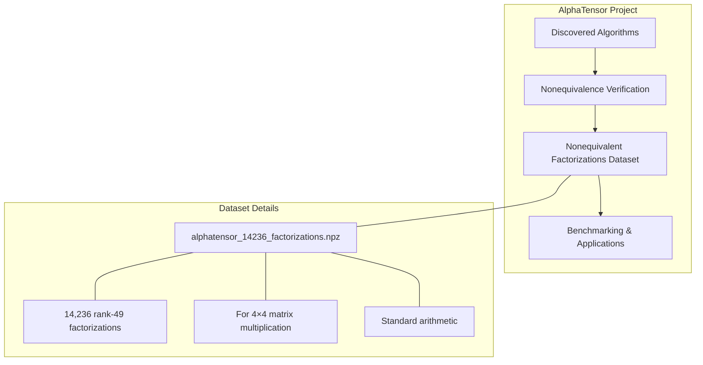
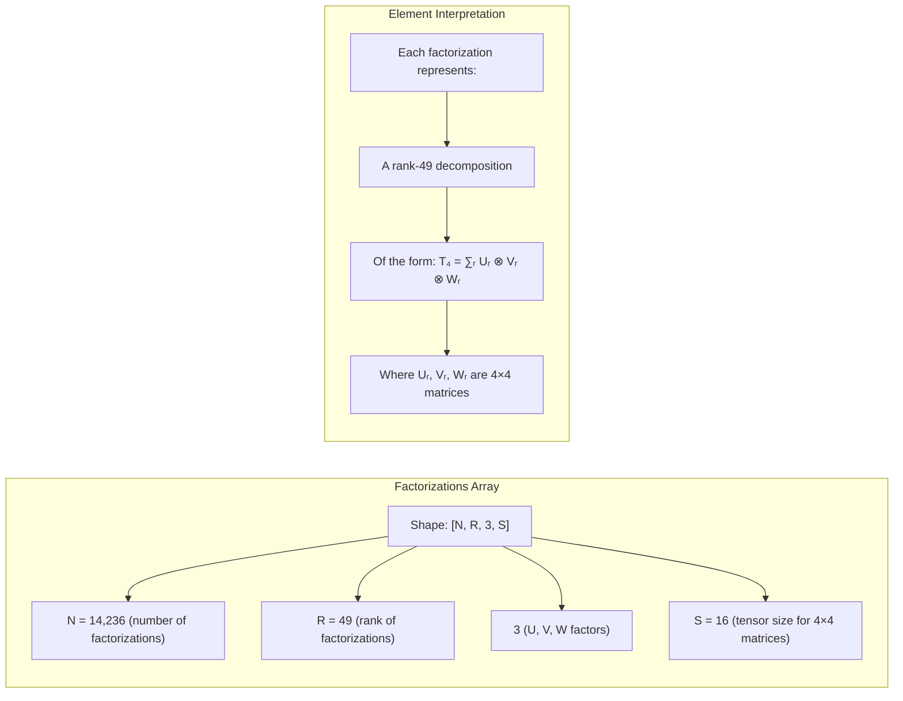
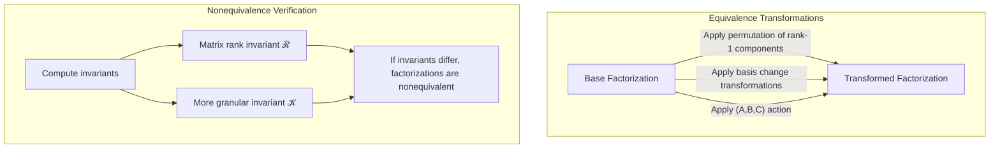
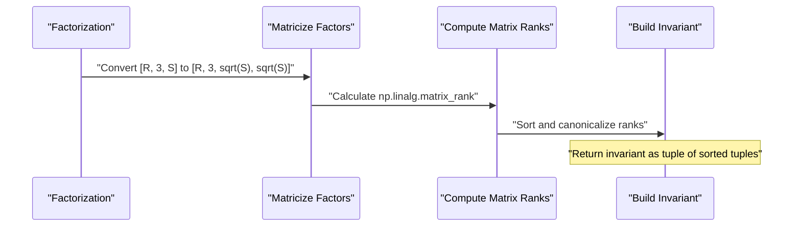
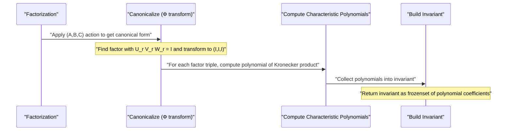

<!-- source: DeepWiki mcp.deepwiki.com · repo google-deepmind/alphatensor · page 4.2 Nonequivalent Factorizations Dataset · fetched 2026-10-26 -->

# Nonequivalent Factorizations Dataset

<details>
<summary>Relevant source files</summary>

The following files were used as context for generating this wiki page:

- [benchmarking/requirements.txt](benchmarking/requirements.txt)
- [nonequivalence/alphatensor_14236_factorizations.npz](nonequivalence/alphatensor_14236_factorizations.npz)
- [nonequivalence/inspect_factorizations_notebook.ipynb](nonequivalence/inspect_factorizations_notebook.ipynb)

</details>


## Purpose and Scope

This document describes the nonequivalent factorizations dataset (`alphatensor_14236_factorizations.npz`), which contains 14,236 provably distinct matrix multiplication algorithms discovered by AlphaTensor. These factorizations represent rank-49 decompositions of the 4×4 matrix multiplication tensor (T₄) in standard arithmetic. This page explains the dataset structure, the mathematical concept of nonequivalence, and how to verify the nonequivalence of algorithms using the provided tools.

For information about how invariants are computed to determine algorithm nonequivalence, see [Invariant Computation](#4.1).

## Dataset Overview

The nonequivalent factorizations dataset is a fundamental component of the AlphaTensor project, representing a collection of mathematically distinct matrix multiplication algorithms.



Sources: [nonequivalence/inspect_factorizations_notebook.ipynb:8-9]()

## Dataset Structure

The dataset is stored in NumPy's `.npz` format, containing a single array named `factorizations`. This array has the following structure:



When loaded, the first dimension indexes the different factorizations, the second dimension represents the rank components, the third dimension represents the three factors (U, V, W), and the fourth dimension represents the flattened 4×4 matrices.

Sources: [nonequivalence/inspect_factorizations_notebook.ipynb:40-44](), [nonequivalence/inspect_factorizations_notebook.ipynb:99-103]()

## Understanding Nonequivalence

Two matrix multiplication algorithms can compute the same result but be structurally different. In the context of tensor factorizations, two factorizations are considered equivalent if one can be transformed into the other through certain symmetry operations.



Nonequivalent factorizations represent genuinely different algorithms that cannot be transformed into each other through symmetry operations. The dataset contains only nonequivalent factorizations, as verified through mathematical invariants.

Sources: [nonequivalence/inspect_factorizations_notebook.ipynb:86-88]()

## Computing and Verifying Nonequivalence

The dataset has been verified to contain only nonequivalent factorizations by computing two types of invariants:

1. **Matrix Rank Invariant (ℛ)**: Computes the matrix ranks of each factor when viewed as square matrices
2. **More Granular Invariant (𝒦)**: A more refined invariant based on characteristic polynomials

### Matrix Rank Invariant Implementation

The matrix rank invariant of a factorization {U_r, V_r, W_r}_{r=1}^R is the unordered collection of triples { { rank(U_r), rank(V_r), rank(W_r) } }_{r=1}^R.



Sources: [nonequivalence/inspect_factorizations_notebook.ipynb:106-123]()

### Granular Invariant Implementation

The more granular invariant 𝒦 involves transforming the factorization to a canonical form and computing characteristic polynomials.



Sources: [nonequivalence/inspect_factorizations_notebook.ipynb:134-186]()

## Working with the Dataset

### Loading the Dataset

The dataset can be loaded using NumPy's `load` function:

```python
import numpy as np
factorizations = np.load('alphatensor_14236_factorizations.npz')['factorizations']
print(factorizations.shape)  # Expected output: (14236, 49, 3, 16)
```

### Basic Inspection

You can compute basic properties of the factorizations:

```python
# Check unique entries in the factorization
entries = list(np.unique(factorizations))
print('Factors include {} as entries.'.format(', '.join(map(str, entries))))

# Count non-zero elements in each factorization
nonzeros = np.count_nonzero(factorizations, axis=(-3, -2, -1))
print('Nonzeros in a factorization range from {} to {}.'.format(
    np.min(nonzeros), np.max(nonzeros)))
```

Sources: [nonequivalence/inspect_factorizations_notebook.ipynb:63-77]()

### Verifying Nonequivalence

To verify that the factorizations are indeed nonequivalent, you can compute the invariants for each factorization and check that they are all unique:

```python
invariants = []
for factorization in factorizations:
    invariant_r = compute_invariant_r(factorization)
    invariant_k = compute_invariant_k(factorization)
    invariants.append((invariant_r, invariant_k))

# Check how many unique invariant combinations exist
print('Number of nonequivalent factorizations:', len(set(invariants)))
```

If the number of unique invariant combinations equals the number of factorizations, then all factorizations in the dataset are mutually nonequivalent.

Sources: [nonequivalence/inspect_factorizations_notebook.ipynb:208-216]()

## Significance and Applications

The nonequivalent factorizations dataset represents a significant achievement in computational algebra. Each factorization in the dataset corresponds to a distinct algorithm for 4×4 matrix multiplication, and these algorithms can be:

1. Benchmarked for performance on various hardware platforms
2. Used as building blocks for larger matrix multiplication algorithms via recombination techniques
3. Studied to gain insights into the algebraic structure of matrix multiplication

The existence of 14,236 nonequivalent rank-49 factorizations demonstrates the rich complexity of the matrix multiplication problem, even for relatively small matrices.

Sources: [nonequivalence/inspect_factorizations_notebook.ipynb:8-9]()

---

