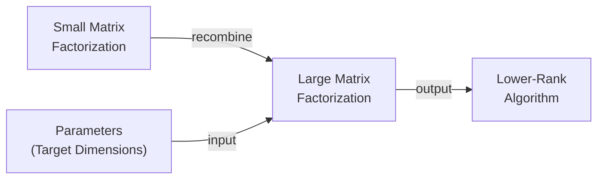
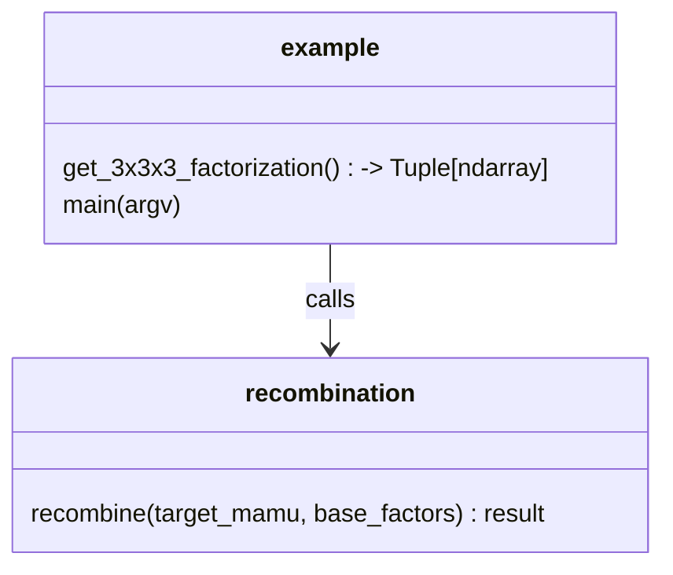
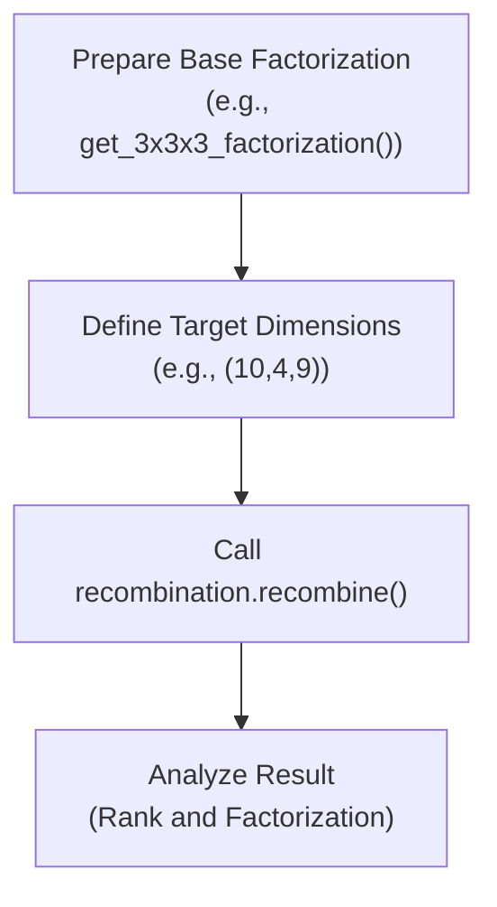
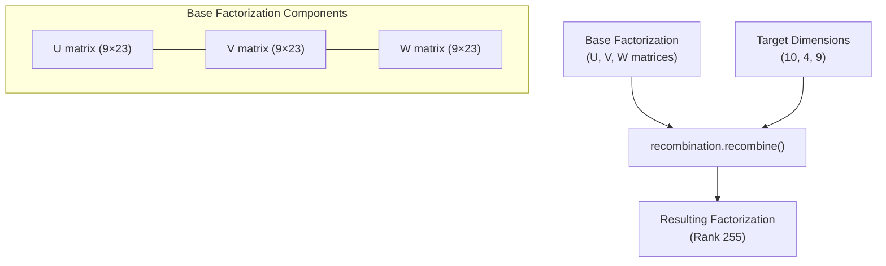

<!-- source: DeepWiki mcp.deepwiki.com · repo google-deepmind/alphatensor · page 5 Recombination · fetched 2026-10-26 -->

# Recombination

<details>
<summary>Relevant source files</summary>

The following files were used as context for generating this wiki page:

- [README.md](README.md)
- [recombination/example.py](recombination/example.py)

</details>


## Purpose and Overview

The Recombination system is a key component of the AlphaTensor project that enables the decomposition of larger matrix multiplication tensors by recombining factorizations of smaller ones. This technique allows researchers to discover more efficient matrix multiplication algorithms for larger dimensions by leveraging known efficient factorizations for smaller dimensions.

This page explains how the recombination technique works, how to use the recombination system, and walks through an example of finding a better factorization for a specific matrix size.

For information about the actual factorizations discovered by AlphaTensor, see [Algorithms](#2). For benchmarking the performance of these factorizations, see [Benchmarking](#3).

Sources: [README.md:21-23]()

## Basic Concepts

Recombination builds on the idea that efficient factorizations for smaller matrix multiplication problems can be combined to construct efficient factorizations for larger matrix problems. In the context of matrix multiplication algorithms:

- A **factorization** represents a specific algorithm for matrix multiplication
- The **rank** of a factorization determines the number of scalar multiplications required
- Lower-rank factorizations correspond to more efficient algorithms
- Recombination allows finding potentially lower-rank factorizations for larger matrices



Sources: [recombination/example.py:16-17](), [README.md:21-23]()

## Technical Implementation

The recombination system is implemented in the `recombination` directory of the AlphaTensor project. The core functionality is provided by the `recombination.recombine` function, which takes:

1. A target matrix multiplication shape (as a tuple of dimensions)
2. Base factorizations for smaller matrix multiplication tensors



The recombination process returns a result dictionary that includes the rank of the new factorization, which represents the computational efficiency of the resulting algorithm.

Sources: [recombination/example.py:76-78]()

## Using the Recombination System

To use the recombination system:

1. Install the required dependencies:
   - Python 3
   - NumPy
   - absl-py

2. Call the `recombination.recombine` function with:
   - The target matrix multiplication dimensions
   - Factorizations for smaller matrices

The system will return the resulting factorization and its rank.



Sources: [README.md:33-61](), [recombination/example.py:69-79]()

## Example: Finding a Rank-255 Factorization

The file `example.py` in the recombination directory demonstrates how to use the recombination technique to find a more efficient factorization for a specific matrix multiplication problem.

In this example:

1. A rank-23 factorization for multiplying 3×3 matrices is defined
2. This base factorization is used to find a factorization for multiplying matrices of dimensions 10×4 and 4×9
3. The recombination process produces a rank-255 factorization, which improves upon the previously known rank-259 factorization

```python
base_factors = get_3x3x3_factorization()
target_mamu = (10, 4, 9)
result = recombination.recombine(target_mamu, base_factors)
```

This example demonstrates how recombination can find more efficient algorithms for larger matrix multiplications than were previously known.

| Matrix Multiplication | Previous Best Rank | Recombination Result |
|-----------------------|-------------------|---------------------|
| T_(10,4,9)            | 259               | 255                 |

Note that the order of dimensions in the target matrix multiplication tensor affects the quality of the result. As shown in the example, `(10, 4, 9)` works better than `(4, 9, 10)`.

Sources: [recombination/example.py:16-79]()

## Implementation Details

The recombination technique is based on the principle of decomposing a larger matrix multiplication problem into smaller subproblems. The core of the implementation consists of:

1. The `get_3x3x3_factorization()` function that provides a rank-23 factorization for 3×3 matrix multiplication, represented as three matrices U, V, and W with dimensions 9×23 each:
   - Matrix U represents rows of the first input matrix
   - Matrix V represents columns of the second input matrix
   - Matrix W represents output elements

2. The `recombination.recombine()` function that constructs a factorization for the target dimensions by cleverly reusing the base factorization



The recombination system leverages mathematical properties of tensor products to construct efficient factorizations for larger tensors, which directly translate to more efficient matrix multiplication algorithms.

Sources: [recombination/example.py:26-66](), [recombination/example.py:73-79]()

## Running the Example

To run the example from the command line:

1. Ensure you have the required dependencies installed:
   ```
   pip3 install -r alphatensor/recombination/requirements.txt
   ```

2. Execute the example from the parent directory that contains the alphatensor repository:
   ```
   python3 -m alphatensor.recombination.example
   ```

3. The program will output the resulting factorization and confirm that it has a rank of 255.

For more detailed information, refer to Supplement H of the research paper referenced in the AlphaTensor documentation.

Sources: [README.md:33-61]()

---

