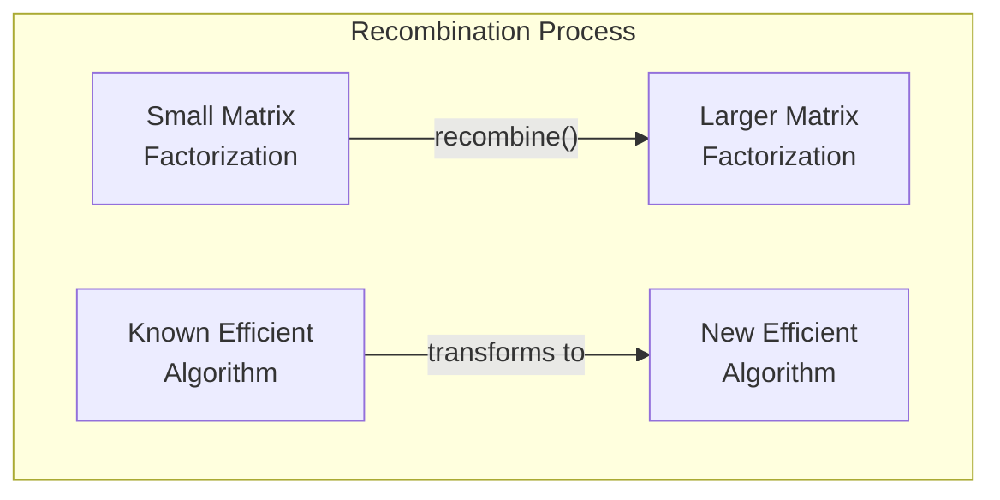
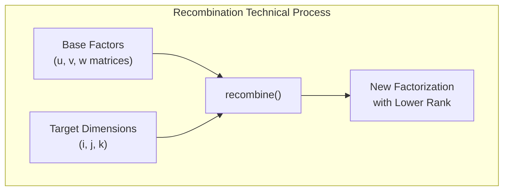
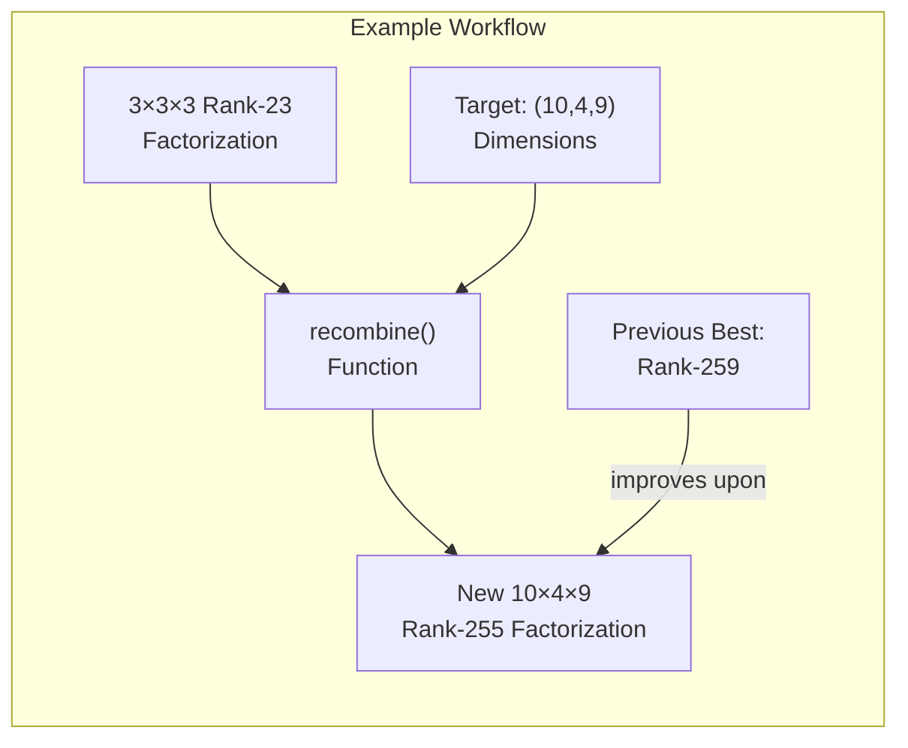

<!-- source: DeepWiki mcp.deepwiki.com · repo google-deepmind/alphatensor · page 5.1 Using Recombination · fetched 2026-10-26 -->

# Using Recombination

<details>
<summary>Relevant source files</summary>

The following files were used as context for generating this wiki page:

- [recombination/example.py](recombination/example.py)

</details>


## Purpose and Scope

This document explains how to use the recombination technique in AlphaTensor to find efficient matrix multiplication algorithms for larger matrices by leveraging known factorizations of smaller matrices. Recombination is a key technique that allows constructing lower-rank factorizations for larger matrix multiplication tensors from factorizations of smaller tensors, potentially resulting in more efficient algorithms than previously known methods.

For general information about the recombination concept, see [Recombination](#5).

## What is Recombination?

Recombination is a technique for constructing factorizations of larger matrix multiplication tensors by leveraging known factorizations of smaller tensors. In the context of AlphaTensor, this means using efficient algorithms for smaller matrix multiplications to build efficient algorithms for larger matrix multiplications.

The technique allows researchers to:
- Find lower-rank factorizations for larger matrix multiplication operations
- Potentially discover more efficient algorithms than previously known
- Extend the benefits of AlphaTensor's discoveries to matrices of various dimensions



Sources: [recombination/example.py:16-17](), [recombination/example.py:73-79]()

## How Recombination Works

The recombination technique works by taking a factorization for a smaller matrix multiplication tensor (e.g., a 3×3×3 multiplication with rank 23) and using it to construct a factorization for a larger target tensor (e.g., a 10×4×9 multiplication).



Sources: [recombination/example.py:73-79]()

## Code Structure and Components

The recombination implementation consists of the following key components:

```mermaid
classDiagram
    class "RecombinationModule" {
        recombine(target_mamu, base_factors)
    }
    
    class "BaseFactorization" {
        u: matrix
        v: matrix
        w: matrix
    }
    
    class "ResultDict" {
        rank: int
        factors: tuple
        other_metadata: any
    }
    
    "RecombinationModule" -- "BaseFactorization" : uses
    "RecombinationModule" -- "ResultDict" : returns
```

Sources: [recombination/example.py:23-24](), [recombination/example.py:68-79]()

## Using the Recombination Module: Step-by-Step Guide

### 1. Obtain Base Factorization

First, you need a known factorization for a smaller matrix multiplication tensor. This factorization is represented as three matrices: `u`, `v`, and `w`.

```python
# Get a known efficient factorization for a smaller matrix multiplication
base_factors = get_3x3x3_factorization()  # Returns (u, v, w) matrices
```

These matrices define the rank-23 factorization for the 3×3×3 matrix multiplication tensor.

Sources: [recombination/example.py:26-66](), [recombination/example.py:73]()

### 2. Define Target Matrix Dimensions

Next, specify the dimensions of the larger matrix multiplication tensor for which you want to find a factorization:

```python
# Define the target matrix multiplication dimensions
target_mamu = (10, 4, 9)  # Represents matrices of sizes 10×4 and 4×9
```

**Important**: The ordering of dimensions can significantly affect the results of recombination. Different permutations may yield factorizations with different ranks.

Sources: [recombination/example.py:74-75]()

### 3. Apply Recombination

Call the `recombine` function with your target dimensions and base factorization:

```python
# Apply recombination to find a factorization for the target dimensions
result = recombination.recombine(target_mamu, base_factors)
```

The function returns a dictionary containing the new factorization details, including the rank achieved.

Sources: [recombination/example.py:77]()

### 4. Analyze Results

Check the rank of the resulting factorization to evaluate its efficiency:

```python
print(result)
print(f"Achieved rank: {result['rank']}")
```

A lower rank generally indicates a more efficient matrix multiplication algorithm.

Sources: [recombination/example.py:78-79]()

## Worked Example: Finding a Rank-255 Factorization

The repository includes a complete example demonstrating how to use recombination to find a rank-255 factorization for a 10×4×9 matrix multiplication, which is better than the previously known rank-259 solution:



The example process:

1. Defines a known rank-23 factorization for 3×3×3 matrix multiplication
2. Sets target dimensions as (10, 4, 9)
3. Applies recombination to find a new factorization
4. Verifies the result has rank 255, which is better than the previously known 259

Sources: [recombination/example.py:16-17](), [recombination/example.py:68-79]()

## Best Practices

When using the recombination technique, consider the following best practices:

| Best Practice | Description |
|---------------|-------------|
| Dimension Ordering | Try different permutations of the target dimensions, as noted in the example: "The result depends on the order of axes; (4, 9, 10) won't work as well." |
| Base Factorization Quality | Use the most efficient (lowest rank) factorization available for your base case |
| Verification | Always verify the correctness of the resulting factorization |
| Multiple Attempts | Try recombination with different base factorizations to find the best result |

Sources: [recombination/example.py:74-75]()

## Technical Details

### Input and Output Format

The recombination function expects:

- **target_mamu**: A tuple of 3 integers (i, j, k) representing the dimensions of the target matrix multiplication (i×j × j×k)
- **base_factors**: A tuple of 3 matrices (u, v, w) representing the factorization of a smaller matrix multiplication tensor

The function returns a dictionary containing:
- **rank**: The rank of the resulting factorization
- **factors**: The factorization matrices for the larger tensor
- Additional metadata about the recombination process

Sources: [recombination/example.py:77-78]()

## Limitations and Considerations

- The efficiency of recombination depends heavily on the quality of the base factorization
- Not all dimension combinations will yield improvements over known algorithms
- The ordering of dimensions in the target tensor can significantly affect results
- Larger target dimensions may require more computational resources for the recombination process

Sources: [recombination/example.py:74-75]()

## Conclusion

The recombination technique provides a powerful method for extending the benefits of efficient matrix multiplication algorithms to larger matrix sizes. By following the steps outlined in this guide and experimenting with different base factorizations and dimension orderings, you can potentially discover more efficient algorithms for your specific matrix multiplication needs.

---

