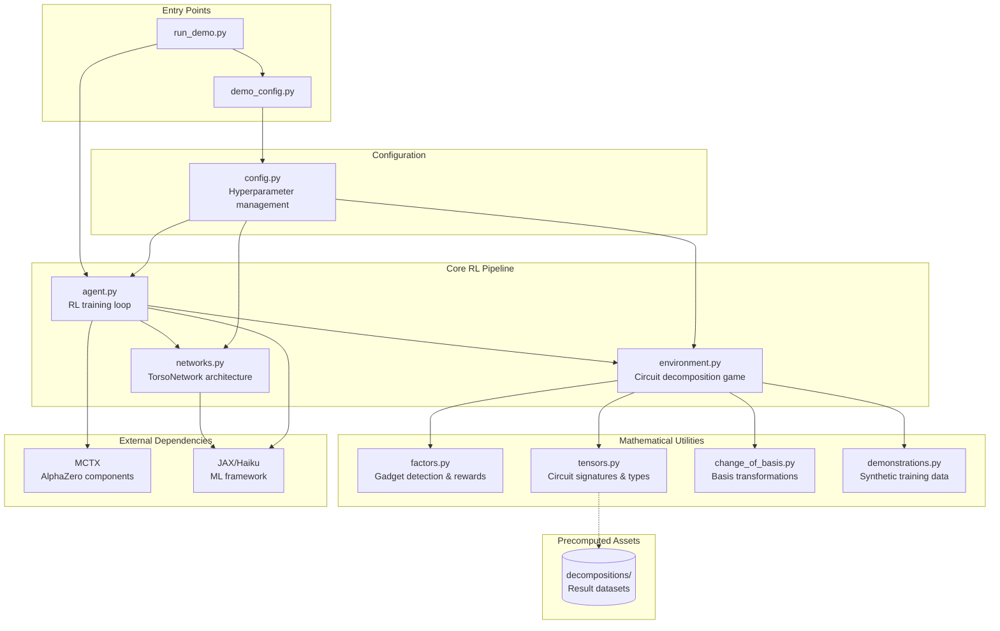
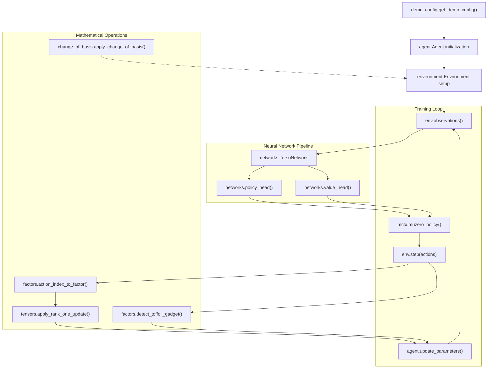

<!-- source: DeepWiki mcp.deepwiki.com · repo google-deepmind/alphatensor_quantum · page 1 Overview · fetched 2026-10-26 -->

# Overview

Relevant source files

The following files were used as context for generating this wiki page:

- [README.md](README.md)

## Purpose and Scope

This document provides a comprehensive overview of the AlphaTensor-Quantum repository, a reinforcement learning system designed for quantum circuit optimization. The system applies the AlphaTensor approach to decompose quantum circuit tensors into rank-one factors, effectively minimizing T-gate counts in quantum circuits.

The repository implements a complete RL pipeline including neural network training, Monte Carlo Tree Search (MCTS), and specialized mathematical operations for quantum circuit analysis in Galois Field GF(2). For specific implementation details of individual components, see the respective sections: [Agent System](#3.1), [Environment System](#3.2), [Neural Networks](#3.3), and [Mathematical Foundations](#4).

Sources: [README.md:1-90]()

## System Architecture

The AlphaTensor-Quantum system follows a modular architecture built around core reinforcement learning components, with specialized utilities for quantum circuit manipulation and tensor decomposition.

### High-Level Architecture

Sources: [README.md:9-28](), System architecture diagrams provided in context

## Key Components

The system's core functionality centers around three primary components that implement the reinforcement learning pipeline for quantum circuit optimization.

### Component Integration Flow

Sources: Inferred from system architecture diagrams and component interaction patterns

## Repository Structure

The repository is organized into two main directories with distinct purposes and execution models.

| Directory | Purpose | Execution Model | Key Files |
|-----------|---------|-----------------|-----------|
| `/src` | Core RL algorithm implementation | Library code (non-runnable) | `agent.py`, `environment.py`, `networks.py` |
| `/src/demo` | Runnable demonstration system | Executable module | `run_demo.py`, `demo_config.py` |
| `/decompositions` | Precomputed optimization results | Static data assets | `.npz` files, `load_decompositions.ipynb` |

### Source Code Organization

The `/src` directory contains the core algorithmic components:

- **Core RL Components**: `agent.py`, `environment.py`, `networks.py`
- **Mathematical Utilities**: `factors.py`, `tensors.py`, `change_of_basis.py`
- **Training Support**: `demonstrations.py`, `config.py`

The `/src/demo` directory provides a simplified, runnable interface that integrates the core components with MCTX for demonstration purposes.

Sources: [README.md:9-15](), [README.md:31-48]()

## Integration with External Systems

The system leverages several external frameworks and follows established patterns from the broader AlphaTensor ecosystem.

### External Dependencies

| System | Role | Integration Point |
|--------|------|------------------|
| **MCTX** | AlphaZero-style MCTS implementation | `mctx.muzero_policy()` in agent training loop |
| **JAX/Haiku** | Neural network framework and automatic differentiation | `networks.py` and `agent.py` |
| **AlphaTensor** | Parent algorithm providing RL approach | Architectural patterns and MCTS integration |
| **Circuit-to-Tensor** | Quantum circuit tensor conversion | External repository (not included) |

### Data Flow Integration

The system processes quantum circuits through a standardized pipeline:

1. **Input**: Binary tensors representing quantum circuits (from external Circuit-to-Tensor repository)
2. **Processing**: RL-based tensor decomposition using rank-one factor operations
3. **Output**: Optimized decompositions stored as `.npz` files in `/decompositions`

The precomputed results in `/decompositions` contain up to 10 non-equivalent decompositions per circuit, with equivalence determined by factor permutations.

Sources: [README.md:14-15](), [README.md:25-27](), [README.md:17-23]()

---

