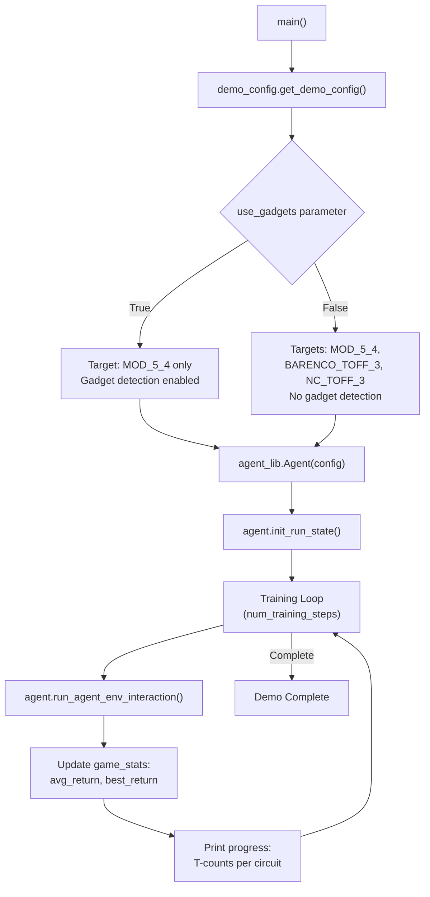
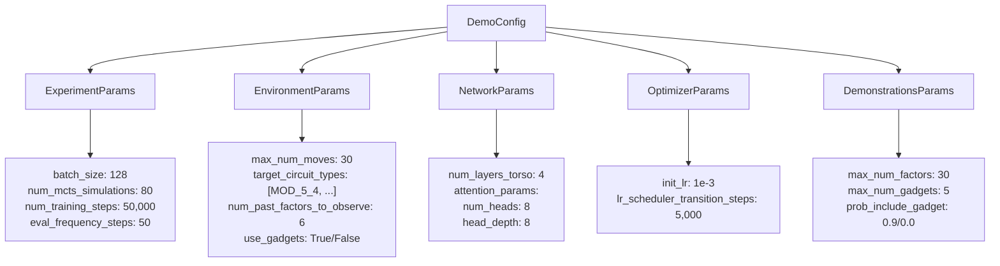

<!-- source: DeepWiki mcp.deepwiki.com · repo google-deepmind/alphatensor_quantum · page 2 Getting Started · fetched 2026-10-26 -->

# Getting Started

<details>
<summary>Relevant source files</summary>

The following files were used as context for generating this wiki page:

- [README.md](README.md)
- [src/demo/demo_config.py](src/demo/demo_config.py)
- [src/demo/run_demo.py](src/demo/run_demo.py)

</details>


This guide walks you through setting up and running the AlphaTensor-Quantum demo, which showcases a reinforcement learning system for quantum circuit optimization. The demo provides a simplified implementation that can reproduce key results from the AlphaTensor-Quantum paper on a single machine.

For information about the overall system architecture, see [Core Architecture](#3). For details about the precomputed decomposition results, see [Precomputed Data Assets](#7).

## Prerequisites

Before running the demo, ensure you have the following requirements:

| Requirement | Details |
|-------------|---------|
| **Python Version** | Python 3 (tested with Python 3.11.9) |
| **Hardware** | Machine with GPU or TPU strongly recommended |
| **Memory** | Sufficient RAM for neural network training |
| **Operating System** | Any system supporting Python 3 and JAX |

The demo has been specifically tested on an Nvidia Quadro P1000 GPU, though other CUDA-compatible GPUs should work as well.

**Sources:** [README.md:33-37]()

## Installation

The demo requires installing Python dependencies but no complex setup procedures:

1. **Clone the repository** (if not already done):
   ```bash
   git clone https://github.com/google-deepmind/alphatensor_quantum.git
   cd alphatensor_quantum
   ```

2. **Install dependencies**:
   ```bash
   pip3 install -r alphatensor_quantum/src/demo/requirements.txt
   ```

Note that the main `/src` directory contains library code that does not require installation, while `/src/demo` contains the executable demo code.

**Sources:** [README.md:29-37]()

## Demo Execution Flow

The following diagram shows how the main demo components interact during execution:



**Sources:** [src/demo/run_demo.py:51-90](), [src/demo/demo_config.py:72-96]()

## Running the Demo

Execute the demo from the parent directory containing the `alphatensor_quantum` repository:

```bash
python3 -m alphatensor_quantum.src.demo.run_demo
```

The demo will automatically start with the default configuration. By default, it runs with `use_gadgets=True`, which focuses on a single target circuit (`MOD_5_4`) and enables gadget detection for more efficient decompositions.

### Key Execution Parameters

The demo uses the following default settings from [src/demo/demo_config.py:98-111]():

| Parameter | Value | Description |
|-----------|-------|-------------|
| `batch_size` | 128 | Number of parallel environments |
| `num_mcts_simulations` | 80 | MCTS simulations per action |
| `num_training_steps` | 50,000 | Total training iterations |
| `eval_frequency_steps` | 50 | Progress reporting frequency |

**Sources:** [README.md:46-48](), [src/demo/run_demo.py:54]()

## Configuration System

The demo configuration is hierarchical, with different parameter groups controlling various aspects of the system:



### Target Circuit Configuration

The `use_gadgets` parameter significantly affects which circuits are targeted:

- **With gadgets** (`use_gadgets=True`): Targets only `MOD_5_4` circuit with gadget detection enabled
- **Without gadgets** (`use_gadgets=False`): Targets three circuits: `MOD_5_4`, `BARENCO_TOFF_3`, and `NC_TOFF_3`

**Sources:** [src/demo/demo_config.py:72-96](), [src/demo/demo_config.py:98-146]()

## Understanding the Output

During execution, the demo prints progress information at regular intervals:

```
Step: 50 .. Running Average Returns: [-7.] .. Time taken: 0.12 seconds/step
  Best T-count for mod_5_4: 7
Step: 100 .. Running Average Returns: [-6.8] .. Time taken: 0.11 seconds/step
  Best T-count for mod_5_4: 6
```

### Output Interpretation

| Output Field | Meaning |
|--------------|---------|
| **Step** | Current training iteration |
| **Running Average Returns** | Smoothed average rewards (negative T-count) |
| **Time taken** | Seconds per training step |
| **Best T-count** | Lowest T-gate count achieved for each target circuit |

The system reports negative returns because it maximizes rewards, where the reward is the negative T-count (lower T-count = higher reward).

### Expected Performance

Based on the demo documentation, you should expect:

- **With gadgets**: Best T-count for `MOD_5_4` achievable in ~450 iterations
- **Without gadgets**: Best T-counts for all three targets achievable in ~7,800 iterations

**Sources:** [src/demo/run_demo.py:27-32](), [src/demo/run_demo.py:72-89]()

## Modifying the Configuration

To experiment with different settings, modify the configuration in [src/demo/run_demo.py:54]():

```python
# Change this line to switch between gadget modes
config = demo_config.get_demo_config(
    use_gadgets=False  # Set to True for gadget-enabled experiment
)
```

For more extensive modifications, you can create custom configuration parameters by following the patterns in [src/demo/demo_config.py]().

**Sources:** [src/demo/run_demo.py:52-55]()

## Next Steps

After successfully running the demo:

1. **Explore the configuration system** - See [Configuration System](#5) for detailed parameter explanations
2. **Understand the core architecture** - See [Core Architecture](#3) for system internals
3. **Analyze precomputed results** - See [Decomposition Analysis](#7.1) for benchmarking against known optimal results
4. **Examine the mathematical foundations** - See [Mathematical Foundations](#4) for the underlying algorithms

The demo serves as an entry point to the full AlphaTensor-Quantum system and can be extended for more complex quantum circuit optimization tasks.

**Sources:** [src/demo/run_demo.py:34-38]()

---

