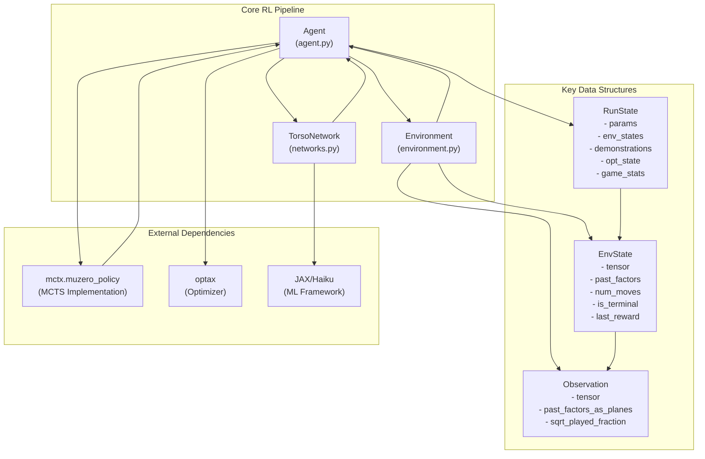
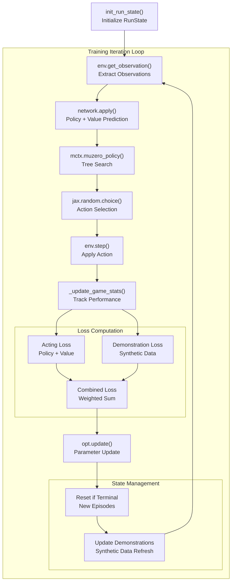
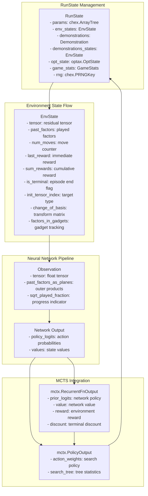

<!-- source: DeepWiki mcp.deepwiki.com · repo google-deepmind/alphatensor_quantum · page 3 Core Architecture · fetched 2026-10-26 -->

# Core Architecture

Relevant source files

The following files were used as context for generating this wiki page:

- [src/demo/agent.py](src/demo/agent.py)
- [src/environment.py](src/environment.py)
- [src/networks.py](src/networks.py)

This document explains the main architectural components of the AlphaTensor-Quantum reinforcement learning system and how they work together in the training pipeline. The core architecture consists of three primary subsystems: the Agent system for RL orchestration, the Environment system for quantum circuit decomposition games, and the Neural Network system for policy and value prediction.

For detailed information about individual components, see [Agent System](#3.1), [Environment System](#3.2), and [Neural Networks](#3.3). For mathematical foundations underlying these components, see [Mathematical Foundations](#4).

## System Overview

The AlphaTensor-Quantum system implements a reinforcement learning approach to quantum circuit optimization using Monte Carlo Tree Search (MCTS) and neural networks. The architecture follows the AlphaZero paradigm, adapted for the specific domain of tensor decomposition games.

### Main Component Architecture

**Sources:** [src/demo/agent.py:54-73](), [src/environment.py:33-62](), [src/environment.py:65-76](), [src/networks.py:256-272]()

## Training Pipeline Data Flow

The training pipeline orchestrates the interaction between acting (gameplay), learning (neural network updates), and synthetic demonstrations. The `Agent` class manages this entire pipeline through its `run_agent_env_interaction` method.

### RL Training Loop Architecture

**Sources:** [src/demo/agent.py:425-548](), [src/demo/agent.py:259-332](), [src/demo/agent.py:166-221]()

## Component Integration and State Management

The system maintains several interconnected state objects that flow through the training pipeline. The `RunState` serves as the central container for all training state, while `EnvState` tracks individual game episodes.

### State and Component Interaction

**Sources:** [src/demo/agent.py:54-73](), [src/environment.py:33-62](), [src/environment.py:65-76](), [src/demo/agent.py:223-257]()

## Key Architectural Patterns

### Neural Network Architecture

The neural network system uses a specialized `TorsoNetwork` with symmetrized axial attention, designed for the geometric structure of tensor decomposition problems.

| Component | Class | Purpose |
|-----------|-------|---------|
| Main Network | `NeuralNetwork` | Simple policy/value head wrapper |
| Feature Extraction | `TorsoNetwork` | Core network architecture |
| Attention Mechanism | `_SymmetrizedAxialAttention` | Geometric-aware attention |
| Transformer Blocks | `_TransformerDecoderBlock` | Self-attention + feedforward |
| Symmetry Handling | `Symmetrization` | Learnable symmetry operations |

**Sources:** [src/demo/agent.py:76-114](), [src/networks.py:256-309](), [src/networks.py:185-253]()

### Environment Game Mechanics

The environment implements a tensor decomposition game where actions correspond to rank-one tensor updates. The game terminates when the tensor becomes zero or maximum moves are reached.

| Mechanism | Implementation | Key Functions |
|-----------|---------------|---------------|
| Action Space | Factor indices | `factors.action_index_to_factor` |
| State Transitions | Rank-one updates | `factors.rank_one_update_to_tensor` |
| Reward System | Move penalties + gadget bonuses | Built into `step()` method |
| Termination | Zero tensor or max moves | `jnp.all(new_tensor == 0)` |
| Gadget Detection | Toffoli and CS patterns | `factors.factors_form_*_gadget` |

**Sources:** [src/environment.py:109-196](), [src/environment.py:316-340]()

### Training Loop Integration

The `Agent` orchestrates the entire training process through the `_run_iteration_agent_env_interaction` method, which handles:

1. **Acting Phase**: MCTS policy search using current network
2. **Learning Phase**: Loss computation and parameter updates  
3. **State Management**: Environment resets and demonstration updates
4. **Statistics Tracking**: Game performance monitoring

The system uses a combined loss function that balances acting experience with synthetic demonstrations, with the demonstration weight decreasing over training steps.

**Sources:** [src/demo/agent.py:425-548](), [src/demo/agent.py:334-381](), [src/demo/agent.py:383-423]()

---

