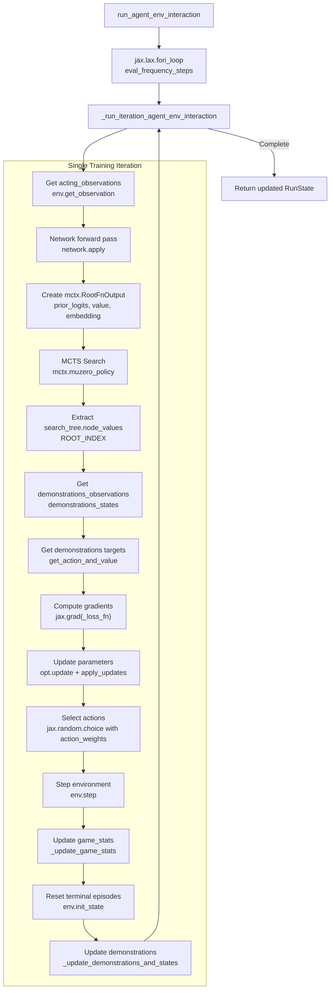
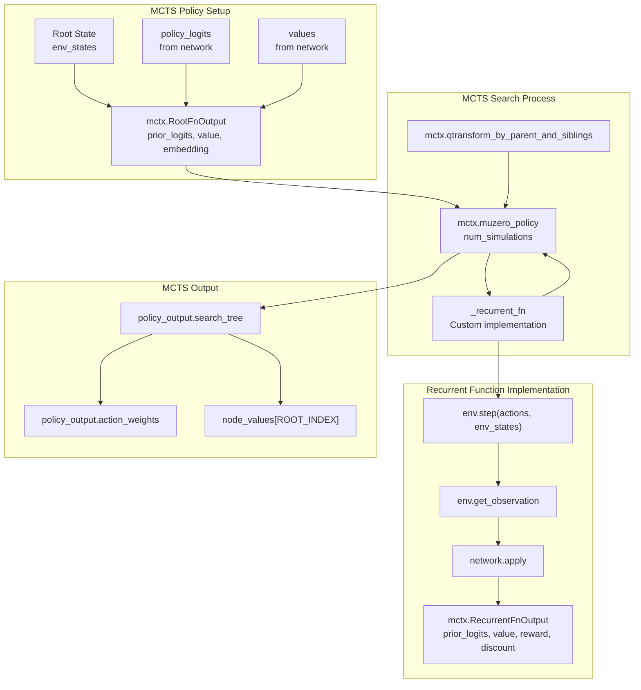
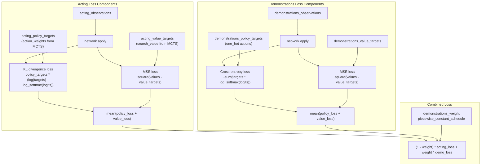
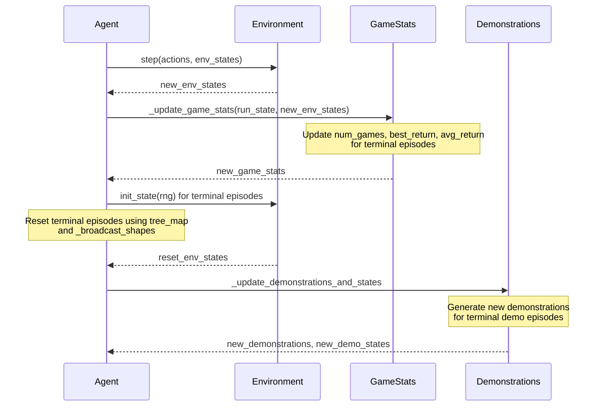
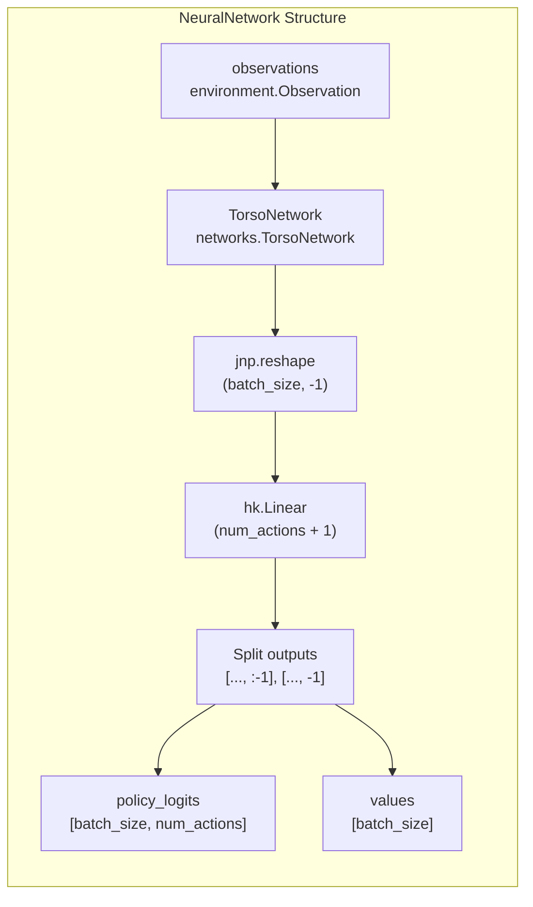

<!-- source: DeepWiki mcp.deepwiki.com · repo google-deepmind/alphatensor_quantum · page 3.1 Agent System · fetched 2026-10-26 -->

# Agent System

<details>
<summary>Relevant source files</summary>

The following files were used as context for generating this wiki page:

- [src/demo/agent.py](src/demo/agent.py)
- [src/demo/demo_config.py](src/demo/demo_config.py)

</details>


This document covers the reinforcement learning agent implementation in AlphaTensor-Quantum, including its training loop, MCTS integration, and state management components. The agent orchestrates the interaction between neural networks, the quantum circuit decomposition environment, and Monte Carlo Tree Search to learn optimal quantum circuit factorizations.

For information about the environment that the agent interacts with, see [Environment System](#3.2). For details about the neural network architecture used by the agent, see [Neural Networks](#3.3). For configuration parameters, see [Configuration System](#5).

## Agent Architecture Overview

The `Agent` class serves as the central controller that orchestrates the reinforcement learning process. It integrates multiple components including neural networks, MCTS policy search, environment interactions, and synthetic demonstrations.

```mermaid
graph TB
    subgraph "Agent System Core"
        Agent["Agent<br/>(agent.py)"]
        RunState["RunState<br/>NamedTuple"]
        GameStats["GameStats<br/>NamedTuple"]
    end
    
    subgraph "Neural Network Components"
        NeuralNetwork["NeuralNetwork<br/>hk.Module"]
        TorsoNetwork["TorsoNetwork<br/>(networks.py)"]
        PolicyHead["Policy Head<br/>Linear Layer"]
        ValueHead["Value Head<br/>Linear Layer"]
    end
    
    subgraph "MCTS Integration"
        MuzeroPolicy["mctx.muzero_policy"]
        RecurrentFn["_recurrent_fn"]
        RootFnOutput["mctx.RootFnOutput"]
        PolicyOutput["PolicyOutput"]
    end
    
    subgraph "Environment Interface"
        Environment["Environment<br/>(environment.py)"]
        EnvState["EnvState"]
        Observation["Observation"]
    end
    
    subgraph "Demonstrations"
        SyntheticDemos["demonstrations_lib"]
        Demonstrations["Demonstration"]
    end
    
    subgraph "Optimization"
        OptaxOptimizer["optax.adamw + clip"]
        LossFunction["_loss_fn"]
        Scheduler["exponential_decay"]
    end
    
    Agent --> RunState
    Agent --> NeuralNetwork
    Agent --> MuzeroPolicy
    Agent --> Environment
    Agent --> OptaxOptimizer
    
    RunState --> GameStats
    RunState --> EnvState
    RunState --> Demonstrations
    
    NeuralNetwork --> TorsoNetwork
    NeuralNetwork --> PolicyHead
    NeuralNetwork --> ValueHead
    
    MuzeroPolicy --> RecurrentFn
    MuzeroPolicy --> RootFnOutput
    MuzeroPolicy --> PolicyOutput
    
    RecurrentFn --> Environment
    
    Agent --> SyntheticDemos
    OptaxOptimizer --> Scheduler
    OptaxOptimizer --> LossFunction
```

*Sources: [src/demo/agent.py:135-165](), [src/demo/agent.py:76-115]()*

## Core Data Structures

The agent system uses several key data structures to maintain state and track training progress:

### RunState

The `RunState` NamedTuple encapsulates the complete state of the training run:

| Field | Type | Purpose |
|-------|------|---------|
| `params` | `chex.ArrayTree` | Neural network parameters |
| `env_states` | `environment.EnvState` | Current environment states for each batch element |
| `demonstrations` | `demonstrations_lib.Demonstration` | Synthetic demonstration data |
| `demonstrations_states` | `environment.EnvState` | Environment states for demonstrations |
| `opt_state` | `optax.OptState` | Optimizer state |
| `game_stats` | `GameStats` | Training statistics and metrics |
| `rng` | `chex.PRNGKey` | Random number generator key |

### GameStats

The `GameStats` NamedTuple tracks performance metrics across different target circuit types:

| Field | Type | Purpose |
|-------|------|---------|
| `num_games` | `jt.Integer[jt.Array, 'batch_size num_target_tensors']` | Count of completed games per target |
| `best_return` | `jt.Float[jt.Array, 'num_target_tensors']` | Best return achieved per target type |
| `avg_return` | `jt.Float[jt.Array, 'batch_size num_target_tensors']` | Smoothed average return per target |

*Sources: [src/demo/agent.py:54-74](), [src/demo/agent.py:36-52]()*

## Training Loop Architecture

The agent implements a structured training loop that alternates between environment interaction, MCTS search, and neural network updates:



*Sources: [src/demo/agent.py:425-529](), [src/demo/agent.py:530-549]()*

## MCTS Integration

The agent integrates Monte Carlo Tree Search through the `mctx.muzero_policy` function, using a custom recurrent function to handle the deterministic quantum circuit environment:



The `_recurrent_fn` method implements the environment dynamics for MCTS simulation. Since the quantum circuit environment is deterministic, it directly steps the environment and applies the neural network to get new policy and value estimates.

*Sources: [src/demo/agent.py:223-258](), [src/demo/agent.py:448-458]()*

## Loss Computation and Optimization

The agent uses a composite loss function that combines losses from both environment interaction (acting) and synthetic demonstrations:

### Loss Function Components



The optimizer uses `optax.adamw` with exponential learning rate decay and gradient clipping:

| Component | Configuration |
|-----------|---------------|
| Base Optimizer | `optax.adamw` with weight decay |
| Learning Rate | `exponential_decay` scheduler |
| Gradient Clipping | `clip_by_global_norm` |
| Scheduler | Staircase decay with configurable steps |

*Sources: [src/demo/agent.py:259-333](), [src/demo/agent.py:151-165]()*

## State Management

The agent manages multiple types of state that need to be synchronized and updated throughout training:

### Environment State Updates



### State Broadcasting and Updates

The agent uses utility functions to handle batch-wise state updates:

- `_broadcast_shapes`: Reshapes arrays for batch-wise operations
- `tree_map`: Applies updates conditionally based on terminal states
- Smoothed averaging for `avg_return` statistics
- Reset logic for terminal episodes

*Sources: [src/demo/agent.py:334-382](), [src/demo/agent.py:383-424](), [src/demo/agent.py:117-133]()*

## Neural Network Integration

The `NeuralNetwork` class provides a simplified interface that combines the `TorsoNetwork` with linear policy and value heads:



The number of actions is calculated as `2^max_tensor_size - 1`, representing all possible non-zero factor indices in the quantum circuit decomposition space.

*Sources: [src/demo/agent.py:76-115](), [src/demo/agent.py:147-150]()*

---

