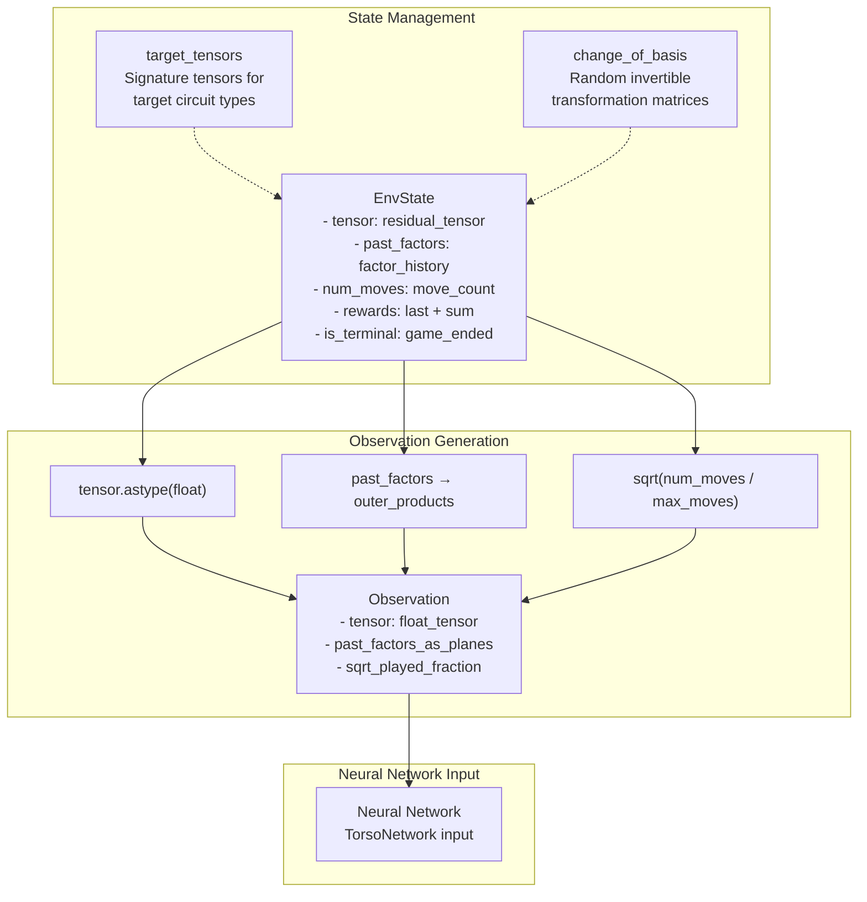
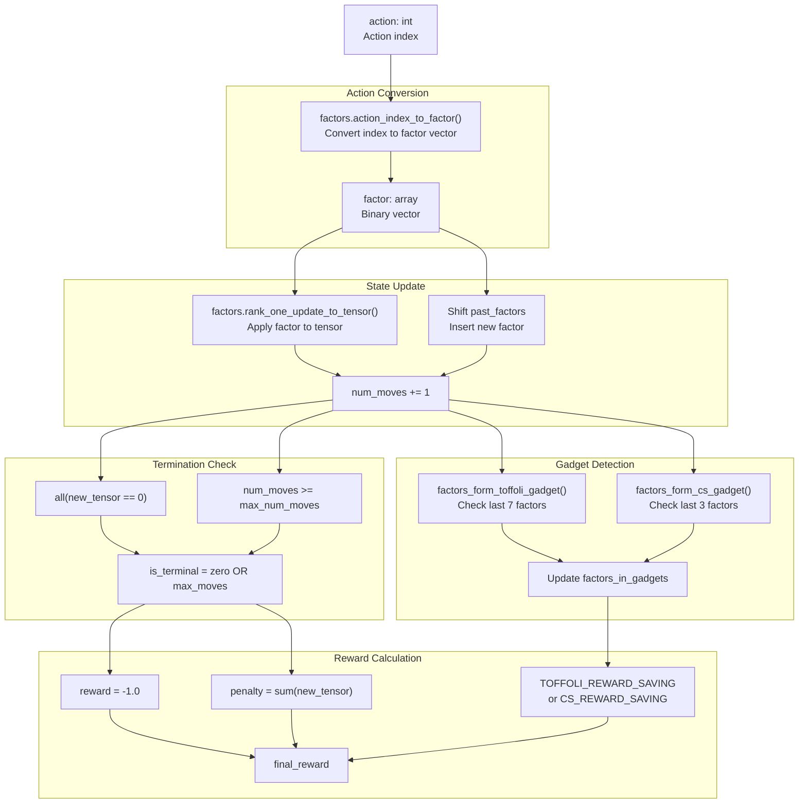
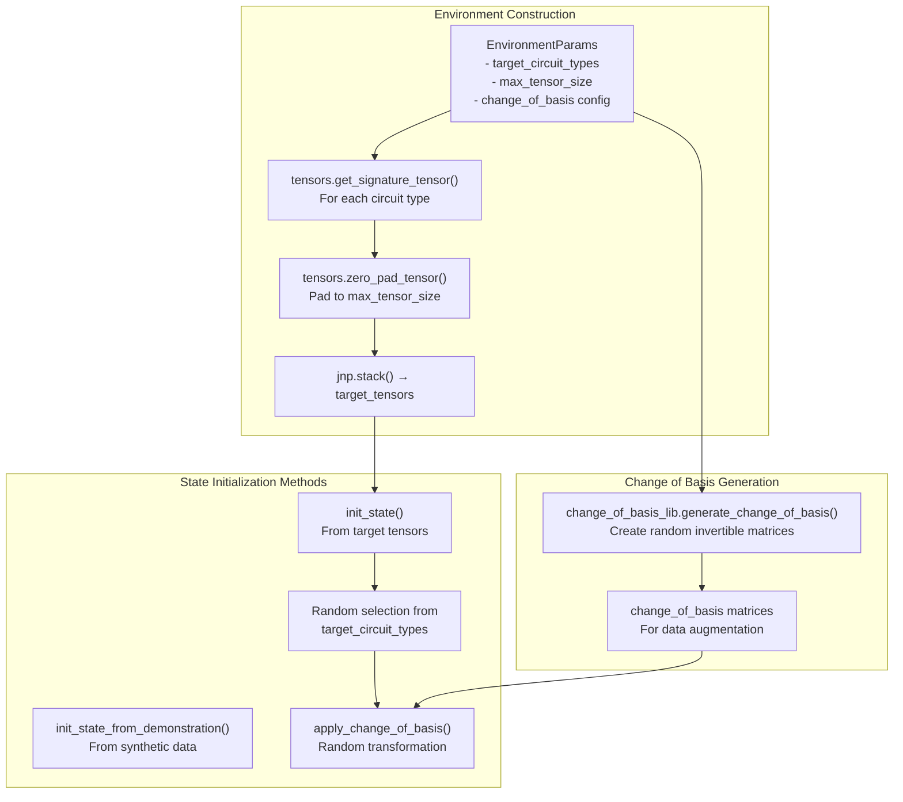
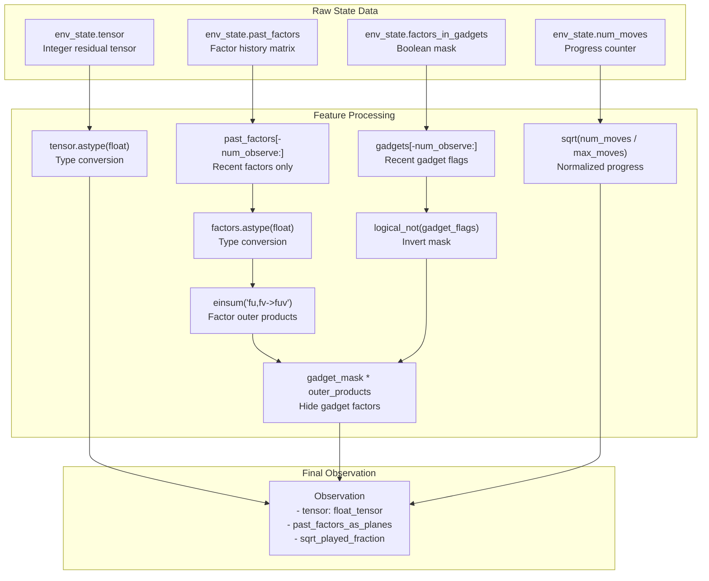

<!-- source: DeepWiki mcp.deepwiki.com · repo google-deepmind/alphatensor_quantum · page 3.2 Environment System · fetched 2026-10-26 -->

# Environment System

Relevant source files

The following files were used as context for generating this wiki page:

- [src/environment.py](src/environment.py)
- [src/environment_test.py](src/environment_test.py)

The Environment System implements the quantum circuit decomposition game environment for the AlphaTensor-Quantum reinforcement learning system. This system manages state transitions, reward calculations, and observation generation for training agents to find efficient quantum circuit decompositions. For neural network architecture details, see [Neural Networks](#3.3). For agent training loop implementation, see [Agent System](#3.1).

## Core Components

The environment system consists of three main data structures that work together to manage the decomposition game state and provide observations to the neural network.

### State Representation

The `EnvState` class represents the complete state of a decomposition game at any point in time. It tracks the current residual tensor, the history of applied factors, game progress, and reward information.

| Field | Type | Purpose |
|-------|------|---------|
| `tensor` | Integer array | Current residual tensor being decomposed |
| `past_factors` | Integer array | History of applied factors (max_num_moves × size) |
| `num_moves` | Integer | Current number of moves taken |
| `last_reward` | Float | Immediate reward from last action |
| `sum_rewards` | Float | Cumulative reward total |
| `is_terminal` | Boolean | Whether game has ended |
| `init_tensor_index` | Integer | Index of target circuit type |
| `change_of_basis` | Integer array | Applied basis transformation matrix |
| `factors_in_gadgets` | Boolean array | Tracks which factors are part of gadgets |

The `Observation` class transforms the environment state into neural network input format, converting raw integer data to float arrays and computing derived features.

**Environment State and Observation Flow**

Sources: [src/environment.py:33-77]()

## Game Mechanics

### Action Processing and State Transitions

The `step` method implements the core game mechanics, converting action indices to factors and applying rank-one updates to the residual tensor. The method handles termination conditions, gadget detection, and reward calculation in a single atomic operation.

**Step Function Flow**

Sources: [src/environment.py:109-196]()

### Gadget Recognition and Rewards

The environment implements specialized reward bonuses for recognizing quantum circuit gadgets - specifically Toffoli and Controlled-S (CS) gadgets. These gadgets represent efficient implementations of common quantum operations.

| Gadget Type | Factors Required | Reward Saving | Detection Function |
|-------------|------------------|---------------|-------------------|
| Toffoli | 7 | `TOFFOLI_REWARD_SAVING` | `factors_form_toffoli_gadget` |
| CS | 3 | `CS_REWARD_SAVING` | `factors_form_cs_gadget` |

The gadget detection system tracks which factors are part of gadgets using the `factors_in_gadgets` boolean array, preventing double-counting and ensuring proper reward attribution.

Sources: [src/environment.py:141-185]()

## Environment Initialization

### Target Circuit Selection

The `Environment` class initializes with a set of target circuit types and their corresponding signature tensors. These tensors are zero-padded to a common size and stored for random sampling during episode initialization.

**Initialization and Target Selection**

Sources: [src/environment.py:82-104](), [src/environment.py:198-283]()

### Change of Basis Transformations

The environment supports data augmentation through random change of basis transformations. Each episode can optionally apply a random invertible matrix transformation to the target tensor, increasing the diversity of training examples while preserving the underlying decomposition structure.

The `_apply_random_change_of_basis` method uses a two-stage randomization process:
1. Bernoulli trial to decide between canonical basis (identity) or transformed basis
2. Random selection from pre-generated invertible matrices

Sources: [src/environment.py:224-251]()

## Observation Generation

### Neural Network Input Format

The `get_observation` method converts the raw environment state into a format suitable for neural network processing. This transformation includes type conversion, feature engineering, and masking of gadget factors.

**Observation Processing Pipeline**

Sources: [src/environment.py:316-340]()

### Factor Masking for Gadgets

A key feature of the observation system is the masking of factors that are part of recognized gadgets. The `past_factors_as_planes` computation multiplies the outer products by the inverted gadget mask, effectively hiding gadget factors from the neural network to prevent interference with gadget recognition rewards.

Sources: [src/environment.py:329-336]()

## Integration Points

The Environment System integrates with several other components of the AlphaTensor-Quantum system:

- **Factor Operations**: Uses `factors.py` for action-to-factor conversion, rank-one updates, and gadget detection
- **Tensor Utilities**: Relies on `tensors.py` for signature tensor generation and zero-padding operations  
- **Change of Basis**: Employs `change_of_basis.py` for matrix generation and tensor transformations
- **Demonstrations**: Supports initialization from synthetic demonstrations generated by `demonstrations.py`
- **Configuration**: Configured through `EnvironmentParams` from the configuration system

Sources: [src/environment.py:26-30]()

---

