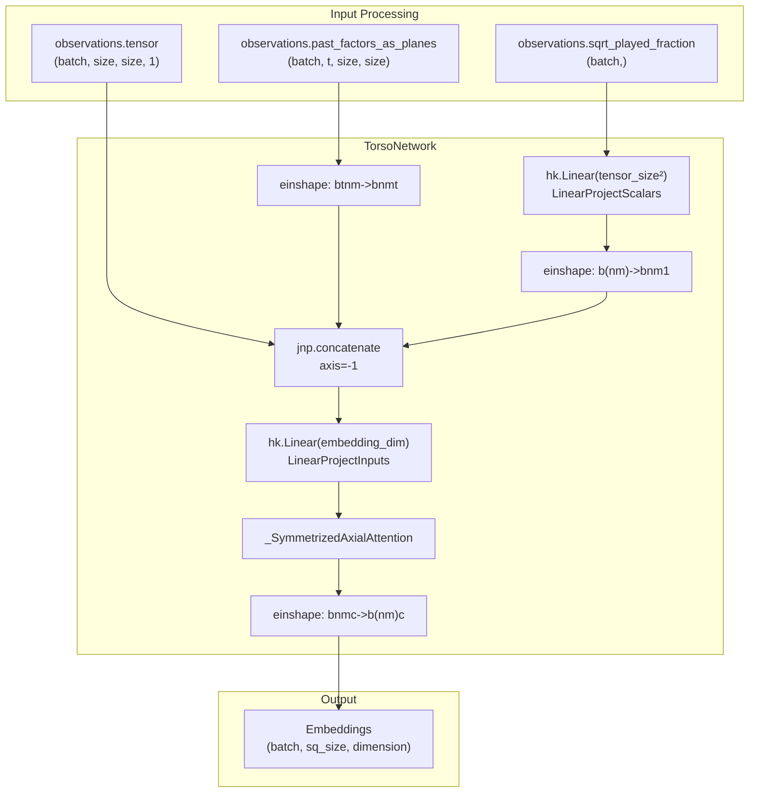
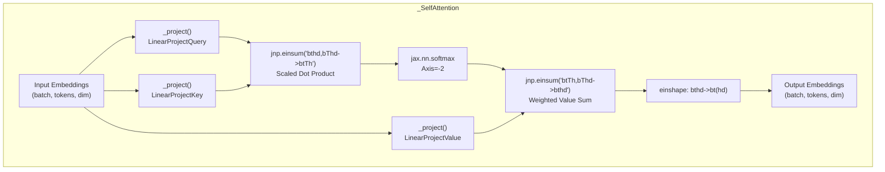
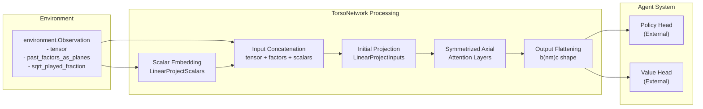

<!-- source: DeepWiki mcp.deepwiki.com · repo google-deepmind/alphatensor_quantum · page 3.3 Neural Networks · fetched 2026-10-26 -->

# Neural Networks

Relevant source files

The following files were used as context for generating this wiki page:

- [src/networks.py](src/networks.py)
- [src/networks_test.py](src/networks_test.py)

This document covers the neural network architecture used in AlphaTensor-Quantum for processing quantum circuit decomposition observations and generating policy and value predictions. The neural networks are implemented using JAX and Haiku and feature a specialized symmetrized axial attention mechanism designed for tensor data.

For information about how these networks integrate with the reinforcement learning agent, see [Agent System](#3.1). For details on the environment observations that feed into these networks, see [Environment System](#3.2).

## Overall Architecture

The neural network system in AlphaTensor-Quantum consists of a main `TorsoNetwork` that processes environment observations and outputs embeddings for downstream policy and value heads. The architecture is specifically designed to handle the structured tensor data that represents quantum circuit decomposition states.

**Sources:** [src/networks.py:274-309]()

## Core Components

### TorsoNetwork

The `TorsoNetwork` is the main neural network class that processes environment observations. It takes structured observations containing the current tensor state, past factors, and game metadata, then outputs embeddings suitable for policy and value prediction.

| Component | Input Shape | Output Shape | Purpose |
|-----------|-------------|--------------|---------|
| Scalar projection | `(batch,)` | `(batch, size, size, 1)` | Embeds game progress |
| Input concatenation | `(batch, size, size, channels)` | `(batch, size, size, total_channels)` | Combines all input modalities |
| Linear projection | `(batch, size, size, total_channels)` | `(batch, size, size, embedding_dim)` | Projects to attention dimension |
| Symmetrized axial attention | `(batch, size, size, embedding_dim)` | `(batch, size, size, embedding_dim)` | Main processing |
| Final reshape | `(batch, size, size, embedding_dim)` | `(batch, size², embedding_dim)` | Flattens for heads |

**Sources:** [src/networks.py:256-310]()

### Symmetrized Axial Attention

The `_SymmetrizedAxialAttention` class implements the core processing mechanism that alternates between axial attention operations and symmetrization. This architecture is designed to respect the symmetries present in tensor decomposition problems.

```mermaid
graph TD
    subgraph "Single Layer Processing"
        Input["Input Tensor<br/>(batch, size, size, dim)"]
        Reshape1["einshape: bnme->(bn)me"]
        AxialAttn1["_TransformerDecoderBlock<br/>axial_attention_1"]
        Reshape2["einshape: (bn)me->(bm)ne"]
        AxialAttn2["_TransformerDecoderBlock<br/>axial_attention_2"]
        Reshape3["einshape: (bm)ne->bnme"]
        Symmetrize["Symmetrization<br/>A*X + (1-A)*X.T"]
        Output["Output Tensor<br/>(batch, size, size, dim)"]
    end
    
    Input --> Reshape1
    Reshape1 --> AxialAttn1
    AxialAttn1 --> Reshape2
    Reshape2 --> AxialAttn2
    AxialAttn2 --> Reshape3
    Reshape3 --> Symmetrize
    Symmetrize --> Output
    
    subgraph "Multi-Layer Structure"
        Layer1["Layer 0"]
        Layer2["Layer 1"]
        LayerN["Layer N-1"]
        Layer1 --> Layer2
        Layer2 --> LayerN
    end
```

**Sources:** [src/networks.py:185-253]()

### Self-Attention Mechanism

The `_SelfAttention` class implements standard multi-head self-attention with query, key, and value projections. It uses scaled dot-product attention with configurable number of heads and head depth.

**Sources:** [src/networks.py:32-82]()

### Symmetrization Layer

The `Symmetrization` class implements a learnable symmetrization operation that blends a tensor with its transpose using learnable weights. This preserves important symmetries in the tensor decomposition problem.

The operation is: `A ⊙ X + (1 - A) ⊙ X.T` where:
- `X` is the input tensor of shape `(batch, size, size, channels)`
- `A` is a learnable weight matrix of shape `(size, size, 1)` 
- `⊙` denotes element-wise multiplication
- `X.T` transposes the two size dimensions

**Sources:** [src/networks.py:146-182]()

## Data Flow and Integration

The neural network processes observations from the quantum circuit decomposition environment and outputs embeddings that are consumed by policy and value heads (managed by the agent system).

**Sources:** [src/networks.py:274-309](), [src/networks_test.py:41-74]()

## Configuration

The neural network architecture is controlled by configuration parameters defined in the `config_lib` module:

| Parameter | Type | Purpose |
|-----------|------|---------|
| `num_layers_torso` | int | Number of symmetrized axial attention layers |
| `attention_params.num_heads` | int | Number of attention heads |
| `attention_params.head_depth` | int | Dimension of each attention head |
| `attention_params.mlp_widening_factor` | int | MLP hidden layer expansion factor |
| `attention_params.init_scale` | float | Weight initialization scale |
| `init_scale` | float | Overall network initialization scale |

The embedding dimension is computed as `num_heads × head_depth` and determines the internal representation size throughout the network.

**Sources:** [src/networks.py:194-204](), [src/networks.py:296-299](), [src/networks_test.py:59-66]()

---

