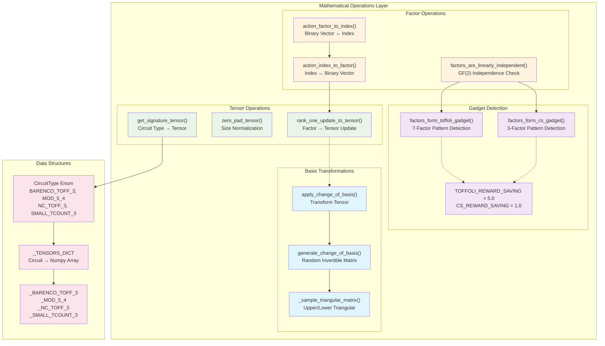
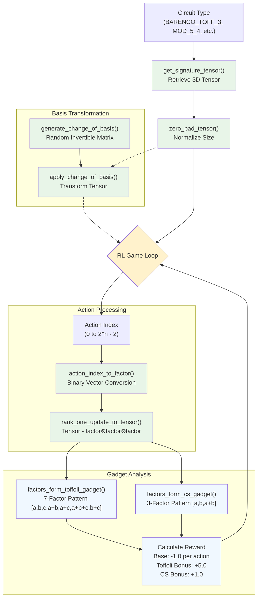

<!-- source: DeepWiki mcp.deepwiki.com · repo google-deepmind/alphatensor_quantum · page 4 Mathematical Foundations · fetched 2026-10-26 -->

# Mathematical Foundations

Relevant source files

The following files were used as context for generating this wiki page:

- [src/change_of_basis.py](src/change_of_basis.py)
- [src/factors.py](src/factors.py)
- [src/tensors.py](src/tensors.py)

This document covers the core mathematical operations and utilities that underpin the quantum circuit optimization algorithms in AlphaTensor-Quantum. It explains the fundamental mathematical concepts including tensor operations in GF(2), factor manipulations, gadget detection, and basis transformations that enable the reinforcement learning system to decompose quantum circuits efficiently.

For specific implementation details of neural networks and MCTS algorithms, see [Neural Networks](#3.3). For environment-specific game mechanics, see [Environment System](#3.2).

## Overview

The AlphaTensor-Quantum system operates primarily in the Galois Field GF(2), where all arithmetic is performed modulo 2. This mathematical foundation enables efficient representation and manipulation of quantum circuit tensors through rank-one decompositions. The system identifies beneficial structures called "gadgets" that correspond to known quantum circuit patterns with favorable T-gate costs.

## Core Mathematical Components

Sources: [src/tensors.py:1-284](), [src/factors.py:1-189](), [src/change_of_basis.py:1-85]()

## Galois Field GF(2) Operations

All mathematical operations in the system are performed in GF(2), the field with two elements {0, 1}. This choice enables efficient quantum circuit representation where:

- Addition is performed modulo 2 (XOR operation): `jnp.mod(a + b, 2)`
- Multiplication follows standard rules: `0 * x = 0`, `1 * x = x`
- Matrix operations maintain invertibility properties for basis transformations

The key advantage is that rank-one tensor decompositions correspond directly to quantum circuit factor structures, enabling the identification of T-gate optimization opportunities.

## Mathematical Operation Flow

Sources: [src/tensors.py:270-284](), [src/factors.py:32-91](), [src/change_of_basis.py:46-84]()

## Key Mathematical Properties

### Tensor Decomposition Structure
The system decomposes 3D tensors representing quantum circuits into sums of rank-one tensors of the form `factor ⊗ factor ⊗ factor`, where each factor is a binary vector in GF(2). This decomposition directly corresponds to quantum gate sequences.

### Gadget Pattern Recognition
Two important structural patterns are detected:

| Gadget Type | Factor Pattern | T-Gate Cost | Reward Bonus |
|-------------|----------------|-------------|--------------|
| Toffoli | `[a, b, c, a+b, a+c, a+b+c, b+c]` (7 factors) | 2 T-gates | +5.0 |
| CS (Controlled-S) | `[a, b, a+b]` (3 factors) | 2 T-gates | +1.0 |

### Linear Independence in GF(2)
Linear independence checks use the property that in GF(2), vectors are linearly independent if and only if they are distinct and no vector equals the sum of others. This enables efficient gadget validation.

## Integration with RL System

The mathematical operations interface with the reinforcement learning components through:

- **Observations**: Current tensor state and factor history
- **Actions**: Factor indices converted to binary vectors via `action_index_to_factor()`
- **Rewards**: T-gate reductions with gadget bonuses calculated by `factors_form_toffoli_gadget()` and `factors_form_cs_gadget()`
- **State Updates**: Tensor modifications through `rank_one_update_to_tensor()`

## Related Pages

For detailed implementations of specific mathematical components:
- [Tensor Operations](#4.1) - Signature tensors, padding, and circuit types
- [Factor Operations](#4.2) - Action conversions, gadget detection, and rewards  
- [Change of Basis](#4.3) - Matrix generation and tensor transformations

Sources: [src/tensors.py:232-284](), [src/factors.py:22-189](), [src/change_of_basis.py:16-84]()

---

