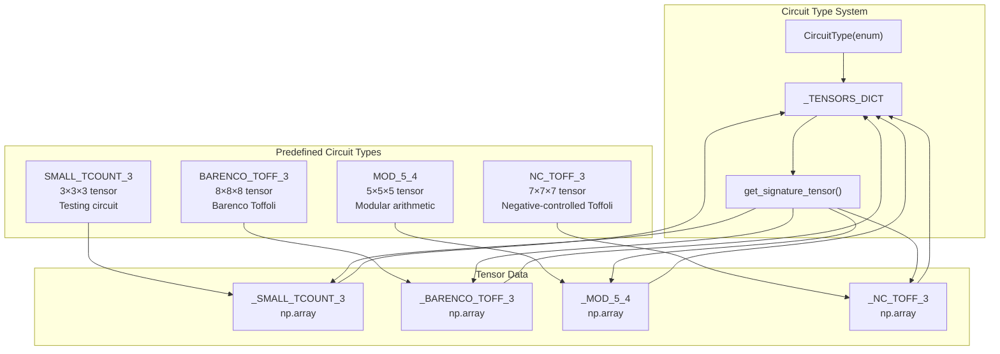
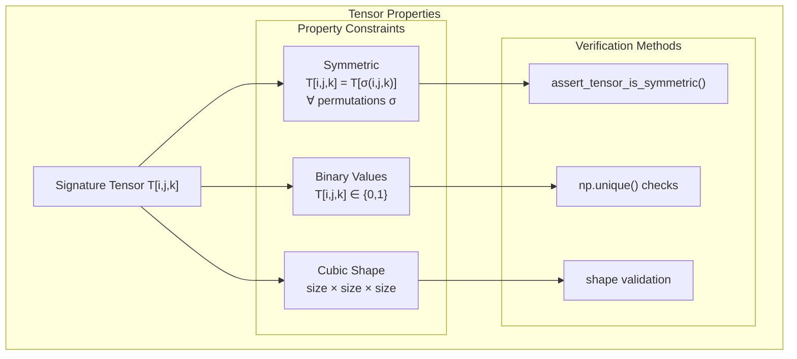
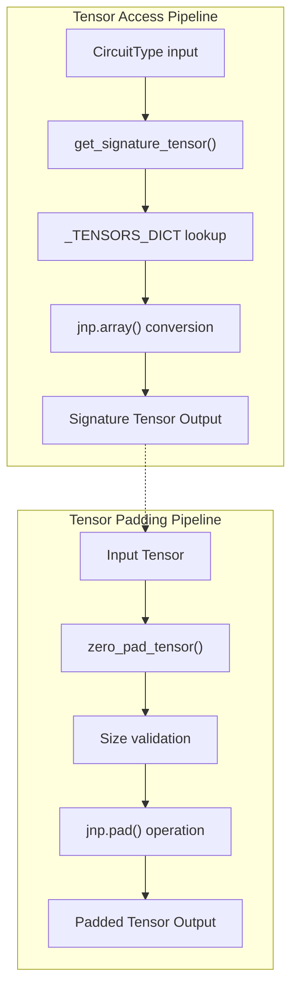
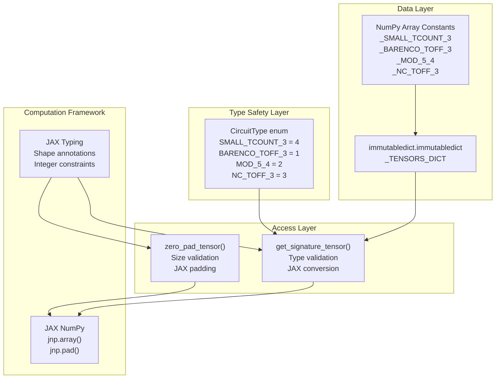

<!-- source: DeepWiki mcp.deepwiki.com · repo google-deepmind/alphatensor_quantum · page 4.1 Tensor Operations · fetched 2026-10-26 -->

# Tensor Operations

<details>
<summary>Relevant source files</summary>

The following files were used as context for generating this wiki page:

- [src/tensors.py](src/tensors.py)
- [src/tensors_test.py](src/tensors_test.py)

</details>


This document covers the tensor utilities and operations that form the mathematical foundation for quantum circuit representations in the AlphaTensor-Quantum system. The module provides signature tensors for different quantum circuit types, tensor manipulation functions, and utilities for working with symmetric binary tensors in GF(2) arithmetic.

For information about tensor decomposition using rank-one factors, see [Factor Operations](#4.2). For basis transformations applied to tensors, see [Change of Basis](#4.3).

## Circuit Types and Signature Tensors

The system defines several predefined quantum circuit types, each represented by a symmetric 3D binary tensor called a signature tensor. These tensors encode the structure of quantum circuits that the reinforcement learning agent learns to decompose.



The `CircuitType` enum provides a type-safe way to reference different quantum circuits:

| Circuit Type | Dimensions | Purpose |
|--------------|------------|---------|
| `SMALL_TCOUNT_3` | 3×3×3 | Small testing circuit with optimal T-count of 3 |
| `BARENCO_TOFF_3` | 8×8×8 | Barenco Toffoli gate decomposition |
| `MOD_5_4` | 5×5×5 | Modular arithmetic circuit |
| `NC_TOFF_3` | 7×7×7 | Negative-controlled Toffoli gate |

Sources: [src/tensors.py:232-240](), [src/tensors.py:242-247]()

## Tensor Properties and Structure

All signature tensors in the system share several key mathematical properties that are essential for the quantum circuit decomposition algorithms.



### Symmetry Properties

The signature tensors are fully symmetric, meaning they remain unchanged under any permutation of their three indices. This property is verified by testing all six possible permutations:

- `T[i,j,k] = T[i,k,j] = T[j,i,k] = T[j,k,i] = T[k,i,j] = T[k,j,i]`

This symmetry is crucial for the tensor decomposition algorithms, as it reduces the search space and ensures consistent behavior regardless of qubit ordering.

Sources: [src/tensors_test.py:60-64](), [src/tensors_test.py:57-58]()

## Tensor Manipulation Operations

The module provides utility functions for manipulating and accessing signature tensors within the quantum circuit decomposition environment.



### Zero Padding Function

The `zero_pad_tensor()` function extends smaller tensors to a specified size by adding zeros. This operation preserves the original tensor data in the leading dimensions while filling the remaining space with zeros.

**Function Signature:**
```python
zero_pad_tensor(tensor, pad_to_size) -> padded_tensor
```

**Behavior:**
- Original tensor data is preserved in indices `[0:size, 0:size, 0:size]`
- Padded regions contain only zeros
- The `pad_to_size` parameter must be at least as large as the original tensor size

Sources: [src/tensors.py:250-267](), [src/tensors_test.py:28-38]()

### Signature Tensor Retrieval

The `get_signature_tensor()` function provides type-safe access to predefined signature tensors through the `CircuitType` enum.

**Function Signature:**
```python
get_signature_tensor(circuit_type: CircuitType) -> jax.Array
```

**Implementation Details:**
- Validates that the `circuit_type` exists in `_TENSORS_DICT`
- Returns JAX arrays for efficient numerical computation
- Raises `ValueError` for unsupported circuit types

Sources: [src/tensors.py:270-283](), [src/tensors_test.py:46-58]()

## Implementation Architecture

The tensor system uses a layered architecture that separates data definitions from access patterns and provides type safety through enums.



The system uses `immutabledict` to ensure that the tensor mappings cannot be modified at runtime, providing data integrity guarantees. JAX typing annotations enforce shape constraints and ensure that all tensors contain integer values.

Sources: [src/tensors.py:19-24](), [src/tensors.py:242-247](), [src/tensors.py:251-253]()

---

