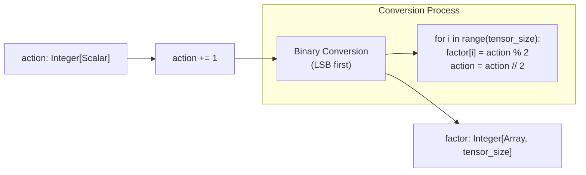
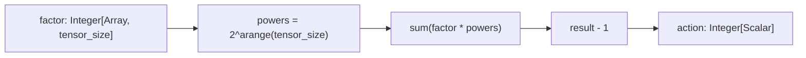
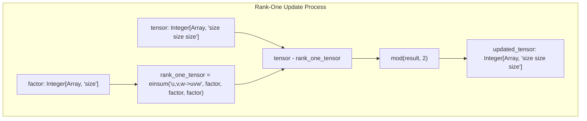
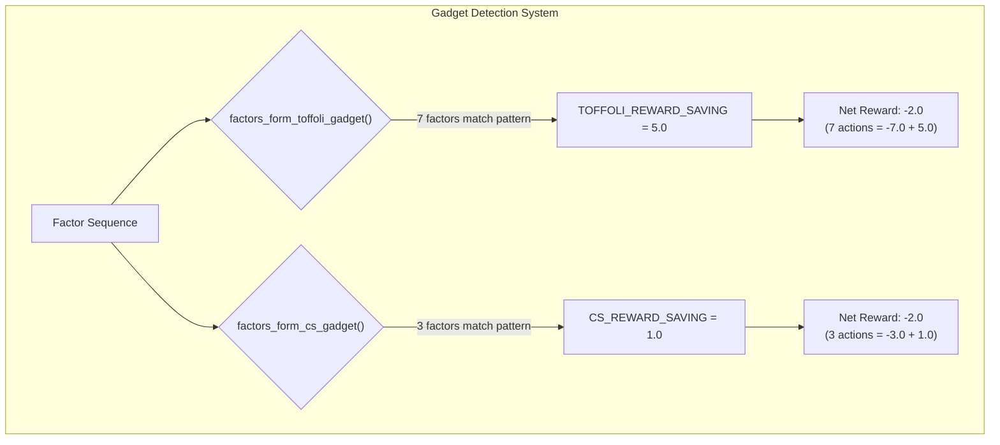
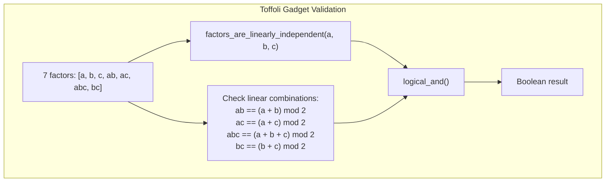
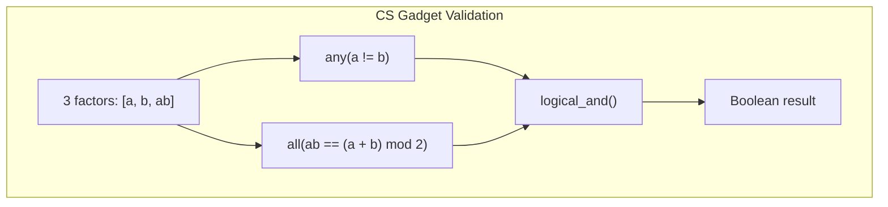
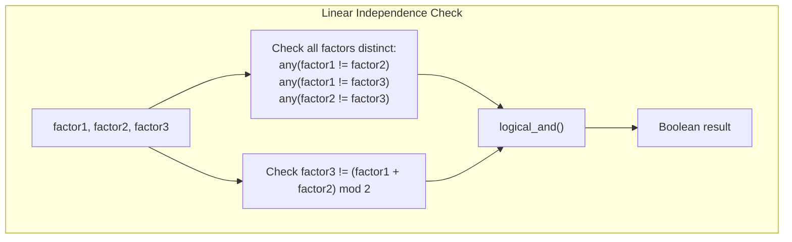
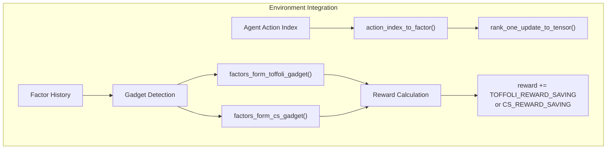

<!-- source: DeepWiki mcp.deepwiki.com · repo google-deepmind/alphatensor_quantum · page 4.2 Factor Operations · fetched 2026-10-26 -->

# Factor Operations

Relevant source files

The following files were used as context for generating this wiki page:

- [src/factors.py](src/factors.py)
- [src/factors_test.py](src/factors_test.py)

This document covers the factor utility methods that enable conversion between action indices and factor representations, tensor updates via rank-one operations, and detection of special quantum circuit gadgets for reward calculation. Factor operations form a core mathematical foundation for the AlphaTensor-Quantum reinforcement learning system.

For tensor manipulation and circuit types, see [Tensor Operations](#4.1). For basis transformations applied to factors, see [Change of Basis](#4.3).

## Action-Factor Conversion System

The factor operations system provides bidirectional conversion between action indices (used by the RL agent) and factor vectors (used for tensor decomposition). Actions are represented as integers in the range `[0, 2^tensor_size - 1]`, while factors are binary vectors in GF(2).

### Action Index to Factor Conversion

The `action_index_to_factor()` function converts scalar action indices to binary factor vectors using a shifted binary representation:

The conversion applies a unit shift to avoid the all-zero factor, mapping action 0 to factor `[1, 0, ..., 0]`. Binary digits are stored in reverse order (least significant bit first).

**Sources:** [src/factors.py:32-54]()

### Factor to Action Index Conversion  

The reverse conversion `action_factor_to_index()` reconstructs the action index from a factor vector:

This computes the weighted sum of binary digits and applies the inverse unit shift to recover the original action index.

**Sources:** [src/factors.py:57-72]()

## Tensor Update Operations

### Rank-One Tensor Updates

The `rank_one_update_to_tensor()` function performs the core tensor decomposition operation by subtracting rank-one tensors formed from factors:

The operation computes the outer product `factor ⊗ factor ⊗ factor` and subtracts it from the input tensor modulo 2, implementing tensor decomposition in GF(2).

**Sources:** [src/factors.py:75-90]()

## Gadget Detection System

The factor operations system detects special quantum circuit patterns called "gadgets" that provide T-gate savings and reward bonuses during training.

### Gadget Types and Rewards

| Gadget Type | Factor Count | T-Gate Cost | Reward Saving | Net Reward |
|-------------|--------------|-------------|---------------|------------|
| Toffoli     | 7           | 2           | 5.0           | -2.0       |
| CS          | 3           | 2           | 1.0           | -2.0       |

**Sources:** [src/factors.py:22-29]()

### Toffoli Gadget Detection

The `factors_form_toffoli_gadget()` function detects 7-factor sequences matching the pattern `[a, b, c, a+b, a+c, a+b+c, b+c]` where `a`, `b`, `c` are linearly independent:

**Sources:** [src/factors.py:121-158]()

### CS Gadget Detection

The `factors_form_cs_gadget()` function detects 3-factor sequences matching the pattern `[a, b, a+b]` where `a` and `b` are linearly independent:

**Sources:** [src/factors.py:161-188]()

## Linear Independence Operations

### Three-Factor Linear Independence

The `factors_are_linearly_independent()` function determines if three factors are linearly independent over GF(2):

In GF(2), factors are linearly independent if they are distinct and no factor equals the sum of the other two.

**Sources:** [src/factors.py:93-118]()

## Integration with Environment System

The factor operations integrate with the broader AlphaTensor-Quantum system through the environment's action processing and reward calculation:

**Sources:** [src/factors.py:1-189](), [src/factors_test.py:1-146]()

---

