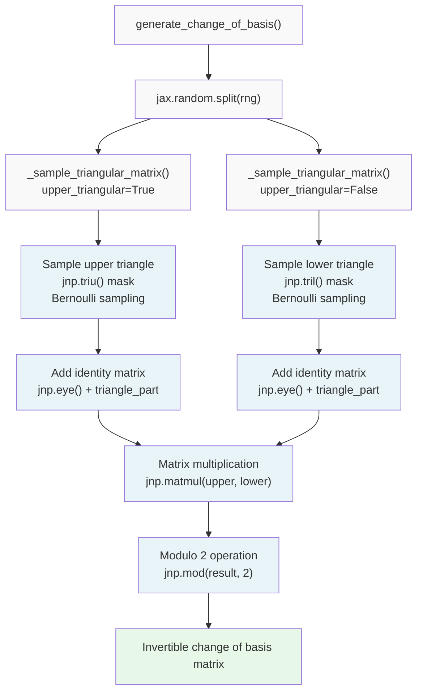
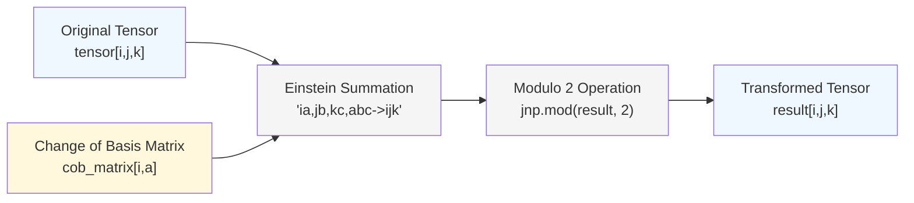
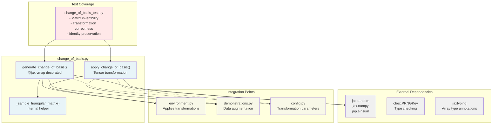

<!-- source: DeepWiki mcp.deepwiki.com · repo google-deepmind/alphatensor_quantum · page 4.3 Change of Basis · fetched 2026-10-26 -->

# Change of Basis

<details>
<summary>Relevant source files</summary>

The following files were used as context for generating this wiki page:

- [src/change_of_basis.py](src/change_of_basis.py)
- [src/change_of_basis_test.py](src/change_of_basis_test.py)

</details>


This document covers the change of basis system for tensor transformations in the AlphaTensor-Quantum codebase. The change of basis module provides functionality to generate random invertible matrices and apply linear transformations to quantum circuit signature tensors, operating in the binary field GF(2).

For information about the signature tensors that these transformations are applied to, see [Tensor Operations](#4.1). For details on how these transformations are used in the environment system, see [Environment System](#3.2).

## Purpose and Mathematical Context

The change of basis system enables data augmentation and generalization in the quantum circuit optimization process. By applying random invertible linear transformations to the signature tensors that represent quantum circuits, the system can:

- Generate equivalent representations of the same mathematical problem
- Increase training data diversity without changing the underlying optimization challenge
- Test the robustness of learned decomposition strategies across different basis representations

All operations are performed in GF(2), the binary field, where addition and multiplication are performed modulo 2. This choice aligns with the binary nature of quantum circuit operations.

**Change of Basis Matrix Generation Process**



Sources: [src/change_of_basis.py:46-65]()

## Matrix Generation Algorithm

The `generate_change_of_basis` function creates invertible matrices through a two-step triangular construction process. This approach guarantees invertibility by ensuring the determinant equals 1 in GF(2).

### Triangular Matrix Construction

The internal `_sample_triangular_matrix` function generates either upper or lower triangular matrices with the following properties:

| Parameter | Purpose |
|-----------|---------|
| `size` | Dimensions of the square matrix |
| `upper_triangular` | Boolean flag for triangle orientation |
| `prob_zero_entry` | Probability of off-diagonal entries being zero |

The construction process:
1. Uses `jnp.triu` or `jnp.tril` masking to select triangle regions
2. Samples entries using Bernoulli distribution with probability `1.0 - prob_zero_entry`
3. Adds identity matrix to ensure diagonal entries are 1

### Final Matrix Construction

The final change of basis matrix is computed as the product of upper and lower triangular matrices, modulo 2:

```
change_of_basis_matrix = (upper_triangular * lower_triangular) mod 2
```

This construction guarantees:
- Invertibility (determinant = 1 in GF(2))
- Full rank
- Reversible transformations

Sources: [src/change_of_basis.py:26-42](), [src/change_of_basis.py:46-65]()

## Tensor Transformation Process

The `apply_change_of_basis` function transforms 3D signature tensors using Einstein summation notation. The transformation applies the change of basis matrix to all three tensor modes simultaneously.

**Tensor Transformation Flow**



The mathematical operation performed is:
```
transformed_tensor[i,j,k] = Σ_a,b,c (cob_matrix[i,a] * cob_matrix[j,b] * cob_matrix[k,c] * tensor[a,b,c]) mod 2
```

This trilinear transformation preserves the tensor's mathematical properties while changing its representation basis.

Sources: [src/change_of_basis.py:68-84]()

## Code Structure and Integration

**Change of Basis Module Architecture**



Sources: [src/change_of_basis.py:1-85](), [src/change_of_basis_test.py:1-74]()

## Implementation Details

### Function Signatures and Types

The module uses JAX typing annotations for precise type specification:

| Function | Input Types | Output Type |
|----------|-------------|-------------|
| `generate_change_of_basis` | `size: int`, `prob_zero_entry: float`, `rng: chex.PRNGKey` | `jt.Integer[jt.Array, '{size} {size}']` |
| `apply_change_of_basis` | `tensor: jt.Integer[jt.Array, 'size size size']`, `cob_matrix: jt.Integer[jt.Array, 'size size']` | `jt.Integer[jt.Array, 'size size size']` |

### Vectorization and Performance

The `generate_change_of_basis` function uses `@functools.partial(jax.vmap, in_axes=(None, None, 0))` decoration to enable batch processing of multiple random keys simultaneously. This allows efficient generation of multiple change of basis matrices in parallel.

### GF(2) Operations

All arithmetic operations use modulo 2 arithmetic:
- Matrix multiplication: `jnp.matmul(upper, lower)`
- Final reduction: `jnp.mod(result, 2)`
- Tensor transformation: `jnp.mod(transformed_tensor, 2)`

Sources: [src/change_of_basis.py:45](), [src/change_of_basis.py:65](), [src/change_of_basis.py:84]()

## Testing and Validation

The test suite validates critical properties of the change of basis system:

### Matrix Properties Tests
- **Invertibility**: Verifies determinant equals 1 in GF(2)
- **Shape correctness**: Confirms output dimensions match specifications
- **Batch processing**: Tests vectorized generation functionality

### Transformation Tests
- **Correctness**: Verifies specific transformation results against expected values
- **Reversibility**: Confirms that applying inverse transformation recovers original tensor
- **Identity preservation**: Tests that identity matrix transformation leaves tensors unchanged

The tests use concrete examples with known signature tensors from `tensors.CircuitType.SMALL_TCOUNT_3` to ensure transformation accuracy.

Sources: [src/change_of_basis_test.py:28-69]()

---

