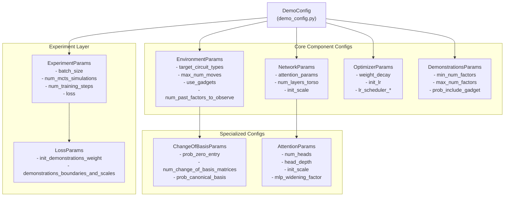
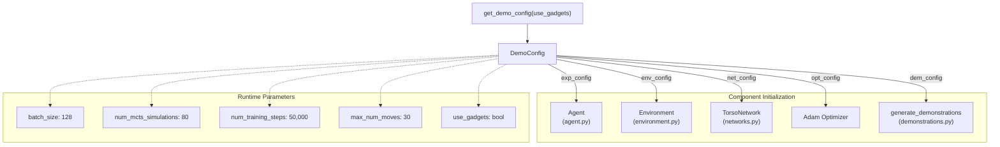
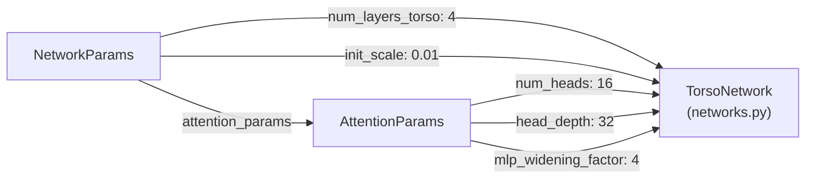
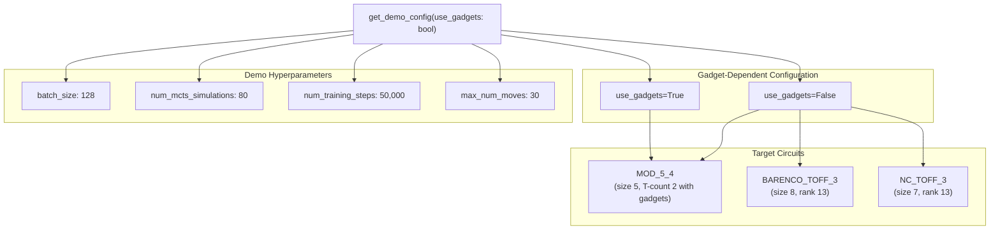

<!-- source: DeepWiki mcp.deepwiki.com · repo google-deepmind/alphatensor_quantum · page 5 Configuration System · fetched 2026-10-26 -->

# Configuration System

<details>
<summary>Relevant source files</summary>

The following files were used as context for generating this wiki page:

- [src/config.py](src/config.py)
- [src/demo/demo_config.py](src/demo/demo_config.py)

</details>


This document covers the hierarchical configuration system used throughout AlphaTensor-Quantum. The configuration system provides structured hyperparameter management for all major components including the environment, neural networks, optimization, and synthetic demonstrations. For information about how these configurations are used within specific components, see [Core Architecture](#3), [Mathematical Foundations](#4), and [Synthetic Demonstrations](#6).

## Configuration Architecture

The configuration system is built using Python dataclasses with a hierarchical structure. Each major subsystem has its own parameter class, which are then composed into higher-level configuration objects.

### Configuration Class Hierarchy



**Sources:** [src/config.py:29-158](), [src/demo/demo_config.py:24-70]()

### Configuration Usage Flow



**Sources:** [src/demo/demo_config.py:72-146]()

## Core Configuration Classes

### EnvironmentParams

The `EnvironmentParams` class controls the quantum circuit decomposition game environment settings.

| Parameter | Type | Default | Description |
|-----------|------|---------|-------------|
| `target_circuit_types` | `Sequence[tensors.CircuitType]` | Required | Circuit types to decompose |
| `target_circuit_probabilities` | `Sequence[float] \| None` | `None` | Probabilities for each circuit type |
| `max_num_moves` | `int` | `250` | Maximum moves per game |
| `use_gadgets` | `bool` | `True` | Enable Toffoli and CS gadgets |
| `num_past_factors_to_observe` | `int` | `20` | Past factors for neural network |
| `change_of_basis` | `ChangeOfBasisParams` | Default instance | Basis transformation settings |

The `max_tensor_size` property is computed dynamically from the signature tensors of the target circuit types [src/config.py:73-79]().

**Sources:** [src/config.py:45-80]()

### NetworkParams and AttentionParams

Neural network architecture is configured through nested parameter classes:



**Sources:** [src/config.py:82-115]()

### OptimizerParams

Optimization hyperparameters control the Adam optimizer and learning rate scheduling:

| Parameter | Type | Default | Description |
|-----------|------|---------|-------------|
| `weight_decay` | `float` | `1e-5` | L2 regularization strength |
| `init_lr` | `float` | `1e-4` | Initial learning rate |
| `lr_scheduler_transition_steps` | `int` | `500,000` | Steps before LR decay begins |
| `lr_scheduler_decay_factor` | `float` | `0.1` | Exponential decay factor |
| `clip_by_global_norm` | `float` | `4.0` | Gradient clipping threshold |

**Sources:** [src/config.py:140-158]()

### DemonstrationsParams

Controls synthetic demonstration generation for training:

| Parameter | Type | Default | Description |
|-----------|------|---------|-------------|
| `min_num_factors` | `int` | `1` | Minimum factors per demonstration |
| `max_num_factors` | `int` | `125` | Maximum factors per demonstration |
| `prob_zero_factor_entry` | `float` | `0.75` | Probability of zero entries |
| `prob_include_gadget` | `float` | `0.9` | Probability of including gadgets |
| `max_num_gadgets` | `int` | `15` | Maximum gadgets per demonstration |
| `prob_toffoli_gadget` | `float` | `0.6` | Probability of Toffoli vs CS gadgets |

**Sources:** [src/config.py:117-138]()

## Demo Configuration

The demo configuration system extends the core configuration with experiment-specific parameters through the `get_demo_config()` function.

### Demo-Specific Parameters



**Sources:** [src/demo/demo_config.py:72-96](), [src/demo/demo_config.py:98-111]()

### Loss Schedule Configuration

The demo includes a sophisticated loss weighting schedule for balancing synthetic demonstrations and acting episodes:

```python
loss=LossParams(
    init_demonstrations_weight=1.0,
    demonstrations_boundaries_and_scales={
        60: 0.99, 200: 0.5, 5_000: 0.2, 10_000: 0.1
    },
)
```

This progressively reduces demonstration weight from 1.0 to 0.1 over training steps [src/demo/demo_config.py:103-110]().

**Sources:** [src/demo/demo_config.py:25-37](), [src/demo/demo_config.py:103-110]()

## Configuration Usage Patterns

### Immutable Dataclasses

All configuration classes use `@dataclasses.dataclass(frozen=True, kw_only=True)`, ensuring:
- Immutability after creation
- Keyword-only initialization for clarity
- Automatic `__init__`, `__repr__`, and comparison methods

**Sources:** [src/config.py:29](), [src/demo/demo_config.py:24]()

### Nested Configuration

Configuration objects are composed hierarchically, with specialized parameter classes embedded within broader configuration classes. The `ChangeOfBasisParams` is embedded within `EnvironmentParams`, and `AttentionParams` within `NetworkParams`.

**Sources:** [src/config.py:69-71](), [src/config.py:110-112]()

### Default Factory Pattern

Complex nested configurations use `dataclasses.field(default_factory=...)` to create fresh instances:

```python
change_of_basis: ChangeOfBasisParams = dataclasses.field(
    default_factory=ChangeOfBasisParams
)
```

**Sources:** [src/config.py:69-71](), [src/config.py:110-112]()

---

