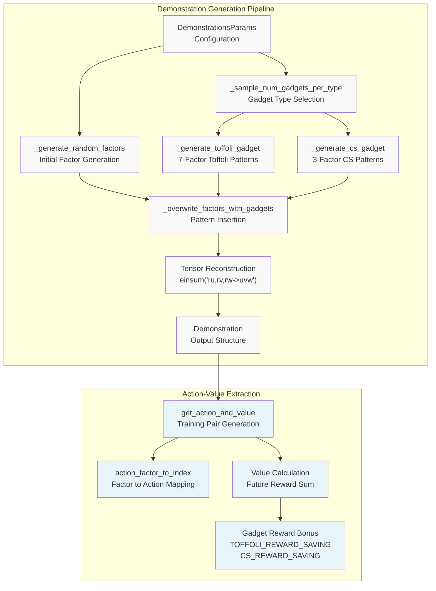
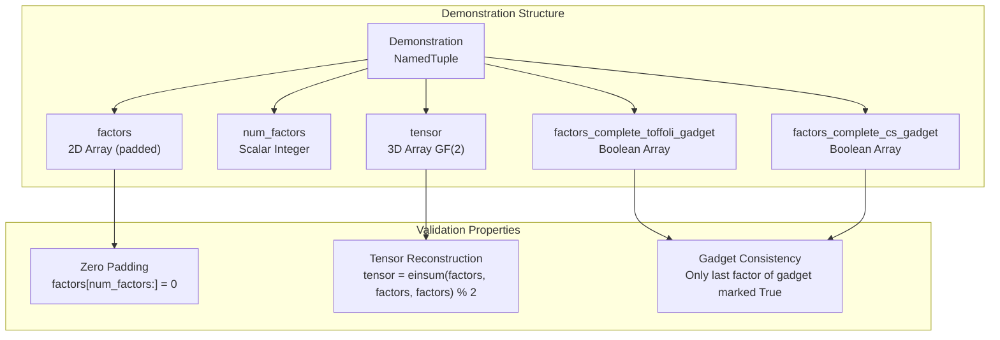
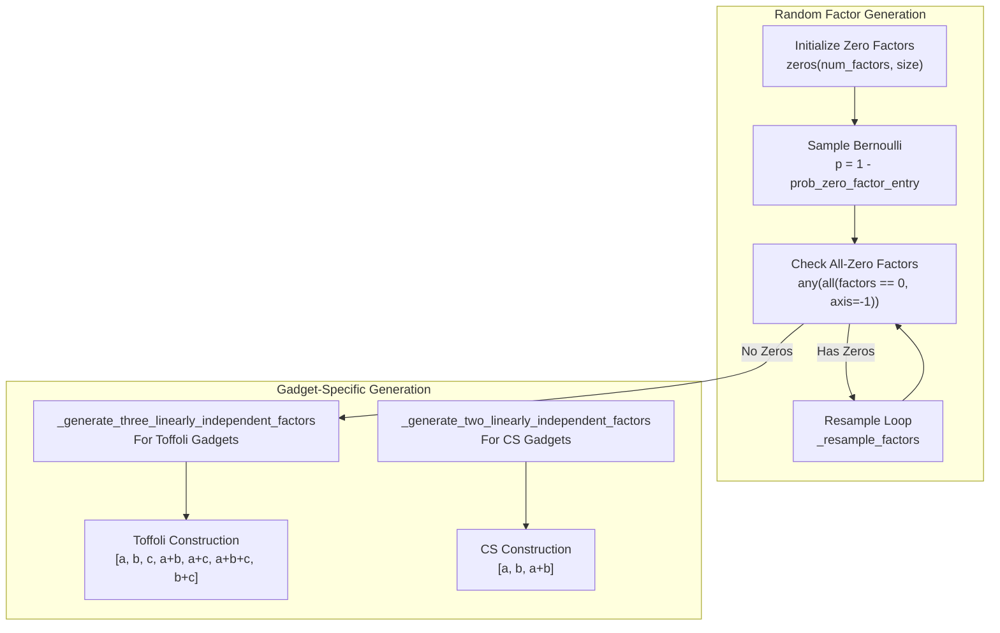
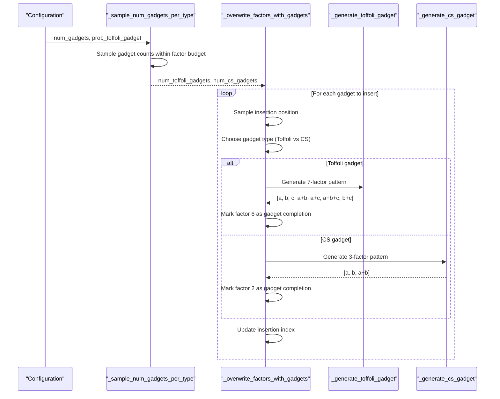
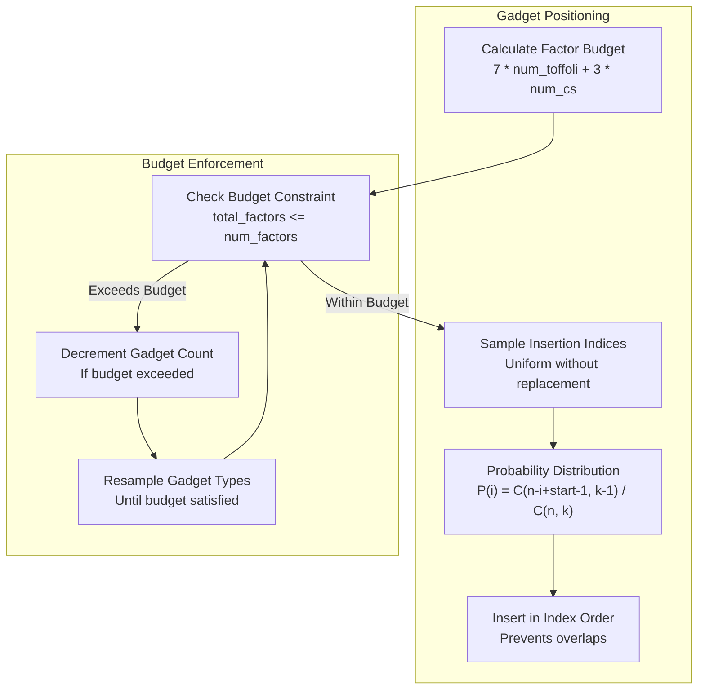
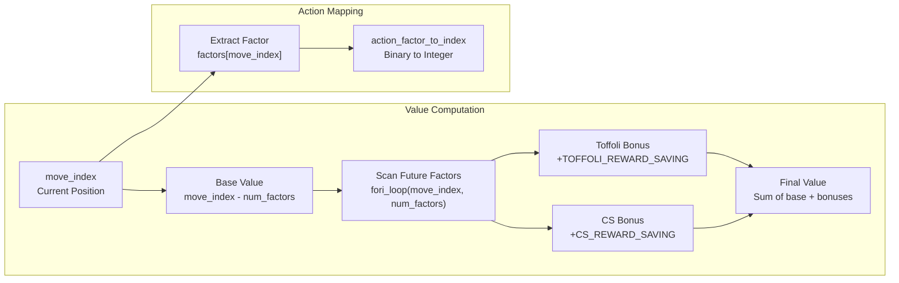
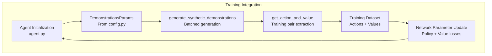

<!-- source: DeepWiki mcp.deepwiki.com · repo google-deepmind/alphatensor_quantum · page 6 Synthetic Demonstrations · fetched 2026-10-26 -->

# Synthetic Demonstrations

Relevant source files

The following files were used as context for generating this wiki page:

- [src/demonstrations.py](src/demonstrations.py)
- [src/demonstrations_test.py](src/demonstrations_test.py)

This page documents the synthetic demonstration generation system used to create training data for the AlphaTensor-Quantum reinforcement learning agent. The system generates random tensor decomposition sequences that incorporate quantum circuit optimization patterns known as gadgets, providing structured training examples that help the agent learn efficient decomposition strategies.

For information about the core tensor and factor operations used in demonstrations, see [Mathematical Foundations](#4). For details about how demonstrations are integrated into the training pipeline, see [Agent System](#3.1).

## System Overview

The synthetic demonstrations system creates artificial training examples that simulate optimal quantum circuit decomposition sequences. Each demonstration consists of a target tensor and a sequence of rank-one factors that decompose it, along with metadata indicating where beneficial gadget patterns occur.

**Sources:** [src/demonstrations.py:473-563](), [src/demonstrations.py:566-610]()

## Demonstration Data Structure

The `Demonstration` class represents a complete synthetic training example containing all necessary information for training the RL agent.

| Field | Type | Purpose |
|-------|------|---------|
| `tensor` | `Array[*batch, size, size, size]` | Target 3D tensor to decompose |
| `num_factors` | `Array[*batch]` | Number of valid factors in sequence |
| `factors` | `Array[*batch, max_factors, size]` | Factor sequence (zero-padded) |
| `factors_complete_toffoli_gadget` | `Array[*batch, max_factors]` | Boolean flags for Toffoli gadget completion |
| `factors_complete_cs_gadget` | `Array[*batch, max_factors]` | Boolean flags for CS gadget completion |

**Sources:** [src/demonstrations.py:30-50](), [src/demonstrations_test.py:39-69]()

## Synthetic Data Generation Process

The `generate_synthetic_demonstrations` function orchestrates the creation of complete demonstrations through a multi-stage process controlled by configuration parameters.

### Factor Generation

Initial factors are generated randomly with configurable sparsity, ensuring no all-zero factors exist:

**Sources:** [src/demonstrations.py:98-117](), [src/demonstrations.py:176-194](), [src/demonstrations.py:197-208]()

### Configuration Parameters

The generation process is controlled by `DemonstrationsParams`:

| Parameter | Purpose | Effect |
|-----------|---------|---------|
| `min_num_factors` | Minimum demonstration length | Controls training sequence diversity |
| `max_num_factors` | Maximum demonstration length | Limits computational overhead |
| `prob_zero_factor_entry` | Factor sparsity probability | Controls factor density |
| `prob_include_gadget` | Gadget inclusion probability | Balances gadget vs. random training |
| `prob_toffoli_gadget` | Toffoli vs. CS gadget ratio | Controls gadget type distribution |
| `max_num_gadgets` | Maximum gadgets per demonstration | Limits gadget density |

**Sources:** [src/demonstrations.py:480-527](), [src/config.py]()

## Gadget Integration

Gadgets are quantum circuit optimization patterns that provide efficiency benefits. The system incorporates two types: Toffoli gadgets (7 factors) and CS gadgets (3 factors).

### Gadget Insertion Process

**Sources:** [src/demonstrations.py:230-291](), [src/demonstrations.py:320-469]()

### Gadget Positioning Algorithm

The system uses a sophisticated algorithm to position gadgets uniformly throughout demonstrations while respecting factor budget constraints:

**Sources:** [src/demonstrations.py:253-290](), [src/demonstrations.py:360-390]()

## Action-Value Extraction

The `get_action_and_value` function converts demonstrations into training pairs for the RL agent, mapping factors to action indices and computing discounted future rewards.

### Value Calculation

Values represent the sum of future rewards from a given position, incorporating gadget completion bonuses:

**Sources:** [src/demonstrations.py:566-610](), [src/factors.py]()

### Reward Structure

| Event | Reward | Purpose |
|-------|--------|---------|
| Each factor applied | -1.0 | Encourages shorter decompositions |
| Toffoli gadget completion | `+TOFFOLI_REWARD_SAVING` | Rewards 4-T-gate savings |
| CS gadget completion | `+CS_REWARD_SAVING` | Rewards 1-T-gate savings |

**Sources:** [src/demonstrations.py:591-600](), [src/factors.py]()

## Configuration and Usage

Synthetic demonstrations are primarily used during agent initialization and training to provide structured examples alongside exploration-based learning.

### Integration with Training Pipeline

**Sources:** [src/demonstrations.py:472](), [src/agent.py](), [src/config.py]()

The synthetic demonstrations system provides a crucial bootstrap mechanism for training, ensuring the agent learns from structured examples that incorporate domain knowledge about quantum circuit optimization patterns while maintaining the flexibility to discover novel decomposition strategies through reinforcement learning.

---

