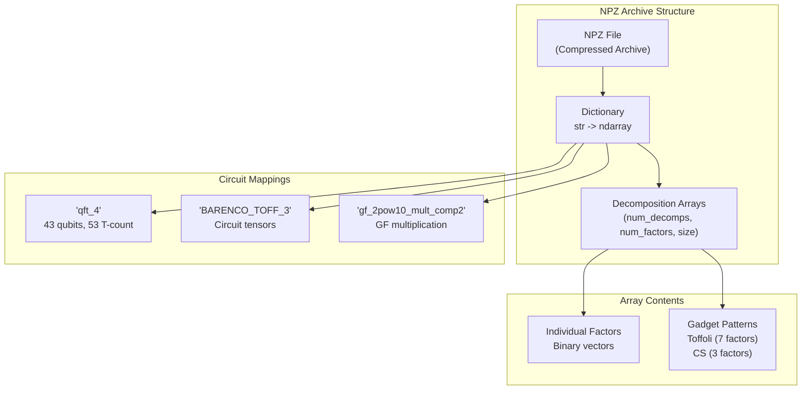
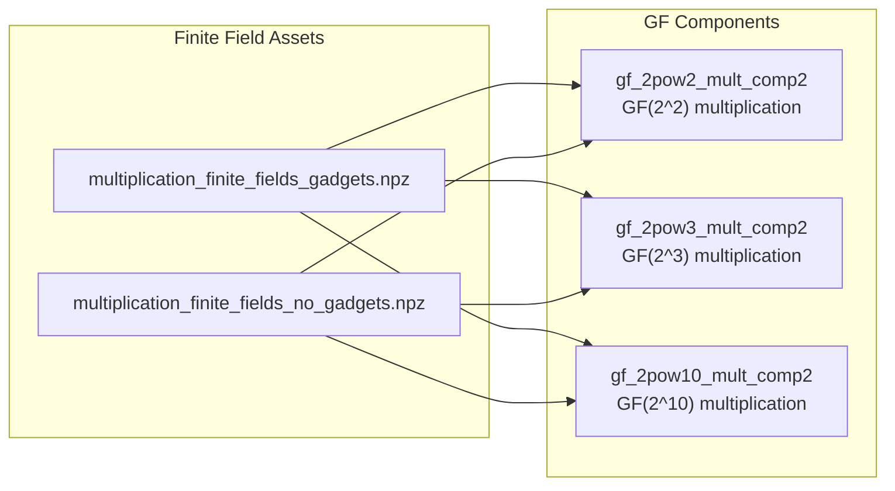
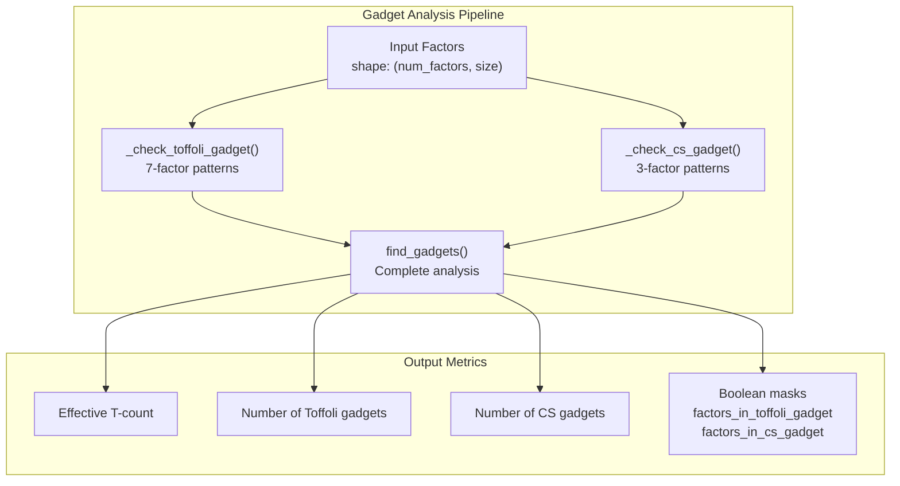
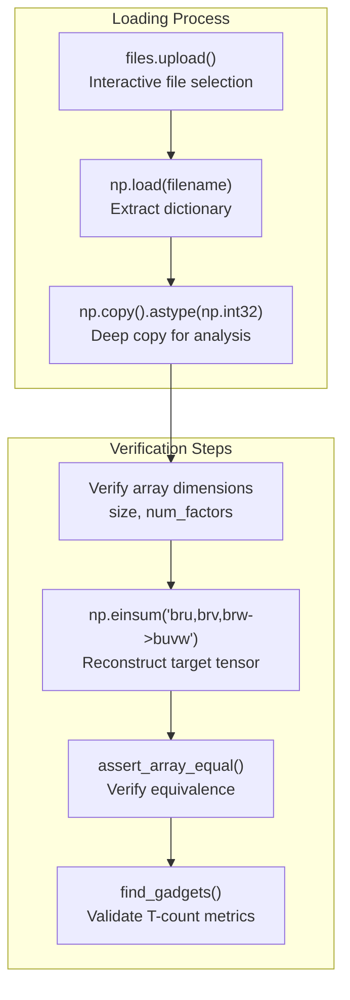

<!-- source: DeepWiki mcp.deepwiki.com · repo google-deepmind/alphatensor_quantum · page 7 Precomputed Data Assets · fetched 2026-10-26 -->

# Precomputed Data Assets

Relevant source files

The following files were used as context for generating this wiki page:

- [decompositions/load_decompositions.ipynb](decompositions/load_decompositions.ipynb)
- [decompositions/multiplication_finite_fields_gadgets.npz](decompositions/multiplication_finite_fields_gadgets.npz)
- [decompositions/multiplication_finite_fields_no_gadgets.npz](decompositions/multiplication_finite_fields_no_gadgets.npz)

This document covers the precomputed tensor decomposition data and benchmarks included with the AlphaTensor-Quantum repository. These assets contain optimized quantum circuit decompositions discovered by the reinforcement learning system, stored in compressed formats for analysis and comparison.

For information about the algorithms that generate these decompositions, see [Core Architecture](#3). For details on synthetic demonstration generation during training, see [Synthetic Demonstrations](#6).

## Data Format and Structure

The precomputed assets are stored as compressed NumPy archives (`.npz` files) containing dictionaries that map target circuit names to decomposition arrays. Each decomposition array has shape `(num_decompositions, num_factors, tensor_size)`, where:

- `num_decompositions`: Number of non-equivalent decompositions (maximum 10)
- `num_factors`: Number of rank-one factors in the decomposition  
- `tensor_size`: Dimensionality of the target tensor

Sources: [decompositions/load_decompositions.ipynb:114-125]()

## Asset Categories

### Finite Field Multiplication Components

The repository includes precomputed decompositions for finite field multiplication operations in various Galois fields. These are organized into two main categories:

**With Gadgets** (`multiplication_finite_fields_gadgets.npz`):
- Contains decompositions that leverage Toffoli and CS gadgets
- Reduced effective T-count through gadget optimization
- Components for GF(2^n) where n ranges from 2 to 10

**Without Gadgets** (`multiplication_finite_fields_no_gadgets.npz`):
- Direct factor-to-T-gate correspondence
- No gadget-based optimizations
- Baseline decompositions for comparison

Sources: [decompositions/multiplication_finite_fields_gadgets.npz:1-216](), [decompositions/multiplication_finite_fields_no_gadgets.npz:1-80]()

### Benchmark Circuit Collections

Additional benchmark datasets are referenced in the analysis notebook, including:

- `benchmarks_no_gadgets.npz`: Quantum circuit benchmarks without gadget optimizations
- `benchmarks_gadgets.npz`: Quantum circuit benchmarks with gadget-based T-count reduction

These contain decompositions for standard quantum circuits such as quantum Fourier transforms (`qft_4`) and other algorithmic primitives.

Sources: [decompositions/load_decompositions.ipynb:58-59](), [decompositions/load_decompositions.ipynb:138-139]()

## Gadget Detection and Analysis

The precomputed assets support two types of quantum gadgets that provide T-count optimizations:

### Toffoli Gadgets
- Consist of 7 factors with specific linear dependency patterns
- Provide 5-factor T-count reduction (7 factors → 2 effective T-gates)
- Detected using `_check_toffoli_gadget()` function

### CS (Controlled-S) Gadgets  
- Consist of 3 factors with linear dependencies
- Provide 1-factor T-count reduction (3 factors → 2 effective T-gates)
- Detected using `_check_cs_gadget()` function

Sources: [decompositions/load_decompositions.ipynb:230-306]()

## Loading and Verification

The repository provides a complete analysis framework through the Jupyter notebook interface. The loading process includes automatic verification of decomposition correctness:

The verification process ensures that:
- All decompositions reconstruct the same target tensor
- Factor counts match expected T-gate requirements
- Gadget patterns are correctly identified and counted

Sources: [decompositions/load_decompositions.ipynb:109-126](), [decompositions/load_decompositions.ipynb:191-207](), [decompositions/load_decompositions.ipynb:317-321]()

## Integration with Training System

These precomputed assets serve multiple roles in the broader AlphaTensor-Quantum system:

- **Benchmarking**: Comparison targets for newly discovered decompositions
- **Initialization**: Starting points for further optimization
- **Validation**: Ground truth for testing decomposition algorithms
- **Research**: Analysis of gadget patterns and optimization strategies

The data format directly matches the tensor operations used in [Tensor Operations](#4.1) and the factor manipulation functions in [Factor Operations](#4.2).

Sources: [decompositions/load_decompositions.ipynb:32-33]()

---

