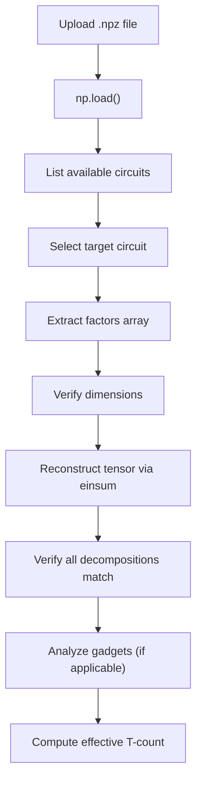
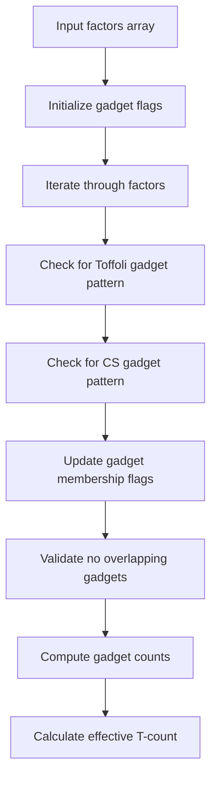

<!-- source: DeepWiki mcp.deepwiki.com · repo google-deepmind/alphatensor_quantum · page 7.1 Decomposition Analysis · fetched 2026-10-26 -->

# Decomposition Analysis

<details>
<summary>Relevant source files</summary>

The following files were used as context for generating this wiki page:

- [decompositions/load_decompositions.ipynb](decompositions/load_decompositions.ipynb)

</details>


This section explains how to load, analyze, and verify the precomputed tensor decompositions provided with AlphaTensor-Quantum using the interactive Jupyter notebook. The decomposition analysis tools allow researchers to examine the structure of optimized quantum circuit decompositions, verify their correctness, and analyze the presence of quantum gadgets.

For information about the underlying mathematical operations used in decompositions, see [Factor Operations](#4.2). For details about the configuration of circuits being decomposed, see [Configuration System](#5).

## Purpose and Data Structure

The decomposition analysis system processes precomputed results stored in `.npz` files, where each file contains a dictionary mapping circuit names to numpy arrays of decomposed factors. The data structure follows this format:

```
decompositions[circuit_name] -> (num_decompositions, num_factors, tensor_size)
```

Where:
- `num_decompositions`: Up to 10 non-equivalent decompositions per circuit
- `num_factors`: Number of rank-one factors in the decomposition  
- `tensor_size`: Dimension of the tensor representing the quantum circuit

The notebook distinguishes between two types of decomposition files:
- Files ending with `_no_gadgets`: Direct factor-to-T-gate mapping
- Files without this suffix: May contain Toffoli and CS gadgets for T-count optimization

## Data Loading and Verification Workflow



Sources: [decompositions/load_decompositions.ipynb:68-126]()

## Tensor Reconstruction Process

The notebook verifies decomposition correctness by reconstructing the original tensor from factors using the Einstein summation convention:

```python
tensors = np.mod(np.einsum('bru,brv,brw->buvw', factors, factors, factors), 2)
```

This operation:
1. Performs outer products of factors for each decomposition batch
2. Applies modulo-2 arithmetic (GF(2) field operations) 
3. Validates that all non-equivalent decompositions yield identical tensors

Sources: [decompositions/load_decompositions.ipynb:123-125]()

## Gadget Detection and Analysis

For files containing gadgets, the system implements specialized detection algorithms for two types of quantum gadgets:

### Gadget Detection Workflow



Sources: [decompositions/load_decompositions.ipynb:228-306]()

### Gadget Detection Functions

| Function | Purpose | Pattern Check |
|----------|---------|---------------|
| `_check_cs_gadget` | Detects 3-factor CS gadgets | Linear independence + dependencies: `ab = a + b` |
| `_check_toffoli_gadget` | Detects 7-factor Toffoli gadgets | Complex linear relationships among 7 factors |
| `find_gadgets` | Main analysis function | Returns T-count, gadget counts, and membership flags |

The T-count calculation for decompositions with gadgets follows:
```
effective_tcount = num_factors - 5 * num_toffoli_gadgets - num_cs_gadgets
```

This reflects the T-gate savings: 5 T-gates saved per Toffoli gadget, 1 T-gate saved per CS gadget.

Sources: [decompositions/load_decompositions.ipynb:230-248](), [decompositions/load_decompositions.ipynb:302]()

## Example Usage Patterns

### Loading No-Gadget Decompositions

The notebook demonstrates loading benchmark decompositions without gadgets:

```python
target_circuit_name = 'qft_4'
expected_size = 43  # qubit count after compilation
expected_tcount = 53  # direct T-count
```

Verification ensures:
- `num_factors == expected_tcount` (direct mapping)
- All decompositions reconstruct to identical tensors
- Tensor size matches expected circuit dimensions

### Loading Gadget-Enhanced Decompositions  

For decompositions with gadgets:

```python
expected_tcount = 44  # effective T-count
expected_num_toffoli_gadgets = 4
expected_num_cs_gadgets = 3
```

The analysis verifies:
- `num_factors >= expected_tcount` (more factors than effective T-count)
- Gadget counts match expected values
- Proper gadget structure and non-overlap

Sources: [decompositions/load_decompositions.ipynb:104-120](), [decompositions/load_decompositions.ipynb:184-201]()

## File Structure and Access

The Jupyter notebook provides an interactive interface for uploading and analyzing decomposition files. Key files mentioned include:

- `benchmarks_no_gadgets.npz`: Standard decompositions without quantum gadgets
- `benchmarks_gadgets.npz`: Optimized decompositions containing Toffoli and CS gadgets

The notebook supports Google Colab integration with file upload functionality via `google.colab.files.upload()`.

Sources: [decompositions/load_decompositions.ipynb:45](), [decompositions/load_decompositions.ipynb:69](), [decompositions/load_decompositions.ipynb:149]()

---

