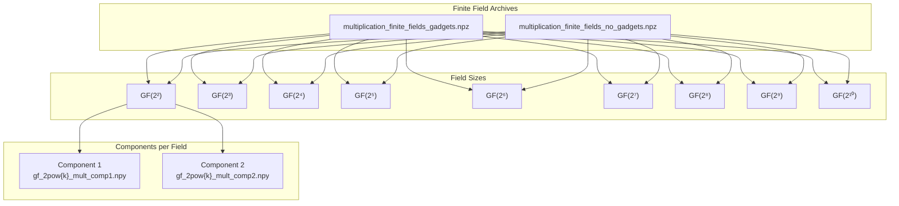
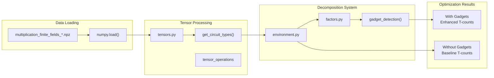

<!-- source: DeepWiki mcp.deepwiki.com · repo google-deepmind/alphatensor_quantum · page 7.2 Finite Field Data · fetched 2026-10-26 -->

# Finite Field Data

<details>
<summary>Relevant source files</summary>

The following files were used as context for generating this wiki page:

- [decompositions/multiplication_finite_fields_gadgets.npz](decompositions/multiplication_finite_fields_gadgets.npz)
- [decompositions/multiplication_finite_fields_no_gadgets.npz](decompositions/multiplication_finite_fields_no_gadgets.npz)

</details>


This document covers the precomputed finite field multiplication decomposition data included in the AlphaTensor-Quantum repository. These datasets contain tensor decomposition results for Galois field arithmetic operations that serve as benchmark problems and training data for the quantum circuit optimization system.

For information about analyzing these decompositions, see [Decomposition Analysis](#7.1). For other benchmark datasets, see [Benchmark Datasets](#7.3).

## Overview

The finite field data consists of precomputed tensor decomposition results for multiplication operations in various Galois fields GF(2^k) where k ranges from 2 to 10. These decompositions are provided in two variants: with and without quantum gate gadgets incorporated into the optimization process.

## File Structure

The finite field data is organized into two main compressed numpy archive files:

| File | Description |
|------|-------------|
| `decompositions/multiplication_finite_fields_gadgets.npz` | Decomposition results with Toffoli and CS gadgets |
| `decompositions/multiplication_finite_fields_no_gadgets.npz` | Decomposition results without gadget optimization |

### Data Organization

Each archive contains multiple numpy arrays following the naming convention `gf_2pow{k}_mult_comp{i}.npy`, where:
- `k` is the field size exponent (2 ≤ k ≤ 10)
- `i` is the component index (1 or 2)

**Finite Field Data Structure**


Sources: [decompositions/multiplication_finite_fields_gadgets.npz:1-216](), [decompositions/multiplication_finite_fields_no_gadgets.npz:1-80]()

## Data Format

Each numpy array contains tensor decomposition results stored as binary data. The arrays represent different aspects of the multiplication operation decomposition for the corresponding Galois field.

### Galois Field Coverage

The datasets cover the following finite fields:

| Field | Elements | Polynomial Degree | Applications |
|-------|----------|-------------------|---------------|
| GF(2²) | 4 | 2 | Basic arithmetic, small examples |
| GF(2³) | 8 | 3 | Cryptographic primitives |
| GF(2⁴) | 16 | 4 | AES S-box operations |
| GF(2⁵) | 32 | 5 | Error correction codes |
| GF(2⁶) | 64 | 6 | Reed-Solomon codes |
| GF(2⁷) | 128 | 7 | BCH codes |
| GF(2⁸) | 256 | 8 | AES field operations |
| GF(2⁹) | 512 | 9 | Large field arithmetic |
| GF(2¹⁰) | 1024 | 10 | Maximum size in dataset |

## Integration with Tensor System

The finite field data integrates with the AlphaTensor-Quantum tensor decomposition system through the tensor loading and processing utilities.

**Finite Field Data Flow**


Sources: [decompositions/multiplication_finite_fields_gadgets.npz:1-216](), [decompositions/multiplication_finite_fields_no_gadgets.npz:1-80]()

## Gadget vs Non-Gadget Variants

The two archive files represent different optimization approaches:

### With Gadgets (`multiplication_finite_fields_gadgets.npz`)
- Incorporates Toffoli and Controlled-S gate gadgets during decomposition
- Achieves lower T-gate counts through gadget pattern recognition
- Results reflect the quantum circuit optimization benefits from gadget detection
- Larger file size due to additional optimization complexity

### Without Gadgets (`multiplication_finite_fields_no_gadgets.npz`)
- Baseline decomposition results without gadget optimization
- Provides comparison benchmarks for measuring gadget effectiveness
- Simpler decomposition structure
- Smaller file size due to reduced complexity

## Loading and Usage

The finite field data can be loaded using standard numpy operations:

```python
import numpy as np

# Load gadget-optimized results
with np.load('decompositions/multiplication_finite_fields_gadgets.npz') as data:
    gf_256_comp1 = data['gf_2pow8_mult_comp1.npy']  # GF(2^8) component 1
    gf_256_comp2 = data['gf_2pow8_mult_comp2.npy']  # GF(2^8) component 2

# Load baseline results
with np.load('decompositions/multiplication_finite_fields_no_gadgets.npz') as data:
    gf_256_baseline = data['gf_2pow8_mult_comp1.npy']
```

The data integrates with the tensor analysis utilities provided in the repository for detailed examination of decomposition properties and T-gate count analysis.

Sources: [decompositions/multiplication_finite_fields_gadgets.npz:1-216](), [decompositions/multiplication_finite_fields_no_gadgets.npz:1-80]()

## Applications

These finite field multiplication decompositions serve multiple purposes within the AlphaTensor-Quantum system:

1. **Benchmark Problems**: Standard test cases for evaluating decomposition algorithm performance
2. **Training Data**: Examples for reinforcement learning agent training
3. **Gadget Analysis**: Comparison studies between optimized and baseline approaches
4. **Quantum Algorithm Development**: Components for quantum algorithms requiring finite field arithmetic

The comprehensive coverage from small fields (GF(2²)) to larger ones (GF(2¹⁰)) provides a range of complexity levels for testing and development purposes.

Sources: [decompositions/multiplication_finite_fields_gadgets.npz:1-216](), [decompositions/multiplication_finite_fields_no_gadgets.npz:1-80]()

---

