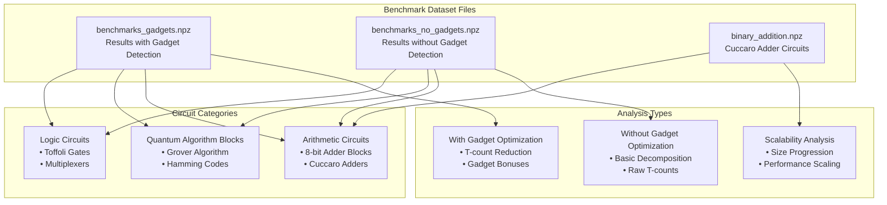
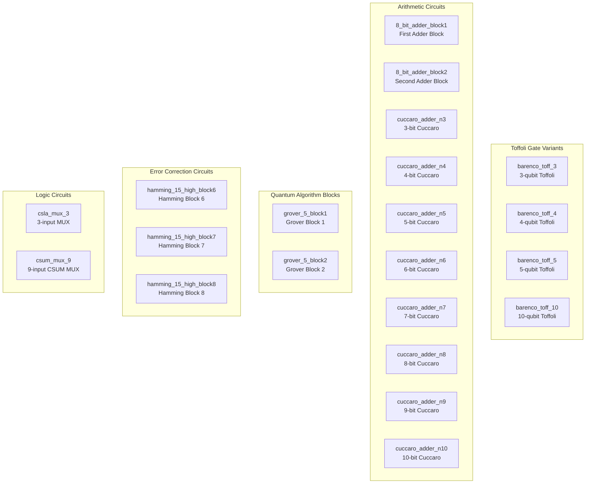
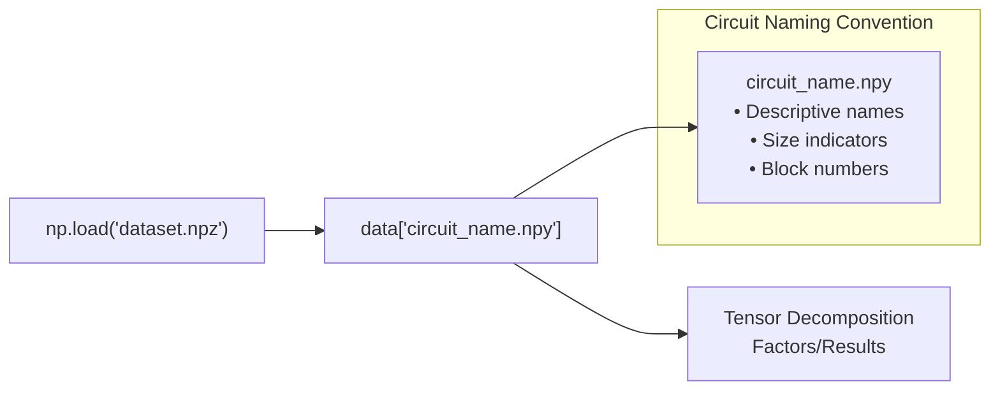
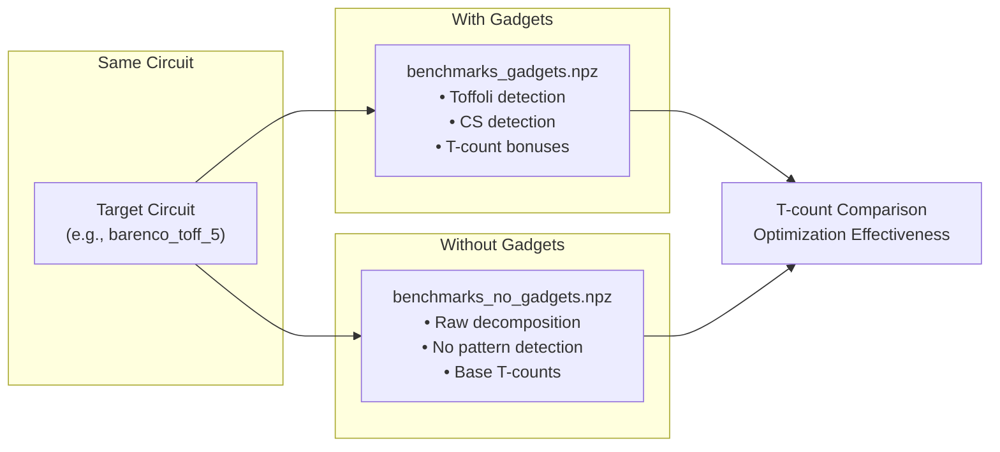

<!-- source: DeepWiki mcp.deepwiki.com · repo google-deepmind/alphatensor_quantum · page 7.3 Benchmark Datasets · fetched 2026-10-26 -->

# Benchmark Datasets

Relevant source files

The following files were used as context for generating this wiki page:

- [decompositions/benchmarks_gadgets.npz](decompositions/benchmarks_gadgets.npz)
- [decompositions/benchmarks_no_gadgets.npz](decompositions/benchmarks_no_gadgets.npz)
- [decompositions/binary_addition.npz](decompositions/binary_addition.npz)
- [decompositions/quantum_chemistry.npz](decompositions/quantum_chemistry.npz)

This document covers the benchmark datasets included in the AlphaTensor-Quantum repository for evaluating quantum circuit optimization performance. These datasets contain precomputed tensor decomposition results for various quantum circuit types and serve as reference points for measuring algorithm effectiveness.

For information about loading and analyzing these datasets, see [Decomposition Analysis](#7.1). For details about the finite field multiplication components, see [Finite Field Data](#7.2).

## Dataset Categories

The benchmark datasets are organized into three main categories, each serving different evaluation purposes:

**Sources:** [decompositions/benchmarks_gadgets.npz](), [decompositions/benchmarks_no_gadgets.npz](), [decompositions/binary_addition.npz]()

## Circuit Types and Organization

The benchmark datasets cover a comprehensive range of quantum circuit types, organized by computational purpose and complexity:

**Sources:** [decompositions/benchmarks_gadgets.npz:1-396](), [decompositions/benchmarks_no_gadgets.npz:1-396](), [decompositions/binary_addition.npz:1-35]()

## Dataset Structure and Access Patterns

The benchmark datasets are stored as NumPy compressed archives (`.npz` files) containing tensor decomposition results for each circuit:

| Dataset File | Content Type | Circuit Count | Purpose |
|-------------|--------------|---------------|---------|
| `benchmarks_gadgets.npz` | With gadget optimization | 15 circuits | Compare T-counts with gadget detection |
| `benchmarks_no_gadgets.npz` | Without gadget optimization | 15 circuits | Baseline decomposition results |
| `binary_addition.npz` | Cuccaro adder progression | 8 circuits | Scalability analysis |

### Data Loading Pattern

The datasets can be accessed through standard NumPy loading mechanisms:

**Sources:** [decompositions/benchmarks_gadgets.npz:1-10](), [decompositions/benchmarks_no_gadgets.npz:1-10]()

## Circuit Complexity Progression

The datasets include circuits of varying complexity to enable comprehensive performance evaluation:

### Toffoli Gate Scaling
- **barenco_toff_3**: Basic 3-qubit implementation
- **barenco_toff_4**: Extended 4-qubit version  
- **barenco_toff_5**: Medium complexity 5-qubit
- **barenco_toff_10**: High complexity 10-qubit implementation

### Adder Circuit Families
- **8-bit Adder Blocks**: Two complementary blocks for 8-bit addition
- **Cuccaro Adders**: Complete progression from 3-bit to 10-bit implementations

### Algorithm-Specific Circuits
- **Grover Blocks**: Two distinct blocks from Grover's search algorithm
- **Hamming Codes**: Three high-complexity error correction blocks
- **Multiplexers**: Carry-save and conditional sum implementations

**Sources:** [decompositions/benchmarks_gadgets.npz:73-396](), [decompositions/binary_addition.npz:1-35]()

## Gadget Optimization Comparison

The dual dataset structure allows direct comparison of optimization effectiveness:

This structure enables evaluation of gadget detection algorithms by comparing T-counts between optimized and unoptimized decompositions for identical circuits.

**Sources:** [decompositions/benchmarks_gadgets.npz](), [decompositions/benchmarks_no_gadgets.npz]()

---

