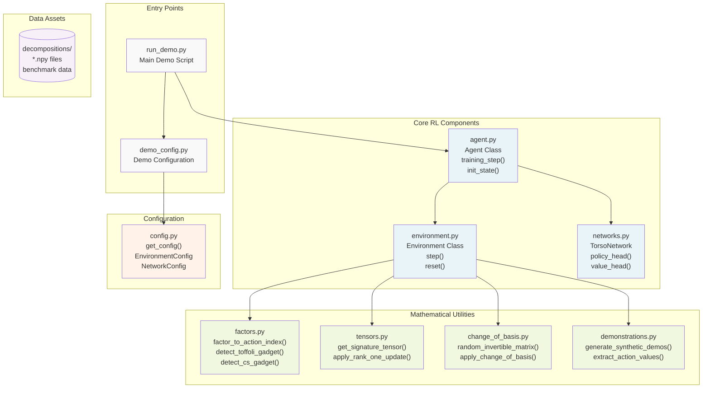
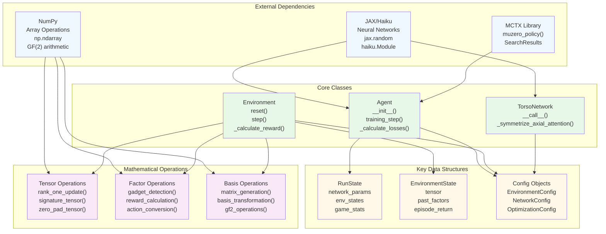

<!-- source: DeepWiki mcp.deepwiki.com · repo google-deepmind/alphatensor_quantum · page 8 Development Guide · fetched 2026-10-26 -->

# Development Guide

<details>
<summary>Relevant source files</summary>

The following files were used as context for generating this wiki page:

- [.gitignore](.gitignore)
- [CONTRIBUTING.md](CONTRIBUTING.md)
- [LICENSE](LICENSE)

</details>


This guide provides information for contributors to the AlphaTensor-Quantum repository, including code organization, testing patterns, contribution guidelines, and development workflows. 

For information about running the system, see [Getting Started](#2). For details about the system architecture and core components, see [Core Architecture](#3). For configuration and deployment specifics, see [Configuration System](#5).

## Repository Structure and Code Organization

The AlphaTensor-Quantum codebase follows a modular architecture with clear separation between reinforcement learning components, mathematical utilities, and configuration systems.

### Core Module Organization



Sources: [CONTRIBUTING.md:1-26](), [.gitignore:1-25]()

### Development Dependencies and Code Entities

The codebase relies on several key external libraries and internal abstractions that developers should understand:



Sources: [CONTRIBUTING.md:1-26](), [.gitignore:2-3]()

## Contribution Guidelines

### Contributor License Agreement

All contributions require a signed Contributor License Agreement (CLA). This gives Google permission to use and redistribute contributions while allowing contributors to retain copyright ownership.

**Process:**
1. Visit [https://cla.developers.google.com/](https://cla.developers.google.com/) to sign the CLA
2. CLAs are typically one-time requirements across Google projects
3. Both individual and corporate CLAs are available

Sources: [CONTRIBUTING.md:5-13]()

### Code Review Process

All code changes, including those from project members, require review through GitHub pull requests.

**Requirements:**
- Create pull requests for all changes
- Ensure all discussions are resolved before merging
- Follow GitHub's pull request workflow
- Maintain code quality standards

**Review Focus Areas:**
- Mathematical correctness of tensor operations
- Proper handling of GF(2) arithmetic
- Neural network architecture consistency
- Configuration system usage
- Test coverage for new functionality

Sources: [CONTRIBUTING.md:15-20]()

### Community Guidelines

The project follows Google's Open Source Community Guidelines, emphasizing:
- Respectful collaboration
- Constructive feedback
- Inclusive participation
- Professional communication

Sources: [CONTRIBUTING.md:22-25]()

## Development Workflow

### Setting Up Development Environment

The codebase requires specific dependencies for machine learning and quantum circuit operations:

| Component | Purpose | Key Modules |
|-----------|---------|-------------|
| JAX/Haiku | Neural network implementation | `networks.py`, `agent.py` |
| MCTX | Monte Carlo Tree Search | `agent.py` MCTS integration |
| NumPy | Mathematical operations | `tensors.py`, `factors.py`, `change_of_basis.py` |
| Python 3.x | Core runtime | All modules |

### Code Organization Patterns

**Module Responsibility Pattern:**
- `agent.py`: RL training loop and MCTS integration
- `environment.py`: Game environment and reward calculation
- `networks.py`: Neural network architecture definitions
- Utility modules: Mathematical operations and data handling
- `config.py`: Centralized configuration management

**Data Flow Pattern:**
- Configuration objects flow from `config.py` to all components
- Environment states flow through `Environment.step()` calls
- Network parameters flow through `Agent.training_step()` updates
- Tensor operations flow through utility functions in mathematical modules

Sources: [.gitignore:1-25]()

## Testing and Quality Assurance

### Testing Strategy

The codebase should maintain test coverage across several key areas:

**Mathematical Correctness:**
- Tensor decomposition operations in `tensors.py`
- GF(2) field arithmetic in `change_of_basis.py`
- Gadget detection algorithms in `factors.py`
- Reward calculation accuracy

**System Integration:**
- Agent-environment interaction loops
- MCTS policy integration with neural networks
- Configuration system functionality
- Data loading and preprocessing

**Performance Validation:**
- Neural network forward/backward passes
- MCTS search efficiency
- Memory usage during training
- Tensor operation performance

### Code Quality Standards

**File Organization:**
- Follow Python module naming conventions
- Maintain clear separation of concerns
- Use descriptive function and class names
- Include comprehensive docstrings

**Configuration Management:**
- Use the centralized `config.py` system
- Avoid hardcoded parameters in implementation files
- Maintain backward compatibility for configuration changes
- Document configuration parameter meanings

Sources: [.gitignore:1-25]()

## Debugging and Development Tools

### Common Development Patterns

**Configuration Debugging:**
```python
# Reference pattern from config.py usage
config = get_config()
env_config = config.environment
network_config = config.network
```

**Environment State Inspection:**
- Monitor tensor shapes and values through environment steps
- Validate GF(2) arithmetic results
- Check gadget detection accuracy
- Verify reward calculations

**Neural Network Debugging:**
- Examine network parameter updates
- Monitor policy and value head outputs
- Validate symmetrized attention mechanisms
- Check gradient flow through TorsoNetwork

### Performance Profiling

**Key Performance Areas:**
- MCTS search time per action selection
- Neural network inference latency
- Tensor operation efficiency
- Memory allocation patterns during training

**Profiling Integration Points:**
- `Agent.training_step()` for overall training performance
- `Environment.step()` for environment simulation speed
- `TorsoNetwork.__call__()` for neural network inference
- Mathematical utility functions for computational bottlenecks

Sources: [CONTRIBUTING.md:1-26](), [.gitignore:2-4]()

## License and Legal Considerations

The repository uses the Apache License 2.0, which provides:
- Permission for commercial and private use
- Distribution and modification rights
- Patent grant from contributors
- Limitation of liability and warranty disclaimers

**Key Requirements:**
- Include copyright notice in distributions
- State changes made to original files
- Include copy of license with distributions
- Include attribution notices from original work

**Contributor Responsibilities:**
- Ensure contributed code is original or properly licensed
- Respect third-party intellectual property
- Follow Google's CLA requirements
- Maintain license compatibility for dependencies

Sources: [LICENSE:1-203]()