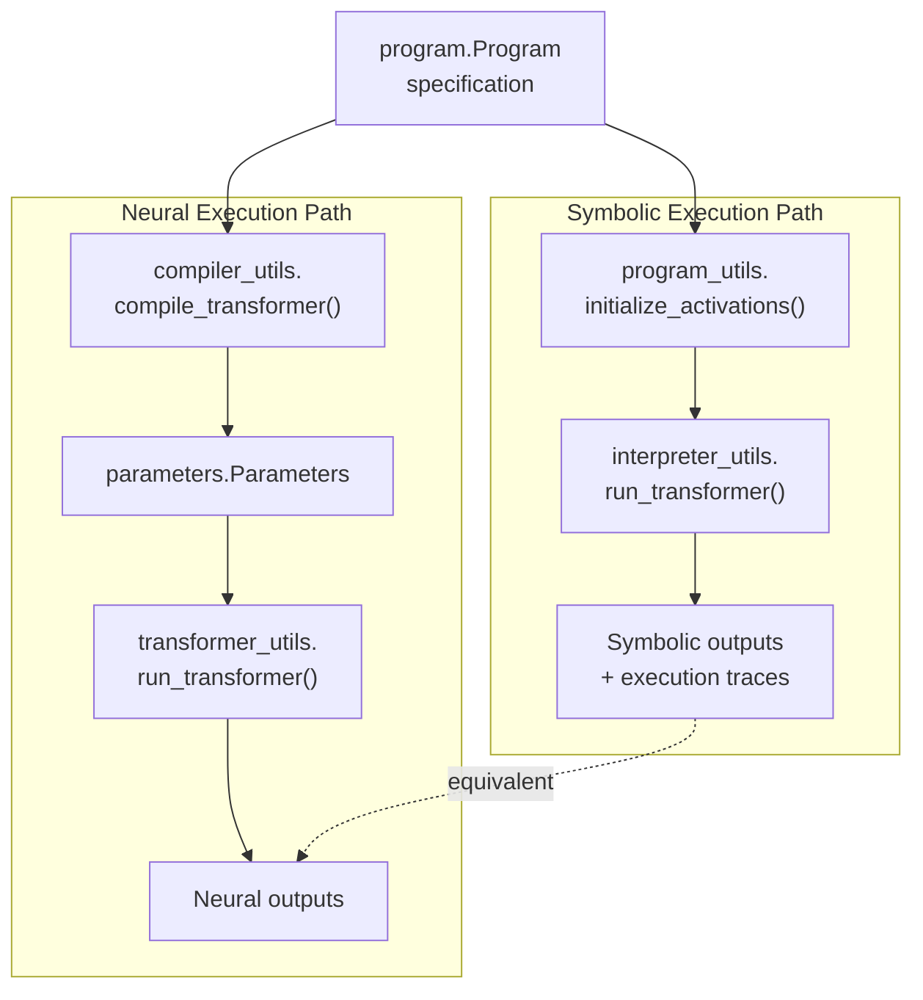
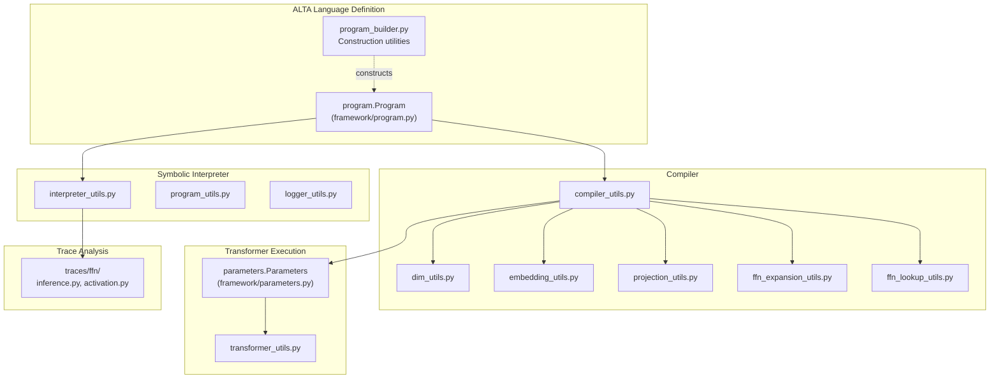
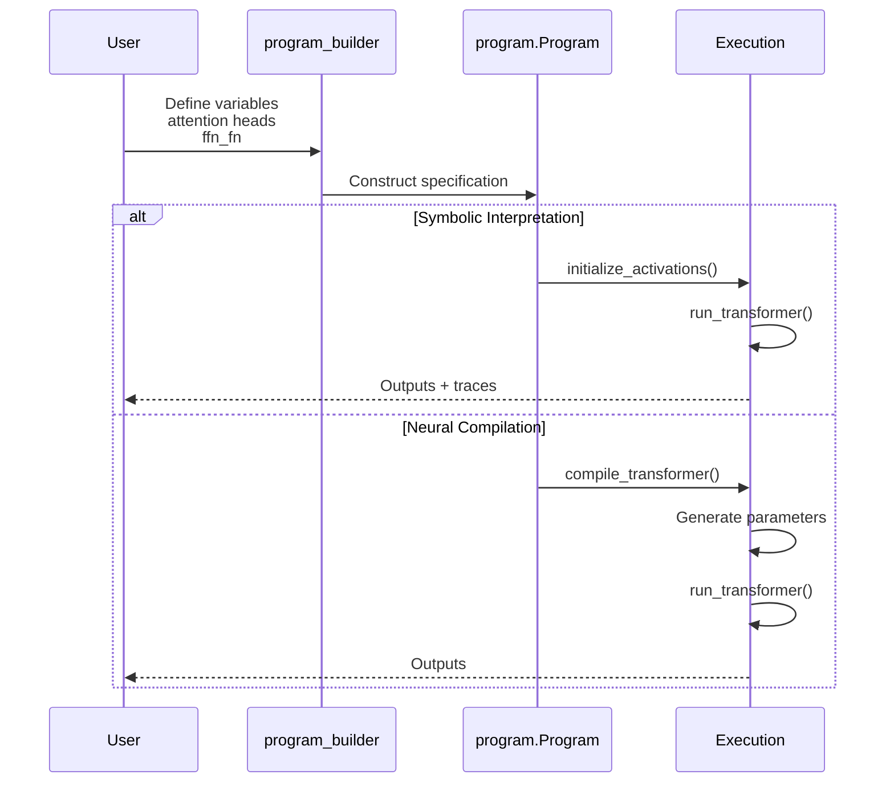
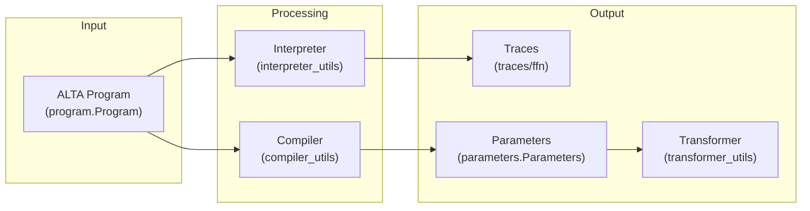

<!-- source: DeepWiki mcp.deepwiki.com · repo google-deepmind/alta · page 1 Overview · fetched 2026-10-26 -->

# Overview

<details>
<summary>Relevant source files</summary>

The following files were used as context for generating this wiki page:

- [README.md](README.md)

</details>


This document provides a high-level introduction to ALTA, its core architectural concepts, and the dual execution paradigm that enables both symbolic analysis and neural execution of programs. For installation and setup instructions, see [Getting Started](#2). For detailed technical documentation of specific components, see [Core Architecture](#3).

## What is ALTA?

ALTA (Algorithmic Language for Transformers Analysis) is a framework for compiler-based analysis of transformer neural networks. It provides a programming language for specifying algorithms that can be executed in two equivalent ways:

1. **Symbolic interpretation** for analysis and verification
2. **Compilation to transformer weights** for neural execution

The framework is implemented in Python and consists of three main components located in the `framework/` directory:

| Component | Location | Purpose |
|-----------|----------|---------|
| Language Specification | [framework/program.py]() | Defines ALTA program structure |
| Symbolic Interpreter | [framework/interpreter/]() | Executes programs symbolically |
| Compiler | [framework/compiler/]() | Translates programs to transformer parameters |

Sources: [README.md:1-68]()

## Core Concept: Dual Execution Paradigm

ALTA programs are defined once but can be executed through two distinct paths that produce equivalent outputs:



**Symbolic Execution Path**
- Entry point: [framework/interpreter/interpreter_utils.py]()
- Maintains symbolic representations of transformer activations
- Produces execution traces for analysis
- Used for program verification and debugging

**Neural Execution Path**
- Entry point: [framework/compiler/compiler_utils.py]()
- Generates fixed transformer parameters (embeddings, attention heads, FFN weights)
- Executes via self-contained transformer implementation
- Used for efficient deployment and integration with standard ML infrastructure

Sources: [README.md:28-35](), Diagram 3 from system architecture overview

## System Architecture

The following diagram maps ALTA's high-level architecture to specific code modules:



The compiler pipeline consists of six specialized utilities, each responsible for translating different aspects of the program specification:

| Utility | Responsibility |
|---------|---------------|
| `dim_utils.py` | Establishes dimension mappings for all variables |
| `embedding_utils.py` | Generates input embeddings |
| `projection_utils.py` | Creates attention head projections and output transforms |
| `ffn_expansion_utils.py` | Compiles first two FFN layers (expansion phase) |
| `ffn_lookup_utils.py` | Compiles last two FFN layers (lookup phase) |

Sources: [README.md:28-35](), Diagram 2 and Diagram 4 from system architecture overview

## Execution Flow

The following sequence diagram shows the complete lifecycle from program definition to execution:



**Program Definition** ([framework/program_builder.py]()):
- Variables declared with `add_variable()`
- Attention heads defined with `add_copy_heads()`, `add_content_heads()`, etc.
- Feed-forward logic specified via `ffn_fn` parameter

**Symbolic Execution** ([framework/interpreter/]()):
- `initialize_activations()` creates symbolic state
- `run_transformer()` executes layer by layer
- Produces both outputs and execution traces

**Neural Execution** ([framework/compiler/]() + [framework/transformer/]()):
- `compile_transformer()` generates `parameters.Parameters` object
- `transformer_utils.run_transformer()` executes using neural weights
- Produces equivalent outputs without traces

Sources: [README.md:28-35](), Diagram 6 from system architecture overview

## Framework Organization

The `framework/` directory contains all core components:

```
framework/
├── program.py                      # Program specification data structures
├── program_builder.py              # High-level program construction API
├── interpreter/                    # Symbolic execution
│   ├── interpreter_utils.py       
│   ├── program_utils.py           
│   └── logger_utils.py            
├── compiler/                       # Compilation to weights
│   ├── compiler_utils.py          
│   ├── dim_utils.py               
│   ├── embedding_utils.py         
│   ├── projection_utils.py        
│   ├── ffn_expansion_utils.py     
│   └── ffn_lookup_utils.py        
├── transformer/                    # Neural execution
│   ├── transformer_utils.py       
│   └── parameters.py              
├── traces/                         # Trace extraction and MLP training
│   └── ffn/                       
│       ├── inference.py           
│       └── activation.py          
└── common/                         # Shared utilities
    ├── io_utils.py                
    └── var_utils.py               
```

**Key Modules**:

- **program.py**: Defines `Program` dataclass containing variables, attention heads, and FFN specification
- **compiler_utils.py**: Main entry point `compile_transformer()` orchestrates all compiler stages
- **interpreter_utils.py**: Main entry point `run_transformer()` executes symbolic interpretation
- **parameters.py**: Defines `Parameters` dataclass containing embeddings, attention weights, FFN weights, and output transforms
- **transformer_utils.py**: Self-contained transformer implementation that operates on `Parameters`

Sources: [README.md:28-35](), Diagram 4 from system architecture overview

## Example Programs

The `examples/` directory contains demonstration programs that showcase ALTA's capabilities:

| Program | File | Description |
|---------|------|-------------|
| Parity Detection | [examples/parity.py]() | Even/odd detection using three different algorithms |
| Multi-Digit Addition | [examples/addition.py]() | Addition with shift/reduce operations |
| Sorting | [examples/sort_unique.py]() | Implements RASP-style sorting operations |
| SCAN Parser | [examples/scan/]() | Complete compositional learning system |
| SUBLEQ ISA | [examples/subleq.py]() | Single-instruction computer implementation |

Each example includes a corresponding test file (e.g., [examples/parity_test.py]()) that demonstrates:
- Symbolic execution via the interpreter
- Compilation to transformer weights
- Verification that both execution paths produce identical results

Example test execution:
```bash
python -m examples.parity_test
```

For detailed documentation of individual examples, see [Example Programs](#4).

Sources: [README.md:37-47](), Diagram 5 from system architecture overview

## Key Components Summary



| Component | Module | Primary Function |
|-----------|--------|------------------|
| Program Builder | `program_builder.py` | Construct ALTA program specifications |
| Symbolic Interpreter | `interpreter_utils.py` | Execute programs symbolically for analysis |
| Compiler | `compiler_utils.py` | Translate programs to transformer weights |
| Transformer Runtime | `transformer_utils.py` | Execute compiled programs neurally |
| Trace Extraction | `traces/ffn/` | Extract and analyze execution traces |

Sources: [README.md:28-35](), all architectural diagrams

## Next Steps

- **To run your first program**: See [Getting Started](#2)
- **To understand program specification**: See [Program Specification](#3.1)
- **To learn about symbolic execution**: See [Symbolic Interpreter](#3.2)
- **To understand compilation**: See [Compiler Pipeline](#3.3)
- **To explore examples**: See [Example Programs](#4)
- **To contribute**: See [Developer Guide](#5)

Sources: Table of contents provided in prompt

---

