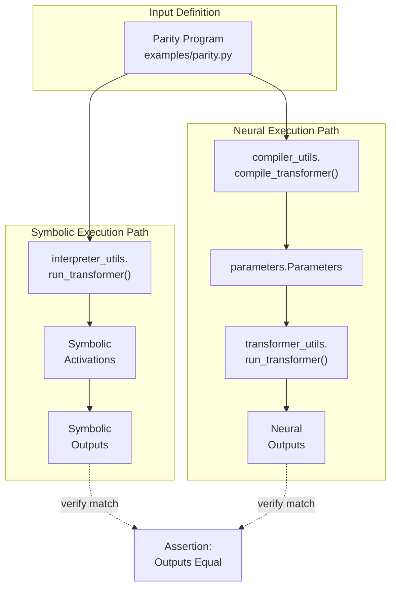
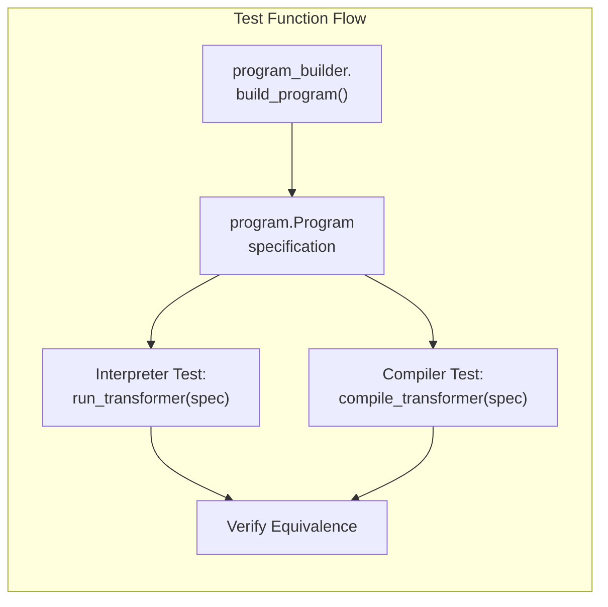
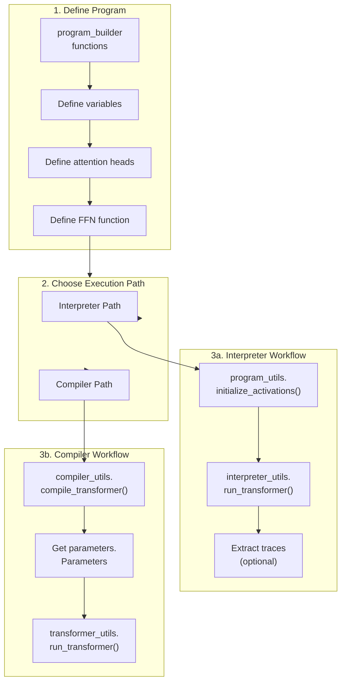
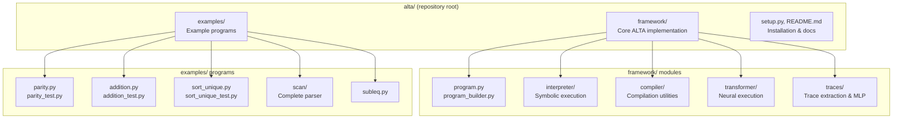

<!-- source: DeepWiki mcp.deepwiki.com · repo google-deepmind/alta · page 2 Getting Started · fetched 2026-10-26 -->

# Getting Started

<details>
<summary>Relevant source files</summary>

The following files were used as context for generating this wiki page:

- [.gitignore](.gitignore)
- [CONTRIBUTING.md](CONTRIBUTING.md)
- [README.md](README.md)
- [setup.py](setup.py)

</details>


## Purpose and Scope

This page guides you through installing ALTA, setting up your development environment, and running your first ALTA program. You will learn how to execute programs using both the symbolic interpreter and the compiler-to-transformer pipeline. For detailed information about ALTA's underlying concepts and architecture, see [Overview](#1). For in-depth exploration of specific example programs, see [Example Programs](#4).

---

## Prerequisites

ALTA requires the following system prerequisites:

| Requirement | Version | Purpose |
|-------------|---------|---------|
| Python | ≥ 3.10 | Runtime environment |
| Git | Any recent version | Repository cloning |
| Virtual environment tool | conda, venv, or virtualenv | Dependency isolation |

**Sources:** [setup.py:28]()

---

## Installation

### Step 1: Clone the Repository

```bash
git clone https://github.com/google-deepmind/alta.git
cd alta
```

### Step 2: Create Virtual Environment

Using conda (recommended):

```bash
conda create -n alta python=3.10
conda activate alta
```

Alternatively, using venv:

```bash
python3.10 -m venv alta_env
source alta_env/bin/activate  # On Windows: alta_env\Scripts\activate
```

### Step 3: Install Dependencies

The package uses a standard Python setuptools installation:

```bash
pip install .
```

This installs the following required packages specified in `setup.py`:

| Package | Purpose |
|---------|---------|
| `absl-py` | Command-line flags and application utilities |
| `tensorflow` | Tensor operations and utilities |
| `numpy` | Numerical array operations |
| `jax` | Numerical computing library |
| `apache-beam` | Data processing pipeline utilities |
| `scipy` | Scientific computing operations |

**Sources:** [README.md:6-26](), [setup.py:20-29]()

---

## Your First ALTA Program: Parity Detection

### Overview of the Parity Example

The parity detection program is the simplest example in ALTA. It determines whether a sequence contains an even or odd number of 1s. This example demonstrates both execution paths: symbolic interpretation and neural compilation.

### Execution Path Diagram



**Sources:** [README.md:37-47](), Diagram 3 from high-level overview

### Running the Parity Tests

Execute the parity program's test suite to verify both execution paths:

```bash
python -m examples.parity_test
```

This command runs unit tests located in `examples/parity_test.py` that exercise three parity algorithms:
- Sequential absolute position parity
- Sequential relative position parity  
- Sum modulo 2 parity

Each test validates that the symbolic interpreter and compiled transformer produce identical outputs.

**Sources:** [README.md:43-47]()

### Understanding the Test Structure

The test file `examples/parity_test.py` demonstrates the standard pattern for ALTA programs:



**Key files involved:**
- `examples/parity.py` - Program definition functions
- `examples/parity_test.py` - Test suite with assertions
- `framework/interpreter/interpreter_utils.py` - Symbolic execution
- `framework/compiler/compiler_utils.py` - Compilation to parameters
- `framework/transformer/transformer_utils.py` - Neural execution

**Sources:** [README.md:39-47](), Diagram 6 from high-level overview

---

## Understanding the Dual Execution Paradigm

ALTA provides two equivalent methods to execute programs:

### Execution Path Comparison

| Aspect | Symbolic Interpreter | Compiler-to-Transformer |
|--------|---------------------|-------------------------|
| Entry point | `interpreter_utils.run_transformer()` | `compiler_utils.compile_transformer()` + `transformer_utils.run_transformer()` |
| Input | `program.Program` specification | `program.Program` specification |
| Intermediate form | Symbolic activations (dictionaries) | `parameters.Parameters` (neural weights) |
| Output | Program results + execution traces | Program results |
| Use case | Analysis, debugging, trace extraction | Deployment, neural network integration |
| Performance | Slower (Python execution) | Faster (vectorized operations) |

### Workflow for Each Path



**Sources:** Diagrams 1, 3, and 6 from high-level overview, [README.md:28-36]()

### When to Use Each Path

**Use the Interpreter** when you need to:
- Debug program logic with symbolic values
- Extract execution traces for analysis
- Understand intermediate computation states
- Train MLPs using trace supervision (see [Traces and MLP Training](#3.5))

**Use the Compiler** when you need to:
- Deploy programs as standard transformer models
- Integrate with existing neural network frameworks
- Achieve optimal runtime performance
- Export fixed neural network parameters

**Sources:** Diagrams 1 and 3 from high-level overview

---

## Directory Structure Overview

After installation, familiarize yourself with the repository structure:



| Directory | Purpose |
|-----------|---------|
| `framework/` | Core ALTA language specification and execution engines |
| `framework/interpreter/` | Symbolic interpreter implementation |
| `framework/compiler/` | Compiler from programs to transformer parameters |
| `framework/transformer/` | Self-contained transformer execution engine |
| `framework/traces/` | Trace extraction and MLP training utilities |
| `examples/` | Example ALTA programs with test suites |

**Sources:** [README.md:28-36](), Diagram 4 from high-level overview

---

## Running Additional Examples

Once you've successfully run the parity test, explore other examples:

### Available Example Programs

| Program | Command | Purpose |
|---------|---------|---------|
| Parity Detection | `python -m examples.parity_test` | Even/odd bit counting |
| Multi-Digit Addition | `python -m examples.addition_test` | Arithmetic with carry operations |
| Sorting Unique Numbers | `python -m examples.sort_unique_test` | Sequence sorting algorithms |

Each test demonstrates both execution paths and validates output equivalence.

**Sources:** [README.md:37-47](), Diagram 5 from high-level overview

---

## Verification of Installation

To verify your installation is complete and functioning:

### Verification Checklist

1. **Python version**: Run `python --version` and verify ≥ 3.10
2. **Package installation**: Run `python -c "import framework"` - should complete without errors
3. **Dependencies**: Run `python -c "import tensorflow, jax, numpy"` - should import successfully
4. **Test execution**: Run `python -m examples.parity_test` - all tests should pass

If any verification step fails, review the installation steps and ensure all dependencies from `setup.py` are properly installed.

**Sources:** [setup.py:20-29](), [README.md:6-26]()

---

## Next Steps

After completing this getting started guide, you can:

1. **Explore program internals**: Learn how ALTA programs are defined - see [Program Specification](#3.1)
2. **Understand compilation**: Learn how programs become transformers - see [Compiler Pipeline](#3.3)
3. **Study complete examples**: Examine production-quality programs - see [SCAN Compositional Learning](#4.4)
4. **Contribute to ALTA**: Review contribution guidelines - see [Contributing Guidelines](#5.1)

For architectural details about the interpreter and compiler, proceed to [Core Architecture](#3).

**Sources:** [README.md:1-68](), [CONTRIBUTING.md:1-26]()

---

