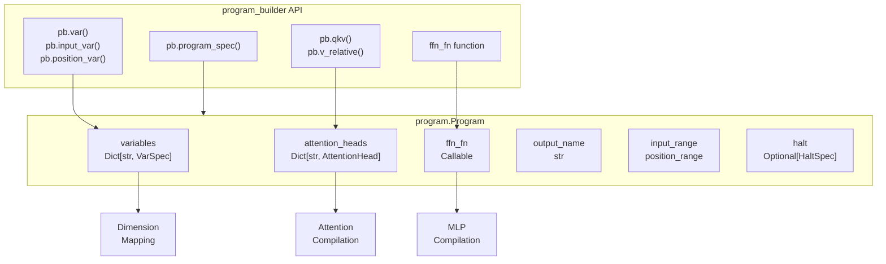
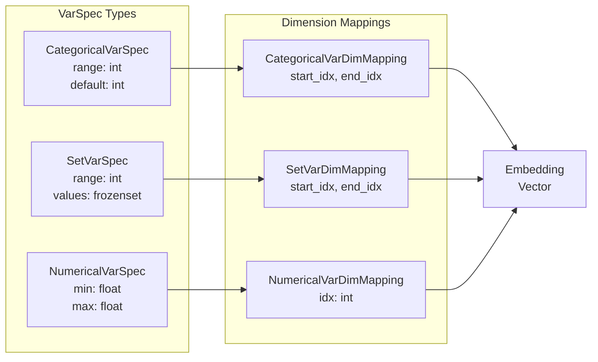
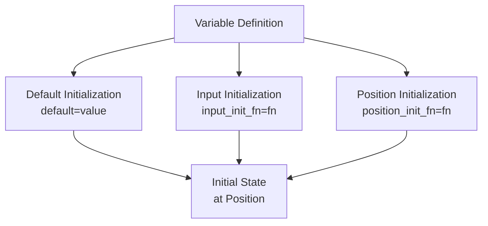
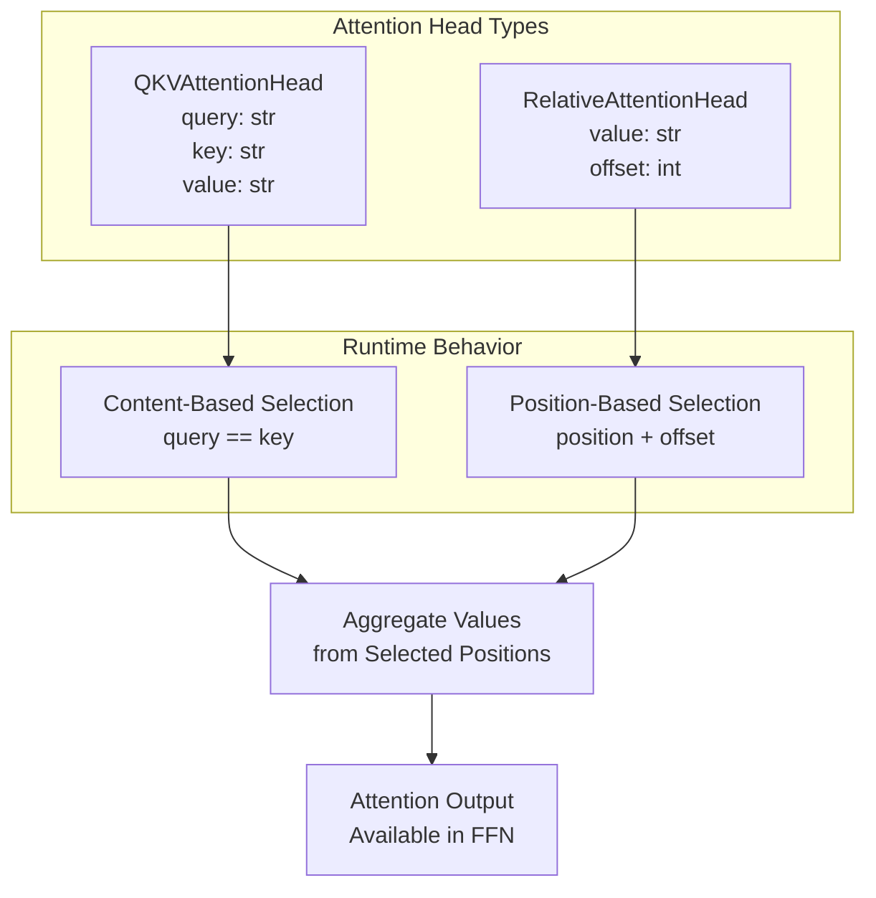
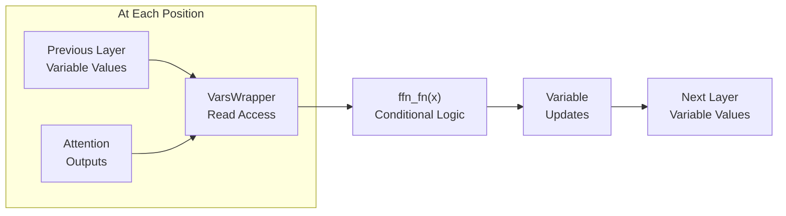
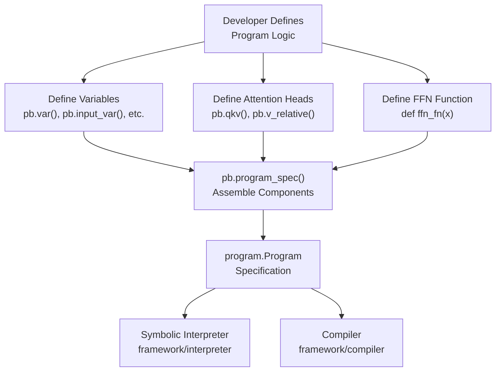
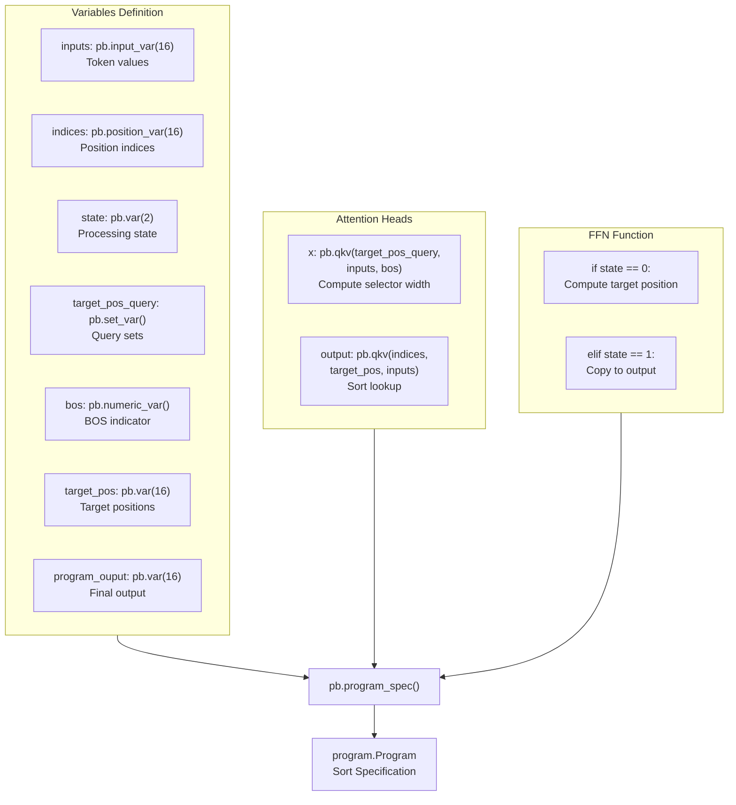
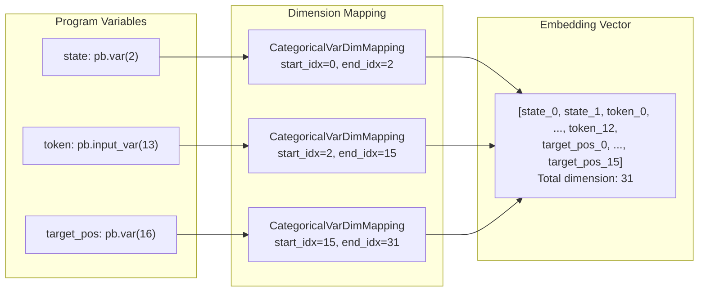

<!-- source: DeepWiki mcp.deepwiki.com · repo google-deepmind/alta · page 3.1 Program Specification · fetched 2026-10-26 -->

# Program Specification

<details>
<summary>Relevant source files</summary>

The following files were used as context for generating this wiki page:

- [examples/addition.py](examples/addition.py)
- [examples/sort_unique.py](examples/sort_unique.py)
- [framework/compiler/dim_utils.py](framework/compiler/dim_utils.py)

</details>


This page documents how ALTA programs are defined using the `program_builder` API. A program specification consists of three main components: **variables** that represent the transformer's state, **attention heads** that define information flow between positions, and a **feed-forward function** that implements state transitions. The program specification serves as the input to both the symbolic interpreter ([3.2](#3.2)) and the compiler ([3.3](#3.3)).

For information about executing program specifications, see the Symbolic Interpreter ([3.2](#3.2)) and Transformer Execution ([3.4](#3.4)) pages. For analysis of compiled programs, see Traces and MLP Training ([3.5](#3.5)).

---

## Program Structure

An ALTA program specification is represented by the `program.Program` dataclass, which is constructed using the `program_builder` module (typically imported as `pb`). The specification defines the complete transformer architecture and behavior.



**Sources:** [examples/sort_unique.py:52-95](), [examples/addition.py:172-185]()

---

## Variable Definitions

Variables represent the transformer's state at each position. Each variable has a **name**, a **type** (categorical, set, or numerical), and a **range** that defines its possible values.

### Variable Types

The framework supports three fundamental variable types, each with different representation strategies:

| Variable Type | Constructor | Representation | Use Case |
|---------------|-------------|----------------|----------|
| **Categorical** | `pb.var(range)` | One-hot vector of size `range` | Discrete states, tokens |
| **Set** | `pb.set_var(range, values)` | Binary vector indicating set membership | Sets of discrete elements |
| **Numerical** | `pb.numeric_var()` | Single floating-point value | Continuous values, pointers |



**Sources:** [framework/compiler/dim_utils.py:24-80]()

### Categorical Variables

Categorical variables represent discrete states with a finite range. They are encoded as one-hot vectors.

**Basic categorical variable:**
```python
variables = {
    "state": pb.var(2),  # Binary state: 0 or 1
    "step": pb.var(4),   # Four-step process: 0, 1, 2, 3
}
```

**Input variables** (token embeddings):
```python
variables = {
    "token": pb.input_var(INPUT_RANGE),  # Initialized from input sequence
}
```

**Position variables** (positional encodings):
```python
variables = {
    "indices": pb.position_var(POSITION_RANGE),  # Position index 0 to POSITION_RANGE-1
}
```

**Sources:** [examples/sort_unique.py:55-71](), [examples/addition.py:131-152]()

### Set Variables

Set variables represent sets of discrete elements. They require both a `range` (element space) and `values` (possible sets).

```python
def _get_target_pos_query(input_id):
    if input_id == BOS_VALUE:
        return frozenset([BOS_VALUE])
    else:
        return frozenset(range(input_id + 1))

def _possible_target_pos_query_values():
    possible_values = set()
    for input_id in range(INPUT_RANGE):
        possible_values.add(_get_target_pos_query(input_id))
    return frozenset(possible_values)

variables = {
    "target_pos_query": pb.set_var(
        range=INPUT_RANGE,
        values=_possible_target_pos_query_values(),
        input_init_fn=_get_target_pos_query,
    ),
}
```

The `input_init_fn` parameter specifies how to initialize the set variable from input values.

**Sources:** [examples/sort_unique.py:38-63]()

### Numerical Variables

Numerical variables store floating-point values in a single dimension.

```python
variables = {
    # Computed numerical value
    "target_pos": pb.var(POSITION_RANGE),
    
    # Initialized by position
    "bos": pb.numeric_var(position_init_fn=lambda x: float(x == 0)),
    
    # Static constant
    "one": pb.var(var_range=2, default=1),
}
```

**Sources:** [examples/sort_unique.py:68-70](), [examples/addition.py:150]()

### Variable Initialization

Variables can be initialized in three ways:

1. **Default values:** Specified via `default` parameter
2. **Input initialization:** Specified via `input_init_fn` parameter
3. **Position initialization:** Specified via `position_init_fn` parameter



**Sources:** [examples/sort_unique.py:59-69]()

---

## Attention Head Specifications

Attention heads define how information flows between positions in the sequence. ALTA supports two types of attention patterns: **QKV attention** for content-based selection and **relative attention** for fixed positional offsets.

### QKV Attention

QKV attention heads are defined by specifying query, key, and value variable names. The attention mechanism selects positions where `query == key` and aggregates their `value` variables.

```python
attention_heads = {
    # Select positions where indices == target_pos, aggregate inputs
    "output": pb.qkv("indices", "target_pos", "inputs"),
    
    # Select positions where target_pos_query contains inputs, aggregate bos
    "x": pb.qkv("target_pos_query", "inputs", "bos"),
    
    # Select positions where one == ptr_a, aggregate token
    "ptr_a_token": pb.qkv("one", "ptr_a", "token"),
}
```

**Attention semantics:**
- For categorical variables: `query == key` (exact match)
- For set variables: `key ∈ query` (membership test)
- For numerical variables: Used as floating-point values in attention computation

**Sources:** [examples/sort_unique.py:72-75](), [examples/addition.py:155-169]()

### Relative Attention

Relative attention heads attend to a fixed offset from the current position.

```python
attention_heads = {
    # Attend to position i+1 (one position to the right)
    "token_right": pb.v_relative("token", 1),
    "ptr_a_right": pb.v_relative("ptr_a", 1),
    
    # Attend to position i-1 (one position to the left)
    "prev_state": pb.v_relative("state", -1),
}
```

The offset parameter specifies the relative position: positive values look right, negative values look left.

**Sources:** [examples/addition.py:155-164]()

### Attention Head Structure



**Sources:** [examples/addition.py:155-169]()

---

## Feed-Forward Network Function

The FFN function implements the core logic of the program. It operates on the `VarsWrapper` interface, which provides access to all variables and attention outputs at a single position.

### VarsWrapper Interface

The `VarsWrapper` object passed to the FFN function provides dictionary-like access to variables:

```python
def ffn_fn(x: simple_mlp.VarsWrapper):
    # Read variable values
    current_state = x["state"]
    carry_value = x["value_carry"]
    
    # Read attention outputs
    right_token = x["token_right"]  # From relative attention
    ptr_a_value = x["ptr_a_token"]  # From QKV attention
    
    # Write variable values
    x["state"] = 1
    x["value_out"] = carry_value + ptr_a_value
```

**Key properties:**
- Reading a variable returns its current value
- Reading an attention head name returns the aggregated output
- Writing to a variable updates its value for the next layer
- Undefined attention outputs (e.g., attending past sequence end) return `undefined`

**Sources:** [examples/sort_unique.py:77-86](), [examples/addition.py:84-128]()

### FFN Function Patterns

ALTA programs typically use state machines implemented via conditional logic:

**Simple state-based computation:**
```python
def ffn_fn(x: simple_mlp.VarsWrapper):
    if x["state"] == 0:
        # Compute inverse of selector width
        x["target_pos"] = round(1 / x["x"]) - 1
        x["state"] = 1
    elif x["state"] == 1:
        # Copy attention output to program output
        x["program_ouput"] = x["output"]
```

**Multi-step processing:**
```python
def _ffn_fn(x: simple_mlp.VarsWrapper):
    if x["step"] == STEP_INIT:
        _init(x)
        x["step"] = STEP_ITERATE
    elif x["step"] == STEP_ITERATE:
        if x["ptr_a_token"] == START_TOKEN:
            x["step"] = STEP_FINALIZE
        else:
            _iterate(x)
    elif x["step"] == STEP_FINALIZE:
        _finalize(x)
```

**Sources:** [examples/sort_unique.py:77-86](), [examples/addition.py:118-128]()

### FFN Execution Model



**Sources:** [examples/addition.py:84-128]()

---

## Complete Program Construction

Programs are assembled using `pb.program_spec()`, which combines all components into a `program.Program` object.

### The program_spec() Function

```python
def build_program_spec() -> program.Program:
    variables = {
        "token": pb.input_var(INPUT_RANGE),
        "state": pb.var(NUM_STEPS),
        "ptr_a": pb.var(2),
        "value_out": pb.var(10),
    }
    
    attention_heads = {
        "token_right": pb.v_relative("token", 1),
        "ptr_a_token": pb.qkv("one", "ptr_a", "token"),
    }
    
    return pb.program_spec(
        variables=variables,
        heads=attention_heads,
        ffn_fn=_ffn_fn,
        output_name="value_out",
        input_range=INPUT_RANGE,
        position_range=None,  # If None, inferred from input
        halt=pb.halt_spec("step", halt_value=STEP_DONE),
        generate_rules=False,
    )
```

**Sources:** [examples/addition.py:172-185](), [examples/sort_unique.py:52-95]()

### program_spec() Parameters

| Parameter | Type | Description |
|-----------|------|-------------|
| `variables` | `dict[str, VarSpec]` | Variable definitions |
| `heads` | `dict[str, AttentionHead]` | Attention head specifications |
| `ffn_fn` | `Callable` | Feed-forward function |
| `output_name` | `str` | Name of variable containing final output |
| `input_range` | `int` | Size of input vocabulary |
| `position_range` | `int \| None` | Maximum sequence length (None to infer) |
| `halt` | `HaltSpec \| None` | Optional early stopping condition |
| `generate_rules` | `bool` | Whether to auto-generate transition rules |

### Halt Specifications

Programs can specify early stopping conditions via `pb.halt_spec()`:

```python
halt=pb.halt_spec("step", halt_value=STEP_DONE)
```

This halts execution when the `step` variable reaches `STEP_DONE` at all positions.

**Sources:** [examples/addition.py:183]()

### Program Construction Flow



**Sources:** [examples/sort_unique.py:52-95](), [examples/addition.py:172-185]()

---

## Example: Sort Unique Program

The following example demonstrates all components of a program specification:



**Complete specification structure:**

| Component | Count | Purpose |
|-----------|-------|---------|
| Input variables | 1 | `inputs` - token values |
| Position variables | 1 | `indices` - position indices |
| State variables | 5 | Track computation progress |
| Attention heads | 2 | Compute selector width, perform sorted lookup |
| FFN states | 2 | Two-stage computation |

**Sources:** [examples/sort_unique.py:52-95]()

---

## Variable Dimension Mapping

The compiler maps variables to dimensions in the transformer's embedding space. This mapping is computed by `dim_utils`:



**Dimension allocation:**
- **Categorical variables:** Allocated `range` dimensions (one-hot encoding)
- **Set variables:** Allocated `range` dimensions (binary membership vector)
- **Numerical variables:** Allocated 1 dimension (floating-point value)

**Sources:** [framework/compiler/dim_utils.py:100-122](), [framework/compiler/dim_utils.py:153-167]()

---

## Summary

An ALTA program specification consists of:

1. **Variables** - Categorical, set, or numerical state containers
2. **Attention heads** - QKV or relative attention patterns  
3. **FFN function** - State transition logic operating on `VarsWrapper`
4. **Configuration** - Output variable, ranges, halt conditions

These components are assembled via `pb.program_spec()` to create a `program.Program` object that can be:
- Executed symbolically by the interpreter ([3.2](#3.2))
- Compiled to transformer weights ([3.3](#3.3))
- Analyzed for trace extraction ([3.5](#3.5))

**Sources:** [examples/sort_unique.py:52-95](), [examples/addition.py:131-185](), [framework/compiler/dim_utils.py:1-185]()

---

