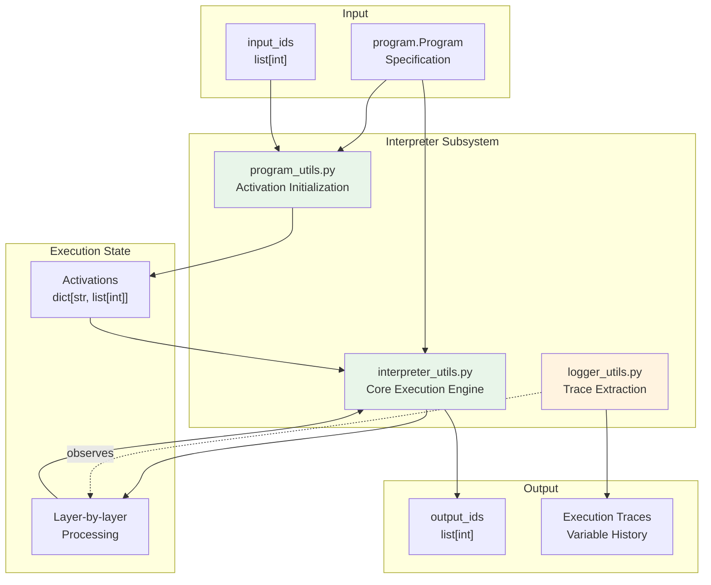
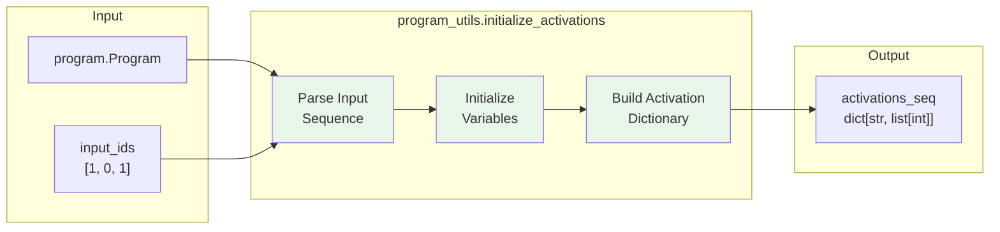
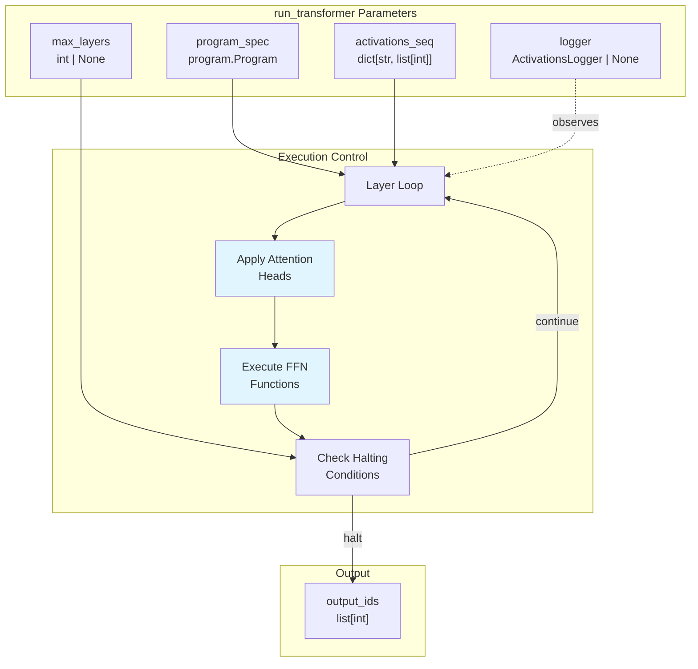
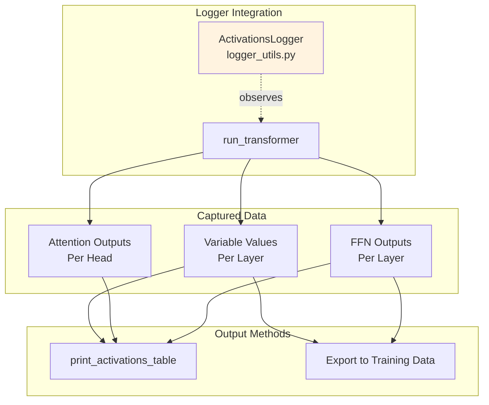
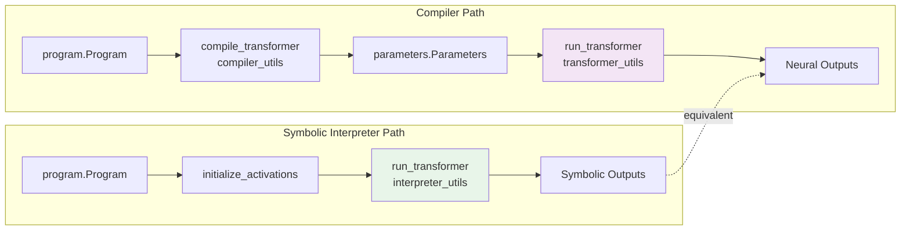
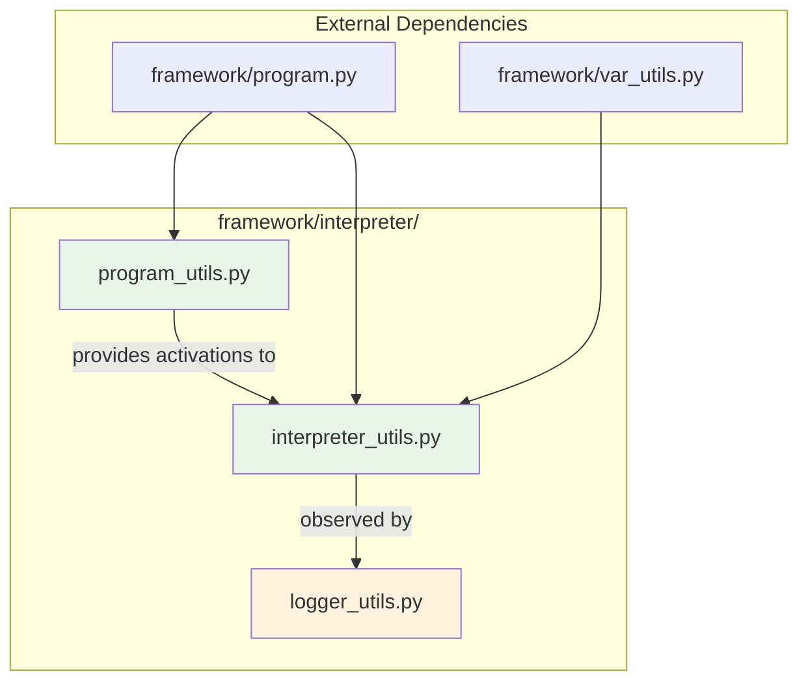

<!-- source: DeepWiki mcp.deepwiki.com · repo google-deepmind/alta · page 3.2 Symbolic Interpreter · fetched 2026-10-26 -->

# Symbolic Interpreter

<details>
<summary>Relevant source files</summary>

The following files were used as context for generating this wiki page:

- [README.md](README.md)
- [examples/addition_test.py](examples/addition_test.py)
- [examples/parity_test.py](examples/parity_test.py)
- [examples/scan/data_utils.py](examples/scan/data_utils.py)

</details>


## Purpose and Scope

The symbolic interpreter provides direct execution of ALTA program specifications without compilation to neural network weights. Unlike the compiler pipeline (see [3.3](#3.3)), which transforms programs into transformer parameters, the interpreter maintains symbolic representations of variables and executes programs step-by-step through transformer layers. This enables program verification, debugging, and extraction of execution traces for analysis.

For information about the compiled execution path, see [Transformer Execution](#3.4). For trace extraction and MLP training capabilities, see [Traces and MLP Training](#3.5).

---

## System Architecture

The interpreter subsystem consists of three primary modules that work together to execute ALTA programs symbolically:



**Interpreter Execution Flow**: The interpreter begins with `program_utils.initialize_activations()` to create initial symbolic states, then `interpreter_utils.run_transformer()` executes the program layer-by-layer. Optional `logger_utils.ActivationsLogger` instances can observe execution to extract traces.

**Sources**: [README.md:30-35](), [examples/parity_test.py:111-120](), [examples/addition_test.py:37-45]()

---

## Activation Initialization

The `program_utils.initialize_activations()` function creates the initial symbolic state for program execution by mapping input tokens to variable activations.

### Initialization Process

| Step | Function | Purpose |
|------|----------|---------|
| 1 | Parse input_ids | Convert input tokens to sequence positions |
| 2 | Initialize variables | Set initial values for all program variables |
| 3 | Create activation dict | Build mapping from variable names to activation sequences |



**Activation Dictionary Structure**: The `initialize_activations()` function returns a dictionary mapping variable names (strings) to sequences of activation values (lists of integers). Each position in the sequence corresponds to a token position in the input.

**Sources**: [examples/parity_test.py:113-115](), [examples/addition_test.py:37-39]()

### Usage Example

```python
# From parity_test.py
program_spec = get_program_spec(parity_algorithm)
activations_seq = program_utils.initialize_activations(
    program_spec, 
    input_ids=[1, 0, 1]
)
# activations_seq is now dict[str, list[int]] with initial variable values
```

**Sources**: [examples/parity_test.py:113-115]()

---

## Interpreter Execution

The core execution engine is `interpreter_utils.run_transformer()`, which processes the program layer-by-layer until completion or maximum layers reached.

### Execution Parameters



**Layer-by-Layer Processing**: Each iteration applies attention heads to aggregate information, then executes FFN functions to update variable values. The loop continues until halting conditions are met or `max_layers` is reached.

**Sources**: [examples/parity_test.py:116-120](), [examples/addition_test.py:40-44]()

### Halting Mechanisms

The interpreter supports two halting mechanisms:

| Mechanism | Trigger | Behavior |
|-----------|---------|----------|
| **Fixed Layers** | `max_layers=N` (integer) | Execute exactly N layers |
| **Dynamic Halting** | `max_layers=None` | Stop when program signals completion |

```python
# Fixed layers execution
outputs = interpreter_utils.run_transformer(
    program_spec,
    activations_seq,
    max_layers=10  # Execute exactly 10 layers
)

# Dynamic halting execution
outputs = interpreter_utils.run_transformer(
    program_spec,
    activations_seq,
    max_layers=None  # Run until program halts
)
```

**Sources**: [examples/parity_test.py:326-340](), [examples/parity_test.py:342-356]()

### Return Value

The `run_transformer()` function returns `output_ids`, a list of integers representing the final output sequence. The mapping from these IDs to semantic values is program-specific and typically handled by postprocessing functions.

```python
# From addition_test.py
output_ids = interpreter_utils.run_transformer(
    program_spec,
    activations_seq,
    max_layers=None,
)
# output_ids: list[int]
output = addition.process_output(output_ids)  # Program-specific postprocessing
```

**Sources**: [examples/addition_test.py:40-46]()

---

## Trace Extraction and Logging

The `logger_utils.ActivationsLogger` class enables observation and extraction of execution traces during symbolic interpretation.

### Logger Architecture



**Trace Collection**: The logger observes variable activations and layer outputs during execution, building a complete history of program state evolution across layers.

**Sources**: [examples/parity_test.py:215-220]()

### Logger Usage

```python
# From parity_test.py
logger = logger_utils.ActivationsLogger()
outputs = interpreter_utils.run_transformer(
    program_spec, 
    activations_seq, 
    max_layers=10, 
    logger=logger
)
# For debugging:
logger.print_activations_table()
```

**Sources**: [examples/parity_test.py:215-220]()

### Trace Applications

Execution traces captured by the logger serve multiple purposes:

| Application | Description | Reference |
|-------------|-------------|-----------|
| **Debugging** | Inspect variable values at each layer | `print_activations_table()` |
| **Verification** | Validate program correctness step-by-step | Test files |
| **MLP Training** | Generate supervised training data for FFN approximation | See [3.5](#3.5) |

**Sources**: [README.md:34-35](), [examples/parity_test.py:219-220]()

---

## Interpreter vs Compiler Comparison

The symbolic interpreter and compiler provide equivalent functionality through different mechanisms:



**Functional Equivalence**: Both execution paths produce identical outputs for the same input, as verified by test suites. The interpreter maintains symbolic representations, while the compiler produces fixed neural weights.

| Aspect | Symbolic Interpreter | Compiler |
|--------|---------------------|----------|
| **Execution** | Step-by-step symbolic processing | Fixed neural network forward pass |
| **Performance** | Slower, detailed tracking | Faster, optimized matrix operations |
| **Observability** | Full variable inspection | Limited to final outputs |
| **Traces** | Can extract execution traces | Cannot extract traces |
| **Use Case** | Development, debugging, analysis | Deployment, production, efficiency |

**Sources**: [examples/parity_test.py:251-264](), [examples/parity_test.py:271-284](), [examples/addition_test.py:70-89]()

---

## Code Organization

The interpreter subsystem is organized into three modules within `framework/interpreter/`:

| Module | Key Functions | Purpose |
|--------|--------------|---------|
| `program_utils.py` | `initialize_activations()` | Create initial activation states from inputs |
| `interpreter_utils.py` | `run_transformer()` | Execute program layer-by-layer symbolically |
| `logger_utils.py` | `ActivationsLogger` | Capture execution traces for analysis |



**Module Separation**: The three-module design separates concerns: initialization, execution, and observation are independent and can be used separately or composed.

**Sources**: [README.md:30-35](), [examples/parity_test.py:24-29]()

---

## Testing and Validation

The interpreter is extensively tested across multiple example programs:

```python
# Standard interpreter test pattern
def test_parity(self, parity_algorithm: ParityAlgorithm):
    program_spec = get_program_spec(parity_algorithm, generate_rules=False)
    
    input_ids = [random.choice([0, 1]) for _ in range(input_length)]
    activations_seq = program_utils.initialize_activations(
        program_spec, 
        get_inputs(parity_algorithm, input_ids)
    )
    outputs = interpreter_utils.run_transformer(
        program_spec,
        activations_seq,
        max_layers=max_layers,
    )
    
    # Verify correctness
    if is_even(input_ids):
        self.assertEqual(outputs[-1], 0)
    else:
        self.assertEqual(outputs[-1], 1)
```

**Sources**: [examples/parity_test.py:103-125]()

### Test Coverage

| Test Suite | Program | Validation |
|------------|---------|------------|
| `parity_test.py` | Parity detection algorithms | Random inputs, edge cases, dynamic halting |
| `addition_test.py` | Multi-digit addition | Specific test cases, output verification |

**Sources**: [examples/parity_test.py:1-390](), [examples/addition_test.py:1-93]()

---

