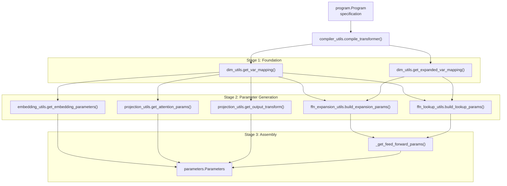
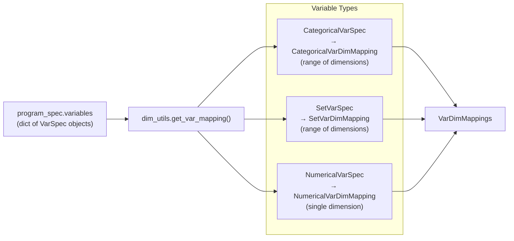
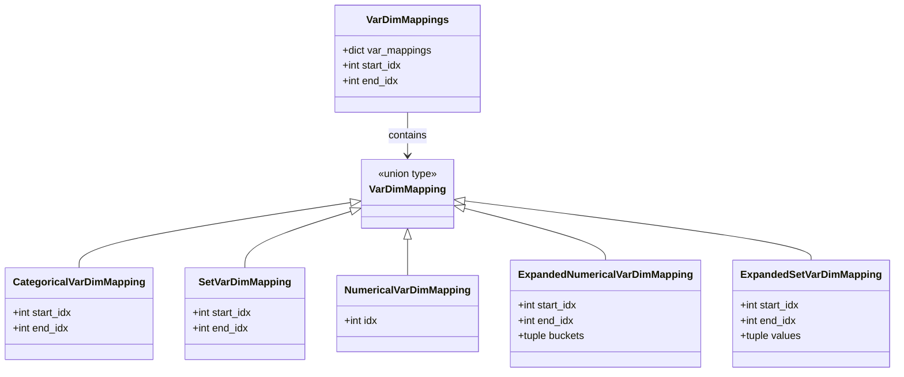
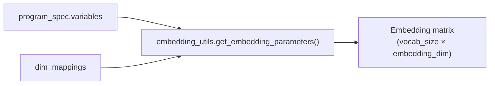
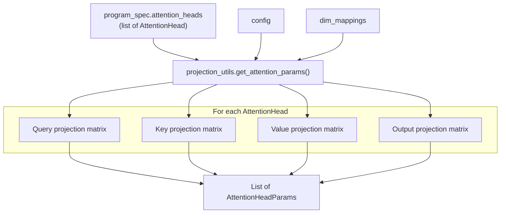
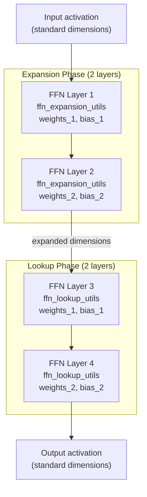
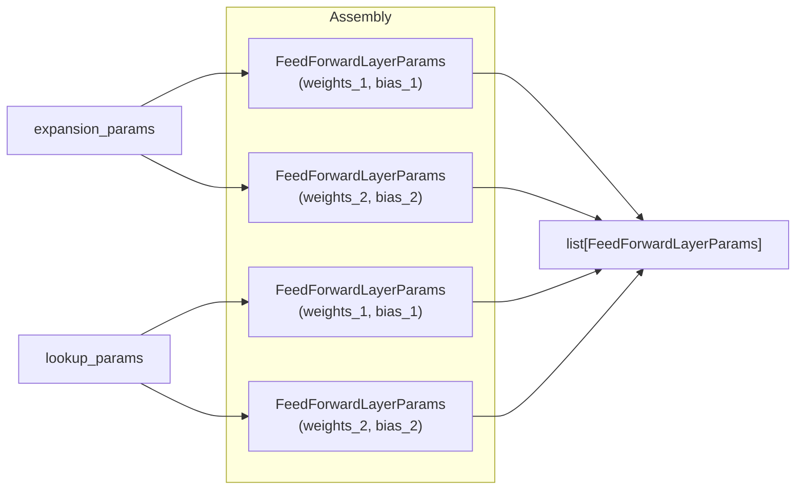
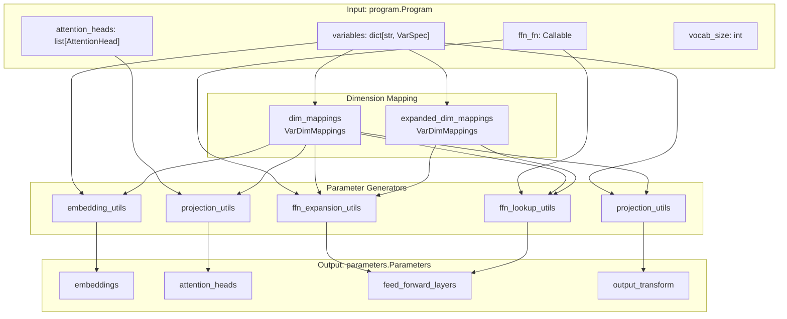

<!-- source: DeepWiki mcp.deepwiki.com · repo google-deepmind/alta · page 3.3 Compiler Pipeline · fetched 2026-10-26 -->

# Compiler Pipeline

<details>
<summary>Relevant source files</summary>

The following files were used as context for generating this wiki page:

- [examples/addition_test.py](examples/addition_test.py)
- [framework/compiler/compiler_utils.py](framework/compiler/compiler_utils.py)
- [framework/compiler/dim_utils.py](framework/compiler/dim_utils.py)

</details>


## Purpose and Scope

The compiler pipeline transforms ALTA program specifications into concrete Transformer parameters that can be executed by the neural network runtime. This document covers the compilation process from `program.Program` specifications to `parameters.Parameters` objects, including dimension mapping, embedding generation, attention head construction, and feed-forward network compilation.

For information about program specification syntax, see [Program Specification](#3.1). For details on how compiled parameters are executed, see [Transformer Execution](#3.4).

**Sources:** [framework/compiler/compiler_utils.py:1-100]()

---

## Compilation Overview

The compiler operates through a single entry point function `compile_transformer` that orchestrates multiple specialized compilation stages. The process begins with dimension mapping, which establishes how each program variable maps to dimensions in the embedding space. This mapping then feeds into five parallel parameter generation stages that produce the complete Transformer parameter set.



**Sources:** [framework/compiler/compiler_utils.py:63-99]()

---

## Entry Point: compile_transformer

The `compile_transformer` function in `compiler_utils` serves as the main interface for compilation. It accepts a `program.Program` specification and a `compiler_config.Config` object, returning a complete `parameters.Parameters` object.

### Function Signature

```python
def compile_transformer(
    program_spec: program.Program,
    config: compiler_config.Config,
    compile_ffn: bool = True,
    verbose: bool = False,
) -> parameters.Parameters:
```

### Parameters

| Parameter | Type | Description |
|-----------|------|-------------|
| `program_spec` | `program.Program` | The ALTA program specification to compile |
| `config` | `compiler_config.Config` | Compiler configuration options |
| `compile_ffn` | `bool` | Whether to compile feed-forward layers (default: `True`) |
| `verbose` | `bool` | Enable detailed logging of dimension mappings (default: `False`) |

### Return Value

Returns a `parameters.Parameters` object containing:
- `embeddings`: Token embedding matrices
- `attention_heads`: List of attention head parameters
- `feed_forward_layers`: List of FFN layer parameters (or `None` if `compile_ffn=False`)
- `output_transform`: Output projection matrices

**Sources:** [framework/compiler/compiler_utils.py:63-99](), [examples/addition_test.py:70-89]()

---

## Stage 1: Dimension Mapping

Dimension mapping is the foundational stage that establishes how program variables map to dimensions in the Transformer's embedding vectors. The `dim_utils` module provides two distinct mapping strategies.

### Standard Variable Mapping

The `get_var_mapping` function creates mappings for normal Transformer execution:



### Expanded Variable Mapping

The `get_expanded_var_mapping` function creates one-hot representations used internally by the FFN:

| Variable Type | Standard Mapping | Expanded Mapping |
|---------------|------------------|------------------|
| `CategoricalVarSpec` | `CategoricalVarDimMapping` (one-hot) | Same as standard |
| `SetVarSpec` | `SetVarDimMapping` (indicator vector) | `ExpandedSetVarDimMapping` (one-hot per possible set) |
| `NumericalVarSpec` | `NumericalVarDimMapping` (single float) | `ExpandedNumericalVarDimMapping` (one-hot buckets) |

### Dimension Mapping Classes

The dimension mapping classes defined in `dim_utils` are:



**Sources:** [framework/compiler/dim_utils.py:1-185](), [framework/compiler/compiler_utils.py:70-75]()

---

## Stage 2: Parameter Generation

After dimension mappings are established, the compiler generates parameters for each Transformer component in parallel. Each component uses the dimension mappings to construct matrices of the appropriate size.

### Embedding Parameters

The `embedding_utils.get_embedding_parameters` function generates token embedding matrices that map input token IDs to embedding vectors.



The embedding matrix dimensions are determined by:
- **Rows**: Maximum token ID across all categorical variables
- **Columns**: Total embedding dimension from `dim_mappings.end_idx`

**Sources:** [framework/compiler/compiler_utils.py:77-79]()

### Attention Head Parameters

The `projection_utils.get_attention_params` function compiles each attention head defined in `program_spec.attention_heads` into parameter matrices.



Each attention head produces four projection matrices that implement the attention mechanism's query, key, value computations and output transformation.

**Sources:** [framework/compiler/compiler_utils.py:80-82]()

### Output Transform

The `projection_utils.get_output_transform` function generates the final projection matrix that maps from the embedding space to output token IDs.

**Sources:** [framework/compiler/compiler_utils.py:90-92]()

---

## Feed-Forward Network Compilation

FFN compilation is the most complex stage, split into two phases: expansion and lookup. Each phase contributes two FFN layers to the final network, resulting in four layers total.

### FFN Architecture



### Expansion Phase

The `ffn_expansion_utils.build_expansion_params` function transforms standard dimension mappings to expanded (one-hot) representations:

| Input | Processing | Output |
|-------|------------|--------|
| Numerical variables (single float) | Discretize into buckets | One-hot bucket representation |
| Set variables (indicator vector) | Enumerate possible sets | One-hot set representation |
| Categorical variables | Pass through | Unchanged one-hot |

The expansion phase uses both `dim_mappings` (standard) and `expanded_dim_mappings` to construct transformation matrices.

**Sources:** [framework/compiler/compiler_utils.py:35-40]()

### Lookup Phase

The `ffn_lookup_utils.build_lookup_params` function implements the program's FFN logic (`program_spec.ffn_fn`) by building lookup tables in the expanded space, then projecting back to standard dimensions.

The lookup phase operates on the expanded one-hot representations, where each possible variable value combination corresponds to a single dimension. This allows the FFN function to be implemented as a simple lookup table.

**Sources:** [framework/compiler/compiler_utils.py:41-45]()

### FFN Assembly

The `_get_feed_forward_params` helper function assembles the four FFN layers into a list of `FeedForwardLayerParams` objects:



**Sources:** [framework/compiler/compiler_utils.py:28-60]()

---

## Complete Compilation Flow

The following diagram shows the complete data flow through the compilation pipeline, mapping program specification components to their corresponding parameter outputs:



**Sources:** [framework/compiler/compiler_utils.py:63-99]()

---

## Compiler Configuration

The `compiler_config.Config` class provides configuration options for the compilation process. While the specific configuration options are defined in the config module, the compiler uses these settings to control aspects like:

- Attention head dimension calculations
- Numerical discretization strategies
- Layer normalization settings
- Compilation optimizations

The config object is passed to parameter generation functions that need these settings, particularly `get_attention_params` and `build_expansion_params`.

**Sources:** [framework/compiler/compiler_utils.py:19](), [examples/addition_test.py:77]()

---

## Usage Example

The following code demonstrates typical compiler usage, taken from the addition test:

```python
from framework.compiler import compiler_config
from framework.compiler import compiler_utils

# Build program specification
program_spec = addition.build_sparse_program_spec()

# Create compiler configuration
config = compiler_config.Config()

# Compile to parameters
parameters = compiler_utils.compile_transformer(program_spec, config)

# Parameters can now be executed by transformer_utils.run_transformer
```

The compiled parameters are then passed to the Transformer execution runtime (see [Transformer Execution](#3.4)).

**Sources:** [examples/addition_test.py:70-78]()

---

## Compilation with FFN Disabled

The `compile_ffn` parameter allows compilation of only the attention mechanism, which can be useful for:

- Testing attention heads in isolation
- Programs that don't require feed-forward computation
- Debugging attention head implementations

When `compile_ffn=False`, the `feed_forward_layers` field in the returned `parameters.Parameters` object is set to `None`.

**Sources:** [framework/compiler/compiler_utils.py:66](), [framework/compiler/compiler_utils.py:84-88]()

---

## Dimension Mapping Inspection

When `verbose=True`, the compiler prints dimension mappings to aid debugging:

```python
parameters = compiler_utils.compile_transformer(
    program_spec, config, verbose=True
)
# Outputs:
# dim_mappings: VarDimMappings(...)
# expanded_dim_mappings: VarDimMappings(...)
```

This output shows exactly how each variable is mapped to embedding dimensions, which is essential for understanding the compiled network structure and debugging dimension mismatches.

**Sources:** [framework/compiler/compiler_utils.py:73-75]()

---

