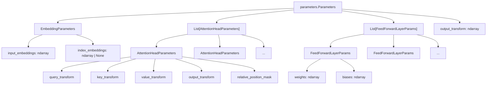
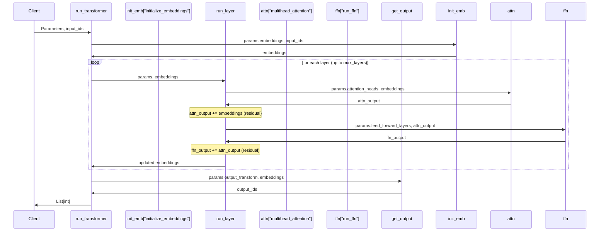
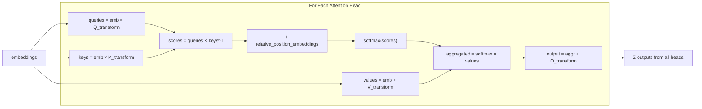
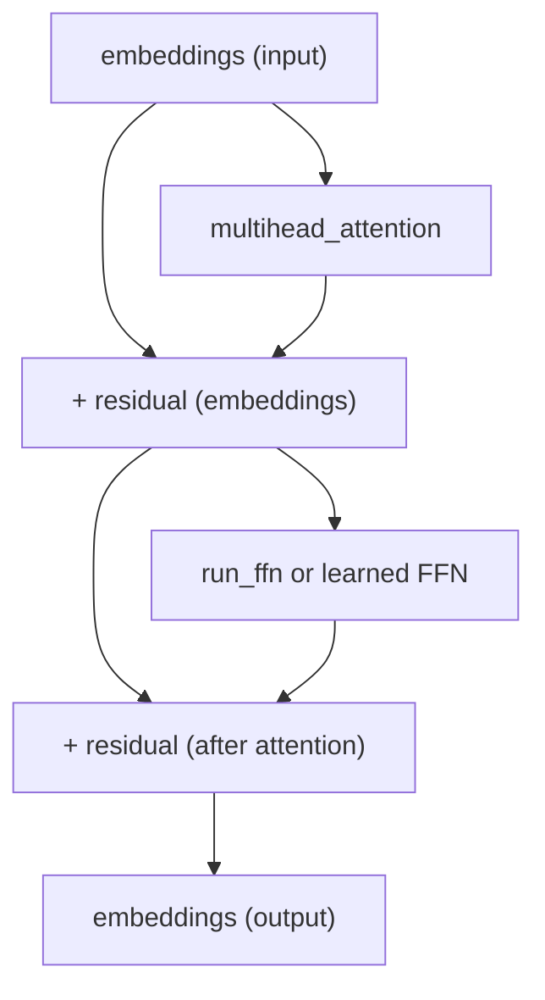

<!-- source: DeepWiki mcp.deepwiki.com · repo google-deepmind/alta · page 3.4 Transformer Execution · fetched 2026-10-26 -->

# Transformer Execution

<details>
<summary>Relevant source files</summary>

The following files were used as context for generating this wiki page:

- [examples/parity_test.py](examples/parity_test.py)
- [examples/scan/data_utils.py](examples/scan/data_utils.py)
- [framework/transformer/parameters.py](framework/transformer/parameters.py)
- [framework/transformer/transformer_utils.py](framework/transformer/transformer_utils.py)

</details>


## Purpose and Scope

This page documents the self-contained transformer implementation that executes compiled ALTA programs as neural networks. The transformer execution system takes compiled parameters (produced by the compiler pipeline, see [Compiler Pipeline](#3.3)) and performs forward passes using standard transformer operations implemented in numpy.

The execution system is distinct from the symbolic interpreter (see [Symbolic Interpreter](#3.2)), which executes ALTA programs symbolically. Both execution paths produce equivalent outputs, but the transformer execution path operates on fixed neural network parameters and enables efficient deployment and integration with standard deep learning frameworks.

**Sources:** [framework/transformer/transformer_utils.py:1-215](), [framework/transformer/parameters.py:1-49]()

## Parameter Structure

The transformer execution system operates on a hierarchical parameter structure defined in `parameters.py`. All parameters are represented as numpy arrays that define the behavior of the compiled transformer.

### Parameters Hierarchy



**Sources:** [framework/transformer/parameters.py:22-49]()

### Parameter Components

| Component | Type | Purpose |
|-----------|------|---------|
| `EmbeddingParameters` | Dataclass | Contains input token embeddings and optional positional embeddings |
| `AttentionHeadParameters` | Dataclass | Defines Q, K, V, O transforms and relative position mask for one attention head |
| `FeedForwardLayerParams` | Dataclass | Contains weights and biases for one FFN layer |
| `Parameters` | Dataclass | Top-level container holding all transformer parameters |

**Sources:** [framework/transformer/parameters.py:22-49]()

## Execution Flow

The transformer execution process follows a standard forward pass pattern with weight-shared layers. The same attention heads and FFN layers are applied repeatedly across multiple transformer layers.

### Main Execution Sequence



**Sources:** [framework/transformer/transformer_utils.py:171-214]()

## Embedding Initialization

The execution begins by converting input token IDs into dense vector representations. This process combines token embeddings with optional positional information.

### Function: `initialize_embeddings`

The `initialize_embeddings` function retrieves embeddings for input tokens and adds positional embeddings if they exist.

```
def initialize_embeddings(params, input_ids):
  input_embeddings = np.take(params.embeddings.input_embeddings, np.array(input_ids), axis=0)
  
  if params.embeddings.index_embeddings is None:
    return input_embeddings
    
  indices = range(len(input_ids))
  position_embeddings = np.take(params.embeddings.index_embeddings, np.array(indices), axis=0)
  return input_embeddings + position_embeddings
```

**Behavior:**
1. Uses `np.take` to index into `input_embeddings` array with `input_ids`
2. If `index_embeddings` is present, retrieves positional embeddings for each position
3. Returns element-wise sum of input and position embeddings

**Sources:** [framework/transformer/transformer_utils.py:27-41]()

## Attention Layer Execution

The attention mechanism computes query-key similarity scores, applies masking, and aggregates values. All attention heads in the program specification are executed in parallel and their outputs are summed.

### Function: `multihead_attention`



**Key Operations:**
1. **Query/Key/Value Projection:** Multiply embeddings by learned transforms [framework/transformer/transformer_utils.py:94-96]()
2. **Attention Scores:** Compute dot product `queries @ keys.T` [framework/transformer/transformer_utils.py:96]()
3. **Relative Position Masking:** Add T5-style position masks [framework/transformer/transformer_utils.py:97-100]()
4. **Softmax Normalization:** Apply softmax along last dimension [framework/transformer/transformer_utils.py:101]()
5. **Value Aggregation:** Multiply attention weights by values [framework/transformer/transformer_utils.py:102-103]()
6. **Output Projection:** Apply output transform and sum across heads [framework/transformer/transformer_utils.py:106]()

**Sources:** [framework/transformer/transformer_utils.py:90-107]()

### Relative Position Embeddings

The `get_relative_position_embeddings` function implements T5-style position masking by setting masked positions to `-1e9` (rather than `-inf` to avoid NaN issues).

**Masking Behavior:**
- If position `j - i` is in `relative_position_mask`, the embedding is `-1e9`
- Otherwise, the embedding is `0`
- This effectively masks attention to certain relative positions

**Example:** For `relative_position_mask={-1}` and 3 tokens:
```
[[-1e9, -1e9, -1e9],
 [   0, -1e9, -1e9],
 [-1e9,    0, -1e9]]
```
This prevents tokens from attending to the previous position.

**Sources:** [framework/transformer/transformer_utils.py:50-87]()

## Feed-Forward Layer Execution

The feed-forward network applies a multi-layer perceptron with clipped ReLU activations. The compiled FFN typically consists of 4 layers corresponding to the expansion and lookup phases of the compilation process (see [Compiler Pipeline](#3.3)).

### Function: `run_ffn`

The FFN execution iterates through feed-forward layers, applying weight multiplication, bias addition, and activation functions.


**Clipped ReLU:** The activation function is `clipped_relu(x) = min(1, max(0, x))`, which bounds outputs to `[0, 1]`. This is applied to all layers except the final output layer.

**Sources:** [framework/transformer/transformer_utils.py:110-137]()

### Learned FFN Alternative

The `run_layer` function supports an alternative execution path using learned FFN parameters instead of compiled parameters. When `learned_ffn_params` is provided, the system uses `inference.batched_predict` with a configurable activation function.

| Mode | Parameters | Activation Function | Use Case |
|------|-----------|-------------------|----------|
| Compiled FFN | `params.feed_forward_layers` | Sigmoid (clipped ReLU) | Standard execution of compiled programs |
| Learned FFN | `learned_ffn_params` | Configurable (e.g., sigmoid, ReLU) | MLP training from traces (see [Traces and MLP Training](#3.5)) |

**Sources:** [framework/transformer/transformer_utils.py:152-160](), [framework/traces/ffn/inference.py]()

## Layer Composition with Residuals

Each transformer layer combines attention and FFN sublayers with residual connections. The `run_layer` function orchestrates this composition.

### Layer Structure



**Residual Connection Points:**
1. **After Attention:** `attn_output += embeddings` [framework/transformer/transformer_utils.py:148]()
2. **After FFN:** `ffn_output += attn_output` [framework/transformer/transformer_utils.py:165]()

These residual connections enable gradient flow and allow information to bypass sublayers, which is essential for deep transformer architectures.

**Sources:** [framework/transformer/transformer_utils.py:140-168]()

## Output Transformation

After all layers complete, the final embeddings are transformed into output predictions through a linear projection and argmax operation.

### Function: `get_output`

```
def get_output(params, embeddings):
  output = np.matmul(embeddings, params.output_transform)
  output = np.argmax(output, axis=1)
  return output.tolist()
```

**Operations:**
1. **Linear Transform:** Multiply embeddings by `output_transform` matrix to get logits
2. **Argmax:** Select the index with maximum value for each position
3. **Conversion:** Convert numpy array to Python list

This produces a list of integer IDs representing the output tokens at each sequence position.

**Sources:** [framework/transformer/transformer_utils.py:43-48]()

## Entry Point and Configuration

The `run_transformer` function serves as the main entry point for executing compiled transformers. It provides configuration options for layer depth, activation functions, and debugging.

### Function Signature

| Parameter | Type | Default | Description |
|-----------|------|---------|-------------|
| `params` | `parameters.Parameters` | Required | Compiled transformer parameters |
| `learned_ffn_params` | `list[tuple] \| None` | Required | Optional learned FFN parameters; if `None`, uses compiled FFN |
| `input_ids` | `list[int]` | Required | Input token IDs to process |
| `max_layers` | `int` | `100` | Maximum number of layers to execute |
| `activation_fn_name` | `str` | `"sigmoid"` | Activation function for learned FFN (must be "sigmoid" for compiled FFN) |
| `verbose` | `bool` | `False` | Whether to print debugging information |

**Execution Loop:**
The function executes layers sequentially up to `max_layers`, applying the same parameters at each layer (weight sharing):

```
for layer_idx in range(max_layers):
    embeddings = run_layer(params, learned_ffn_params, embeddings, activation_fn_name, verbose)
```

**Note:** Dynamic halting (early stopping based on program state) is planned but not yet implemented [framework/transformer/transformer_utils.py:212]().

**Sources:** [framework/transformer/transformer_utils.py:171-214]()

### Validation

The function enforces that compiled FFN parameters must use sigmoid activation:

```python
if not learned_ffn_params and activation_fn_name != "sigmoid":
    raise ValueError("If using compiled FFN, activation function must be sigmoid.")
```

This constraint ensures consistency with the compilation process, which produces parameters designed for clipped ReLU (sigmoid) activations.

**Sources:** [framework/transformer/transformer_utils.py:194-197]()

## Usage Example

The following example from the test suite demonstrates typical usage of the transformer execution system:

```python
# Compile program to parameters
config = compiler_config.Config(expansion_scalar_1=1000)
parameters = compiler_utils.compile_transformer(program_spec, config)

# Execute compiled transformer
input_ids = [1, 0, 1]
outputs = transformer_utils.run_transformer(
    parameters,
    learned_ffn_params=None,
    input_ids=input_ids,
    max_layers=4,
    verbose=False,
)
```

This pattern is used extensively in the parity tests to verify that compiled programs produce correct outputs.

**Sources:** [examples/parity_test.py:251-264]()

## Key Functions Reference

| Function | Location | Purpose |
|----------|----------|---------|
| `run_transformer` | [framework/transformer/transformer_utils.py:171-214]() | Main entry point for transformer execution |
| `initialize_embeddings` | [framework/transformer/transformer_utils.py:27-41]() | Converts input IDs to embeddings with positions |
| `run_layer` | [framework/transformer/transformer_utils.py:140-168]() | Executes one transformer layer with residuals |
| `multihead_attention` | [framework/transformer/transformer_utils.py:90-107]() | Computes multi-head attention mechanism |
| `run_ffn` | [framework/transformer/transformer_utils.py:115-137]() | Executes feed-forward network layers |
| `get_output` | [framework/transformer/transformer_utils.py:43-48]() | Transforms final embeddings to output IDs |
| `get_relative_position_embeddings` | [framework/transformer/transformer_utils.py:50-87]() | Generates T5-style position masks |
| `clipped_relu` | [framework/transformer/transformer_utils.py:110-113]() | Applies bounded ReLU activation |

**Sources:** [framework/transformer/transformer_utils.py:1-215]()

---

