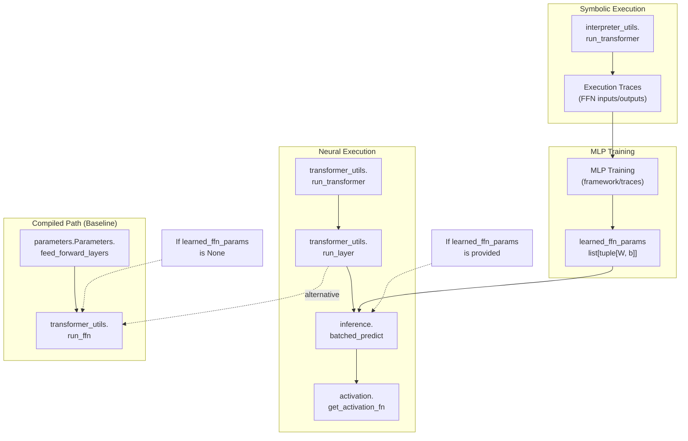
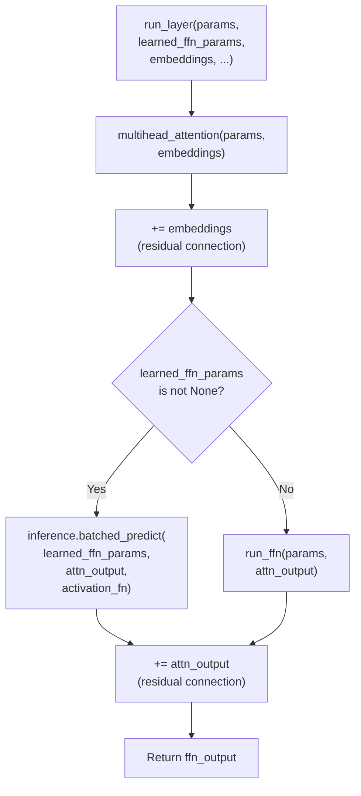
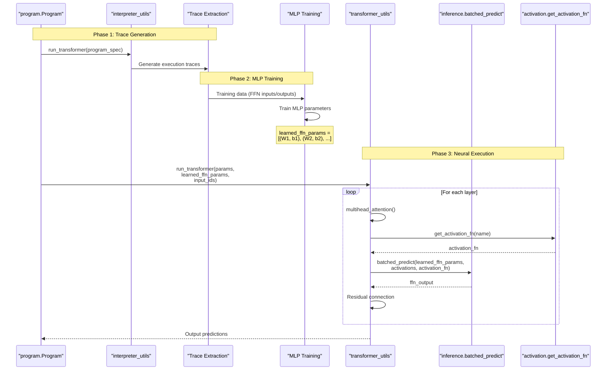

<!-- source: DeepWiki mcp.deepwiki.com · repo google-deepmind/alta · page 3.5 Traces and MLP Training · fetched 2026-10-26 -->

# Traces and MLP Training

<details>
<summary>Relevant source files</summary>

The following files were used as context for generating this wiki page:

- [README.md](README.md)
- [framework/transformer/transformer_utils.py](framework/transformer/transformer_utils.py)

</details>


## Purpose and Scope

This page documents the trace extraction and MLP training subsystem within ALTA (`framework/traces`). This system provides tools for extracting execution traces from the symbolic interpreter and using these traces to train learned MLPs that can replace the compiled feed-forward networks in transformers.

For information about the symbolic interpreter that generates traces, see [Symbolic Interpreter](#3.2). For details about compiled FFN parameters, see [Compiler Pipeline](#3.3).

## Overview

The traces subsystem serves as a bridge between symbolic and neural execution paradigms. While the ALTA compiler produces fixed feed-forward network parameters from program specifications, the trace system enables an alternative approach: training MLPs from execution traces. This provides two key benefits:

1. **Flexibility**: Learned MLPs can use arbitrary activation functions (ReLU, sigmoid, etc.), not just the clipped sigmoid required by compiled FFNs
2. **Potential for generalization**: Training from traces may enable MLPs to generalize beyond the exact symbolic specification

The system consists of two primary modules located in `framework/traces/ffn/`:
- **inference.py**: Provides forward pass functionality for learned MLPs
- **activation.py**: Defines activation functions for MLP training and inference

## Architecture

The following diagram shows how the trace system integrates with ALTA's execution paths:



**Sources**: [framework/transformer/transformer_utils.py:1-215](), [README.md:28-36]()

## Learned FFN Integration

### Parameter Structure

Learned FFN parameters are represented as a list of tuples, where each tuple contains the weights and biases for one layer:

```python
learned_ffn_params: list[tuple[jnp.ndarray, jnp.ndarray]]
```

Each tuple `(W, b)` represents:
- **W**: Weight matrix for the layer
- **b**: Bias vector for the layer

This structure differs from the compiled FFN parameters in `parameters.Parameters.feed_forward_layers`, which use a custom `FeedForwardLayerParameters` dataclass.

**Sources**: [framework/transformer/transformer_utils.py:173]()

### Execution Path Selection

The transformer execution function supports both compiled and learned FFN paths through an optional parameter:

| Parameter | Type | Default | Description |
|-----------|------|---------|-------------|
| `learned_ffn_params` | `list[tuple[jnp.ndarray, jnp.ndarray]] \| None` | `None` | If provided, uses learned MLP; otherwise uses compiled FFN |
| `activation_fn_name` | `str` | `"sigmoid"` | Activation function name (only configurable for learned FFN) |

The system enforces that compiled FFNs must use sigmoid activation:

```python
if not learned_ffn_params and activation_fn_name != "sigmoid":
    raise ValueError(
        "If using compiled FFN, activation function must be sigmoid."
    )
```

**Sources**: [framework/transformer/transformer_utils.py:171-197]()

## Layer Execution with Learned FFN

The following diagram shows the control flow within a single transformer layer:



**Sources**: [framework/transformer/transformer_utils.py:140-168]()

### Code Implementation

The layer execution logic is implemented in `run_layer`:

```python
def run_layer(params, learned_ffn_params, embeddings, activation_fn_name, verbose=False):
    attn_output = multihead_attention(params, embeddings)
    attn_output += embeddings  # Residual connection
    
    if learned_ffn_params is not None:
        ffn_output = inference.batched_predict(
            learned_ffn_params,
            attn_output,
            activation.get_activation_fn(activation_fn_name),
        )
    else:
        ffn_output = run_ffn(params, attn_output, verbose=verbose)
    
    ffn_output += attn_output  # Residual connection
    return ffn_output
```

**Sources**: [framework/transformer/transformer_utils.py:140-168]()

## FFN Inference Module

The `inference` module in `framework/traces/ffn/inference.py` provides the forward pass implementation for learned MLPs. The primary function is `batched_predict`:

### Function Signature

```python
inference.batched_predict(
    learned_ffn_params: list[tuple[jnp.ndarray, jnp.ndarray]],
    inputs: np.ndarray,
    activation_fn: Callable
) -> np.ndarray
```

### Parameters

| Parameter | Type | Description |
|-----------|------|-------------|
| `learned_ffn_params` | `list[tuple[jnp.ndarray, jnp.ndarray]]` | List of (weights, biases) tuples for each layer |
| `inputs` | `np.ndarray` | Input activations (batch of embeddings) |
| `activation_fn` | `Callable` | Activation function to apply between layers |

### Return Value

Returns the output activations after passing through all MLP layers with the specified activation function.

**Sources**: [framework/transformer/transformer_utils.py:22-24](), [framework/transformer/transformer_utils.py:154-158]()

## Activation Functions Module

The `activation` module in `framework/traces/ffn/activation.py` provides activation function implementations and a lookup mechanism.

### Activation Function Retrieval

The module exports a `get_activation_fn` function that returns activation function implementations by name:

```python
activation_fn = activation.get_activation_fn(activation_fn_name)
```

### Supported Activation Functions

The `activation_fn_name` parameter in `run_transformer` defaults to `"sigmoid"`, but the system supports multiple activation functions when using learned FFNs. The exact set of supported functions is defined in the activation module.

**Comparison with Compiled FFN**: The compiled FFN uses a fixed `clipped_relu` activation (clipping values to [0, 1]):

```python
def clipped_relu(x):
    return np.minimum(1, np.maximum(0, x))
```

This activation is hardcoded in the compiled path and cannot be changed without recompiling the program.

**Sources**: [framework/transformer/transformer_utils.py:110-112](), [framework/transformer/transformer_utils.py:157](), [framework/transformer/transformer_utils.py:176]()

## Execution Workflow

The following sequence diagram illustrates the complete workflow from program specification to execution with learned FFN:



**Sources**: [framework/transformer/transformer_utils.py:140-214](), [README.md:28-36]()

## Usage Patterns

### Pattern 1: Using Compiled FFN (Default)

```python
# Compile program to transformer parameters
params = compiler_utils.compile_transformer(program_spec)

# Run with compiled FFN (learned_ffn_params=None)
outputs = transformer_utils.run_transformer(
    params=params,
    learned_ffn_params=None,  # Uses compiled FFN
    input_ids=input_ids,
    activation_fn_name="sigmoid"  # Must be sigmoid for compiled FFN
)
```

### Pattern 2: Using Learned FFN

```python
# 1. Extract traces from symbolic execution
# (Trace extraction code in framework/traces)

# 2. Train MLP from traces
# (Training code produces learned_ffn_params)

# 3. Run transformer with learned FFN
outputs = transformer_utils.run_transformer(
    params=params,
    learned_ffn_params=learned_ffn_params,  # Use learned MLP
    input_ids=input_ids,
    activation_fn_name="relu"  # Can use any activation
)
```

**Sources**: [framework/transformer/transformer_utils.py:171-214]()

## Comparison: Compiled vs Learned FFN

The following table summarizes the differences between the two execution paths:

| Aspect | Compiled FFN | Learned FFN |
|--------|--------------|-------------|
| **Source** | Generated by compiler from program specification | Trained from execution traces |
| **Parameter Structure** | `parameters.FeedForwardLayerParameters` | `list[tuple[jnp.ndarray, jnp.ndarray]]` |
| **Activation Function** | Fixed `clipped_relu` (sigmoid) | Configurable via `activation_fn_name` |
| **Layer Implementation** | `run_ffn()` function | `inference.batched_predict()` function |
| **Precision** | Exact implementation of program specification | Approximation learned from traces |
| **Flexibility** | None - fixed at compile time | Can adapt via retraining |
| **Location** | [framework/transformer/transformer_utils.py:115-137]() | [framework/traces/ffn/inference.py]() |

**Sources**: [framework/transformer/transformer_utils.py:115-168]()

## Benefits of Learned FFN Approach

1. **Activation Function Flexibility**: Unlike compiled FFNs which must use clipped sigmoid, learned FFNs can use any activation function (ReLU, tanh, etc.) that may be more suitable for specific tasks.

2. **Integration with Standard Deep Learning**: The learned FFN uses standard JAX/NumPy array tuples, making it easy to integrate with existing deep learning frameworks and training pipelines.

3. **Potential for Compression**: A learned MLP might discover a more compact representation than the exact compiled implementation.

4. **Experimental Analysis**: The trace system enables experiments comparing symbolic (compiled) vs learned implementations of the same logic.

**Sources**: [framework/transformer/transformer_utils.py:152-197](), [README.md:34-35]()

## File Structure

The trace and MLP training system is organized as follows:

```
framework/
└── traces/
    └── ffn/
        ├── inference.py      # MLP forward pass implementation
        └── activation.py     # Activation function definitions
```

The transformer integration is in:

```
framework/
└── transformer/
    └── transformer_utils.py  # Integration of learned FFN with transformer execution
```

**Sources**: [README.md:28-36](), [framework/transformer/transformer_utils.py:22-24]()

## Technical Implementation Details

### Batched Processing

The `batched_predict` function processes entire batches of embeddings simultaneously, maintaining efficiency when processing sequences of tokens. The input shape is `(sequence_length, embedding_dim)`, and the function processes all positions in the sequence in parallel.

### Parameter Format

Learned FFN parameters use JAX NumPy arrays (`jnp.ndarray`), which are compatible with both JAX-based training pipelines and NumPy-based inference. The tuple structure `(weights, biases)` is a common convention in neural network implementations, making the format familiar to practitioners.

### Integration Point

The learned FFN is called immediately after the attention sub-layer and its residual connection, replacing the compiled FFN at the same execution point. This ensures that learned and compiled FFNs receive identical inputs and produce outputs that are combined with the same residual connection.

**Sources**: [framework/transformer/transformer_utils.py:140-168]()

---

