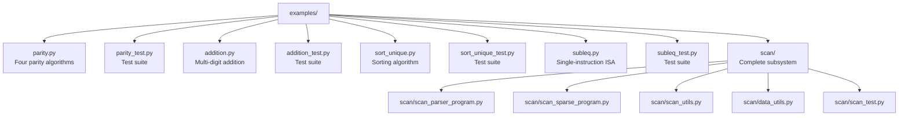
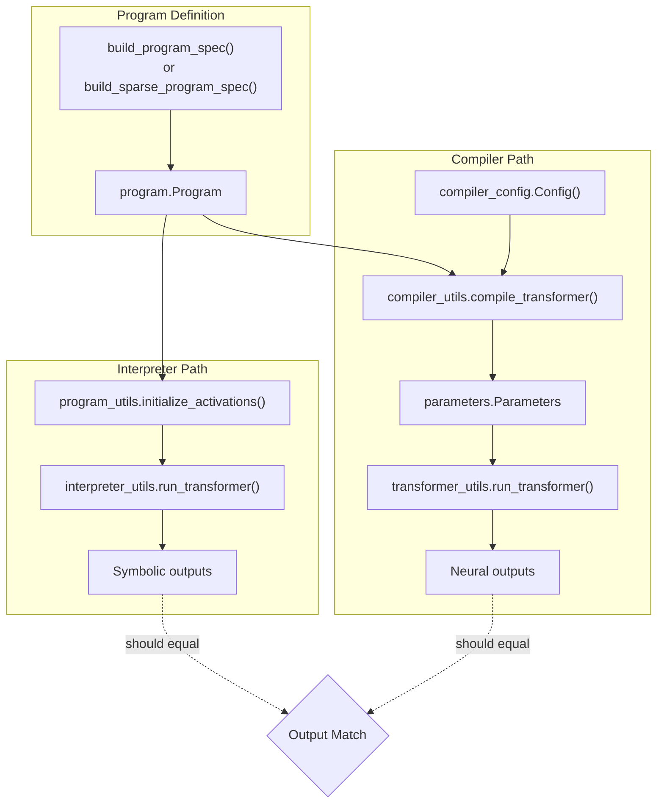
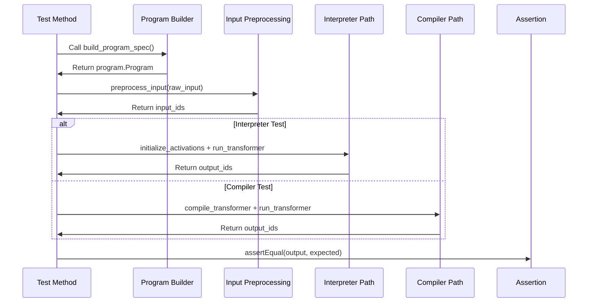
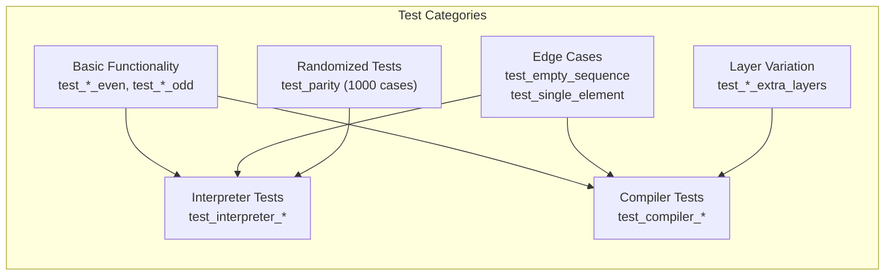

<!-- source: DeepWiki mcp.deepwiki.com · repo google-deepmind/alta · page 4 Example Programs · fetched 2026-10-26 -->

# Example Programs

<details>
<summary>Relevant source files</summary>

The following files were used as context for generating this wiki page:

- [README.md](README.md)
- [examples/addition_test.py](examples/addition_test.py)
- [examples/parity_test.py](examples/parity_test.py)
- [examples/scan/data_utils.py](examples/scan/data_utils.py)

</details>


## Purpose and Scope

This page provides an overview of the example programs included in the ALTA repository, located in the `examples/` directory. These programs demonstrate ALTA's capabilities across different domains and complexities, from simple algorithmic tasks to complete language processing applications. Each example illustrates how ALTA programs can be executed through both the symbolic interpreter and the compiled transformer path.

For detailed documentation of specific programs, see:
- Parity Detection algorithms ([4.1](#4.1))
- Multi-Digit Addition implementation ([4.2](#4.2))
- Sorting Unique Numbers ([4.3](#4.3))
- SCAN Compositional Learning system ([4.4](#4.4))
- SUBLEQ Instruction Set Architecture ([4.5](#4.5))

For information about the underlying execution mechanisms, see the Symbolic Interpreter ([3.2](#3.2)) and Compiler Pipeline ([3.3](#3.3)) pages.

---

## Directory Structure

The `examples/` directory is organized with each major program in its own file or subdirectory:



**Sources:** [README.md:37-46](), Directory structure from high-level diagrams

---

## Program Categories

The example programs fall into three main categories based on complexity and purpose:

### Algorithmic Tasks

| Program | File | Description | Variants |
|---------|------|-------------|----------|
| **Parity Detection** | `parity.py` | Determines if input contains even/odd number of 1's | Sequential Absolute, Sequential Relative, Sum Mod 2, Intermediate Variable |
| **Multi-Digit Addition** | `addition.py` | Adds two multi-digit numbers using shift/reduce operations | Standard, Sparse |
| **Sorting Unique Numbers** | `sort_unique.py` | Sorts unique numbers using RASP-style operations | Single variant |

These programs demonstrate transformer's ability to implement algorithmic reasoning and sequential computation patterns.

### Low-Level Systems

| Program | File | Description | Purpose |
|---------|------|-------------|---------|
| **SUBLEQ** | `subleq.py` | Single-instruction computer architecture | Shows ALTA can model instruction set architectures |

This example demonstrates that ALTA can express computation at the level of individual machine instructions.

### Complete Applications

| System | Directory | Components | Purpose |
|--------|-----------|------------|---------|
| **SCAN** | `scan/` | Parser, Decoder, Data utilities | End-to-end language understanding and generation |

The SCAN system represents a production-quality application with multiple modules working together to solve compositional learning tasks.

**Sources:** [examples/parity_test.py:33-38](), [examples/addition_test.py:28-89](), [examples/scan/data_utils.py:1-51](), Diagram 5 from high-level overview

---

## Dual Execution Paradigm

All example programs can be executed through two paths: symbolic interpretation and neural compilation. The test files demonstrate both execution modes.



**Sources:** [examples/parity_test.py:103-325](), [examples/addition_test.py:28-89]()

### Interpreter Execution Pattern

The interpreter path executes programs symbolically, maintaining explicit variable states:

1. **Build Program Specification**: Call program-specific builder function (e.g., `parity.build_sequential_program_absolute()`)
2. **Initialize Activations**: Use `program_utils.initialize_activations()` to create initial state
3. **Run Interpreter**: Call `interpreter_utils.run_transformer()` with program spec and activations
4. **Extract Outputs**: Retrieve results from the returned output sequence

Example from parity test:
```python
program_spec = get_program_spec(parity_algorithm, generate_rules=False)
activations_seq = program_utils.initialize_activations(
    program_spec, get_inputs(parity_algorithm, input_ids)
)
outputs = interpreter_utils.run_transformer(
    program_spec,
    activations_seq,
    max_layers=max_layers,
)
```

**Sources:** [examples/parity_test.py:103-125](), [examples/addition_test.py:30-48]()

### Compiler Execution Pattern

The compiler path translates programs into transformer weights and executes them neurally:

1. **Build Program Specification**: Same as interpreter path
2. **Create Compiler Config**: Instantiate `compiler_config.Config()` with parameters
3. **Compile to Parameters**: Call `compiler_utils.compile_transformer()` to generate weights
4. **Run Transformer**: Use `transformer_utils.run_transformer()` with parameters and input
5. **Extract Outputs**: Retrieve results from the returned output sequence

Example from parity test:
```python
program_spec = get_program_spec(parity_algorithm=parity_algorithm)
config = compiler_config.Config(expansion_scalar_1=1000)
parameters = compiler_utils.compile_transformer(program_spec, config)
outputs = transformer_utils.run_transformer(
    parameters,
    learned_ffn_params=None,
    input_ids=get_inputs(parity_algorithm, input_ids),
    max_layers=4,
    verbose=False,
)
```

**Sources:** [examples/parity_test.py:251-264](), [examples/addition_test.py:70-89]()

---

## Running Examples

### Running Unit Tests

The recommended way to explore examples is through their unit tests. Each program has a corresponding `*_test.py` file:

```bash
# Run parity program tests
python -m examples.parity_test

# Run addition program tests  
python -m examples.addition_test

# Run SCAN tests
python -m examples.scan.scan_test
```

**Sources:** [README.md:43-47]()

### Test Execution Flow



**Sources:** [examples/parity_test.py:103-125](), [examples/addition_test.py:30-48]()

### Input Preprocessing and Output Processing

Most examples include helper functions for preparing inputs and interpreting outputs:

| Example | Preprocessing Function | Output Processing Function | Purpose |
|---------|----------------------|---------------------------|---------|
| Parity | `get_inputs()` | Direct use of output | Adds special tokens (START, EOS) based on algorithm variant |
| Addition | `addition.preprocess_input()` | `addition.process_output()` | Converts integers to/from digit sequences |
| SCAN | `scan_utils.preprocess()` | `scan_utils.process_output()` | Tokenizes commands and converts actions |

**Sources:** [examples/parity_test.py:72-84](), [examples/addition_test.py:34-46]()

---

## Test Coverage Pattern

All example programs follow a consistent testing pattern that validates both execution paths:



### Common Test Patterns

**Interpreter Tests**: Verify symbolic execution correctness
- Use `program_utils.initialize_activations()` for state initialization
- Call `interpreter_utils.run_transformer()` for execution
- Optional: Use `logger_utils.ActivationsLogger()` for debugging
- Example: [examples/parity_test.py:208-221]()

**Compiler Tests**: Verify neural execution equivalence
- Create `compiler_config.Config()` with appropriate parameters
- Call `compiler_utils.compile_transformer()` to generate weights
- Use `transformer_utils.run_transformer()` for neural execution
- Example: [examples/parity_test.py:251-264]()

**Edge Case Tests**: Validate boundary conditions
- Empty sequences: [examples/parity_test.py:159-174]()
- Single elements: [examples/parity_test.py:185-197]()
- Special configurations

**Randomized Tests**: Ensure robustness across input space
- Generate random inputs with varying lengths
- Test with random layer counts
- Example: [examples/parity_test.py:103-125]()

**Sources:** [examples/parity_test.py:87-390](), [examples/addition_test.py:28-93]()

---

## Program Specification Building

Each example program defines one or more builder functions that construct `program.Program` specifications:

```mermaid
graph TB
    subgraph "Builder Functions in Examples"
        P1["parity.build_sequential_program_absolute()"]
        P2["parity.build_sequential_program_relative()"]
        P3["parity.build_sum_mod_2_program_spec()"]
        P4["parity.build_intermediate_variable_sum_mod_2_program_spec()"]
        
        A1["addition.build_program_spec()"]
        A2["addition.build_sparse_program_spec()"]
        
        SCAN1["scan_parser_program.build_scan_parser_program()"]
        SCAN2["scan_sparse_program.build_scan_sparse_program()"]
        
        SORT["sort_unique.build_sort_unique_program()"]
        
        SUBLEQ["subleq.build_subleq_program()"]
    end
    
    subgraph "Framework Components Used"
        PB["program_builder<br/>variable definitions"]
        VAR["Variables:<br/>bos, eos, counters, pointers"]
        HEADS["Attention Heads:<br/>causal, positional, content"]
        FFN["FFN Functions:<br/>conditional logic, arithmetic"]
    end
    
    P1 --> VAR
    P2 --> VAR
    P3 --> VAR
    A1 --> VAR
    SCAN1 --> VAR
    
    VAR --> PB
    HEADS --> PB
    FFN --> PB
```



**Sources:** [examples/parity_test.py:45-69](), [examples/addition_test.py:31-71](), Program builder usage across examples

---

## Special Features Demonstrated

### Dynamic Halting

Some programs demonstrate dynamic halting, where execution terminates based on program state rather than a fixed layer count:

- **Parity Sequential Relative**: [examples/parity_test.py:326-340]()
- **Parity Sequential Absolute**: [examples/parity_test.py:342-356]()

### Multiple Algorithm Variants

The parity example demonstrates how different algorithmic approaches can be expressed in ALTA:

| Algorithm | Approach | Complexity |
|-----------|----------|------------|
| Sequential Absolute | Process positions 0, 1, 2, ... directly | O(n) positions |
| Sequential Relative | Process relative to previous position | O(n) relative |
| Sum Mod 2 | Aggregate all 1's and take modulo | O(log n) aggregation |
| Intermediate Variable | Use helper variables for sum | O(log n) with variables |

**Sources:** [examples/parity_test.py:33-69]()

### Data Loading and Processing

The SCAN example demonstrates integration with external datasets:

- `scan/data_utils.py` provides dataset loading utilities
- `load_examples()` function reads examples from files
- `parse_example()` converts SCAN format to internal representation
- Token mapping with `TARGET_MAP` dictionary

**Sources:** [examples/scan/data_utils.py:21-50]()

---

## Summary

The example programs demonstrate ALTA's versatility across three categories:

1. **Algorithmic Tasks**: Parity, Addition, Sorting - show transformer's computational capabilities
2. **Low-Level Systems**: SUBLEQ - demonstrates instruction-level modeling
3. **Complete Applications**: SCAN - illustrates end-to-end language processing

All examples support dual execution (interpreter and compiler) with comprehensive test coverage validating equivalence between paths. The consistent testing patterns make it easy to understand how to use ALTA for new programs.

For detailed implementation analysis of specific programs, refer to the child pages ([4.1](#4.1) through [4.5](#4.5)).

---

