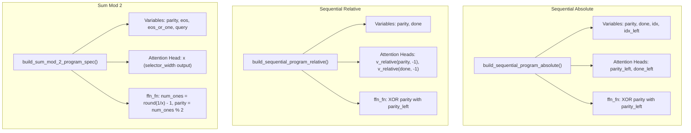
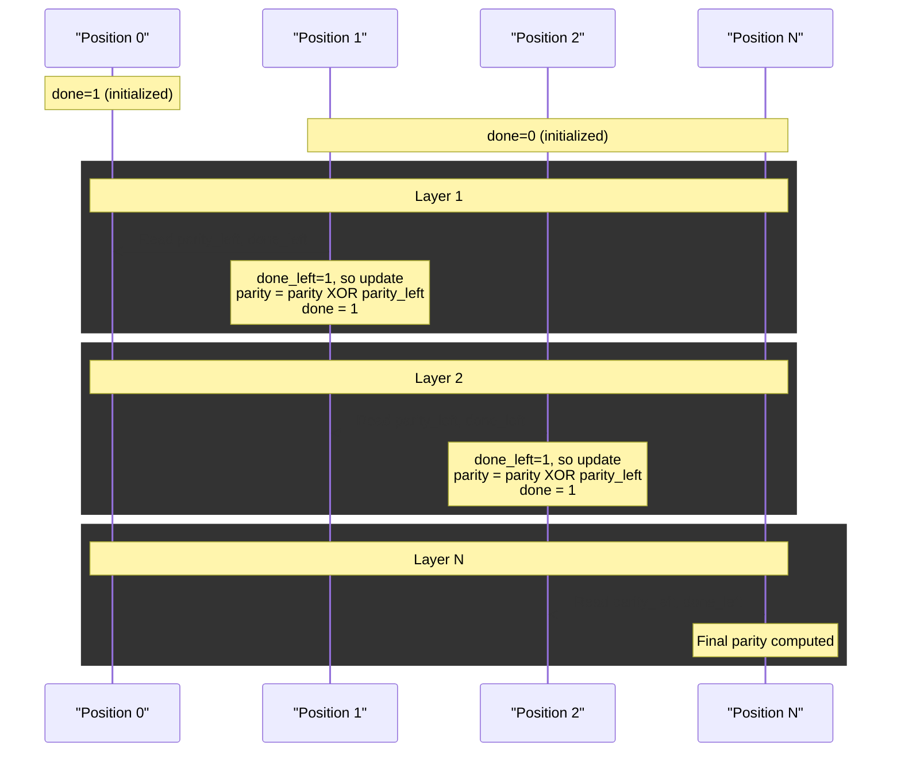
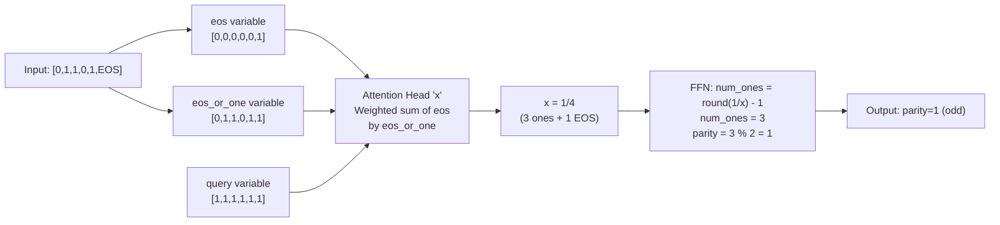
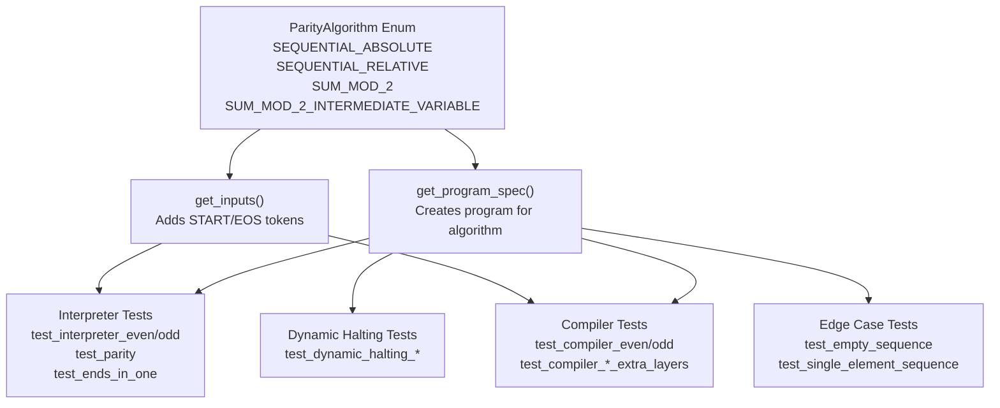

<!-- source: DeepWiki mcp.deepwiki.com · repo google-deepmind/alta · page 4.1 Parity Detection · fetched 2026-10-26 -->

# Parity Detection

<details>
<summary>Relevant source files</summary>

The following files were used as context for generating this wiki page:

- [examples/parity.py](examples/parity.py)
- [examples/parity_sparse.py](examples/parity_sparse.py)
- [examples/parity_sparse_test.py](examples/parity_sparse_test.py)
- [examples/parity_test.py](examples/parity_test.py)
- [examples/scan/data_utils.py](examples/scan/data_utils.py)

</details>


## Purpose and Scope

This page documents the parity detection example programs in ALTA. Parity detection determines whether a binary sequence contains an even or odd number of 1's. This task serves as a fundamental example demonstrating ALTA's ability to compile algorithmic programs to transformer weights.

The parity task was studied in the paper "What Algorithms can Transformers Learn? A Study in Length Generalization" (https://arxiv.org/pdf/2310.16028.pdf) and is implemented in ALTA using three distinct algorithms. For general information about ALTA example programs, see [Example Programs](#4). For framework-level details on program specification, see [Program Specification](#3.1).

**Sources:** [examples/parity.py:16-26]()

## Task Definition

The parity detection task takes a sequence of binary values (0's and 1's) as input and outputs:
- A sequence of all 0's if the input contains an **even** number of 1's
- A sequence of all 1's if the input contains an **odd** number of 1's

For example:
- Input `[1, 0, 1]` → Output `[0, 0, 0]` (two 1's, even)
- Input `[1, 0, 1, 1]` → Output `[1, 1, 1, 1]` (three 1's, odd)

**Sources:** [examples/parity.py:23-25]()

## Implementation Overview

ALTA provides three algorithmic approaches to parity detection, each demonstrating different transformer capabilities:

| Algorithm | Approach | Position Encoding | Special Tokens | File |
|-----------|----------|-------------------|----------------|------|
| **Sequential Absolute** | Iterative computation using absolute positions | Absolute (`idx`, `idx_left`) | None | [examples/parity.py:37-77]() |
| **Sequential Relative** | Iterative computation using relative positions | Relative (offset -1) | START token | [examples/parity.py:80-114]() |
| **Sum Mod 2** | Parallel computation via selector_width | None required | EOS token | [examples/parity.py:117-152]() |

### Algorithm Comparison Diagram



**Sources:** [examples/parity.py:37-152]()

## Sequential Absolute Algorithm

The sequential absolute position algorithm uses absolute position encodings to iteratively compute parity from left to right.

### Variable Definitions

The program uses four variables defined in [examples/parity.py:44-51]():

- `parity`: Input variable (range 2) initialized from input tokens
- `done`: Position variable (range 2) marking processed positions, initialized to 1 at position 0
- `idx`: Position variable encoding absolute position
- `idx_left`: Position variable encoding position-1 (for left neighbor access)

### Attention Mechanism

Two attention heads enable left-neighbor access [examples/parity.py:52-55]():

- `parity_left`: Retrieves `parity` value from position `idx_left`
- `done_left`: Retrieves `done` value from position `idx_left`

Both use the query-key-value pattern: `pb.qkv("idx_left", "idx", <value_var>)`.

### Feed-Forward Logic

The FFN function [examples/parity.py:57-61]() implements the core algorithm:

```python
def ffn_fn(z):
    if z["done"] != done_value and z["done_left"] == done_value:
        z["parity"] = z["parity_left"] ^ z["parity"]
        z["done"] = done_value
```

This executes when the current position is not done but the left neighbor is done. It XORs the current `parity` with `parity_left` and marks the position as done.

### Execution Flow



**Sources:** [examples/parity.py:37-77]()

## Sequential Relative Algorithm

The sequential relative algorithm achieves the same result using relative position encoding instead of absolute positions.

### Key Differences from Absolute

1. **Position Encoding:** Uses `pb.v_relative(var, -1)` instead of absolute position variables
2. **Special Token:** Requires START token (value 2) prepended to input
3. **Initialization:** `parity` initialized to 0 for START token, otherwise from input
4. **Configuration:** Sets `position_range=None` and `input_range=3`

### Variable Definitions

Defined in [examples/parity.py:85-88]():

- `parity`: Input variable initialized via lambda: `lambda x: 0 if x == START else x`
- `done`: Input variable initialized to True for START token: `lambda x: x == START`

### Attention with Relative Positions

The attention heads use relative position encoding [examples/parity.py:89-92]():

- `parity_left`: `pb.v_relative("parity", -1)` - retrieves parity from offset -1
- `done_left`: `pb.v_relative("done", -1)` - retrieves done from offset -1

### FFN Logic

The FFN logic [examples/parity.py:94-98]() is identical to the absolute version, demonstrating algorithmic equivalence despite different position encodings.

**Sources:** [examples/parity.py:80-114]()

## Sum Mod 2 Algorithm

The sum mod 2 algorithm uses a parallel approach based on the `selector_width` technique to count 1's and compute parity in a single pass.

### Algorithm Description

Instead of iterative computation, this algorithm:
1. Uses attention to compute the reciprocal of the number of 1's (plus 1)
2. Inverts this value to get the count: `num_ones = round(1/x) - 1`
3. Computes parity: `parity = int(num_ones % 2 != 0)`

### Variable Definitions

Defined in [examples/parity.py:123-130]():

- `parity`: General variable (range 2) for output
- `eos`: Numeric variable, value 1.0 at EOS token position, 0.0 elsewhere
- `eos_or_one`: Input variable, True if input is 1 or EOS
- `query`: General variable (constant 1) for attention query

### Selector Width Attention

The key innovation is the attention head output specification [examples/parity.py:132-136]():

```python
buckets = tuple(sorted([1 / x for x in range(1, max_input_length + 1)]))
output_spec = pb.numeric_var(values=buckets)
attention_heads = {
    "x": pb.qkv("query", "eos_or_one", "eos", output_spec=output_spec),
}
```

The `buckets` contain values `[1/max_input_length, 1/(max_input_length-1), ..., 1/2, 1/1]`. The attention mechanism computes a weighted sum of `eos` values, where positions with `eos_or_one=1` contribute to the sum. The result approximates `1 / (num_ones + 1)`.

### Feed-Forward Computation

The FFN [examples/parity.py:138-142]() converts the attention output to parity:

```python
def ffn_fn(activations):
    num_ones = round(1 / activations["x"]) - 1
    activations["parity"] = int(num_ones % 2 != 0)
```

### Data Flow Diagram



**Sources:** [examples/parity.py:117-152]()

## Intermediate Variable Sum Mod 2

A variant of sum mod 2 designed for intermediate supervision is defined in [examples/parity.py:155-221](). This version makes two key modifications:

1. **Categorical num_ones:** Stores the count as a categorical variable (range `max_input_length+1`) rather than deriving it from a numeric value, making it easier for MLPs to learn the parity mapping.

2. **Scaled values:** Multiplies the `eos` value by `scalar=1000` to create a larger range for the `x` attention output, enabling noise injection during training.

3. **Two-stage FFN:** Uses a `state` variable to split computation across two layers:
   - Layer 1: Compute `num_ones` from `x`
   - Layer 2: Compute `parity` from `num_ones`

This program is used with `generate_rules=False` due to the combinatorial explosion of rules with the larger variable ranges [examples/parity.py:170-171]().

**Sources:** [examples/parity.py:155-221]()

## Sparse Implementations

The file `examples/parity_sparse.py` provides alternative implementations using the `MLPBuilder` API for sparse rule generation. These implementations produce identical behavior but express the FFN logic using explicit rule enumeration.

### MLPBuilder Pattern

The sparse implementations replace the `ffn_fn` function with explicit rule construction using `pb.MLPBuilder` [examples/parity_sparse.py:51-58]():

```python
x = pb.MLPBuilder(variables, attention_heads)
for done in x.get("done"):
    if done != done_value:
        for done_left in x.get("done_left"):
            if done_left == done_value:
                x.set("done", done_value)
                for parity_left, parity in x.get("parity_left", "parity"):
                    x.set("parity", parity_left ^ parity)
```

The `MLPBuilder` iterates over all possible values of variables and generates explicit rules for each combination, then passes these rules to `pb.program_spec_from_rules()`.

### Sparse vs. Dense Comparison

| Aspect | Dense (parity.py) | Sparse (parity_sparse.py) |
|--------|-------------------|---------------------------|
| FFN Specification | Python function `ffn_fn` | Explicit rules via `MLPBuilder` |
| Rule Generation | `generate_rules` parameter | Always uses rules |
| Program Creation | `pb.program_spec()` | `pb.program_spec_from_rules()` |
| Use Case | General, flexible | Explicit rule enumeration |

**Sources:** [examples/parity_sparse.py:27-147]()

## Dynamic Halting

Both sequential algorithms support optional dynamic halting, which allows the transformer to halt computation once all positions are processed.

### Enabling Dynamic Halting

Set `dynamic_halting=True` when building the program [examples/parity.py:38](), [examples/parity.py:81]():

```python
program_spec = parity.build_sequential_program_absolute(dynamic_halting=True)
```

This adds a halt specification: `halt_spec = pb.halt_spec("done", halt_value=done_value)`, which tells the interpreter to stop when all positions have `done=1`.

### Behavior

With dynamic halting:
- The interpreter automatically determines the minimum number of layers needed
- Execution stops when the halt condition is satisfied
- Useful for analyzing algorithmic complexity and minimum depth requirements

Tests demonstrate dynamic halting in [examples/parity_test.py:326-356]() and [examples/parity_sparse_test.py:293-323]().

**Sources:** [examples/parity.py:63-66](), [examples/parity_test.py:326-356]()

## Testing Infrastructure

The parity implementations are validated through comprehensive test suites in `examples/parity_test.py` and `examples/parity_sparse_test.py`.

### Test Structure



### Key Test Categories

#### Parameterized Tests

All three algorithms are tested with the same test cases using `@parameterized.named_parameters` [examples/parity_test.py:94-102]():

- `test_parity`: 1000 random binary sequences of varying lengths
- `test_interpreter_even/odd`: Specific even/odd test cases
- `test_compiler_even/odd`: Same tests with compiled transformers
- `test_ends_in_one`: Edge case where input ends with 1
- `test_empty_sequence`: Empty input handling
- `test_single_element_sequence`: Single element `[1]`

#### Interpreter Execution

Tests execute programs using [examples/parity_test.py:113-120]():

```python
activations_seq = program_utils.initialize_activations(
    program_spec, get_inputs(parity_algorithm, input_ids)
)
outputs = interpreter_utils.run_transformer(
    program_spec, activations_seq, max_layers=max_layers
)
```

#### Compiler Execution

Tests compile and run using [examples/parity_test.py:253-264]():

```python
config = compiler_config.Config(expansion_scalar_1=1000)
parameters = compiler_utils.compile_transformer(program_spec, config)
outputs = transformer_utils.run_transformer(
    parameters,
    learned_ffn_params=None,
    input_ids=get_inputs(parity_algorithm, input_ids),
    max_layers=4,
    verbose=False,
)
```

### Input Preprocessing

The `get_inputs()` helper function [examples/parity_test.py:72-84]() adds algorithm-specific tokens:
- Sequential Relative: Prepends START token (value 2)
- Sum Mod 2: Appends EOS token (value 2)
- Sequential Absolute: No modification

### Expected Output Validation

All tests verify that outputs match expected parity [examples/parity_test.py:122-125]():

```python
if is_even(input_ids):
    self.assertEqual(outputs[-1], 0)
else:
    self.assertEqual(outputs[-1], 1)
```

**Sources:** [examples/parity_test.py:1-391](), [examples/parity_sparse_test.py:1-360]()

## Running the Tests

Execute the test suites from the repository root:

```bash
# Run dense implementation tests
python -m examples.parity_test

# Run sparse implementation tests  
python -m examples.parity_sparse_test

# Run specific test
python -m examples.parity_test ParityTest.test_compiler_even
```

Tests validate both interpreter and compiler paths for all algorithms, ensuring functional equivalence between symbolic execution and compiled neural execution.

**Sources:** [examples/parity_test.py:389-390](), [examples/parity_sparse_test.py:358-359]()

---

