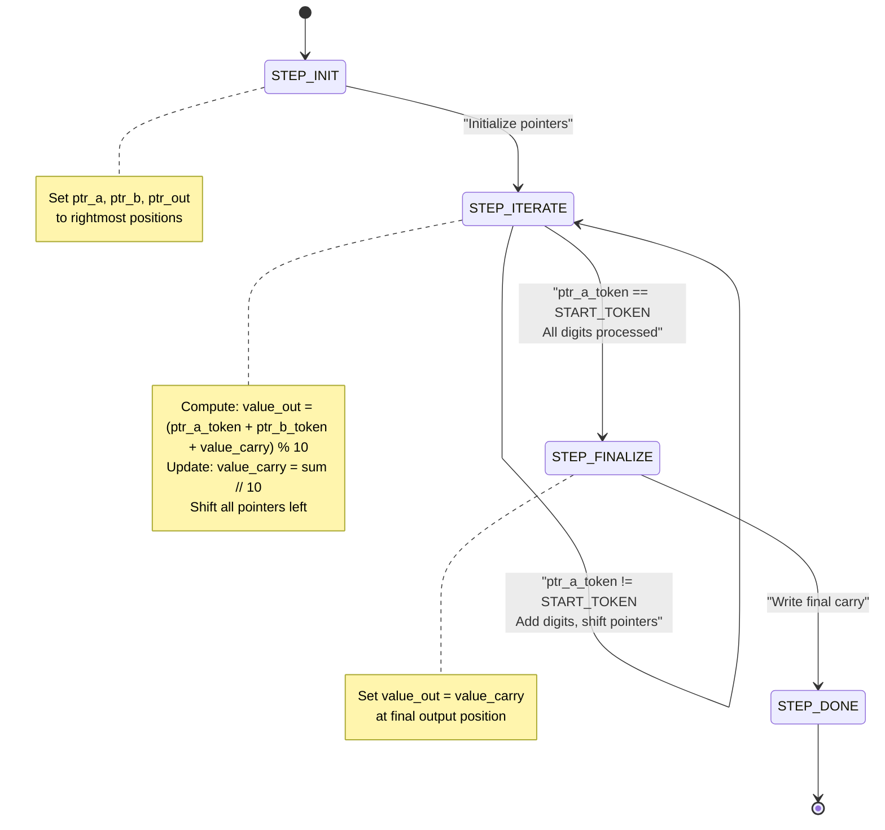
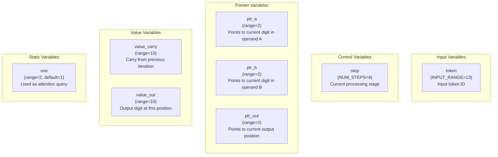
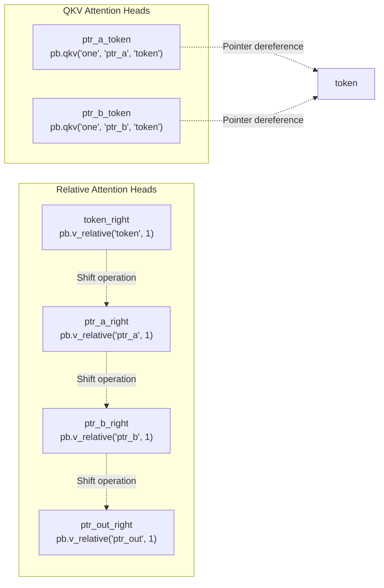
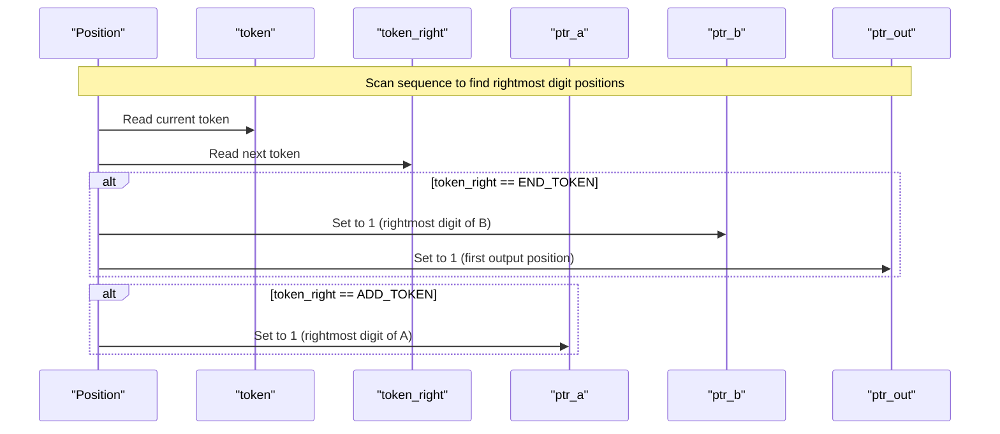
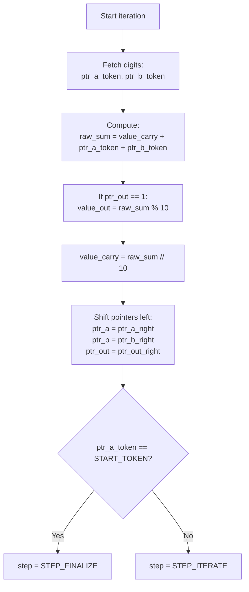
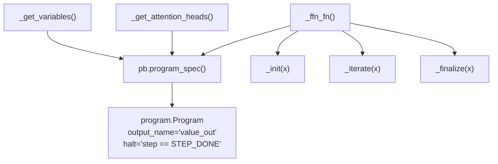
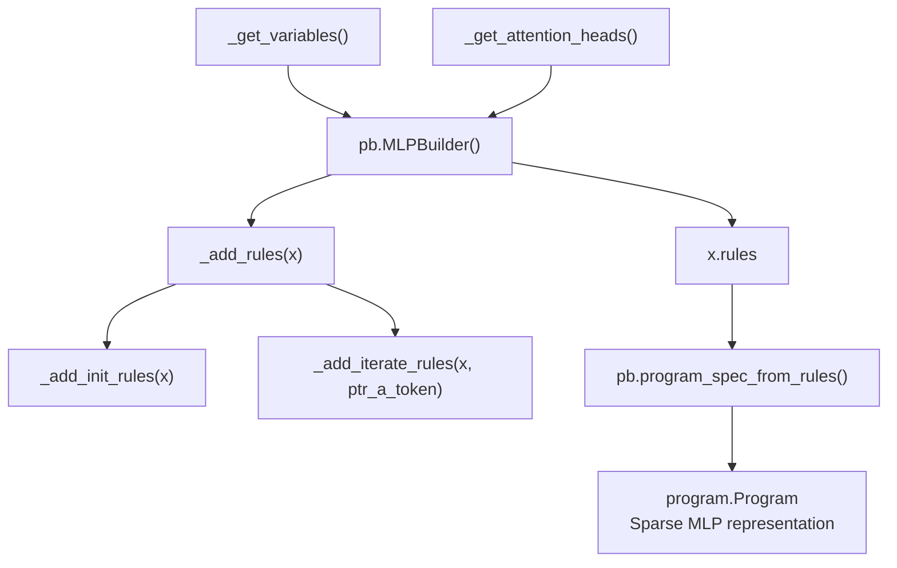
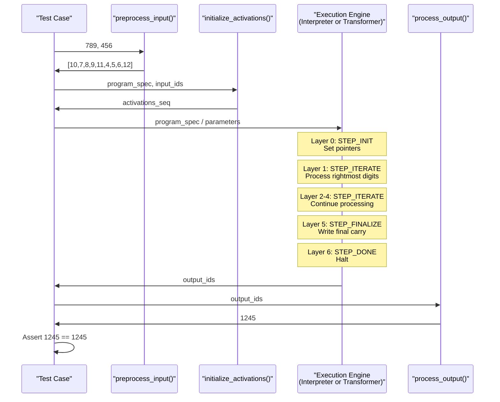

<!-- source: DeepWiki mcp.deepwiki.com · repo google-deepmind/alta · page 4.2 Multi-Digit Addition · fetched 2026-10-26 -->

# Multi-Digit Addition

<details>
<summary>Relevant source files</summary>

The following files were used as context for generating this wiki page:

- [examples/addition.py](examples/addition.py)
- [examples/addition_test.py](examples/addition_test.py)

</details>


## Purpose and Scope

This document describes the multi-digit addition program implementation in ALTA, located in [examples/addition.py](). The program demonstrates how ALTA can implement arithmetic algorithms using pointer-based operations and shift/reduce patterns. It processes two padded integers and computes their sum by iterating through digits from right to left while maintaining a carry value.

For information about other algorithmic examples, see [Parity Detection](#4.1) and [Sorting Unique Numbers](#4.3). For details on how to define programs in ALTA, see [Program Specification](#3.1).

**Sources:** [examples/addition.py:16-25]()

## Algorithm Overview

The addition algorithm operates as a state machine with four distinct processing stages:

| Step | Constant | Value | Description |
|------|----------|-------|-------------|
| Initialization | `STEP_INIT` | 0 | Set up pointers at rightmost digits |
| Iteration | `STEP_ITERATE` | 1 | Process one digit position, update carry |
| Finalization | `STEP_FINALIZE` | 2 | Write final carry to output |
| Completion | `STEP_DONE` | 3 | Halt execution |

The algorithm processes digits from right to left (least significant to most significant), maintaining three pointers to track positions in the two input operands and the output buffer. At each iteration, it adds the current digits plus any carry from the previous iteration, writes the result modulo 10 to the output, and updates the carry.

**Sources:** [examples/addition.py:32-37]()

### State Machine Diagram



**Sources:** [examples/addition.py:118-128]()

## Input and Output Format

### Input Format

The program expects inputs formatted as a single string with specific delimiters:

```
s<digits_a>+<digits_b>e
```

Where:
- `s` is the START_TOKEN (value 10)
- `<digits_a>` and `<digits_b>` are the decimal digits of the two operands (padded to equal length)
- `+` is the ADD_TOKEN (value 11)
- `e` is the END_TOKEN (value 12)

Example: `789 + 456` becomes `"s789+456e"`

### Token Vocabulary

| Token | Symbol | Token ID |
|-------|--------|----------|
| Digit 0-9 | `'0'`-`'9'` | 0-9 |
| Start marker | `'s'` | 10 |
| Addition operator | `'+'` | 11 |
| End marker | `'e'` | 12 |

The total input range is 13 tokens (`INPUT_RANGE = 13`).

### Preprocessing and Postprocessing

The module provides utility functions for converting between integers and token sequences:

- `format_input(input_a: int, input_b: int) -> str` - Pads operands to equal length and formats as string [examples/addition.py:49-55]()
- `preprocess_input(input_a: int, input_b: int) -> list[int]` - Converts to token IDs [examples/addition.py:69-74]()
- `process_output(output_ids: list[int]) -> int` - Converts token sequence back to integer [examples/addition.py:77-81]()

**Sources:** [examples/addition.py:39-82]()

## State Representation

### Variables

The program maintains seven variables at each sequence position:



**Variable Details:**

| Variable | Range | Role | Definition |
|----------|-------|------|------------|
| `token` | 13 | Input token at this position | `pb.input_var(INPUT_RANGE)` |
| `step` | 4 | Current processing stage | `pb.var(NUM_STEPS)` |
| `ptr_a` | 2 | Binary pointer to operand A digit | `pb.var(2)` |
| `ptr_b` | 2 | Binary pointer to operand B digit | `pb.var(2)` |
| `ptr_out` | 2 | Binary pointer to output position | `pb.var(2)` |
| `value_carry` | 10 | Carry value (0-9) | `pb.var(10)` |
| `value_out` | 10 | Output digit (0-9) | `pb.var(10)` |
| `one` | 2 | Static query value (always 1) | `pb.var(var_range=2, default=1)` |

**Sources:** [examples/addition.py:131-152]()

### Attention Heads

The program uses six attention heads to implement pointer operations and relative position access:



**Attention Head Details:**

| Head Name | Type | Query | Key | Value | Purpose |
|-----------|------|-------|-----|-------|---------|
| `token_right` | Relative | - | - | `token` | Access token at position+1 |
| `ptr_a_right` | Relative | - | - | `ptr_a` | Access ptr_a at position+1 |
| `ptr_b_right` | Relative | - | - | `ptr_b` | Access ptr_b at position+1 |
| `ptr_out_right` | Relative | - | - | `ptr_out` | Access ptr_out at position+1 |
| `ptr_a_token` | QKV | `one` | `ptr_a` | `token` | Fetch token where ptr_a=1 |
| `ptr_b_token` | QKV | `one` | `ptr_b` | `token` | Fetch token where ptr_b=1 |

The relative attention heads enable pointer shifting (moving left by one position), while the QKV heads enable pointer dereferencing (reading the value at the pointed location).

**Sources:** [examples/addition.py:155-169]()

## Processing Stages

### Initialization Stage (STEP_INIT)

The initialization stage sets up pointers at the rightmost positions of both operands and the output buffer:



**Implementation:**

The initialization logic examines each position and its right neighbor to identify boundary positions:
- When `token_right == END_TOKEN`, this position holds the last digit of operand B, so `ptr_b` and `ptr_out` are set to 1
- When `token_right == ADD_TOKEN`, this position holds the last digit of operand A, so `ptr_a` is set to 1

**Sources:** [examples/addition.py:84-93](), [examples/addition.py:188-196]()

### Iteration Stage (STEP_ITERATE)

The iteration stage processes one digit position per transformer layer:



**Iteration Algorithm:**

1. **Fetch operand digits:** Use `ptr_a_token` and `ptr_b_token` to read the current digits
2. **Compute sum:** `raw_sum = value_carry + ptr_a_token + ptr_b_token`
3. **Write output digit:** At the position where `ptr_out == 1`, set `value_out = raw_sum % 10`
4. **Update carry:** `value_carry = raw_sum // 10`
5. **Shift pointers:** Move all pointers one position to the left using the `*_right` attention heads
6. **Check completion:** If `ptr_a_token == START_TOKEN`, all digits have been processed

**Example Execution:**

For input `s12+34e`:

| Layer | ptr_a | ptr_b | ptr_a_token | ptr_b_token | carry | raw_sum | value_out |
|-------|-------|-------|-------------|-------------|-------|---------|-----------|
| Init | `[0,1,0,0,0,0,0]` | `[0,0,0,0,1,0,0]` | 2 | 4 | 0 | - | - |
| L1 | `[1,0,0,0,0,0,0]` | `[0,0,1,0,0,0,0]` | 1 | 3 | 0 | 6 | 6 |
| L2 | `[s,0,0,0,0,0,0]` | `[0,s,0,0,0,0,0]` | s | s | 0 | 4 | 4 |

**Sources:** [examples/addition.py:95-109](), [examples/addition.py:199-218]()

### Finalization Stage (STEP_FINALIZE)

The finalization stage writes the final carry value to the output buffer:

At the position where `ptr_out == 1`, set `value_out = value_carry`. This handles cases where the sum has more digits than the operands (e.g., 99 + 1 = 100).

After writing the carry, transition to `STEP_DONE` to halt execution.

**Sources:** [examples/addition.py:111-115](), [examples/addition.py:234-238]()

## Program Specifications

The addition module provides two program specifications that implement the same algorithm using different ALTA features:

### Dense FFN Function Specification

`build_program_spec()` defines the FFN logic using a Python function:



The FFN function `_ffn_fn(x)` uses conditional logic with `VarsWrapper` to access variables and attention head results. This approach is more compact but produces dense MLP weights when compiled.

**Key characteristics:**
- Uses `simple_mlp.VarsWrapper` for variable access
- Direct Python conditionals (`if`/`elif`)
- `generate_rules=False` in program spec
- Produces dense FFN layers when compiled

**Sources:** [examples/addition.py:118-129](), [examples/addition.py:172-185]()

### Sparse Rules-Based Specification

`build_sparse_program_spec()` defines the FFN logic using explicit transition rules:



The rules-based approach uses `pb.MLPBuilder` to construct transition rules by iterating over possible variable values. This produces a sparse MLP representation that can be more efficient.

**Key characteristics:**
- Uses `pb.MLPBuilder` with `.get()` and `.set()` methods
- Explicit iteration over variable value combinations
- Produces sparse rules that can be compiled more efficiently
- Same algorithmic behavior as dense version

**Example rule construction pattern:**
```python
for step in x.get("step"):
    if step == STEP_INIT:
        _add_init_rules(x)
        x.set("step", STEP_ITERATE)
```

**Sources:** [examples/addition.py:221-239](), [examples/addition.py:241-255]()

## Testing and Validation

### Test Coverage

The addition program includes comprehensive tests in [examples/addition_test.py]() covering three execution modes:

| Test | Program Spec | Execution Path | Description |
|------|--------------|----------------|-------------|
| `test_addition` | `build_program_spec()` | Interpreter | Dense FFN function via symbolic execution |
| `test_addition_sparse` | `build_sparse_program_spec()` | Interpreter | Sparse rules via symbolic execution |
| `test_addition_compiled` | `build_sparse_program_spec()` | Compiler | Sparse rules compiled to transformer weights |

### Example Test Case

All tests validate the computation `789 + 456 = 1245`:

1. **Preprocessing:** Convert to token IDs: `[10, 7, 8, 9, 11, 4, 5, 6, 12]`
2. **Execution:** Run through interpreter or compiled transformer
3. **Postprocessing:** Extract output digits and convert to integer
4. **Validation:** Assert output equals 1245

**Interpreter execution:**
```python
activations_seq = program_utils.initialize_activations(program_spec, input_ids)
output_ids = interpreter_utils.run_transformer(program_spec, activations_seq, max_layers=None)
```

**Compiled execution:**
```python
parameters = compiler_utils.compile_transformer(program_spec, config)
output_ids = transformer_utils.run_transformer(parameters, learned_ffn_params=None, 
                                                input_ids=input_ids, max_layers=10)
```

**Sources:** [examples/addition_test.py:30-89]()

### Execution Flow Diagram



**Sources:** [examples/addition_test.py:30-89]()

## Summary

The multi-digit addition program demonstrates several key ALTA programming patterns:

1. **Pointer-based computation:** Using binary pointer variables with QKV attention for dereferencing
2. **Shift/reduce operations:** Using relative attention to implement left shifts
3. **Multi-stage algorithms:** State machine with distinct initialization, iteration, and finalization phases
4. **Dual specification approaches:** Both dense FFN functions and sparse rules for the same algorithm
5. **Carry propagation:** Maintaining state across iterations to handle multi-digit arithmetic

The implementation showcases how transformer architectures can be programmed to execute algorithmic procedures that require sequential processing and state management.

**Sources:** [examples/addition.py:1-256](), [examples/addition_test.py:1-94]()

---

