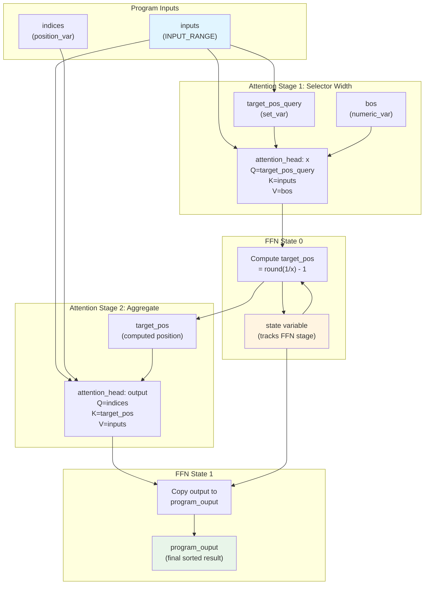
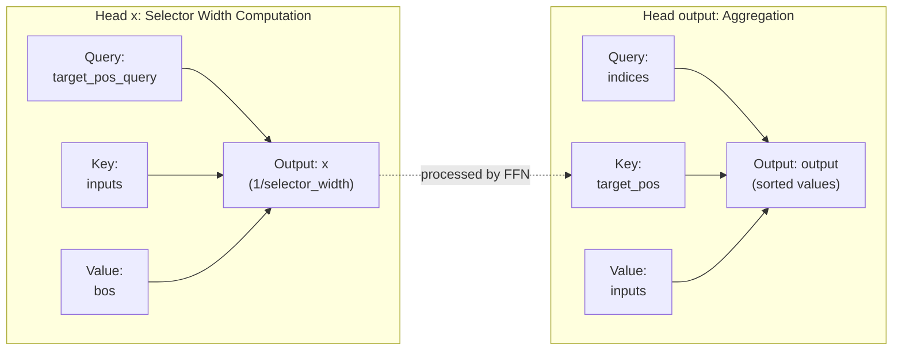
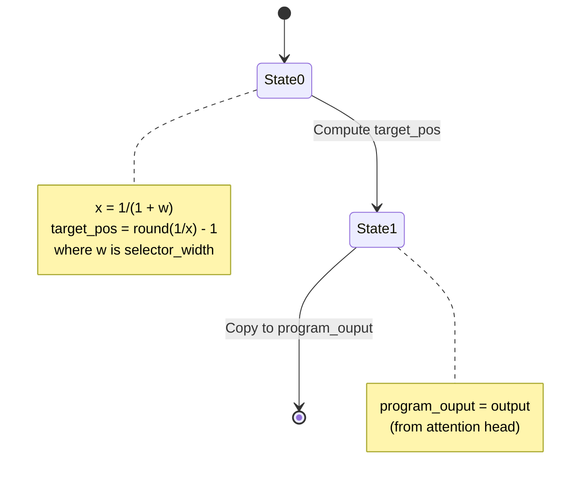
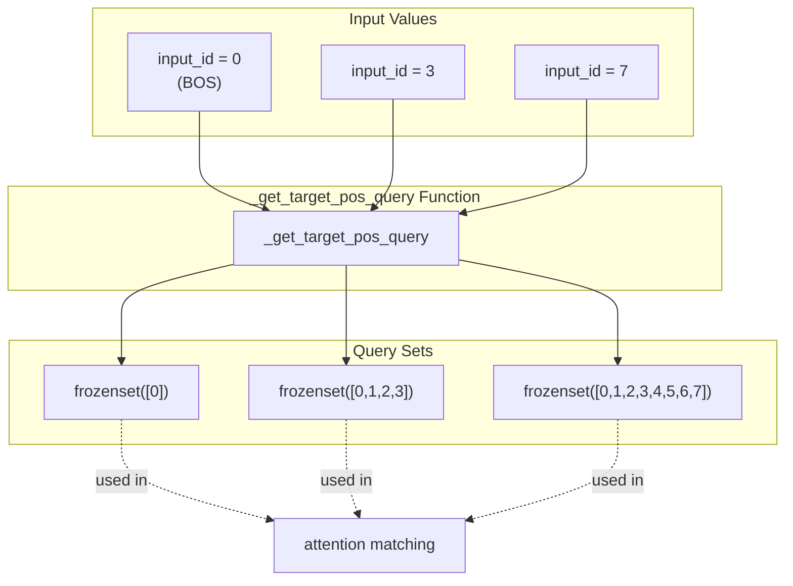

<!-- source: DeepWiki mcp.deepwiki.com · repo google-deepmind/alta · page 4.3 Sorting Unique Numbers · fetched 2026-10-26 -->

# Sorting Unique Numbers

<details>
<summary>Relevant source files</summary>

The following files were used as context for generating this wiki page:

- [examples/sort_unique.py](examples/sort_unique.py)

</details>


## Purpose and Scope

This page documents the sorting unique numbers example program located at [examples/sort_unique.py](). This program demonstrates how ALTA can implement the `selector_width` and `aggregate` operations from RASP (Restricted Access Sequence Processing), which are fundamental building blocks for many sequence processing algorithms. The program sorts a unique set of numbers using a two-stage attention-based approach.

For information on how to define ALTA programs in general, see [Program Specification](#3.1). For other example programs demonstrating different algorithmic patterns, see [Parity Detection](#4.1) and [Multi-Digit Addition](#4.2).

## RASP Algorithm Background

The sorting algorithm is based on the Tracr paper's toy task and implements the following RASP program:

```
smaller = select(tokens, tokens, <=)
target_pos = selector_width(smaller)
sel_sort = select(target_pos, indices, ==)
sort = aggregate(sel_sort, tokens)
```

This algorithm works by:
1. Creating a selection matrix where entry (i,j) is true if token[j] ≤ token[i]
2. Computing the width (number of true values) in each row, which gives the target sorted position
3. Creating a second selection matrix that matches target positions to sequence indices
4. Aggregating input tokens according to the second selection to produce sorted output

Sources: [examples/sort_unique.py:16-27]()

## Program Constants

The program defines three key constants that control its behavior:

| Constant | Value | Purpose |
|----------|-------|---------|
| `BOS_VALUE` | 0 | Special beginning-of-sequence marker value |
| `INPUT_RANGE` | 16 | Range of possible input values [0, 15] |
| `POSITION_RANGE` | 16 | Range of possible position values [0, 15] |

The algorithm requires a special BOS (Beginning of Sequence) token with value 0 to function correctly.

Sources: [examples/sort_unique.py:33-35]()

## Program Structure Overview



**Diagram: Two-Stage Sorting Pipeline**

The program executes in two distinct stages coordinated by the `state` variable. Stage 0 computes target positions using the `selector_width` operation, and Stage 1 performs the final aggregation to produce sorted output.

Sources: [examples/sort_unique.py:55-95]()

## Variables Definition

The program defines seven variables, each serving a specific role in the sorting algorithm:

### Input Variables

**`inputs`** - [examples/sort_unique.py:56]()
- Type: `input_var(INPUT_RANGE)`
- Purpose: Holds the unsorted input sequence of unique numbers

**`indices`** - [examples/sort_unique.py:57]()
- Type: `position_var(INPUT_RANGE)`
- Purpose: Provides sequential position indices [0, 1, 2, ..., n-1]

### Intermediate Variables

**`state`** - [examples/sort_unique.py:58]()
- Type: `var(2)`
- Purpose: Tracks which FFN processing stage (0 or 1) is active

**`target_pos_query`** - [examples/sort_unique.py:59-63]()
- Type: `set_var` with custom initialization
- Purpose: For each input value, stores the set of all values ≤ that input
- Initialization: `_get_target_pos_query(input_id)` returns `frozenset(range(input_id + 1))` for non-BOS values

**`bos`** - [examples/sort_unique.py:68]()
- Type: `numeric_var` with position initialization
- Purpose: Contains 1.0 at position 0, 0.0 elsewhere (used for selector_width computation)
- Initialization: `lambda x: float(x == 0)`

**`target_pos`** - [examples/sort_unique.py:69]()
- Type: `var(POSITION_RANGE)`
- Purpose: Stores the computed target position for each element in the sorted sequence

### Output Variable

**`program_ouput`** - [examples/sort_unique.py:70]()
- Type: `var(INPUT_RANGE)`
- Purpose: Final sorted output sequence

Sources: [examples/sort_unique.py:55-71]()

## Attention Heads

The program defines two attention heads that implement the RASP select and aggregate operations:



**Diagram: Attention Head QKV Configuration**

### Head "x" - Selector Width

- **Query**: `target_pos_query` (set of values ≤ current input)
- **Key**: `inputs` (input sequence)
- **Value**: `bos` (1.0 at position 0, 0.0 elsewhere)

This head computes a soft approximation of selector width. For each position i, it attends to all positions j where `inputs[j] ∈ target_pos_query[i]`. Since `bos` has value 1.0 only at position 0, the attention output is approximately `1/(1 + w)` where w is the number of non-BOS positions attended to (i.e., the selector width).

### Head "output" - Aggregation

- **Query**: `indices` (position indices)
- **Key**: `target_pos` (computed target positions)
- **Value**: `inputs` (input sequence)

This head implements the aggregate operation. For each position i, it attends to the position j where `target_pos[j] == indices[i]`, effectively routing each input value to its correct sorted position.

Sources: [examples/sort_unique.py:72-75]()

## FFN Function Implementation

The feed-forward network function operates in two stages controlled by the `state` variable:



**Diagram: FFN State Machine**

### State 0: Computing Target Positions

[examples/sort_unique.py:78-82]()

```python
if x["state"] == 0:
    x["target_pos"] = round(1 / x["x"]) - 1
    x["state"] = 1
```

This stage inverts the attention output `x["x"]` to recover the selector width. Given that `x["x"] = 1/(1 + w)`, the formula `round(1/x) - 1` recovers `w`, which is the number of elements ≤ the current element (excluding BOS). This gives the target position in the sorted sequence.

### State 1: Copying Output

[examples/sort_unique.py:83-85]()

```python
elif x["state"] == 1:
    x["program_ouput"] = x["output"]
```

This stage simply copies the attention output from head "output" to the final program output variable. This is necessary because attention outputs are considered undefined after the FFN stage in ALTA's execution model.

Sources: [examples/sort_unique.py:77-86]()

## Target Position Query Construction

The `target_pos_query` variable uses a custom initialization function to create set-valued queries:



**Diagram: Target Position Query Generation**

### `_get_target_pos_query(input_id)`

[examples/sort_unique.py:38-42]()

For the BOS token (value 0), returns `frozenset([BOS_VALUE])`. For all other values, returns `frozenset(range(input_id + 1))`, which represents all values from 0 to `input_id` inclusive.

This set-based representation enables the attention mechanism to match against all values less than or equal to the current input, implementing the RASP `select(tokens, tokens, <=)` operation.

### `_possible_target_pos_query_values()`

[examples/sort_unique.py:45-49]()

This helper function enumerates all possible query values across the entire input range. It is used during program compilation to determine the space of possible set values for dimension mapping purposes.

Sources: [examples/sort_unique.py:38-49]()

## Execution Flow Example

Consider sorting the sequence `[3, 1, 2]` with BOS token at position 0:

| Position | inputs | target_pos_query | selector_width | target_pos | Sorted Output |
|----------|--------|------------------|----------------|------------|---------------|
| 0 (BOS) | 0 | {0} | 0 | 0 | 0 |
| 1 | 3 | {0,1,2,3} | 3 | 3 | 1 |
| 2 | 1 | {0,1} | 1 | 1 | 2 |
| 3 | 2 | {0,1,2} | 2 | 2 | 3 |

**Stage 1 (State 0):**
1. Attention head "x" computes `x = 1/(1 + selector_width)` for each position
2. FFN inverts this to recover selector_width and stores in `target_pos`

**Stage 2 (State 1):**
1. Attention head "output" matches indices to target_pos values
2. Each input value is routed to its sorted position
3. FFN copies the result to `program_ouput`

Sources: [examples/sort_unique.py:77-86]()

## Key Operations Mapping

This table shows how RASP operations map to ALTA constructs:

| RASP Operation | ALTA Implementation | Code Location |
|----------------|---------------------|---------------|
| `select(tokens, tokens, <=)` | Set-based query matching in head "x" | [examples/sort_unique.py:59-63, 73]() |
| `selector_width(smaller)` | Inversion formula in FFN state 0 | [examples/sort_unique.py:81]() |
| `select(target_pos, indices, ==)` | Exact matching in head "output" | [examples/sort_unique.py:74]() |
| `aggregate(sel_sort, tokens)` | Value aggregation via head "output" | [examples/sort_unique.py:74]() |

Sources: [examples/sort_unique.py:20-24]()

## Program Specification Generation

The main entry point is the `build_program_spec()` function:

[examples/sort_unique.py:52-95]()

```python
def build_program_spec() -> program.Program:
    """Returns a program spec for sort unique task."""
    # ... variable definitions ...
    return pb.program_spec(
        variables=variables,
        heads=attention_heads,
        ffn_fn=ffn_fn,
        output_name="program_ouput",
        input_range=INPUT_RANGE,
        position_range=POSITION_RANGE,
        generate_rules=False,
    )
```

This function constructs a `program.Program` object that can be executed via the symbolic interpreter (see [Symbolic Interpreter](#3.2)) or compiled to transformer parameters (see [Compiler Pipeline](#3.3)).

The `generate_rules=False` parameter indicates that MLP inference rules should not be automatically generated, as this program uses a custom FFN function that requires manual implementation.

Sources: [examples/sort_unique.py:52-95]()

## Usage

To use this program:

1. Import and build the program specification:
   ```python
   from examples import sort_unique
   program_spec = sort_unique.build_program_spec()
   ```

2. Execute via interpreter or compile to transformer:
   ```python
   # Interpreter path (see section 3.2)
   from framework import interpreter_utils
   outputs = interpreter_utils.run_transformer(program_spec, inputs)
   
   # Compiler path (see section 3.3)
   from framework import compiler_utils
   params = compiler_utils.compile_transformer(program_spec)
   ```

The program expects input sequences of unique numbers in the range [0, INPUT_RANGE-1] with a BOS token at position 0.

Sources: [examples/sort_unique.py:52-95]()

---

