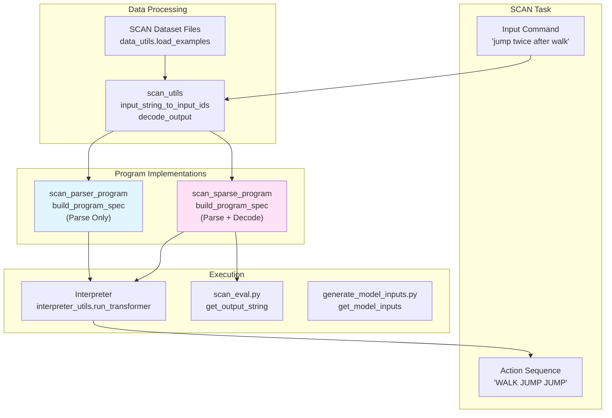
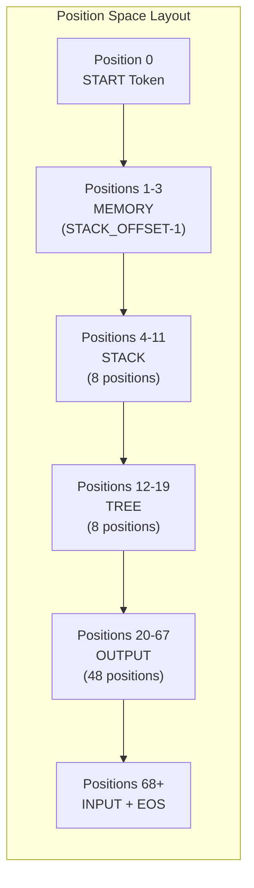
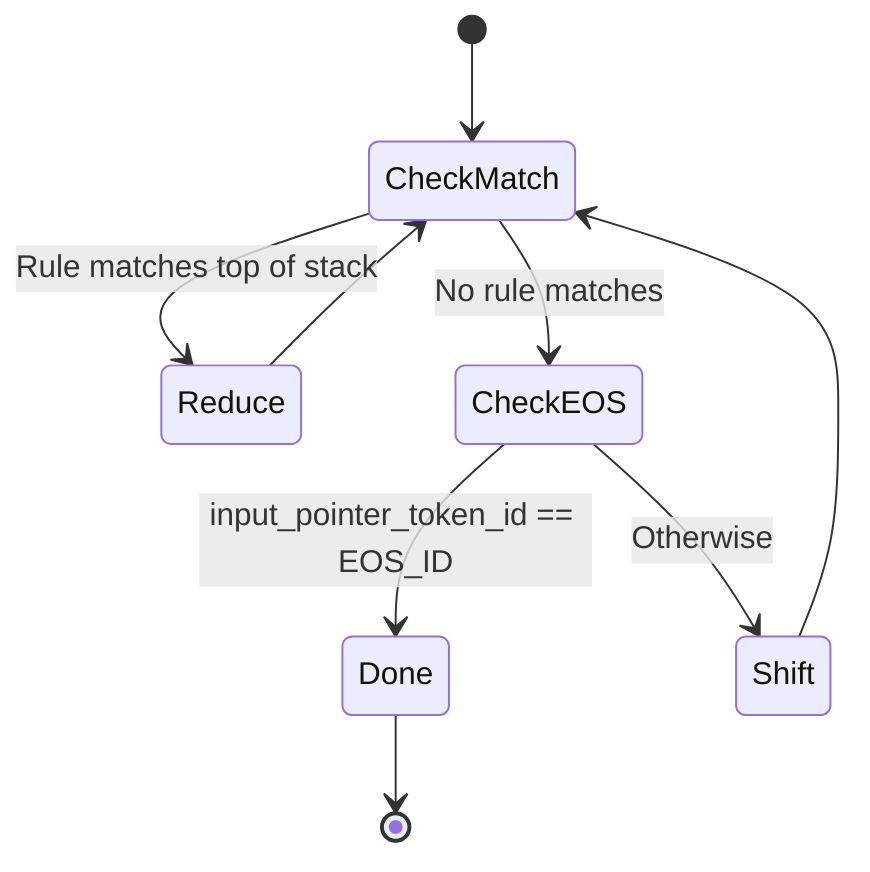
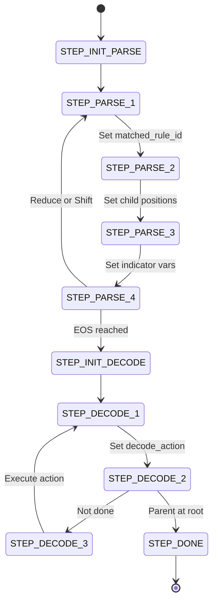
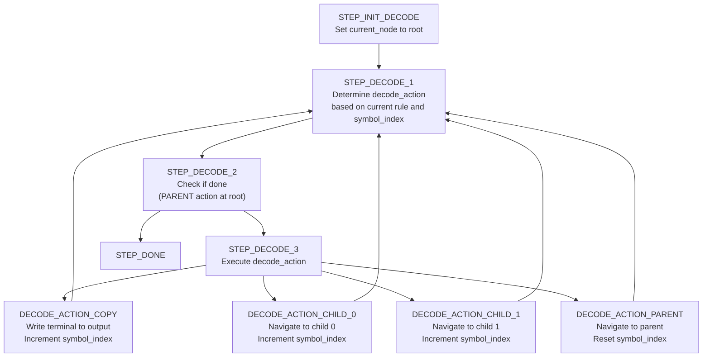

<!-- source: DeepWiki mcp.deepwiki.com · repo google-deepmind/alta · page 4.4 SCAN Compositional Learning · fetched 2026-10-26 -->

# SCAN Compositional Learning

<details>
<summary>Relevant source files</summary>

The following files were used as context for generating this wiki page:

- [examples/parity_test.py](examples/parity_test.py)
- [examples/scan/data_utils.py](examples/scan/data_utils.py)
- [examples/scan/generate_model_inputs.py](examples/scan/generate_model_inputs.py)
- [examples/scan/scan_eval.py](examples/scan/scan_eval.py)
- [examples/scan/scan_parser_program.py](examples/scan/scan_parser_program.py)
- [examples/scan/scan_parser_program_test.py](examples/scan/scan_parser_program_test.py)
- [examples/scan/scan_sparse_program.py](examples/scan/scan_sparse_program.py)
- [examples/scan/scan_utils.py](examples/scan/scan_utils.py)

</details>


This page documents the SCAN (Simplified version of the CommAI Navigation) task implementation in ALTA. SCAN is a semantic parsing benchmark that tests compositional generalization by mapping natural language commands to sequences of actions.

For information about other example programs in ALTA, see [Example Programs](#4). For the underlying compiler and interpreter mechanisms, see [Core Architecture](#3).

## Overview

The SCAN implementation demonstrates how ALTA can encode a complete semantic parsing system that performs context-free grammar (CFG) parsing followed by tree-based decoding. The system translates commands like "jump twice after walk" into action sequences like "WALK JUMP JUMP".

Two program implementations are provided:
- **Parser-only** (`scan_parser_program.py`): CFG parsing that produces a parse tree
- **Full system** (`scan_sparse_program.py`): Complete parsing and decoding pipeline

Both implementations use shift-reduce parsing with explicit stack and tree memory structures encoded in the transformer's position space.

**Sources:** [examples/scan/scan_parser_program.py:1-189](), [examples/scan/scan_sparse_program.py:1-601]()

## System Architecture



**Sources:** [examples/scan/scan_parser_program.py:148-189](), [examples/scan/scan_sparse_program.py:485-601](), [examples/scan/scan_eval.py:46-64](), [examples/scan/data_utils.py:43-50]()

## SCAN Grammar and Task

The SCAN task uses a Quasi-Context-Free Grammar (QCFG) where:
- **Source** is the input language (natural language commands)
- **Target** is the output language (action sequences)
- Rules map source patterns to target patterns with potential reordering

Example grammar rules:
- `"jump"` → `("JUMP",)`
- `("S", "twice")` → `("S", "S")`  (repeat action twice)
- `("S", "after", "S")` → `(S₁, S₀)` (reverse order)

The grammar is defined in `grammar_utils` (referenced but not shown in provided files) and includes:
- **Source terminals**: "jump", "walk", "run", "look", "turn", "left", "right", "twice", "thrice", "and", "after"
- **Target terminals**: "JUMP", "WALK", "RUN", "LOOK", "LTURN", "RTURN"
- **Nonterminals**: "S" (sentence), "D" (direction), "V" (verb)

**Sources:** [examples/scan/scan_parser_program.py:36-86](), [examples/scan/data_utils.py:21-40]()

## Memory Layout

The SCAN program uses a sophisticated memory layout that partitions the position space into distinct regions:



| Region | Offset Constant | Size | Purpose |
|--------|----------------|------|---------|
| Start | 0 | 1 | Special start token |
| Memory | 1 | 3 | Padding (STACK_OFFSET - 1) |
| Stack | `STACK_OFFSET=4` | 8 | Parsing stack |
| Tree | `TREE_OFFSET=12` | 8 | Parse tree nodes |
| Output | `OUTPUT_OFFSET=20` | 48 | Decoded action buffer |
| Input | `INPUT_OFFSET=68` | Variable | Input command tokens |

The total number of positions is calculated by `get_num_positions(max_num_padding)` which accounts for padding variations needed for the length generalization split.

**Sources:** [examples/scan/scan_utils.py:23-70](), [examples/scan/scan_sparse_program.py:485-487]()

## Parser-Only Implementation

### Variables and Attention Heads

The parser program (`scan_parser_program.py`) defines a minimal set of variables for CFG parsing:

**Core Variables:**
- `token`: Input token ID (size: `NUM_INPUT_TOKENS`)
- `position`: Position in sequence (size: `NUM_POSITIONS=16`)
- `done`: Parsing completion flag (size: 2)

**Stack Management:**
- `stack_pointer_0`, `stack_pointer_1`, `stack_pointer_2`, `stack_pointer_3`: Pointers to top 4 stack positions
- `symbol_id`: Symbol ID at each stack position (size: `NUM_SYMBOLS + 1`)

**Tree and Pointer Tracking:**
- `tree_pointer`: Next position to write in parse tree
- `input_pointer`: Next input token to process
- `rule_id`: Grammar rule ID for each tree node

**Attention Heads:**
```python
heads = {
    "input_pointer_token_id": pb.qkv("input_pointer", "position", "token"),
    "stack_symbol_1": pb.qkv("stack_pointer_1", "position", "symbol_id"),
    "stack_symbol_2": pb.qkv("stack_pointer_2", "position", "symbol_id"),
    "stack_symbol_3": pb.qkv("stack_pointer_3", "position", "symbol_id"),
}
```

These heads enable the program to:
1. Look up the current input token
2. Examine the top 3 symbols on the parsing stack

**Sources:** [examples/scan/scan_parser_program.py:148-189]()

### Parsing Algorithm

The parser uses a shift-reduce algorithm implemented in the FFN function:



**Shift Operation** (`shift` function [examples/scan/scan_parser_program.py:119-126]()):
1. Push current input token onto stack
2. Increment input pointer
3. Update all stack pointers

**Reduce Operation** (`reduce` function [examples/scan/scan_parser_program.py:106-117]()):
1. Pop RHS symbols from stack (based on matched rule length)
2. Push LHS nonterminal onto stack
3. Add rule to parse tree at `tree_pointer`
4. Increment tree pointer
5. Update stack pointers

**Rule Matching** (`_maybe_match_rule` function [examples/scan/scan_parser_program.py:43-72]()):
- Compares top 1-3 stack symbols against all grammar rules
- Special handling for "S and S" and "S after S" rules (must be at root, i.e., when `input_token_str == "eos"`)
- Returns matched `QCFGRule` or `None`

**Sources:** [examples/scan/scan_parser_program.py:28-146]()

## Full Parsing and Decoding Implementation

### Processing State Machine

The full SCAN program (`scan_sparse_program.py`) uses a multi-step state machine:



**Parsing Steps:**
- `STEP_INIT_PARSE` (0): Initialize stack, tree, and input pointers
- `STEP_PARSE_1` (1): Match grammar rules and set `matched_rule_id`, `child_0_stack_position`, `child_1_stack_position`
- `STEP_PARSE_2` (2): Resolve child node positions from stack positions
- `STEP_PARSE_3` (3): Set indicator variables (`is_child_0`, `is_child_1`, `is_next_nt`, `is_tree_pointer`)
- `STEP_PARSE_4` (4): Execute shift or reduce action

**Decoding Steps:**
- `STEP_INIT_DECODE` (5): Initialize output pointer and set tree pointer to root
- `STEP_DECODE_1` (6): Determine next decode action based on current tree node
- `STEP_DECODE_2` (7): Check if decoding is complete
- `STEP_DECODE_3` (8): Execute decode action (copy terminal, navigate to child/parent)

**Sources:** [examples/scan/scan_sparse_program.py:24-42](), [examples/scan/scan_sparse_program.py:461-483]()

### Parsing Implementation Details

The parsing implementation in `scan_sparse_program.py` extends the parser-only version with additional state tracking:

**Parse Step 1** (`_step_parse_1` [examples/scan/scan_sparse_program.py:134-162]()):
- Matches rules of length 1, 2, or 3 by comparing `stack_symbol_1`, `stack_symbol_2`, `stack_symbol_3`
- Special handling for "S and S" and "S after S" rules (only match when at EOS)
- Sets `matched_rule_id`, `matched_rule_len`, `child_0_stack_position`, `child_1_stack_position`

**Parse Step 2** (`_step_parse_2` [examples/scan/scan_sparse_program.py:181-185]()):
- Resolves child positions by looking up tree node positions at stack positions
- Uses attention to `tree_node_position` variable at stack positions

**Parse Step 3** (`_step_parse_3` [examples/scan/scan_sparse_program.py:249-274]()):
- Sets indicator variables for specific positions:
  - `is_next_nt`: Position where LHS nonterminal will be placed
  - `should_reset`: Positions being popped from stack
  - `is_tree_pointer`: Current tree write position
  - `is_child_0`, `is_child_1`: Child node positions

**Parse Step 4** (`_step_parse_4` [examples/scan/scan_sparse_program.py:277-308]()):
- Executes `_reduce` if rule matched, else `_shift` or finish
- Resets temporary variables

**Shift Operation** (`_shift` [examples/scan/scan_sparse_program.py:188-202]()):
- Converts input token to symbol ID
- Writes to stack at `stack_pointer`
- Increments input pointer and stack pointers

**Reduce Operation** (`_reduce` [examples/scan/scan_sparse_program.py:204-247]()):
- Resets nodes being removed from stack (where `should_reset == 1`)
- Writes LHS nonterminal to stack at position indicated by `is_next_nt`
- Creates tree node at `tree_pointer` with `rule_id` and child pointers
- Sets `tree_parent` pointers in child nodes
- Updates stack pointers by `1 - matched_rule_len`

**Sources:** [examples/scan/scan_sparse_program.py:84-308]()

### Tree Data Structure

The parse tree is stored using three variables per position:

| Variable | Purpose |
|----------|---------|
| `rule_id` | Grammar rule ID (1-indexed, 0 = no rule) |
| `tree_child_0` | Position of first child node |
| `tree_child_1` | Position of second child node |
| `tree_parent` | Position of parent node |

This enables tree traversal during decoding using attention heads:
- `current_node_rule_id`: Rule at current node
- `current_node_child_0`: First child position
- `current_node_child_1`: Second child position
- `current_node_parent`: Parent position
- `current_node_symbol_index`: Current position in target sequence

**Sources:** [examples/scan/scan_sparse_program.py:554-589]()

### Decoding Algorithm

The decoder traverses the parse tree in depth-first order to generate the output action sequence:



**Decode Actions:**

| Action | Value | Description |
|--------|-------|-------------|
| `DECODE_ACTION_NONE` | 0 | No action |
| `DECODE_ACTION_COPY` | 1 | Copy terminal symbol to output |
| `DECODE_ACTION_CHILD_0` | 2 | Navigate to first child |
| `DECODE_ACTION_CHILD_1` | 3 | Navigate to second child |
| `DECODE_ACTION_PARENT` | 4 | Navigate to parent |

**Decode Step 1** (`_step_decode_1` [examples/scan/scan_sparse_program.py:337-378]()):
- Looks up current rule's target sequence
- Based on `current_node_symbol_index`:
  - If equals target length: set `DECODE_ACTION_PARENT`
  - If target symbol is terminal: set `DECODE_ACTION_COPY` and `decode_symbol`
  - If target symbol is nonterminal: set `DECODE_ACTION_CHILD_0` or `DECODE_ACTION_CHILD_1` based on `rule.mapping`

**Decode Step 2** (`_step_decode_2` [examples/scan/scan_sparse_program.py:382-393]()):
- Checks if decoding is complete: `decode_action == PARENT` and `current_node_is_root`
- Otherwise proceeds to execute action

**Decode Step 3** (`_step_decode_3` [examples/scan/scan_sparse_program.py:438-459]()):
- **Copy** (`_copy_terminal` [examples/scan/scan_sparse_program.py:395-412]()): Writes `decode_symbol` to `output_symbol_id` at `output_pointer`, increments both output pointer and symbol index
- **Child navigation** (`_go_to_child` [examples/scan/scan_sparse_program.py:426-436]()): Sets `current_node_pointer` to child, increments symbol index
- **Parent navigation** (`_go_to_parent` [examples/scan/scan_sparse_program.py:414-424]()): Sets `current_node_pointer` to parent, resets symbol index to 0

**Sources:** [examples/scan/scan_sparse_program.py:310-459]()

## Data Processing

### Input Encoding

The `scan_utils.input_string_to_input_ids` function converts SCAN commands to input sequences:

```python
# Example: "jump twice" with padding=0
input_tokens = [
    "pad" * padding,           # Variable padding
    "start",                   # Position 0
    "memory" * 3,              # Positions 1-3 (STACK_OFFSET - 1)
    "memory" * 8,              # Positions 4-11 (stack area)
    "memory" * 8,              # Positions 12-19 (tree area)
    "memory" * 48,             # Positions 20-67 (output area)
    "jump", "twice",           # Actual input tokens
    "eos"                      # End of sequence marker
]
```

The function:
1. Splits input string by spaces
2. Adds padding if requested
3. Prepends special tokens and memory regions
4. Appends input tokens and EOS
5. Converts all tokens to integer IDs using `get_input_id`

**Sources:** [examples/scan/scan_utils.py:92-115]()

### Output Decoding

The `scan_utils.decode_output` function converts output IDs to action tokens:

```python
def decode_output(output_ids: list[int]) -> list[str]:
  output_tokens = []
  for output_id in output_ids:
    if output_id != 0:  # Skip empty positions
      token = grammar_utils.get_symbol_token(output_id)
      if token is not None:
        output_tokens.append(token)
  return output_tokens
```

**Sources:** [examples/scan/scan_utils.py:117-127]()

### Dataset Loading

The `data_utils` module handles loading the original SCAN dataset files:

**Token Mapping:**
```python
TARGET_MAP = {
    "I_TURN_RIGHT": "RTURN",
    "I_TURN_LEFT": "LTURN",
    "I_WALK": "WALK",
    "I_LOOK": "LOOK",
    "I_RUN": "RUN",
    "I_JUMP": "JUMP",
}
```

The original SCAN format uses verbose action names which are shortened for efficiency.

**Parsing:**
```python
# Example line: "IN: jump twice OUT: I_JUMP I_JUMP"
# Parsed to: ("jump twice", "JUMP JUMP")
```

The `parse_example` function:
1. Splits on "OUT:" to separate input and output
2. Removes "IN:" prefix from input
3. Replaces verbose action names with short versions
4. Returns `(input_string, output_string)` tuple

**Sources:** [examples/scan/data_utils.py:21-50]()

## Evaluation and Usage

### Evaluation Script

The `scan_eval.py` script evaluates the SCAN program on dataset examples:

```python
def get_output_string(input_string):
  """Returns output string for given input string."""
  program_spec = scan_sparse_program.build_program_spec()
  input_ids = scan_utils.input_string_to_input_ids(input_string)
  activations_seq = program_utils.initialize_activations(
      program_spec, input_ids, position_shift=_POSITION_SHIFT.value
  )
  outputs = interpreter_utils.run_transformer(
      program_spec, activations_seq, max_layers=128, logger=None
  )
  output_tokens = scan_utils.decode_output(outputs)
  return " ".join(output_tokens)
```

The script:
1. Loads examples from SCAN dataset file
2. Processes batch of examples (controlled by `--offset` and `--limit` flags)
3. Compares predicted output against expected output
4. Raises error on mismatch

**Command-line flags:**
- `--input`: Path to SCAN dataset file
- `--offset`: Starting example index
- `--limit`: Number of examples to process
- `--position_shift`: Offset for positional indexes (for debugging)

**Sources:** [examples/scan/scan_eval.py:1-90]()

### Generating Model Inputs

The `generate_model_inputs.py` script creates JSONL files of unique model inputs for pre-compilation:

```python
def get_model_inputs(examples):
  """Get set of unique model inputs."""
  model_inputs_set = set()
  for input_string, _ in examples:
    for padding in get_paddings():
      model_input = scan_utils.input_string_to_input_ids(
          input_string, padding=padding
      )
      model_inputs_set.add(tuple(model_input))
  
  model_inputs = []
  for model_input_tuple in model_inputs_set:
    model_inputs.append(list(model_input_tuple))
  return model_inputs
```

The script:
1. Loads examples from dataset
2. Generates input IDs with variable padding (if `--num_padding > 0`)
3. Deduplicates model inputs
4. Writes unique inputs to JSONL file

This is useful for:
- Pre-generating inputs for batch compilation
- Testing length generalization with variable padding
- Creating training data for MLP-based FFN approximations

**Sources:** [examples/scan/generate_model_inputs.py:1-91]()

### Testing

The `scan_parser_program_test.py` demonstrates parser-only testing:

```python
def test_scan(self):
  program_spec = scan_parser_program.build_program_spec()
  
  input_tokens = ["jump", "twice", "after", "walk", "eos"]
  input_ids = [scan_utils.get_input_id(token) for token in input_tokens]
  activations_seq = program_utils.initialize_activations(
      program_spec, input_ids
  )
  logger = logger_utils.ActivationsLogger()
  outputs = interpreter_utils.run_transformer(
      program_spec, activations_seq, max_layers=32, logger=logger
  )
  
  rule_ids = [x - 1 for x in outputs if x > 0]
  rule_sources = [" ".join(grammar_utils.RULES[x].source) for x in rule_ids]
  self.assertEqual(rule_sources, ["jump", "S twice", "walk", "S after S"])
```

The test verifies that the parser produces the correct sequence of grammar rules. The expected parse tree for "jump twice after walk":
1. Rule: "jump" → JUMP
2. Rule: "S twice" → S S (jump twice)
3. Rule: "walk" → WALK
4. Rule: "S after S" → S₁ S₀ (reverse order)

**Sources:** [examples/scan/scan_parser_program_test.py:28-54]()

## Implementation Comparison

| Aspect | Parser-Only | Full System |
|--------|-------------|-------------|
| **File** | `scan_parser_program.py` | `scan_sparse_program.py` |
| **Output** | Parse tree (rule IDs) | Action sequences |
| **State Machine** | Simple FFN function | Multi-step state machine (10 steps) |
| **Variables** | 9 variables | 30+ variables |
| **Attention Heads** | 4 heads | 10+ heads |
| **Max Layers** | ~32 | ~128 |
| **Tree Representation** | Rule IDs only | Full tree with parent/child pointers |
| **Use Case** | Educational/illustration | Production evaluation |

The parser-only implementation is simpler and useful for understanding the shift-reduce algorithm. The full implementation adds the complete decoding pipeline needed to generate SCAN outputs.

**Sources:** [examples/scan/scan_parser_program.py:148-189](), [examples/scan/scan_sparse_program.py:485-601]()

## Key Design Patterns

### MLPBuilder Pattern

The full SCAN program uses the `MLPBuilder` pattern from `program_builder` to define complex FFN logic:

```python
m = pb.MLPBuilder(variables, heads)
_get_rules(m)
return pb.program_spec_from_rules(
    variables=variables,
    heads=heads,
    rules=m.rules,
    output_name="output_symbol_id",
    input_range=scan_utils.NUM_INPUT_TOKENS,
    position_range=num_positions,
)
```

The `MLPBuilder` provides helper methods:
- `m.get(var_name)`: Iterate over variable values
- `m.set(var_name, value)`: Set variable to value
- `_eq(m, var_name, value)`: Helper to iterate once at specific value
- `_set_from_zero(m, var_name, value)`: Set from zero (common pattern)

This pattern enables complex conditional logic while maintaining compilability to transformer weights.

**Sources:** [examples/scan/scan_sparse_program.py:591-600](), [examples/scan/scan_sparse_program.py:60-71]()

### Position-Based Memory

Both implementations use position-based memory regions instead of learned parameters. This design:
- Makes the algorithm explicit and interpretable
- Enables verification through symbolic interpretation
- Allows compilation to exact transformer weights
- Supports variable input lengths through relative addressing

The memory layout is carefully designed to avoid position conflicts and enable efficient attention-based lookups.

**Sources:** [examples/scan/scan_utils.py:23-70]()

### Pointer-Based Data Structures

The programs implement stack and tree data structures using position pointers:
- **Stack**: Top-of-stack pointer (`stack_pointer_0`) with lookahead pointers (`stack_pointer_1-3`)
- **Tree**: Nodes with explicit child and parent pointers stored in variables
- **Buffers**: Output and input buffers with read/write pointers

This approach demonstrates how transformers can implement classical data structures using attention and positional encoding.

**Sources:** [examples/scan/scan_parser_program.py:98-126](), [examples/scan/scan_sparse_program.py:554-589]()

---

