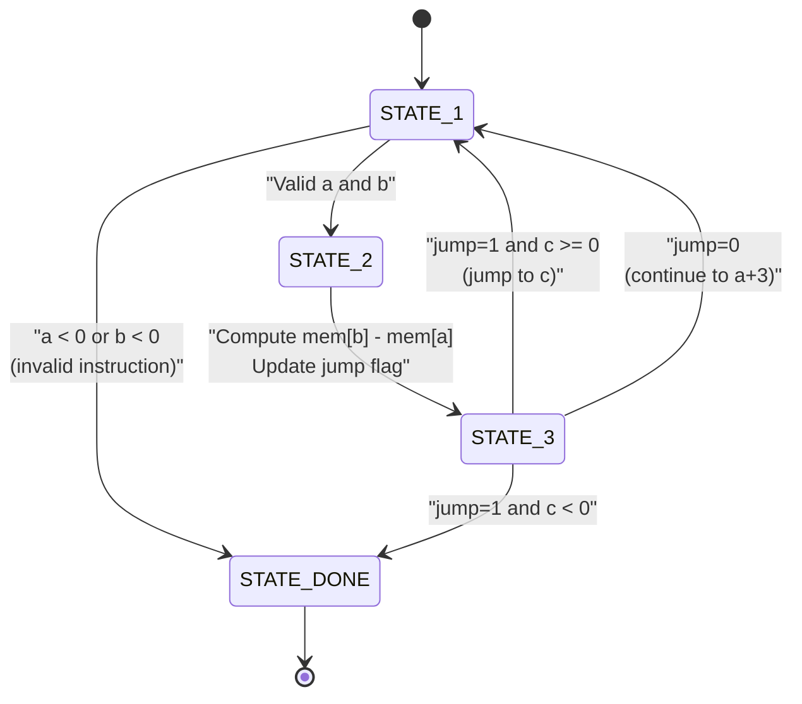
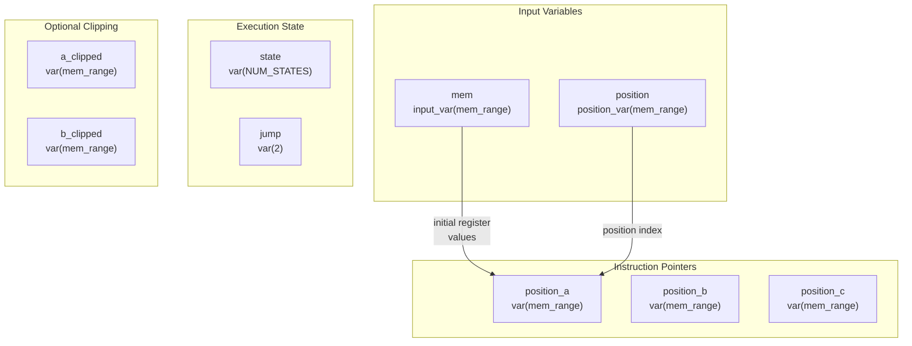
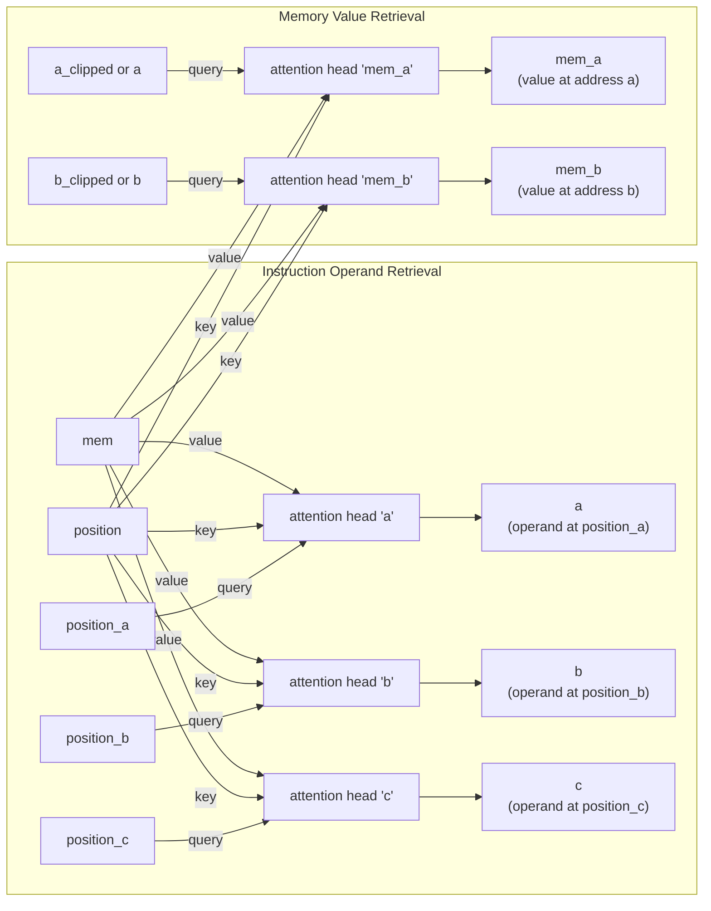
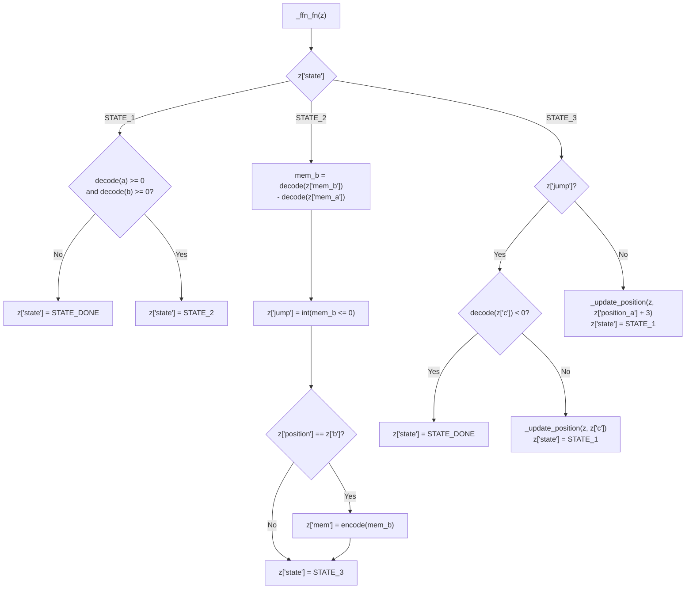
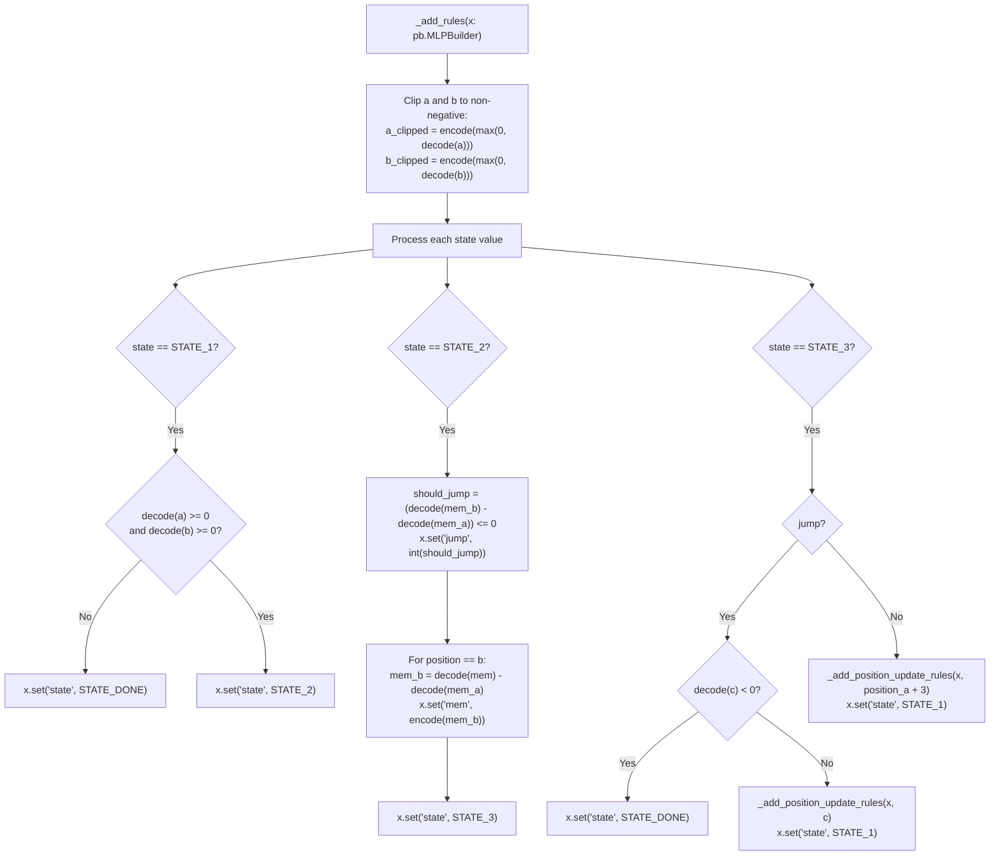
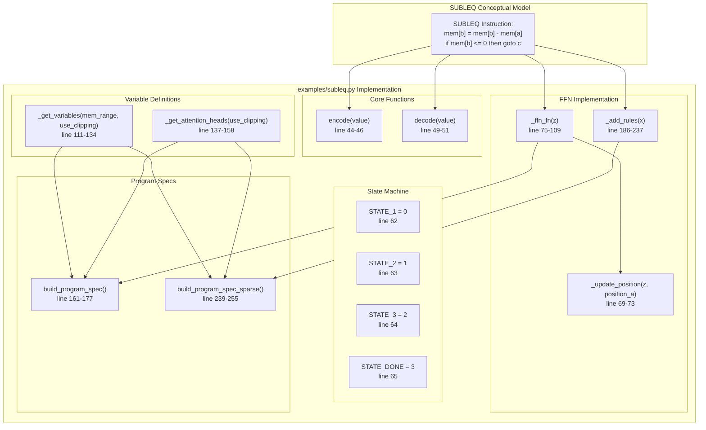

<!-- source: DeepWiki mcp.deepwiki.com · repo google-deepmind/alta · page 4.5 SUBLEQ Instruction Set · fetched 2026-10-26 -->

# SUBLEQ Instruction Set

<details>
<summary>Relevant source files</summary>

The following files were used as context for generating this wiki page:

- [examples/subleq.py](examples/subleq.py)

</details>


## Purpose and Scope

This document describes the SUBLEQ single-instruction language implementation in ALTA. SUBLEQ demonstrates how ALTA can model low-level instruction set architectures (ISAs) by implementing a Turing-complete machine with only one instruction type. The implementation is located in [examples/subleq.py]() and serves as an example of how ALTA's program specification can express complex control flow, conditional branching, and memory operations.

For other algorithmic examples, see [Parity Detection](#4.1), [Multi-Digit Addition](#4.2), and [Sorting Unique Numbers](#4.3). For higher-level language processing, see [SCAN Compositional Learning](#4.4).

---

## SUBLEQ Language Overview

SUBLEQ (SUBtract and branch if Less than or EQual to zero) is a single-instruction Turing-complete language. The entire language consists of one instruction format:

```
subleq a, b, c
```

This instruction performs the following operations:

1. **Subtract**: `mem[b] = mem[b] - mem[a]`
2. **Conditional Branch**:
   - If `mem[b] <= 0`:
     - If `c < 0`: halt execution
     - Otherwise: jump to instruction at address `c`
   - Otherwise: continue to next instruction at address `a + 3`

The instruction takes three memory addresses as operands. Since each instruction occupies three consecutive memory locations, sequential execution advances by 3 positions.

**Sources:** [examples/subleq.py:16-29]()

---

## Implementation Constants and Configuration

The SUBLEQ implementation in ALTA operates with the following constraints:

| Constant | Value | Purpose |
|----------|-------|---------|
| `NUM_POSITIONS` | 16 | Number of memory registers available |
| `MIN_VALUE` | -16 | Minimum value a register can hold |
| `MAX_VALUE` | 16 | Maximum value a register can hold |
| `STATE_1` | 0 | Fetch instruction operands |
| `STATE_2` | 1 | Execute subtraction |
| `STATE_3` | 2 | Determine next instruction |
| `STATE_DONE` | 3 | Halt state |

**Sources:** [examples/subleq.py:36-66]()

---

## Value Encoding

Since ALTA operates on non-negative integers, negative register values are encoded using offset functions:

```python
def encode(value: int) -> int:
  return value - MIN_VALUE

def decode(value: int) -> int:
  return value + MIN_VALUE
```

This encoding shifts the range `[-16, 16]` to `[0, 32]`, allowing ALTA's internal representation to work with non-negative values while the SUBLEQ semantics operate on signed integers.

**Sources:** [examples/subleq.py:44-51]()

---

## State Machine Architecture

The SUBLEQ implementation uses a three-phase state machine to execute each instruction:



**State Transitions:**

| Current State | Condition | Action | Next State |
|--------------|-----------|--------|------------|
| `STATE_1` | `a < 0` or `b < 0` | Invalid instruction | `STATE_DONE` |
| `STATE_1` | Valid `a`, `b` | Fetch operands | `STATE_2` |
| `STATE_2` | Always | Compute `mem[b] - mem[a]`, set `jump` | `STATE_3` |
| `STATE_3` | `jump=1`, `c < 0` | Halt | `STATE_DONE` |
| `STATE_3` | `jump=1`, `c >= 0` | Jump to `c` | `STATE_1` |
| `STATE_3` | `jump=0` | Advance to `a+3` | `STATE_1` |

**Sources:** [examples/subleq.py:62-66](), [examples/subleq.py:75-109]()

---

## Variables and Attention Heads

### Variable Structure

The SUBLEQ implementation defines variables to track memory state, instruction pointers, and execution state:



| Variable | Type | Range | Purpose |
|----------|------|-------|---------|
| `mem` | input_var | `[0, 32]` | Value stored in each memory register |
| `position` | position_var | `[0, 32]` | Position index (0 to NUM_POSITIONS-1) |
| `position_a` | var | `[0, 32]` | Address of first operand (subtract from) |
| `position_b` | var | `[0, 32]` | Address of second operand (subtract into) |
| `position_c` | var | `[0, 32]` | Address of branch target |
| `state` | var | `[0, 3]` | Current execution state |
| `jump` | var | `[0, 1]` | Whether to branch (1) or continue (0) |
| `a_clipped` | var | `[0, 32]` | Clipped value of `a` for safe attention |
| `b_clipped` | var | `[0, 32]` | Clipped value of `b` for safe attention |

**Sources:** [examples/subleq.py:111-134]()

### Attention Head Structure

The attention heads retrieve instruction operands and memory values:



| Attention Head | Query | Key | Value | Purpose |
|----------------|-------|-----|-------|---------|
| `a` | `position_a` | `position` | `mem` | Retrieve operand at address stored in `position_a` |
| `b` | `position_b` | `position` | `mem` | Retrieve operand at address stored in `position_b` |
| `c` | `position_c` | `position` | `mem` | Retrieve branch target at address stored in `position_c` |
| `mem_a` | `a` (or `a_clipped`) | `position` | `mem` | Retrieve memory value at address `a` |
| `mem_b` | `b` (or `b_clipped`) | `position` | `mem` | Retrieve memory value at address `b` |

The two-level attention mechanism first retrieves instruction operands (addresses), then uses those addresses to retrieve the actual memory values needed for computation.

**Sources:** [examples/subleq.py:137-158]()

---

## Feed-Forward Function Execution

### Function-Based Implementation

The `_ffn_fn` function implements the SUBLEQ state machine logic:



The helper function `_update_position` updates the instruction pointer:

```python
def _update_position(z, position_a):
  z["position_a"] = position_a
  z["position_b"] = position_a + 1
  z["position_c"] = position_a + 2
```

**Sources:** [examples/subleq.py:69-109]()

### Rule-Based Implementation

The `_add_rules` function provides an alternative implementation using the `MLPBuilder` interface:



**Sources:** [examples/subleq.py:186-237]()

---

## Two Program Specifications

The SUBLEQ implementation provides two ways to build a program specification:

### `build_program_spec()` - Function-Based

This specification uses the `_ffn_fn` function directly:

```python
def build_program_spec() -> program.Program:
  mem_range = (MAX_VALUE - MIN_VALUE) + 1
  variables = _get_variables(mem_range)
  attention_heads = _get_attention_heads()

  return pb.program_spec(
      variables=variables,
      heads=attention_heads,
      ffn_fn=_ffn_fn,
      output_name="mem",
      input_range=mem_range,
      position_range=NUM_POSITIONS,
      generate_rules=False,
      halt=pb.halt_spec("state", halt_value=STATE_DONE),
  )
```

**Key characteristics:**
- Uses `ffn_fn=_ffn_fn` parameter
- Sets `generate_rules=False` to prevent automatic rule generation
- Does not use value clipping variables

**Sources:** [examples/subleq.py:161-177]()

### `build_program_spec_sparse()` - Rule-Based

This specification uses explicit rules generated by `MLPBuilder`:

```python
def build_program_spec_sparse() -> program.Program:
  mem_range = (MAX_VALUE - MIN_VALUE) + 1
  variables = _get_variables(mem_range, use_clipping=True)
  attention_heads = _get_attention_heads(use_clipping=True)
  x = pb.MLPBuilder(variables, attention_heads)
  _add_rules(x)
  return pb.program_spec_from_rules(
      variables=variables,
      heads=attention_heads,
      rules=x.rules,
      output_name="mem",
      input_range=mem_range,
      position_range=NUM_POSITIONS,
      halt=pb.halt_spec("state", halt_value=STATE_DONE),
  )
```

**Key characteristics:**
- Uses `program_spec_from_rules()` instead of `program_spec()`
- Includes `a_clipped` and `b_clipped` variables to avoid undefined attention when addresses are negative
- Generates rules explicitly via `MLPBuilder`

Both specifications produce equivalent behavior but demonstrate different approaches to expressing the same computation in ALTA.

**Sources:** [examples/subleq.py:239-255]()

---

## Code Entity Mapping

The following diagram maps the conceptual SUBLEQ architecture to specific code entities:



**Sources:** [examples/subleq.py:1-256]()

---

## Usage and Integration

To use the SUBLEQ implementation:

```python
# Import the SUBLEQ module
from examples import subleq

# Build a program specification (choose one)
program_spec = subleq.build_program_spec()
# or
program_spec = subleq.build_program_spec_sparse()

# Encode input program and data
inputs = subleq.encode_inputs([3, 0, 6, 1, 0, -1, ...])  # SUBLEQ instructions

# Execute via interpreter (see section 3.2)
from framework import interpreter_utils
outputs = interpreter_utils.run_transformer(program_spec, inputs)

# Decode outputs
decoded = subleq.decode_outputs(outputs)
```

The implementation demonstrates how ALTA can express:
- **Complex control flow** through state machine encoding
- **Conditional branching** using the `halt` specification
- **Memory indirection** via two-level attention (address → value)
- **In-place memory updates** conditioned on position equality

**Sources:** [examples/subleq.py:44-60](), [examples/subleq.py:161-177](), [examples/subleq.py:239-255]()

---

