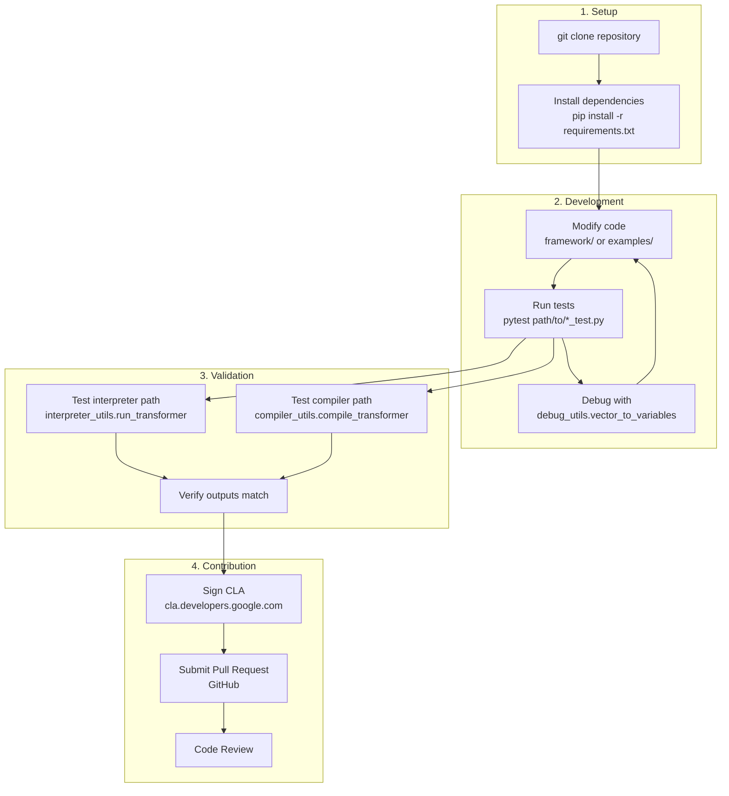
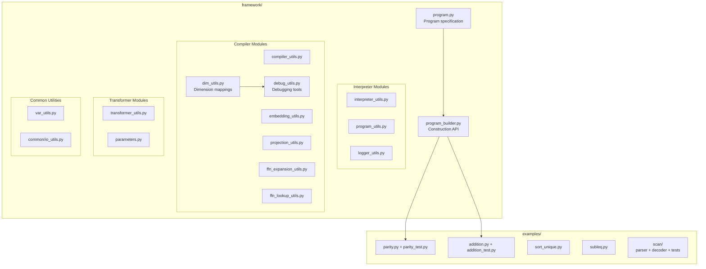
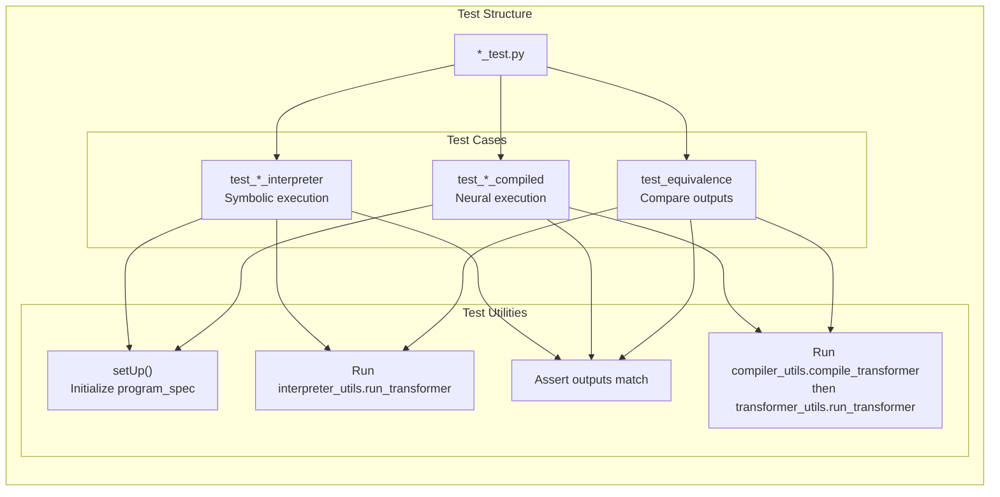
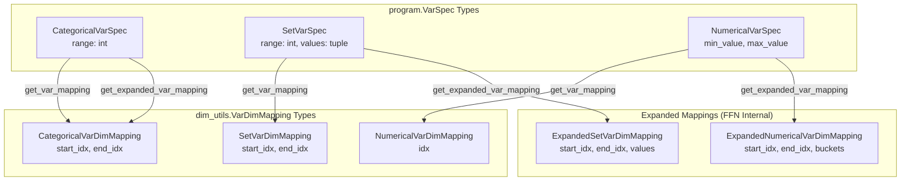
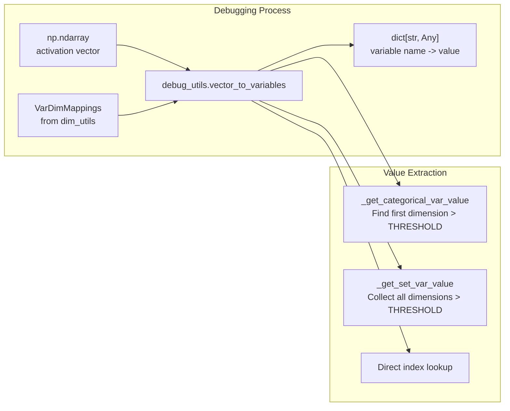

<!-- source: DeepWiki mcp.deepwiki.com · repo google-deepmind/alta · page 5 Developer Guide · fetched 2026-10-26 -->

# Developer Guide

<details>
<summary>Relevant source files</summary>

The following files were used as context for generating this wiki page:

- [.gitignore](.gitignore)
- [CONTRIBUTING.md](CONTRIBUTING.md)
- [framework/compiler/debug_utils.py](framework/compiler/debug_utils.py)
- [framework/compiler/dim_utils.py](framework/compiler/dim_utils.py)

</details>


This guide provides information for developers who want to contribute to ALTA or understand its internal implementation. It covers development workflow, testing practices, code organization, and debugging utilities. For specific contribution requirements, see [Contributing Guidelines](#5.1). For detailed debugging tools, see [Debugging Utilities](#5.2). For in-depth architecture information, see [Internal Architecture](#5.3).

## Development Workflow

ALTA development follows a standard GitHub workflow with pull request reviews and CLA requirements. The typical development cycle involves modifying program definitions, running tests to verify both interpreter and compiler paths, and using debugging utilities to inspect intermediate states.

### Development Cycle Diagram



Sources: [CONTRIBUTING.md:1-26]()

### Dual Path Testing

All ALTA programs must be validated through both execution paths to ensure functional equivalence. Test files verify that symbolic interpretation and neural execution produce identical results.

| Execution Path | Entry Point | Output Type | Testing Purpose |
|----------------|-------------|-------------|-----------------|
| Interpreter | `interpreter_utils.run_transformer` | Symbolic activations + traces | Verify program logic and extract traces |
| Compiler | `compiler_utils.compile_transformer` → `transformer_utils.run_transformer` | Neural activations | Verify compiled parameters produce correct outputs |

Sources: High-level diagrams (Diagram 3)

## Code Organization

The ALTA codebase is organized into two main directories with clear separation of concerns:

### Repository Structure



Sources: High-level diagrams (Diagram 4), [framework/compiler/debug_utils.py:1-72](), [framework/compiler/dim_utils.py:1-185]()

### Module Dependencies

Each module has well-defined responsibilities:

| Module | Primary Responsibility | Key Functions/Classes |
|--------|------------------------|----------------------|
| `program.py` | Define program specifications | `Program`, `VarSpec` types |
| `program_builder.py` | Construct program objects | Builder helper functions |
| `dim_utils.py` | Map variables to dimensions | `get_var_mapping`, `get_expanded_var_mapping` |
| `debug_utils.py` | Convert vectors to readable format | `vector_to_variables` |
| `compiler_utils.py` | Orchestrate compilation | `compile_transformer` |
| `interpreter_utils.py` | Execute symbolically | `run_transformer` |

Sources: [framework/compiler/dim_utils.py:153-184](), [framework/compiler/debug_utils.py:56-71]()

## Testing Structure

ALTA uses pytest for testing. Each example program has an accompanying test file that validates both execution paths.

### Test File Organization



Sources: High-level diagrams (Diagram 3), Table of Contents (section 4 example programs)

### Running Tests

Tests can be run individually or collectively:

```bash
# Run all tests
pytest

# Run specific example tests
pytest examples/parity_test.py
pytest examples/addition_test.py
pytest examples/scan/scan_test.py

# Run with verbose output
pytest -v examples/parity_test.py

# Run specific test function
pytest examples/parity_test.py::TestParity::test_parity_interpreter
```

## Dimension Mapping System

Understanding dimension mappings is critical for debugging and extending ALTA. The `dim_utils` module manages how program variables map to embedding dimensions.

### Variable Dimension Mapping Types



Sources: [framework/compiler/dim_utils.py:24-80](), [framework/compiler/dim_utils.py:100-151]()

### Dimension Mapping Functions

The two main functions for creating dimension mappings are:

| Function | Purpose | Usage Context |
|----------|---------|---------------|
| `get_var_mapping` | Creates standard mappings where numerical variables use single dimensions | Used by embeddings, attention, output projection |
| `get_expanded_var_mapping` | Creates one-hot mappings for all variables | Used internally by FFN implementation |

**Example dimension mapping creation:**

```python
# From framework/compiler/dim_utils.py
var_mappings = dim_utils.get_var_mapping(program_spec, start_idx=0)
# Returns VarDimMappings with:
# - var_mappings: dict[str, VarDimMapping]
# - start_idx: int
# - end_idx: int

expanded_mappings = dim_utils.get_expanded_var_mapping(program_spec, start_idx=0)
# Returns VarDimMappings with expanded (one-hot) representations
```

Sources: [framework/compiler/dim_utils.py:153-184]()

## Debugging Workflow

The `debug_utils` module provides tools for inspecting intermediate states during program execution.

### Using vector_to_variables

The primary debugging function converts activation vectors back to human-readable variable dictionaries:



Sources: [framework/compiler/debug_utils.py:56-71](), [framework/compiler/debug_utils.py:28-53]()

### Threshold Configuration

The `THRESHOLD` constant at [framework/compiler/debug_utils.py:25]() allows flexibility when interpreting values:

```python
# Default threshold
THRESHOLD = 0.9

# Used to check if a dimension is "active"
if vector[idx] > THRESHOLD:
    # Dimension is considered active
```

This threshold accounts for floating-point precision and allows dimensions close to 1.0 to be recognized as active.

Sources: [framework/compiler/debug_utils.py:24-25]()

### Example Debug Usage

```python
import numpy as np
from framework.compiler import dim_utils, debug_utils

# Get dimension mappings
var_mappings = dim_utils.get_var_mapping(program_spec)

# During execution, inspect an activation vector
activation_vector = np.array([...])  # From interpreter or transformer

# Convert to readable variables
variables = debug_utils.vector_to_variables(
    vector=activation_vector,
    var_mappings=var_mappings
)

# Result is a dictionary like:
# {'position': 3, 'char': 5, 'output_set': {0, 2, 4}}
```

Sources: [framework/compiler/debug_utils.py:56-71]()

## Code Quality Standards

### Python Style

The codebase follows standard Python conventions:

- Type hints for function signatures
- Dataclasses for structured data ([framework/compiler/dim_utils.py:24-80]())
- Descriptive variable names
- Comprehensive docstrings

### File Organization

Each file includes:

1. Copyright header with Apache 2.0 license
2. Module-level docstring
3. Imports organized by: standard library, third-party, local
4. Type definitions (dataclasses, TypeAlias)
5. Helper functions (often prefixed with `_`)
6. Public API functions

Sources: [framework/compiler/dim_utils.py:1-22](), [framework/compiler/debug_utils.py:1-16]()

## Common Development Tasks

### Adding a New Variable Type

1. Define `VarSpec` subclass in `framework/program.py`
2. Add corresponding `VarDimMapping` subclass in `framework/compiler/dim_utils.py`
3. Update `_get_mapping_from_spec` and `_get_expanded_mapping_from_spec` functions
4. Update `debug_utils.vector_to_variables` to handle new type
5. Add tests validating the new type

### Creating a New Example Program

1. Create `examples/my_program.py` with program specification
2. Create `examples/my_program_test.py` with test cases
3. Implement both interpreter and compiler test paths
4. Verify outputs match between paths
5. Document the example in the wiki

### Extending Compiler Functionality

1. Identify which compiler stage needs modification (`embedding_utils`, `projection_utils`, `ffn_*_utils`)
2. Update the relevant utility module
3. Ensure `dim_utils` mappings support your changes
4. Add test cases validating compiler output
5. Verify transformer execution produces correct results

## Next Steps

For detailed information on specific topics:

- **[Contributing Guidelines](#5.1)**: CLA requirements, pull request process, code review procedures
- **[Debugging Utilities](#5.2)**: In-depth documentation of `debug_utils.vector_to_variables` and dimension inspection tools
- **[Internal Architecture](#5.3)**: Deep dive into compiler optimization techniques, FFN implementation details, and design decisions

Sources: [CONTRIBUTING.md:1-26](), Table of Contents (sections 5.1-5.3)

---

