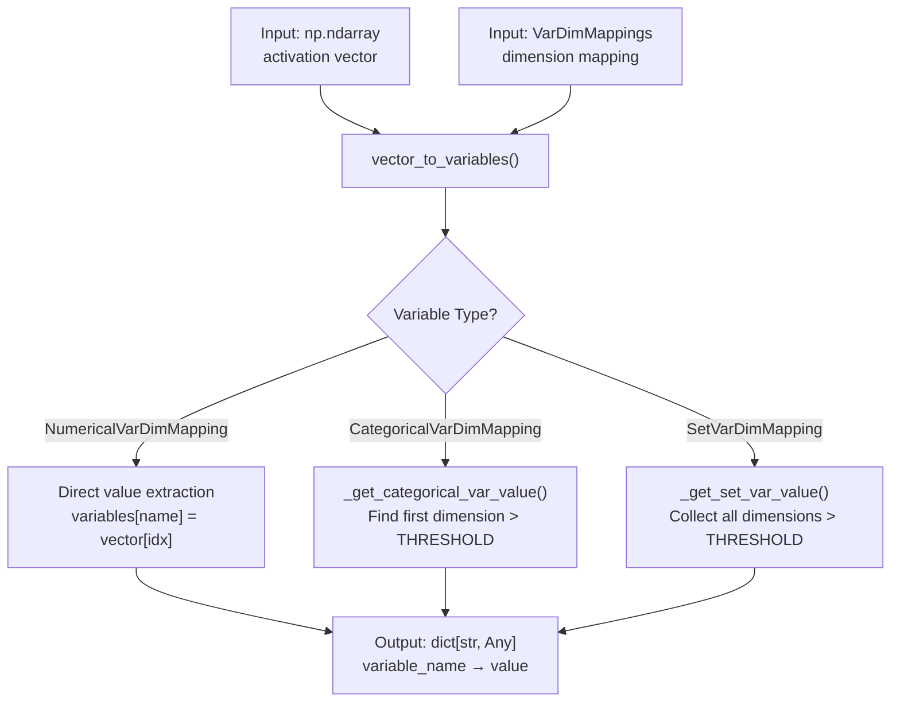
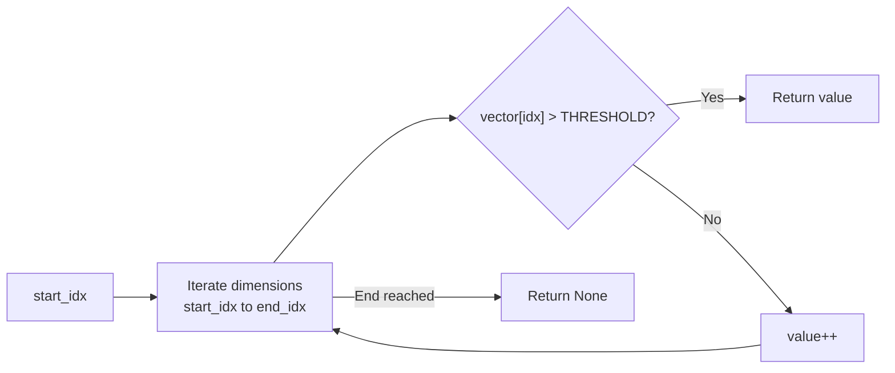
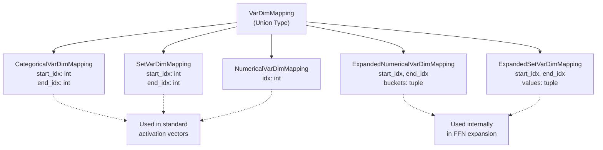
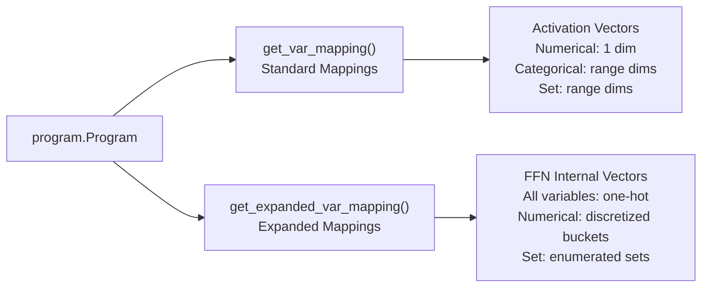
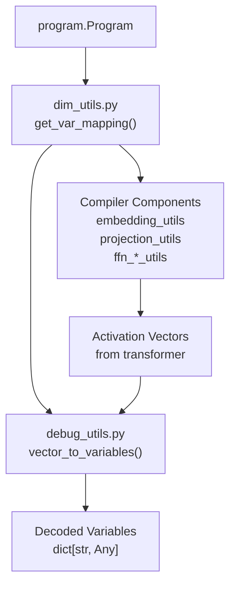

<!-- source: DeepWiki mcp.deepwiki.com · repo google-deepmind/alta · page 5.2 Debugging Utilities · fetched 2026-10-26 -->

# Debugging Utilities

<details>
<summary>Relevant source files</summary>

The following files were used as context for generating this wiki page:

- [framework/compiler/debug_utils.py](framework/compiler/debug_utils.py)
- [framework/compiler/dim_utils.py](framework/compiler/dim_utils.py)

</details>


## Purpose and Scope

This page documents the debugging utilities provided in ALTA for inspecting internal vector representations and dimension mappings. These tools are essential for developers who need to understand how program variables are encoded in transformer activation vectors during compilation and execution.

The primary utilities enable:
- Converting activation vectors back to human-readable variable values
- Inspecting dimension mappings for categorical, set, and numerical variables
- Troubleshooting compilation issues and verifying correctness

For broader architectural context on how variables are represented in the compiler, see [Internal Architecture](#5.3). For information on using the interpreter to generate execution traces for debugging, see [Symbolic Interpreter](#3.2).

---

## Overview

The ALTA compiler translates program variables into high-dimensional vector representations. During debugging, developers often need to reverse this process to understand what values are encoded in specific activation vectors. The debugging utilities in `framework/compiler/debug_utils.py` provide this inverse mapping functionality.

**Sources:** [framework/compiler/debug_utils.py:1-72]()

---

## Core Debugging Functions

### vector_to_variables()

The primary debugging function `vector_to_variables()` converts a dense activation vector back into a dictionary of variable names and their corresponding values. This function handles all three variable types supported by ALTA: numerical, categorical, and set variables.



**Function Signature:**
- **Input:** `vector` (np.ndarray) - The activation vector to decode
- **Input:** `var_mappings` (VarDimMappings) - The dimension mapping specification
- **Output:** `dict[str, Any]` - Dictionary mapping variable names to their decoded values

**Sources:** [framework/compiler/debug_utils.py:56-71](), [framework/compiler/dim_utils.py:84-98]()

---

## Variable Type Handlers

The `vector_to_variables()` function delegates to specialized handlers for each variable type:

### Numerical Variables

Numerical variables are stored as single floating-point values in one dimension. The handler performs direct indexing:

```python
# From framework/compiler/debug_utils.py:64
variables[var_name] = vector[var_mapping.idx]
```

The `NumericalVarDimMapping` specifies the single index where the value is stored.

**Sources:** [framework/compiler/debug_utils.py:63-64](), [framework/compiler/dim_utils.py:41-44]()

### Categorical Variables

Categorical variables use one-hot encoding across multiple dimensions. The handler `_get_categorical_var_value()` searches for the first dimension exceeding the threshold:



**Implementation Details:**
- Returns the ordinal position of the first active dimension
- Returns `None` if no dimension exceeds the threshold
- Threshold is set to `0.9` by default

**Sources:** [framework/compiler/debug_utils.py:28-37](), [framework/compiler/dim_utils.py:24-29]()

### Set Variables

Set variables can represent multiple active values simultaneously. The handler `_get_set_var_value()` collects all dimensions that exceed the threshold:

| Dimension Range | Active if vector[idx] > THRESHOLD | Resulting Set |
|----------------|-----------------------------------|---------------|
| start_idx to end_idx | Multiple positions can be active | {value₁, value₂, ...} |

**Note:** There is a bug in the current implementation at [framework/compiler/debug_utils.py:48]() where the range calculation uses `end_idx - start_idx` instead of just the dimension count. This should iterate from `start_idx` to `end_idx`.

**Sources:** [framework/compiler/debug_utils.py:40-53](), [framework/compiler/dim_utils.py:32-37]()

---

## Dimension Mapping System

The debugging utilities rely on the dimension mapping structures defined in `dim_utils.py`. Understanding these mappings is crucial for effective debugging.

### Dimension Mapping Types



**Sources:** [framework/compiler/dim_utils.py:24-80]()

### VarDimMappings Container

The `VarDimMappings` class aggregates all variable mappings for a program:

| Field | Type | Description |
|-------|------|-------------|
| `var_mappings` | `dict[str, VarDimMapping]` | Maps variable names to their dimension specifications |
| `start_idx` | `int` | Starting dimension index for the entire variable block |
| `end_idx` | `int` | Ending dimension index (exclusive) |

**Usage Pattern:**
```python
# Obtain mappings for a program
var_mappings = dim_utils.get_var_mapping(program_spec)

# Use in debugging
variables = debug_utils.vector_to_variables(activation_vector, var_mappings)
```

**Sources:** [framework/compiler/dim_utils.py:84-98](), [framework/compiler/dim_utils.py:153-167]()

---

## Threshold Configuration

The debugging utilities use a configurable threshold to determine when a dimension is "active":

```python
# From framework/compiler/debug_utils.py:25
THRESHOLD = 0.9
```

This threshold serves as a tolerance for the one-hot encoding used in categorical and set variables:
- Values **greater than 0.9** are considered active (representing that category or set element)
- Values **at or below 0.9** are considered inactive

**Rationale:** The threshold accounts for floating-point precision errors and near-one-hot representations that may arise during transformer execution. A perfect one-hot encoding would have exactly 1.0 in the active dimension, but numerical computation may produce values like 0.999 or 1.001.

**Sources:** [framework/compiler/debug_utils.py:25]()

---

## Practical Usage Examples

### Debugging Activation Vectors

When debugging compiled transformers, you can inspect intermediate activation vectors at specific layers:

```python
from framework.compiler import debug_utils
from framework.compiler import dim_utils

# After running a compiled transformer
activation_at_layer_2 = activations[2][position_idx]

# Get variable mappings from the program
var_mappings = dim_utils.get_var_mapping(program_spec)

# Decode the activation vector
decoded_vars = debug_utils.vector_to_variables(
    activation_at_layer_2, 
    var_mappings
)

# Inspect variables
print(f"Variable 'x' = {decoded_vars['x']}")
print(f"Variable 'category' = {decoded_vars['category']}")
```

### Inspecting Dimension Allocations

To understand how dimensions are allocated across variables:

```python
var_mappings = dim_utils.get_var_mapping(program_spec)

for var_name, mapping in var_mappings.var_mappings.items():
    if isinstance(mapping, dim_utils.NumericalVarDimMapping):
        print(f"{var_name}: dimension {mapping.idx}")
    elif isinstance(mapping, dim_utils.CategoricalVarDimMapping):
        print(f"{var_name}: dimensions {mapping.start_idx}-{mapping.end_idx}")
    elif isinstance(mapping, dim_utils.SetVarDimMapping):
        print(f"{var_name}: dimensions {mapping.start_idx}-{mapping.end_idx}")
```

**Sources:** [framework/compiler/debug_utils.py:56-71](), [framework/compiler/dim_utils.py:153-167]()

---

## Expanded Dimension Mappings

For advanced debugging of FFN internals, ALTA provides expanded dimension mappings that represent all variables in one-hot form:



### Expanded Mapping Types

- **ExpandedNumericalVarDimMapping:** Discretizes numerical variables into buckets, with each bucket represented as one dimension
- **ExpandedSetVarDimMapping:** Enumerates all possible set values, with each distinct set as one dimension

These expanded mappings are used internally during FFN compilation (see [Compiler Pipeline](#3.3)) but are typically not needed for standard debugging tasks.

**Sources:** [framework/compiler/dim_utils.py:48-72](), [framework/compiler/dim_utils.py:170-184]()

---

## Limitations and Considerations

### Current Implementation Issues

1. **Set Variable Bug:** The `_get_set_var_value()` function has an incorrect range calculation at line 48, using `end_idx - start_idx` instead of iterating through the full range.

2. **Threshold Sensitivity:** The fixed threshold of 0.9 may not be appropriate for all scenarios. Values close to the threshold may produce ambiguous results.

3. **No Expanded Mapping Support:** The `vector_to_variables()` function does not currently handle `ExpandedNumericalVarDimMapping` or `ExpandedSetVarDimMapping` types, limiting its use for debugging FFN internals.

### When to Use These Tools

**Appropriate Use Cases:**
- Debugging unexpected outputs from compiled transformers
- Verifying dimension mapping correctness during compiler development
- Understanding activation patterns at specific positions and layers
- Troubleshooting variable encoding issues

**Alternative Approaches:**
- For high-level program behavior, use the symbolic interpreter (see [Symbolic Interpreter](#3.2))
- For FFN-specific debugging, use execution traces (see [Traces and MLP Training](#3.5))

**Sources:** [framework/compiler/debug_utils.py:40-53](), [framework/compiler/debug_utils.py:56-71]()

---

## Integration with Compiler Components

The debugging utilities integrate with the broader compiler architecture:



The `dim_utils` module serves as the bridge between program specifications and both the compiler and debugging utilities, ensuring consistent dimension mappings throughout the system.

**Sources:** [framework/compiler/debug_utils.py:22](), [framework/compiler/dim_utils.py:153-184]()

---

