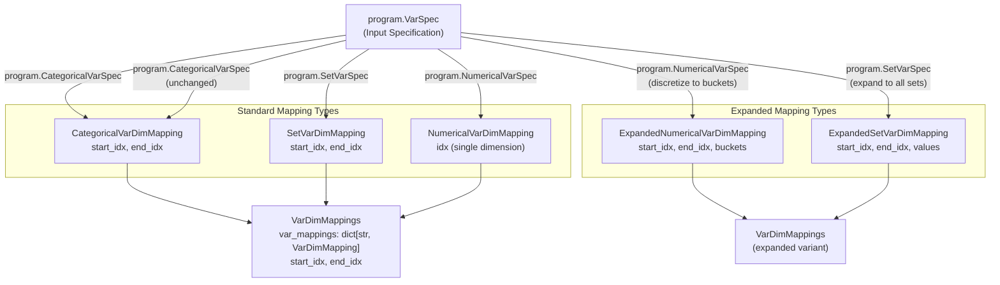
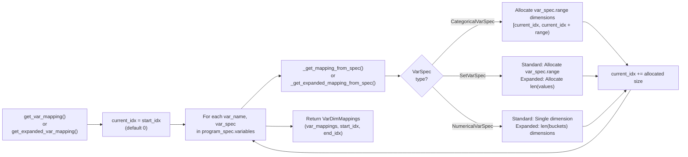
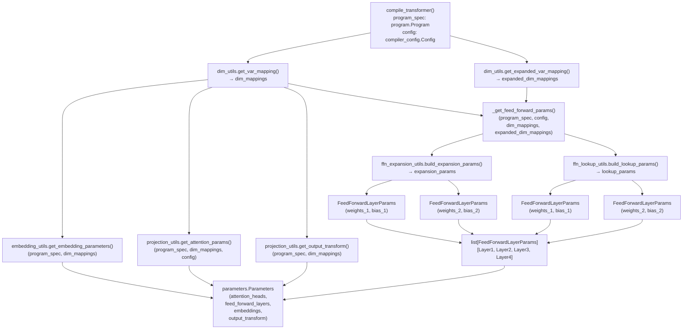
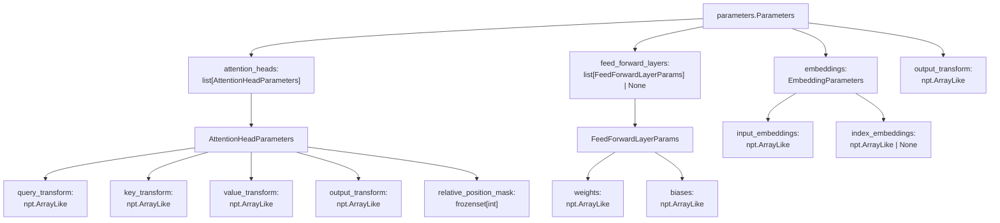
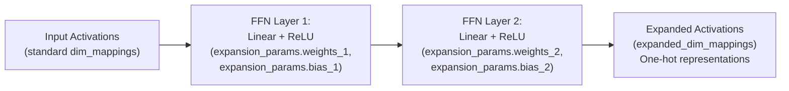
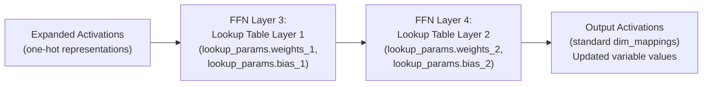

<!-- source: DeepWiki mcp.deepwiki.com · repo google-deepmind/alta · page 5.3 Internal Architecture · fetched 2026-10-26 -->

# Internal Architecture

<details>
<summary>Relevant source files</summary>

The following files were used as context for generating this wiki page:

- [framework/compiler/compiler_utils.py](framework/compiler/compiler_utils.py)
- [framework/compiler/dim_utils.py](framework/compiler/dim_utils.py)
- [framework/transformer/parameters.py](framework/transformer/parameters.py)

</details>


## Purpose and Scope

This document provides a deep dive into the internal design decisions, implementation strategies, and optimization techniques used within the ALTA compiler. It is intended for contributors who need to understand or modify the compiler's internals.

For high-level understanding of the compilation process, see [Compiler Pipeline](#3.3). For practical debugging tools that leverage these internals, see [Debugging Utilities](#5.2).

This document focuses on:
- Dimension mapping strategies and their two-stage design
- Compiler orchestration and dependency flow
- Parameter structure design principles
- FFN compilation approach and rationale
- Internal optimization techniques

---

## Dimension Mapping Architecture

The compiler's foundation is a two-stage dimension mapping system that determines how ALTA variables are represented in the transformer's embedding space. This system is implemented in `dim_utils.py` and consists of two distinct mapping strategies.

### Standard vs Expanded Mappings

The compiler maintains two separate dimension mappings for each program:

| Mapping Type | Purpose | Numerical Variables | Set Variables | Used By |
|--------------|---------|---------------------|---------------|---------|
| **Standard** (`VarDimMappings`) | Compact representation for attention | Single float dimension | One-hot encoding (range size) | Embeddings, Attention, Output |
| **Expanded** (`VarDimMappings`) | Discretized representation for FFN | One-hot buckets | One-hot all possible sets | FFN layers |

This dual-mapping design enables the compiler to use efficient representations in attention layers while maintaining the discrete lookup tables required for FFN computation.

**Sources:** [framework/compiler/dim_utils.py:83-98](), [framework/compiler/compiler_utils.py:70-75]()

### Mapping Type Hierarchy



**Sources:** [framework/compiler/dim_utils.py:24-80](), [framework/compiler/dim_utils.py:100-122](), [framework/compiler/dim_utils.py:124-151]()

### Dimension Allocation Algorithm

The dimension allocation follows a deterministic sequential allocation strategy:



The ordering of variables in the embedding space depends on Python dictionary insertion order (guaranteed in Python 3.6+), as noted in the TODO comment at [framework/compiler/dim_utils.py:159-160]().

**Sources:** [framework/compiler/dim_utils.py:153-168](), [framework/compiler/dim_utils.py:170-184]()

---

## Compiler Orchestration

The `compile_transformer()` function in `compiler_utils.py` orchestrates the compilation process through a carefully sequenced series of stages. Each stage depends on dimension mappings but operates independently otherwise.

### Compilation Stage Flow



**Sources:** [framework/compiler/compiler_utils.py:63-99](), [framework/compiler/compiler_utils.py:28-60]()

### Stage Independence and Parallelizability

The compiler's modular design has important properties:

1. **Dimension Mapping Centralization**: All stages depend on `dim_mappings` and `expanded_dim_mappings`, but these are computed once at the beginning [framework/compiler/compiler_utils.py:71-72]().

2. **Stage Independence**: After dimension mappings are computed, the five parameter generation stages (embeddings, attention, FFN expansion, FFN lookup, output) are independent and could theoretically execute in parallel.

3. **FFN Two-Phase Design**: The FFN compilation deliberately splits into expansion and lookup phases, each contributing two layers [framework/compiler/compiler_utils.py:47-60](). This separation enables different optimization strategies for different aspects of the FFN computation.

4. **Optional FFN Compilation**: The `compile_ffn` parameter allows disabling FFN compilation [framework/compiler/compiler_utils.py:66](), useful for testing attention-only programs.

**Sources:** [framework/compiler/compiler_utils.py:63-99]()

---

## Parameter Structure Design

The parameter structures in `parameters.py` use Python dataclasses to create a type-safe, hierarchical representation of transformer weights.

### Parameter Hierarchy



**Sources:** [framework/transformer/parameters.py:22-48]()

### Design Rationale

| Design Decision | Rationale | Code Reference |
|----------------|-----------|----------------|
| **List of attention heads** | Enables multi-head attention with different query/key/value transformations | [parameters.py:45]() |
| **Optional FFN layers** | Supports attention-only programs for testing | [parameters.py:46]() |
| **Optional index embeddings** | Positional encodings only needed for position-dependent programs | [parameters.py:40]() |
| **Frozen relative position mask** | Immutable set prevents accidental modification of causal/bidirectional masks | [parameters.py:28]() |
| **Separate Q/K/V/O transforms** | Allows full flexibility in attention head design | [parameters.py:24-27]() |

The structure avoids weight sharing across heads, giving each attention head complete independence. This design choice trades memory efficiency for compilation simplicity and flexibility.

**Sources:** [framework/transformer/parameters.py:1-49]()

---

## FFN Two-Stage Compilation Strategy

The FFN compilation uses a two-stage approach that separates variable expansion from lookup table implementation. This design decision is fundamental to how ALTA implements arbitrary Python functions as neural network layers.

### Expansion Phase

The expansion phase transforms the compact standard representation into the discretized expanded representation:



The expansion phase is implemented by `ffn_expansion_utils.build_expansion_params()` and produces two sequential layers. The first layer applies linear transformations and ReLU activations, while the second layer completes the discretization into one-hot encodings.

**Sources:** [framework/compiler/compiler_utils.py:35-40](), [framework/compiler/compiler_utils.py:48-52]()

### Lookup Phase

The lookup phase implements the actual FFN function as a lookup table over discretized inputs:



The lookup phase is implemented by `ffn_lookup_utils.build_lookup_params()`. It encodes the user's `ffn_fn` function as a lookup table where each possible combination of discretized inputs maps to the corresponding output.

**Sources:** [framework/compiler/compiler_utils.py:41-45](), [framework/compiler/compiler_utils.py:54-58]()

### Why Two Stages?

The two-stage design provides several architectural benefits:

1. **Separation of Concerns**: Expansion handles representation transformation (continuous → discrete), while lookup handles function implementation (input → output mapping).

2. **Optimization Flexibility**: Each stage can be optimized independently. Expansion can use different discretization strategies, while lookup can employ different table encoding techniques.

3. **Debugging Clarity**: Intermediate expanded representations can be inspected to verify discretization correctness before lookup logic is applied.

4. **Modularity**: Changes to discretization strategies (e.g., different bucketing schemes) only affect `ffn_expansion_utils`, while changes to function encoding only affect `ffn_lookup_utils`.

**Sources:** [framework/compiler/compiler_utils.py:28-60]()

---

## Variable Ordering and Memory Layout

### Insertion-Order Dependency

The current implementation relies on Python 3.6+ dictionary insertion order to determine variable positions in embedding vectors. This is documented in TODO comments at [framework/compiler/dim_utils.py:159-160]() and [framework/compiler/dim_utils.py:177-178]().

**Current Behavior:**
```python
# Variables are allocated dimensions in the order they appear in
# program_spec.variables dictionary (insertion order)
for var_name, var_spec in program_spec.variables.items():
    var_mappings[var_name], current_idx = _get_mapping_from_spec(
        var_spec, current_idx
    )
```

**Implications:**
- Variable ordering is deterministic but implicit
- Programs with identical variables in different declaration order will have different dimension layouts
- No explicit control over dimension allocation strategy (e.g., grouping related variables)

**Sources:** [framework/compiler/dim_utils.py:161-164]()

### Compact vs One-Hot Encodings

The dimension mapping strategy makes deliberate trade-offs between compactness and lookup efficiency:

| Variable Type | Standard Mapping | Expanded Mapping | Design Rationale |
|---------------|------------------|------------------|------------------|
| **Categorical** | One-hot (range dimensions) | Unchanged | Already discrete, no expansion needed |
| **Set** | One-hot (range dimensions) | One-hot (all possible sets) | Expansion enumerates all 2^n possible sets |
| **Numerical** | Single float | One-hot (buckets) | Expansion discretizes continuous values |

The standard mapping prioritizes compactness for attention computation where floating-point operations are efficient. The expanded mapping prioritizes discrete representations for lookup tables where one-hot encodings enable simple linear transformations.

**Sources:** [framework/compiler/dim_utils.py:100-122](), [framework/compiler/dim_utils.py:124-151]()

---

## Compiler Configuration

The `compiler_config.Config` class (imported at [framework/compiler/compiler_utils.py:19]()) provides configuration options that affect compilation behavior. This configuration is passed to attention parameter generation [framework/compiler/compiler_utils.py:80-82]() and FFN expansion [framework/compiler/compiler_utils.py:36-39]().

Configuration options control:
- Attention head behavior (e.g., masking strategies)
- FFN layer activation functions
- Numerical precision settings
- Optimization flags

The configuration system allows experimentation with different compilation strategies without modifying core compiler logic.

**Sources:** [framework/compiler/compiler_utils.py:19](), [framework/compiler/compiler_utils.py:36-39](), [framework/compiler/compiler_utils.py:80-82]()

---

## Summary of Design Principles

The internal architecture follows these key principles:

1. **Two-Stage Dimension Mapping**: Separate standard (compact) and expanded (discrete) representations enable efficient attention and lookup-based FFN computation.

2. **Modular Stage Design**: Compiler stages are independent after dimension mapping, enabling parallel development and testing.

3. **Type-Safe Parameter Structures**: Dataclass-based parameter definitions provide compile-time type checking and clear interfaces.

4. **Expansion-Lookup Separation**: FFN compilation splits into orthogonal concerns (representation transformation vs function encoding).

5. **Configuration-Driven Behavior**: Compilation options are externalized to configuration objects rather than hardcoded.

6. **Deterministic but Implicit Ordering**: Variable dimension allocation follows dictionary insertion order, prioritizing simplicity over explicit control.

These principles guide the implementation and should inform future modifications to the compiler architecture.