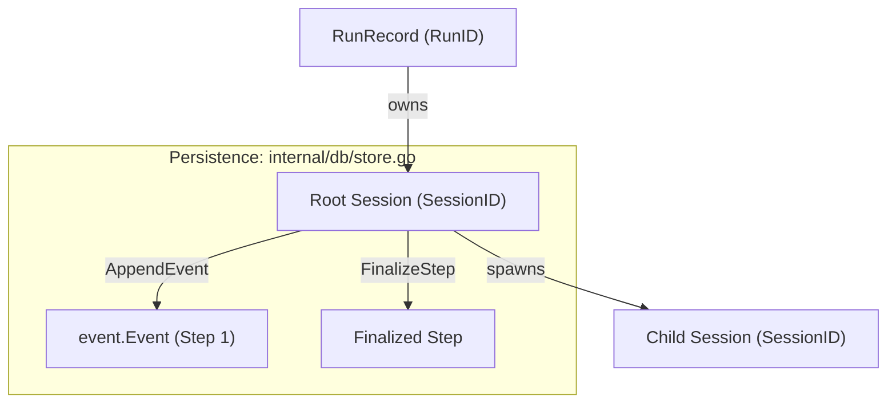

<!-- source: DeepWiki mcp.deepwiki.com · repo google-deepmind/amplio · page 1 Amplio Overview · fetched 2026-10-26 -->

# Amplio Overview

<details>
<summary>Relevant source files</summary>

The following files were used as context for generating this wiki page:

- [README.md](README.md)
- [cmd/amplio/main.go](cmd/amplio/main.go)
- [cmd/amplio/serve.go](cmd/amplio/serve.go)
- [docs/guide/runs.md](docs/guide/runs.md)
- [internal/db/errtag.go](internal/db/errtag.go)
- [internal/db/store.go](internal/db/store.go)

</details>


Amplio is a technical framework designed for long-horizon autonomous research and coding tasks [cmd/amplio/main.go:15-16](). It provides a robust, multi-agent harness that emphasizes persistence and crash-recovery, allowing agents to work through complex, multi-step trajectories over extended periods [README.md:1-8]().

### Key Design Principles

*   **DB-First Persistence**: Every event, tool call, and state transition is committed to a SQLite database before execution continues. This "persistence-first" approach ensures that if the process crashes at any point, the session can be resumed exactly where it left off [README.md:4-6]().
*   **Crash-Resume**: Amplio distinguishes between harness failures and environment failures. Harness crashes are handled by reviving session goroutines from the last known DB state, while tool/environment failures are reported back to the agent as observations [docs/guide/runs.md:65-73]().
*   **Multi-Agent Coordination**: A single "Run" can encompass a tree of agent sessions. A parent agent can `spawn` sub-agents for specialized tasks (e.g., builds, surveys), communicating via asynchronous messaging and event awaiting [internal/db/store.go:94-109]().
*   **Hybrid Autonomy**: Supports both **Autonomous** modes (task-driven with automatic critic reporting) and **Interactive** modes (chatbot-driven for steering and debugging) [docs/guide/runs.md:19-35]().

### System Architecture

The system is composed of a Go backend that manages the agent runtime, a SQLite persistence layer, and a SvelteKit-based frontend for monitoring and interaction.

#### Code Entity Mapping: High-Level Components
The following diagram illustrates how high-level system concepts map to specific entities in the codebase.

```mermaid
graph TD
    subgraph "Natural Language Space"
        Task["User Task"]
        Agent["Autonomous Agent"]
        SubAgent["Sub-Agent"]
        Critic["Auto-Critic"]
    end

    subgraph "Code Entity Space"
        RM["runtime.RunManager"]
        Store["db.Store (sqliteStore)"]
        ELA["agent.EventLoopAgent"]
        ReportGen["runtime.EphemeralAgent (kind='report')"]
        
        Task --> RM
        Agent --> ELA
        SubAgent --> ELA
        Critic --> ReportGen
        
        RM -- "persists to" --> Store
        ELA -- "appends events to" --> Store
    end
    
    [cmd/amplio/serve.go:139-161]()
    [internal/runtime/manager.go:1-50]()
    [internal/db/store.go:38-136]()
```
Sources: [cmd/amplio/serve.go:139-161](), [internal/runtime/manager.go:1-50](), [internal/db/store.go:38-136]()

#### Run and Session Hierarchy
Amplio organizes work into `Runs`, which contain one or more `Sessions`.

| Entity | Code Reference | Description |
| :--- | :--- | :--- |
| **Run** | `db.RunRecord` | The top-level container for a specific task, workspace, and set of artifacts. |
| **Session** | `db.SessionRecord` | A single execution context (goroutine) for an agent. |
| **Event** | `event.Event` | The atomic unit of history (Assistant, Tool, System, etc.). |
| **Step** | `last_finalized_step` | A logical turn in the conversation, ending with an Assistant message. |


Sources: [internal/db/store.go:38-136](), [internal/db/models.go:1-100](), [docs/guide/runs.md:1-12]()

### Subsystems

*   **Runtime Manager**: Orchestrates the lifecycle of runs and sessions, handling the initial start, recovery after crashes, and the injection of LLM providers [cmd/amplio/serve.go:139-146]().
*   **Persistence (SQLite)**: Uses a `db.Store` interface to manage all state. It employs WAL mode to allow concurrent reads and writes, ensuring the UI remains responsive while agents are active [internal/db/store.go:27-37]().
*   **Observer & Critic**: Background processes that summarize trajectories into "phases" and generate final reports with grades (garbage to excellent) once a run concludes [docs/guide/runs.md:81-112]().
*   **Recall System**: An embedding-based search over "Skills" (pre-defined documentation) and "Lessons" (mined from previous run reports) to provide agents with long-term memory [cmd/amplio/main.go:168-171]().
*   **LLM Provider Layer**: A flexible abstraction supporting Vertex AI (Gemini/Claude), OpenAI, and local bridge protocols, allowing per-model configurations like "thinking" tokens or caching [README.md:28-41]().

### Child Pages

For detailed documentation on specific areas of Amplio, refer to the following pages:

*   **[Getting Started](#1.1)**: Installation, `config.toml` setup, and launching the server.
*   **[Runs and Sessions](#1.2)**: Deep dive into the agent lifecycle, sub-agent spawning, and status transitions.
*   **[Command-Line Interface](#1.3)**: Reference for `amplio serve`, `client`, and `headless` commands, including the `notify` shim.

Sources: [cmd/amplio/main.go:15-26](), [cmd/amplio/serve.go:90-126](), [README.md:21-60](), [docs/guide/runs.md:1-121]()

---

